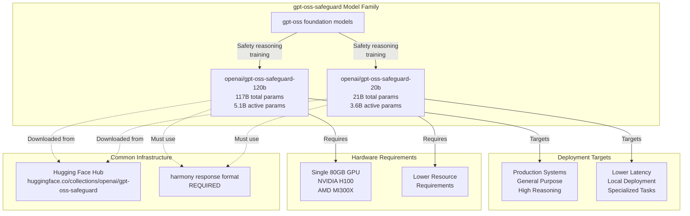
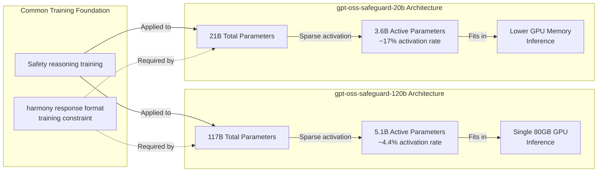
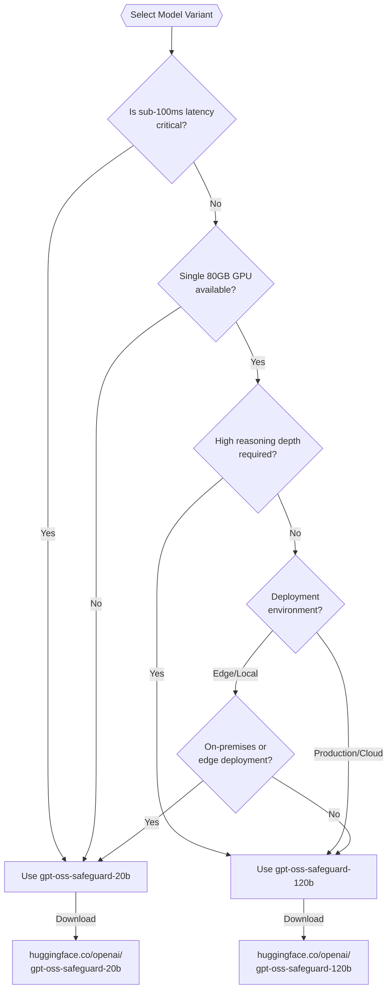
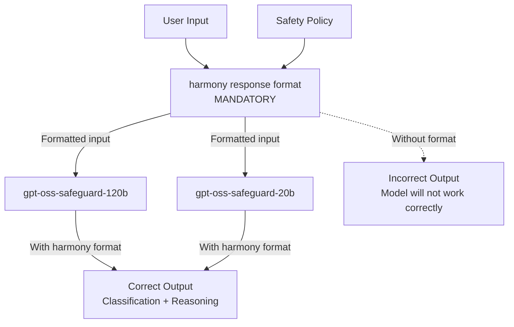
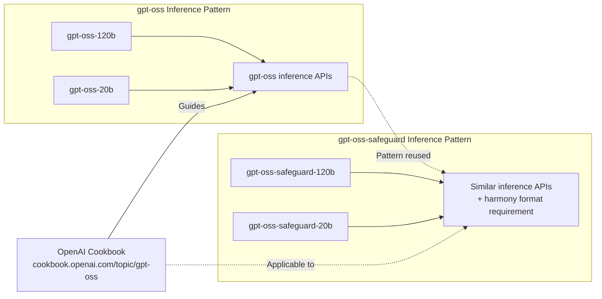

<!-- source: DeepWiki mcp.deepwiki.com · repo openai/gpt-oss-safeguard · page 3 Model Variants · fetched 2026-10-26 -->

# Model Variants

<details>
<summary>Relevant source files</summary>

The following files were used as context for generating this wiki page:

- [README.md](README.md)
- [docs/gpt-oss-safeguard-120b.png](docs/gpt-oss-safeguard-120b.png)
- [docs/gpt-oss-safeguard-20b.png](docs/gpt-oss-safeguard-20b.png)

</details>


## Purpose and Scope

This page compares the two model variants in the gpt-oss-safeguard family: `gpt-oss-safeguard-120b` and `gpt-oss-safeguard-20b`. It explains their technical specifications, deployment characteristics, and guidance for selecting the appropriate variant for your use case.

For detailed documentation on each individual variant, see [gpt-oss-safeguard-120b](#3.1) and [gpt-oss-safeguard-20b](#3.2). For information about deploying these models, see [Deployment and Integration](#8). For hardware requirements, see [Hardware Requirements](#8.1).

---

## Model Family Overview

The gpt-oss-safeguard family consists of two model variants built upon [gpt-oss](https://github.com/openai/gpt-oss), each optimized for different deployment scenarios and resource constraints. Both models implement safety reasoning capabilities and require the harmony response format for correct operation.



**Sources:** [README.md:14-20]()

---

## Technical Specifications Comparison

| Specification | gpt-oss-safeguard-120b | gpt-oss-safeguard-20b |
|--------------|------------------------|----------------------|
| **Total Parameters** | 117B | 21B |
| **Active Parameters** | 5.1B | 3.6B |
| **Architecture Type** | Sparse/Mixture-of-Experts | Sparse/Mixture-of-Experts |
| **GPU Requirement** | Single 80GB (H100, MI300X) | Lower resource requirements |
| **Primary Use Cases** | Production, General purpose, High reasoning | Lower latency, Local deployment, Specialized tasks |
| **Hugging Face Path** | `openai/gpt-oss-safeguard-120b` | `openai/gpt-oss-safeguard-20b` |
| **Response Format** | harmony (required) | harmony (required) |
| **Base Model** | gpt-oss-120b | gpt-oss-20b |

The parameter counts reveal both models use sparse activation patterns, where only a fraction of the total parameters are active during inference. This architectural choice enables efficient inference despite large total parameter counts.

**Sources:** [README.md:17-18]()

---

## Architectural Characteristics



The 120B model activates approximately 4.4% of its parameters per inference pass, while the 20B model activates approximately 17%. This higher activation ratio in the smaller model contributes to its lower latency characteristics, as fewer routing decisions are required during forward passes.

**Sources:** [README.md:17-18](), [README.md:20]()

---

## Selection Decision Matrix



**Sources:** [README.md:17-18]()

---

## Use Case Alignment

### gpt-oss-safeguard-120b Optimal Scenarios

The 120B variant is optimized for scenarios where:

- **Production deployment**: Centralized cloud infrastructure with dedicated GPU resources
- **General purpose safety**: Broad applicability across diverse content types and policy domains
- **High reasoning tasks**: Complex policy evaluation requiring nuanced understanding
- **Hardware availability**: Single 80GB GPU (NVIDIA H100 or AMD MI300X) is available
- **Accuracy priority**: Classification precision is more important than response latency

Example use cases:
- Enterprise content moderation systems
- Multi-policy evaluation pipelines
- High-stakes safety decisions (financial services, healthcare)
- Research and policy development

### gpt-oss-safeguard-20b Optimal Scenarios

The 20B variant is optimized for scenarios where:

- **Lower latency**: Response time under 100ms is required
- **Local deployment**: On-premises or edge infrastructure without cloud connectivity
- **Specialized tasks**: Narrow domain with well-defined policy boundaries
- **Resource constraints**: 80GB GPU not available or cost-prohibitive
- **Distributed deployment**: Multiple instances across geographic regions

Example use cases:
- Real-time chat moderation
- Edge device content filtering
- Cost-sensitive deployments
- Specialized vertical applications (e.g., gaming, forums)

**Sources:** [README.md:17-18]()

---

## Common Characteristics

Both model variants share the following characteristics:

| Characteristic | Details |
|---------------|---------|
| **Base Architecture** | Built upon gpt-oss foundation models |
| **Safety Training** | Trained to reason about safety policies |
| **Policy Flexibility** | Support custom user-defined policies (bring your own policy) |
| **Response Format** | Require harmony response format; will not work correctly without it |
| **Reasoning Exposure** | Provide complete reasoning process (not for end users) |
| **Reasoning Effort** | Support low/medium/high configurable reasoning effort |
| **License** | Apache 2.0 permissive license |
| **Distribution** | Hugging Face Hub |
| **Inference API** | Similar to gpt-oss-120b and gpt-oss-20b |

**Sources:** [README.md:14-15](), [README.md:20](), [README.md:24-28]()

---

## Response Format Requirement



Both models were trained exclusively using the harmony response format. Attempting to use them without this format will result in incorrect behavior. The models will not function as safety classifiers if the input does not conform to the harmony structure.

For details on the harmony response format, see [Harmony Response Format](#4.2). For inference configuration, see [Inference Configuration](#8.3).

**Sources:** [README.md:20]()

---

## Model Access and Downloads

Both model variants are available through the Hugging Face Hub collection:

```
https://huggingface.co/collections/openai/gpt-oss-safeguard
```

Individual model repositories:

- **120B variant**: `https://huggingface.co/openai/gpt-oss-safeguard-120b`
- **20B variant**: `https://huggingface.co/openai/gpt-oss-safeguard-20b`

Download instructions follow the same pattern as `gpt-oss-120b` and `gpt-oss-20b`. For detailed setup instructions, see [Model Download and Setup](#8.2).

An interactive demo of the 20B variant is available at:
```
https://huggingface.co/spaces/openai/gpt-oss-safeguard-20b
```

**Sources:** [README.md:3](), [README.md:6](), [README.md:40]()

---

## Inference Similarity to gpt-oss



Inference setup for gpt-oss-safeguard models follows the same patterns as the base gpt-oss models, with the critical addition of the harmony response format requirement. Developers familiar with gpt-oss-120b or gpt-oss-20b can apply the same inference techniques to the safeguard variants.

The OpenAI Cookbook provides detailed inference examples that apply to both model families. For gpt-oss-safeguard-specific guidance, including policy formatting, see the [detailed prompting guide](https://cookbook.openai.com/articles/gpt-oss-safeguard-guide).

**Sources:** [README.md:32](), [README.md:36]()

---

## Performance Trade-offs

| Dimension | gpt-oss-safeguard-120b | gpt-oss-safeguard-20b | Considerations |
|-----------|------------------------|----------------------|----------------|
| **Latency** | Higher | Lower | 20B provides faster response times |
| **Accuracy** | Higher reasoning depth | Optimized for speed | 120B better for complex policies |
| **Resource Cost** | Requires 80GB GPU | Lower requirements | 20B more cost-effective |
| **Deployment Flexibility** | Centralized | Distributed | 20B enables edge deployment |
| **Policy Complexity** | Handles nuanced policies | Best for focused policies | 120B supports richer policy definitions |

The selection between variants should be driven by your deployment constraints and use case requirements rather than a blanket "better/worse" assessment. Both models are production-ready and implement the same core safety reasoning capabilities.

**Sources:** [README.md:17-18]()

---

## Reasoning Effort Configuration

Both model variants support configurable reasoning effort levels (low, medium, high), allowing users to trade latency for accuracy within the same model. This configuration is independent of the variant selection:

- **Low effort**: Fastest response, suitable for high-volume processing
- **Medium effort**: Balanced performance for general use
- **High effort**: Maximum accuracy for critical decisions

The reasoning effort setting applies to both variants, though the absolute latency values differ between the 120B and 20B models. For detailed information on reasoning effort configuration, see [Configurable Reasoning Effort](#4.4).

**Sources:** [README.md:27]()

---

