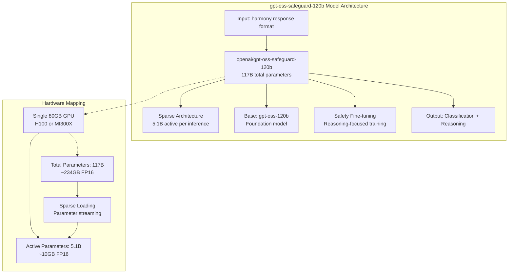
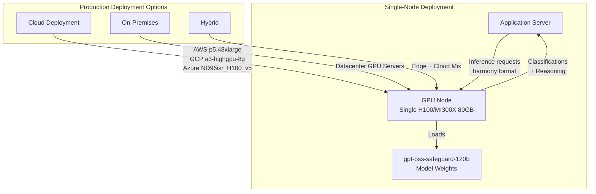
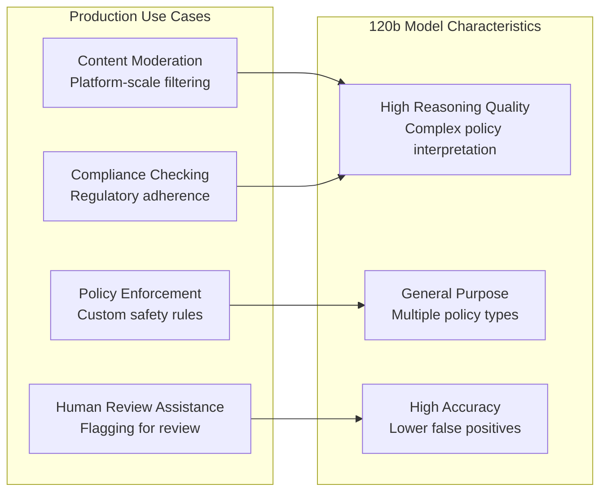
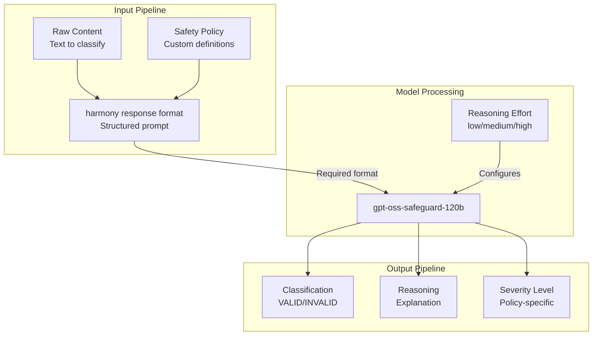
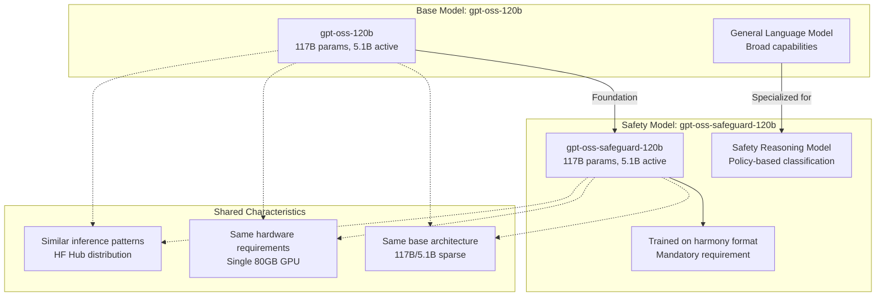

<!-- source: DeepWiki mcp.deepwiki.com · repo openai/gpt-oss-safeguard · page 3.1 gpt-oss-safeguard-120b · fetched 2026-10-26 -->

# gpt-oss-safeguard-120b

<details>
<summary>Relevant source files</summary>

The following files were used as context for generating this wiki page:

- [README.md](README.md)
- [docs/gpt-oss-safeguard-120b.png](docs/gpt-oss-safeguard-120b.png)

</details>


## Purpose and Scope

This page provides detailed technical documentation for the `gpt-oss-safeguard-120b` model variant, including its architecture characteristics, hardware requirements, deployment considerations, and optimal use cases. This model is the larger of the two gpt-oss-safeguard variants, designed for production environments where high reasoning quality is prioritized over inference latency.

For information about the smaller model variant, see [gpt-oss-safeguard-20b](#3.2). For general guidance on choosing between model variants, see [Model Variants](#3). For deployment and integration instructions, see [Deployment and Integration](#8).

**Sources:** [README.md:1-46]()

---

## Overview

The `gpt-oss-safeguard-120b` model is a safety reasoning model with the following technical specifications:

| Specification | Value |
|--------------|-------|
| **Total Parameters** | 117 billion |
| **Active Parameters** | 5.1 billion |
| **Model Identifier** | `openai/gpt-oss-safeguard-120b` |
| **Base Architecture** | Built upon gpt-oss-120b |
| **Response Format** | harmony response format (mandatory) |
| **Minimum GPU Memory** | 80GB |
| **Recommended GPUs** | NVIDIA H100, AMD MI300X |
| **License** | Apache 2.0 |

The significant difference between total parameters (117B) and active parameters (5.1B) indicates this model uses a sparse mixture-of-experts (MoE) or similar architecture that activates only a subset of parameters for each inference request. This design enables the model to fit within a single 80GB GPU while maintaining the capacity benefits of a much larger parameter count.

**Sources:** [README.md:17]()

---

## Architecture Characteristics



**Diagram: gpt-oss-safeguard-120b Architecture and Hardware Mapping**

The architecture consists of:

1. **Base Model Layer**: Built on `gpt-oss-120b`, inheriting its language modeling capabilities
2. **Sparse Activation Layer**: Activates only 5.1B parameters per inference through mixture-of-experts or similar routing
3. **Safety Reasoning Layer**: Additional fine-tuning focused on reasoning about safety policies and classifications

The sparse architecture is critical for deployment feasibility. With 117B parameters stored in FP16 precision (~234GB), the model would exceed single-GPU memory capacity. By activating only 5.1B parameters (~10GB) per request, the model achieves single-GPU deployment while maintaining the capacity to handle diverse safety reasoning tasks.

**Sources:** [README.md:17]()

---

## Hardware Requirements

### Minimum Requirements

| Component | Specification |
|-----------|---------------|
| **GPU Model** | NVIDIA H100 (80GB) or AMD MI300X (80GB) |
| **GPU Memory** | 80GB minimum |
| **System RAM** | 64GB recommended |
| **Storage** | 250GB for model weights + overhead |
| **CUDA Version** | 12.0+ (for NVIDIA) or ROCm 5.7+ (for AMD) |

### Recommended Deployment Topologies



**Diagram: Hardware Deployment Topologies**

The single-GPU design simplifies deployment compared to multi-GPU distributed architectures. Key considerations:

- **No GPU Parallelism Required**: The model runs on a single device, eliminating the complexity of tensor parallelism or pipeline parallelism
- **Simplified Networking**: No inter-GPU communication overhead (NVLink, InfiniBand not required)
- **Standard Server Racks**: Single H100 or MI300X fits in standard PCIe or SXM configurations
- **Cost Efficiency**: Lower total cost of ownership compared to multi-GPU setups

**Sources:** [README.md:17]()

---

## Optimal Use Cases

The `gpt-oss-safeguard-120b` model is optimized for scenarios where reasoning quality and accuracy are prioritized over inference latency:

### Production Safety Systems



**Diagram: Production Use Case Mapping**

| Use Case | Why 120b | Alternative |
|----------|----------|-------------|
| **Production Content Moderation** | Handles diverse content types and complex policies with high accuracy | Use 20b if latency < 50ms is required |
| **General Purpose Safety** | Single model serves multiple safety policies without specialization | Use 20b if deploying multiple specialized instances |
| **High-Stakes Decisions** | Critical applications where false positives/negatives have significant consequences | No alternative; 120b provides best accuracy |
| **Complex Policy Reasoning** | Policies with nuanced definitions, edge cases, and ambiguity handling | Use 20b if policies are simple binary classifications |
| **Centralized Deployment** | Single model instance serving multiple applications/tenants | Use 20b for distributed/edge deployments |

### When to Choose 120b Over 20b

Choose `gpt-oss-safeguard-120b` when:

1. **Accuracy is paramount**: False positives or false negatives have significant business or user impact
2. **Policy complexity is high**: Definitions span multiple paragraphs with edge cases and escalation rules
3. **General purpose deployment**: One model must handle diverse content types and multiple policies
4. **Hardware is available**: 80GB GPU infrastructure is accessible (cloud or on-premises)
5. **Latency tolerance**: Applications can tolerate 100-500ms per classification (depending on reasoning effort)
6. **Reasoning transparency**: Detailed explanations are valuable for debugging, auditing, or human review workflows

**Sources:** [README.md:17]()

---

## Model Download and Access

### Hugging Face Hub

The model is distributed through Hugging Face Hub with the following identifiers:

| Resource | URL/Identifier |
|----------|----------------|
| **Model Repository** | `openai/gpt-oss-safeguard-120b` |
| **Collection** | `openai/gpt-oss-safeguard` |
| **Direct Link** | https://huggingface.co/openai/gpt-oss-safeguard-120b |


**Diagram: Model Download Flow**

### Download Instructions

The model can be downloaded using standard Hugging Face tooling, similar to `gpt-oss-120b`:

```bash
# Using Hugging Face CLI
huggingface-cli download openai/gpt-oss-safeguard-120b

# Using Python transformers library
from transformers import AutoModelForCausalLM, AutoTokenizer

model = AutoModelForCausalLM.from_pretrained(
    "openai/gpt-oss-safeguard-120b",
    device_map="auto",
    torch_dtype="float16"
)
tokenizer = AutoTokenizer.from_pretrained("openai/gpt-oss-safeguard-120b")
```

**Note:** Exact inference patterns follow the gpt-oss cookbook examples. The model requires the harmony response format for all inference requests.

**Sources:** [README.md:3,32,40]()

---

## Inference Configuration

### Required Format: harmony response format



**Diagram: Inference Pipeline with harmony response format**

The model was trained exclusively with the `harmony response format` and will not function correctly without it. This format structures:

1. **Policy Definitions**: Safety rules and severity taxonomies
2. **Content Input**: The text to be classified
3. **Output Schema**: Expected classification structure (VALID/INVALID, severity labels)
4. **Reasoning Effort**: Configuration for low/medium/high reasoning modes

### Reasoning Effort Configuration

| Effort Level | Latency Impact | Use Case |
|--------------|----------------|----------|
| **Low** | ~100-150ms | High-throughput screening where most content is clearly safe |
| **Medium** | ~200-300ms | Balanced performance for general production use |
| **High** | ~400-500ms | Complex edge cases, human review assistance, high-stakes decisions |

The reasoning effort parameter affects both the depth of analysis and the verbosity of the reasoning output. Higher effort levels produce more detailed explanations but increase latency proportionally.

**Sources:** [README.md:20,26,27,32]()

---

## Performance Characteristics

### Inference Performance

Based on the architecture and deployment characteristics:

| Metric | Typical Range | Notes |
|--------|---------------|-------|
| **Throughput (single GPU)** | 5-15 requests/second | Depends on reasoning effort and content length |
| **Latency (p50)** | 150-300ms | Medium reasoning effort, typical content |
| **Latency (p99)** | 400-600ms | High reasoning effort or long content |
| **GPU Utilization** | 60-90% | During active inference |
| **Memory Usage** | ~40-60GB | Active model + inference overhead |

### Accuracy Characteristics

The 120b model prioritizes accuracy over speed:

- **Higher precision**: Fewer false positives compared to 20b variant
- **Better recall**: Catches more policy violations, especially subtle or complex cases
- **Nuanced reasoning**: Handles ambiguity and edge cases more effectively
- **Policy generalization**: Better performance on custom policies without fine-tuning

Example metrics from the spam detection policy demonstrate the model's accuracy profile (these are reference metrics; actual performance depends on your specific policy):

| Metric | Value | Interpretation |
|--------|-------|----------------|
| Accuracy | 0.9 | 90% of classifications match ground truth |
| Precision | 1.0 | Zero false positives (no safe content marked as spam) |
| Recall | 0.8 | 80% of actual spam is detected |
| F1 Score | 0.889 | Balanced measure favoring precision |

**Sources:** [README.md:17]()

---

## Relationship to gpt-oss-120b



**Diagram: Relationship Between gpt-oss-120b and gpt-oss-safeguard-120b**

The `gpt-oss-safeguard-120b` model is built upon `gpt-oss-120b`, sharing:

1. **Architecture**: Same 117B/5.1B sparse parameter structure
2. **Hardware Profile**: Identical GPU requirements (single 80GB device)
3. **Distribution**: Both models use Hugging Face Hub
4. **Inference Patterns**: Similar loading and inference APIs

Key differences:

| Aspect | gpt-oss-120b | gpt-oss-safeguard-120b |
|--------|--------------|------------------------|
| **Primary Purpose** | General language modeling | Safety reasoning and classification |
| **Training Focus** | Broad capabilities | Policy-based safety reasoning |
| **Input Format** | Standard prompting | harmony response format (mandatory) |
| **Output Format** | Completion text | Structured classification + reasoning |
| **Use Cases** | General LLM applications | Safety/moderation systems |
| **Recommended For** | Non-safety applications | Safety-specific applications |

Inference setup follows the same patterns as `gpt-oss-120b`, as documented in the OpenAI Cookbook. The primary integration difference is the mandatory use of the harmony response format for constructing prompts.

**Sources:** [README.md:14,15,32]()

---

## Best Practices

### Deployment Recommendations

1. **Hardware Provisioning**
   - Allocate full 80GB GPU for exclusive model use
   - Ensure adequate cooling for sustained high utilization
   - Plan for ~250GB storage for model weights and overhead

2. **Inference Optimization**
   - Use FP16 precision (default) for optimal memory/performance balance
   - Start with medium reasoning effort and adjust based on latency requirements
   - Batch requests when possible to improve throughput

3. **Monitoring**
   - Track GPU memory usage to detect leaks or issues
   - Monitor p50/p95/p99 latency for SLA compliance
   - Log reasoning outputs for quality auditing

4. **Policy Management**
   - Validate custom policies with golden datasets before production deployment
   - Version control policy files and track changes
   - Test policy updates on representative traffic samples

### When to Upgrade from 20b to 120b

Consider migrating from `gpt-oss-safeguard-20b` to `gpt-oss-safeguard-120b` when:

- **Accuracy metrics** fall below acceptable thresholds for your use case
- **Policy complexity** increases beyond simple binary classifications
- **False positive rates** create negative user experiences
- **Hardware budget** allows for 80GB GPU infrastructure
- **Latency tolerance** can accommodate the 2-3x increase for better accuracy

### When to Consider Custom Fine-tuning

While the 120b model provides strong general-purpose safety reasoning, consider domain-specific fine-tuning when:

- Highly specialized policies require domain expertise (medical, legal, financial)
- Throughput requirements exceed single-GPU capacity
- Cost constraints necessitate smaller, more efficient models
- Proprietary safety definitions cannot be captured in text policies

**Sources:** [README.md:17,20,26,32]()

---

## Summary

The `gpt-oss-safeguard-120b` model provides production-grade safety reasoning capabilities in a single 80GB GPU form factor. Key characteristics:

| Characteristic | Value |
|----------------|-------|
| **Parameter Count** | 117B total / 5.1B active |
| **Deployment** | Single H100 or MI300X (80GB) |
| **Optimal For** | Production, general purpose, high reasoning |
| **Required Format** | harmony response format (mandatory) |
| **License** | Apache 2.0 (permissive commercial use) |
| **Download** | `openai/gpt-oss-safeguard-120b` on Hugging Face Hub |

For detailed implementation guidance, see [Getting Started](#2), [Working with Policies](#5), and [Deployment and Integration](#8).

**Sources:** [README.md:1-46]()

---

