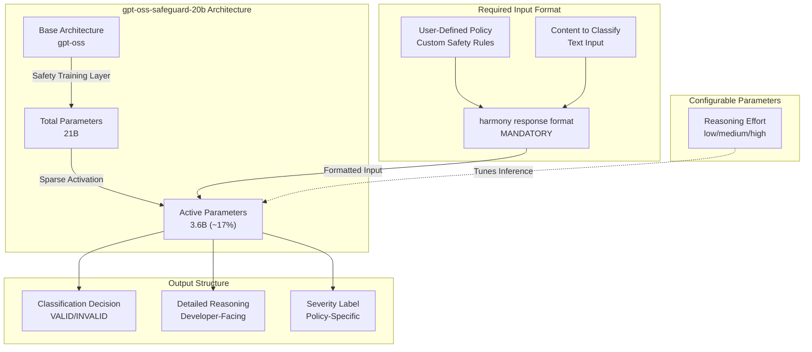
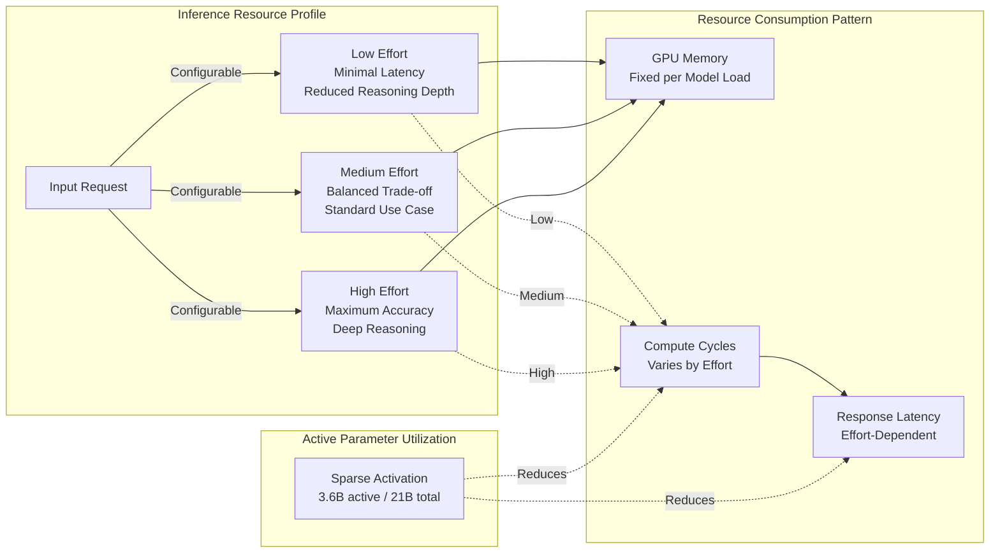
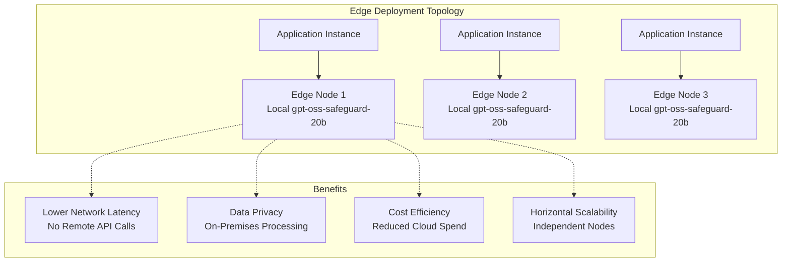
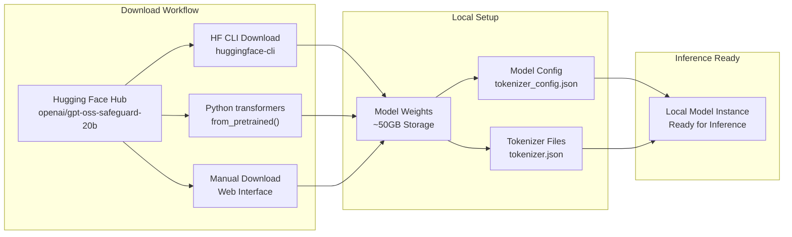
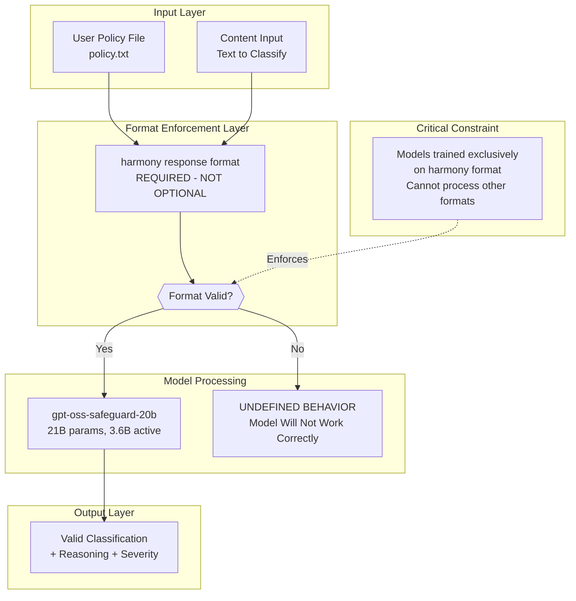
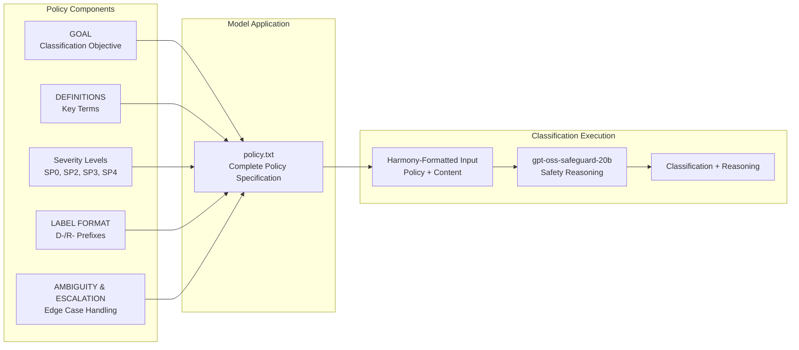
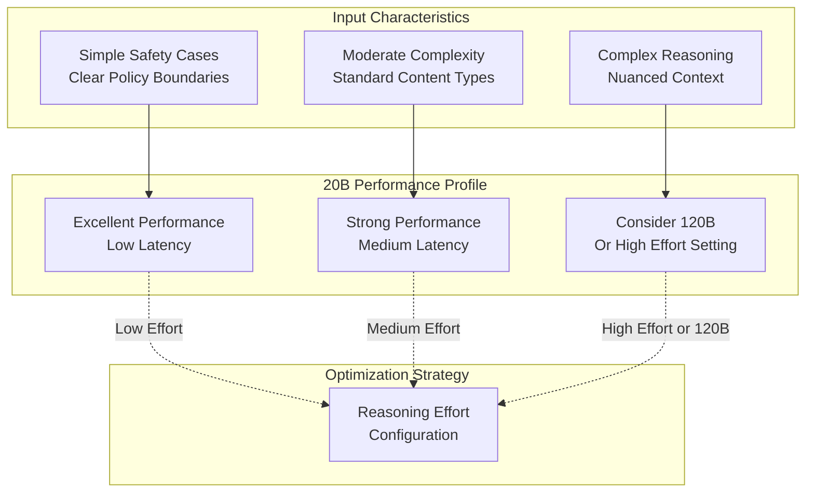
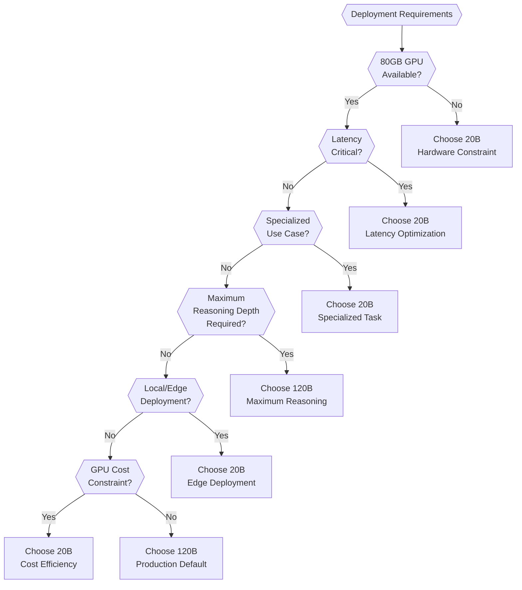
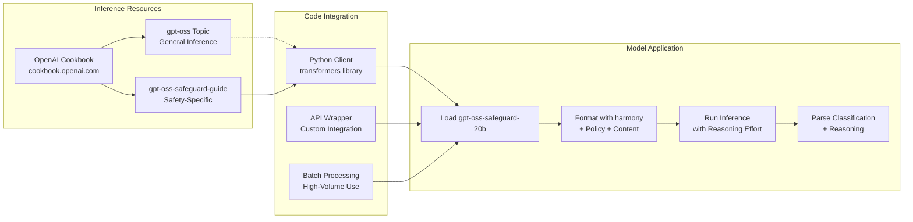
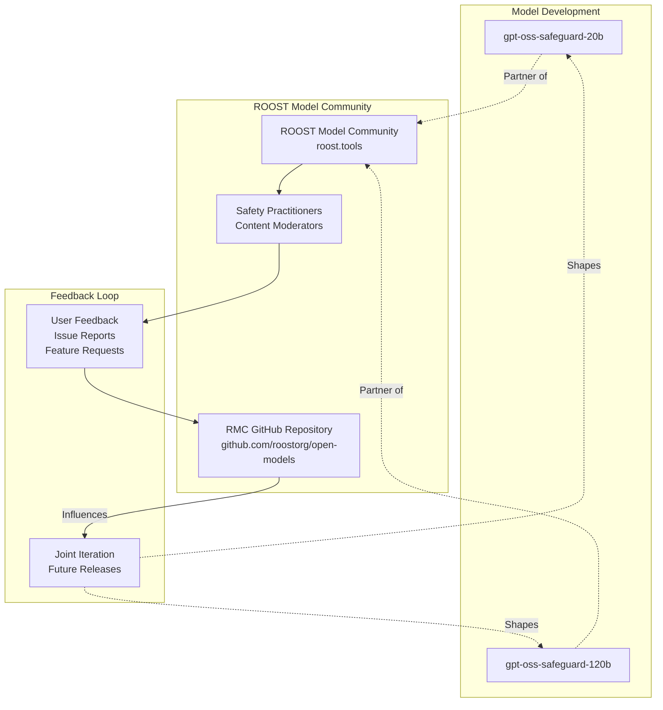

<!-- source: DeepWiki mcp.deepwiki.com · repo openai/gpt-oss-safeguard · page 3.2 gpt-oss-safeguard-20b · fetched 2026-10-26 -->

# gpt-oss-safeguard-20b

<details>
<summary>Relevant source files</summary>

The following files were used as context for generating this wiki page:

- [README.md](README.md)
- [docs/gpt-oss-safeguard-20b.png](docs/gpt-oss-safeguard-20b.png)

</details>


## Purpose and Scope

This document provides technical specifications and deployment guidance for `gpt-oss-safeguard-20b`, the smaller of the two model variants in the gpt-oss-safeguard family. This model variant is optimized for lower latency, resource-constrained environments, and specialized safety classification tasks.

For information about the larger model variant, see [gpt-oss-safeguard-120b](#3.1). For guidance on choosing between model variants, see [Model Variants](#3). For core concepts applicable to both models (harmony response format, policy-based classification), see [Core Concepts](#4).

**Sources:** [README.md:14-18]()

---

## Model Architecture and Specifications

### Parameter Configuration

The `gpt-oss-safeguard-20b` model employs a sparse activation architecture with the following characteristics:

| Specification | Value |
|--------------|-------|
| Total Parameters | 21 billion |
| Active Parameters | 3.6 billion |
| Activation Ratio | ~17% (3.6B / 21B) |
| Architecture Base | gpt-oss |
| Required Format | harmony response format |

The sparse activation pattern indicates a mixture-of-experts (MoE) or similar efficient architecture where only a subset of parameters are active during inference. This design choice enables the model to maintain strong reasoning capabilities while reducing computational requirements compared to dense architectures.

### Architecture Characteristics



**Diagram: gpt-oss-safeguard-20b Architecture and Data Flow**

The model requires properly formatted input via the harmony response format. Failure to use this format results in undefined behavior and incorrect classifications.

**Sources:** [README.md:14-18](), [README.md:20]()

---

## Hardware Requirements and Resource Utilization

### Minimum Hardware Specifications

Unlike the 120B variant which requires a single 80GB GPU, the 20B model is designed for more flexible deployment scenarios:

| Resource Type | Requirement |
|--------------|-------------|
| GPU Memory | < 80GB (exact requirements vary by precision) |
| GPU Architecture | NVIDIA (Ampere, Ada, Hopper) or AMD (CDNA2, CDNA3) |
| System RAM | 32GB+ recommended |
| Storage | 50GB+ for model weights |
| Deployment Options | Single GPU, Multi-GPU, CPU inference (slower) |

### Resource Efficiency



**Diagram: Resource Utilization and Reasoning Effort Configuration**

The configurable reasoning effort parameter allows tuning the latency-accuracy trade-off. For detailed information on reasoning effort configuration, see [Configurable Reasoning Effort](#4.4).

**Sources:** [README.md:17-18](), [README.md:27]()

---

## Optimal Use Cases

### Target Deployment Scenarios

The 20B model variant is specifically designed for the following scenarios:

#### 1. Edge and Distributed Deployments



**Diagram: Edge Deployment Pattern for gpt-oss-safeguard-20b**

#### 2. Specialized Safety Tasks

| Use Case Category | Description | Reasoning Effort Recommendation |
|------------------|-------------|--------------------------------|
| Real-time Chat Moderation | High-volume, low-latency content filtering | Low to Medium |
| Specialized Domain Safety | Industry-specific safety policies (e.g., healthcare, education) | Medium to High |
| Development and Testing | Policy iteration and golden dataset validation | Variable |
| On-Premises Enterprise | Data sovereignty requirements, private networks | Medium |

#### 3. Resource-Constrained Environments

The 20B model enables safety reasoning in environments where:
- GPU memory is limited (< 80GB)
- Multiple models must share hardware resources
- Inference budget is constrained by cost or power consumption
- Deployment must occur on consumer-grade or mobile hardware (with appropriate adapters)

**Sources:** [README.md:18]()

---

## Download and Access

### Hugging Face Hub

The model is distributed through Hugging Face Hub and can be accessed via:

```
Model Repository: https://huggingface.co/openai/gpt-oss-safeguard-20b
Collection: https://huggingface.co/collections/openai/gpt-oss-safeguard
Interactive Demo: https://huggingface.co/spaces/openai/gpt-oss-safeguard-20b
```

### Download Instructions



**Diagram: Model Download and Setup Workflow**

The download process follows the same pattern as `gpt-oss-120b`. For detailed setup instructions similar to gpt-oss models, see [Model Download and Setup](#8.2).

**Sources:** [README.md:3](), [README.md:6](), [README.md:40]()

---

## Integration with Core Systems

### Mandatory Format Requirements



**Diagram: Harmony Response Format Integration and Validation Flow**

The model's training exclusively used the harmony response format. Using any other format will produce incorrect results. For detailed format specifications, see [Harmony Response Format](#4.2).

### Policy Integration

The 20B model integrates with user-defined policies using the same policy structure as the 120B variant:



**Diagram: Policy-to-Classification Integration Flow**

For detailed policy creation guidance, see [Working with Policies](#5). For the spam detection example demonstrating this integration, see [Example: Spam Detection Policy](#6).

**Sources:** [README.md:20](), [README.md:25](), [README.md:35-36]()

---

## Performance Characteristics

### Latency-Accuracy Trade-offs

The 20B model provides a different performance profile compared to the 120B variant:

| Metric | 20B Model | 120B Model (Reference) |
|--------|-----------|----------------------|
| Active Parameters | 3.6B | 5.1B |
| Relative Latency | Lower (baseline) | Higher (~40-60% increase estimated) |
| Reasoning Depth | Specialized tasks | General-purpose, high-reasoning |
| Hardware Accessibility | Broader GPU range | Single 80GB GPU minimum |
| Deployment Flexibility | High (edge, local, cloud) | Moderate (cloud, enterprise DC) |

### Reasoning Quality



**Diagram: Performance Profile by Use Case Complexity**

The 20B model excels at specialized, well-defined safety tasks. For general-purpose production deployments requiring maximum reasoning capability, consider the 120B variant (see [gpt-oss-safeguard-120b](#3.1)).

**Sources:** [README.md:17-18]()

---

## When to Choose 20B vs 120B

### Decision Framework



**Diagram: Model Variant Selection Decision Tree**

### Use Case Mapping

| Scenario | Recommended Variant | Reasoning |
|----------|-------------------|-----------|
| Real-time chat moderation (< 100ms p95 latency) | 20B | Latency critical, high volume |
| Production content moderation (general-purpose) | 120B | Accuracy and reasoning depth prioritized |
| On-premises enterprise deployment | 20B | Flexible hardware, data sovereignty |
| Edge computing (CDN nodes, regional data centers) | 20B | Distributed topology, lower resource profile |
| Policy development and testing | 20B or 120B | 20B for fast iteration, 120B for final validation |
| Specialized domain (e.g., healthcare compliance) | 20B + High Effort | Domain-specific policy, focused use case |
| Multi-policy classification system | 120B | Complex reasoning across multiple policies |
| Cost-sensitive SaaS application | 20B | Lower infrastructure costs |

**Sources:** [README.md:17-18]()

---

## Inference Examples

### Cookbook Integration

The 20B model uses the same inference patterns as `gpt-oss-20b`:



**Diagram: Inference Implementation Pattern**

For comprehensive inference examples, see the [OpenAI Cookbook gpt-oss-safeguard guide](https://cookbook.openai.com/articles/gpt-oss-safeguard-guide) and general [gpt-oss inference patterns](https://cookbook.openai.com/topic/gpt-oss).

For deployment and integration details, see [Deployment and Integration](#8).

**Sources:** [README.md:32](), [README.md:7]()

---

## Community and Support

### ROOST Model Community Partnership

The gpt-oss-safeguard models are partners of the ROOST Model Community:



**Diagram: ROOST Model Community Feedback and Iteration Flow**

For more information on community governance and how to provide feedback, see [ROOST Model Community Partnership](#9.3).

**Sources:** [README.md:42-45]()

---

## Additional Resources

### External Documentation

- **Hugging Face Model Hub:** [openai/gpt-oss-safeguard-20b](https://huggingface.co/openai/gpt-oss-safeguard-20b)
- **Interactive Demo:** [Hugging Face Space](https://huggingface.co/spaces/openai/gpt-oss-safeguard-20b)
- **Usage Guide:** [OpenAI Cookbook - gpt-oss-safeguard Guide](https://cookbook.openai.com/articles/gpt-oss-safeguard-guide)
- **Model Card:** [arXiv Paper](https://arxiv.org/abs/2508.10925)
- **Announcement:** [OpenAI Blog](https://openai.com/index/introducing-gpt-oss-safeguard/)

### Related Wiki Pages

- [gpt-oss-safeguard-120b](#3.1) - Larger model variant for production use
- [Model Variants](#3) - Comparison and selection guidance
- [Harmony Response Format](#4.2) - Required input format specification
- [Policy-Based Classification](#4.3) - Core classification approach
- [Working with Policies](#5) - Policy creation and management
- [Hardware Requirements](#8.1) - Detailed deployment specifications

**Sources:** [README.md:3](), [README.md:6-9]()

---

