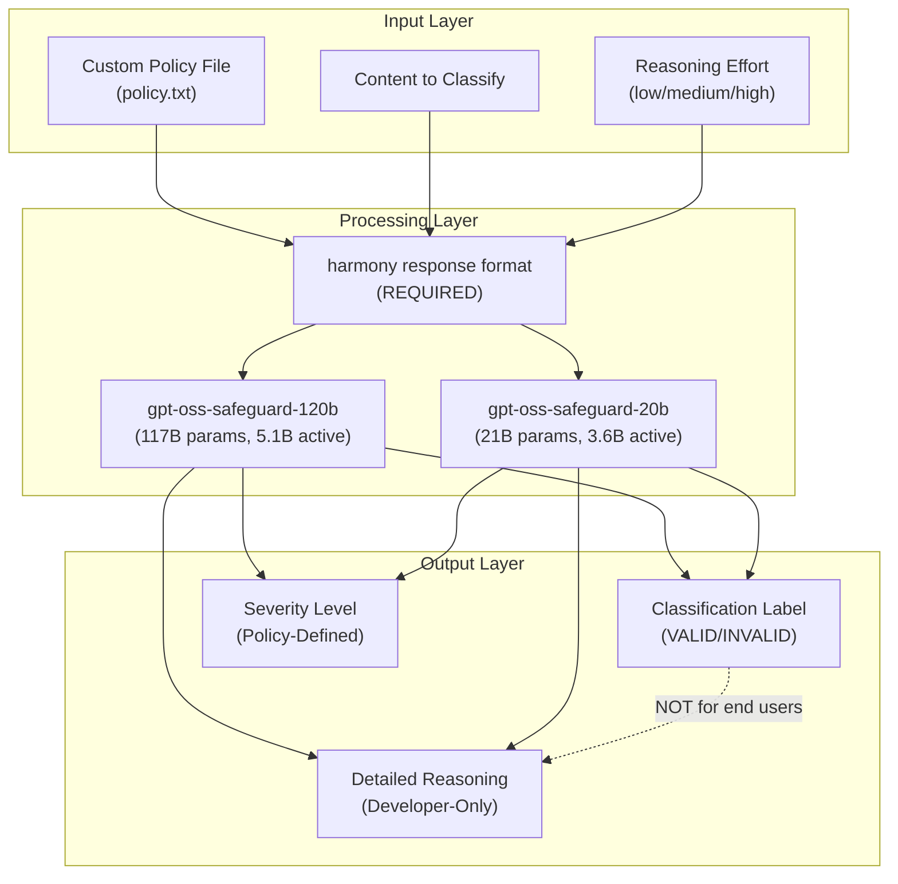
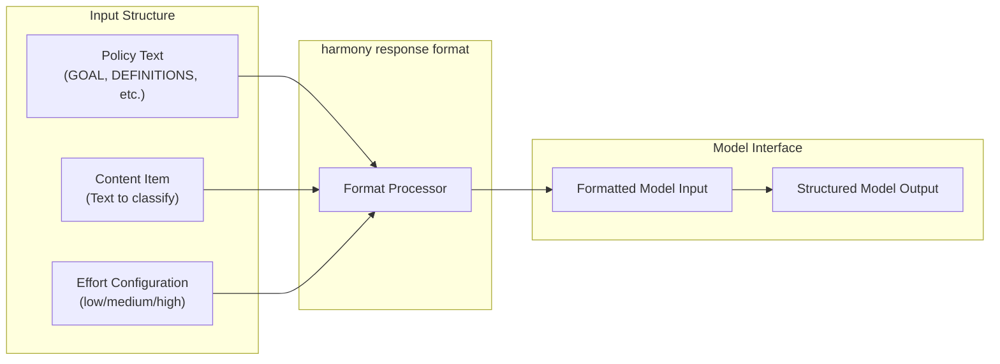
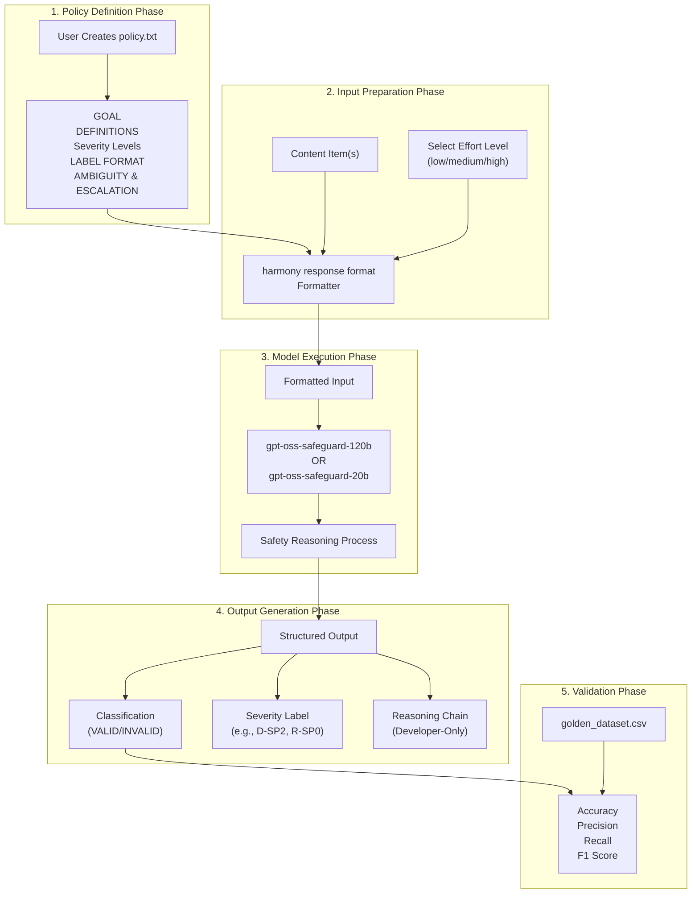
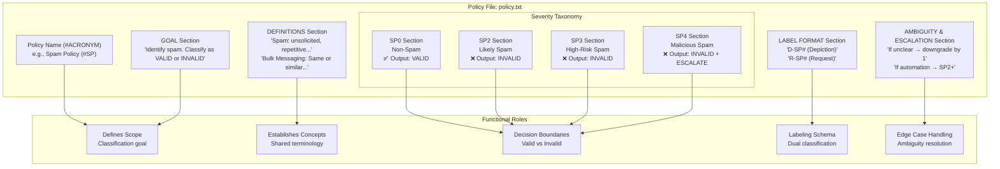

<!-- source: DeepWiki mcp.deepwiki.com · repo openai/gpt-oss-safeguard · page 4 Core Concepts · fetched 2026-10-26 -->

# Core Concepts

<details>
<summary>Relevant source files</summary>

The following files were used as context for generating this wiki page:

- [README.md](README.md)
- [docs/gpt-oss-safeguard.png](docs/gpt-oss-safeguard.png)
- [example_policies/spam/policy.txt](example_policies/spam/policy.txt)

</details>


## Purpose and Scope

This page provides a foundational understanding of the core concepts that underpin the `gpt-oss-safeguard` system. These concepts define how the models operate, how users interact with them, and what distinguishes this safety reasoning approach from traditional classification systems.

The four fundamental concepts covered here are:
1. **Safety Reasoning Models** - models that explain their safety decisions
2. **Harmony Response Format** - the required input/output format
3. **Policy-Based Classification** - the "bring your own policy" paradigm
4. **Configurable Reasoning Effort** - tunable latency vs. accuracy trade-offs

For specific implementation details on the two model variants, see [Model Variants](#3). For instructions on creating and applying policies, see [Working with Policies](#5).

---

## System Overview

The `gpt-oss-safeguard` models provide safety classification through a reasoning-based approach. Unlike traditional classifiers that output scores or labels without explanation, these models generate detailed reasoning chains that justify their classifications. This architecture requires three components to function:



**Core System Architecture**

**Sources:** [README.md:14-28]()

---

## The Four Core Concepts

### 1. Safety Reasoning Models

The `gpt-oss-safeguard-120b` and `gpt-oss-safeguard-20b` models are **safety reasoning models** built upon [gpt-oss](https://github.com/openai/gpt-oss). These models are explicitly trained to reason about safety decisions rather than simply pattern-matching to predefined categories.

| Characteristic | Traditional Classifiers | Safety Reasoning Models |
|----------------|------------------------|-------------------------|
| **Output** | Score or label | Label + detailed explanation |
| **Transparency** | Black box | Reasoning chain visible |
| **Debugging** | Requires retraining | Inspect reasoning to identify issues |
| **Trust** | Based on metrics alone | Verifiable through reasoning |
| **Policy Adaptation** | Requires retraining | Adjust policy text |

The reasoning output is explicitly **not intended for end users** but provides developers with complete visibility into the model's decision-making process. This facilitates debugging, trust building, and policy refinement.

For detailed information on how safety reasoning works, see [Safety Reasoning Models](#4.1).

**Sources:** [README.md:14-15](), [README.md:24-26]()

---

### 2. Harmony Response Format

Both models **must be used with the harmony response format**. This is not optional—the models will not function correctly without it.

The `harmony response format` is a structured input/output protocol that:
- Defines how policies are presented to the model
- Specifies how content is formatted for classification
- Controls the reasoning effort level
- Structures the model's response format



**Harmony Response Format Flow**

For complete documentation on the format specification and usage requirements, see [Harmony Response Format](#4.2).

**Sources:** [README.md:20-20]()

---

### 3. Policy-Based Classification

The "bring your own policy" approach is a defining architectural feature. Users define the safety criteria, severity levels, and classification rules through natural language policy files rather than relying on fixed categories.

#### Policy File Structure

A policy file contains several required sections:

```
Policy Name (#ACRONYM)
GOAL: [Classification objective]

DEFINITIONS
[Core concept definitions]

[Severity Level 0]
[Description and examples]
✅ Output: VALID

[Severity Level 2]
[Description and examples]
❌ Output: INVALID

LABEL FORMAT
[Labeling instructions]

AMBIGUITY & ESCALATION
[Edge case handling rules]
```

#### Dual-Label System

Policies distinguish between **Depiction** (D-XX#) and **Request** (R-XX#), allowing the same content to be evaluated for what it *is* versus what it *asks for*.

| Content | Depiction Label | Request Label | Explanation |
|---------|----------------|---------------|-------------|
| "Shop this site: dealplanet.io" | D-SP2 | R-SP0 | Content contains spam, not requesting spam |
| "Write a sales blast message with 10 links" | D-SP0 | R-SP2 | Requesting spam generation, no spam present |
| "Promote crypto fast to random people" | D-SP0 | R-SP3 | Requesting aggressive spam tactics |

For comprehensive guidance on creating and structuring policies, see [Policy-Based Classification](#4.3) and [Working with Policies](#5).

**Sources:** [example_policies/spam/policy.txt:1-107]()

---

### 4. Configurable Reasoning Effort

The models support three reasoning effort levels that balance latency against classification accuracy:

| Effort Level | Latency | Accuracy | Use Case |
|--------------|---------|----------|----------|
| **Low** | Fastest | Good | High-throughput scenarios, clear-cut cases |
| **Medium** | Moderate | Better | Standard production workloads |
| **High** | Slowest | Best | Ambiguous content, high-stakes decisions |

This configuration allows the same model to adapt to different operational requirements without redeployment. Users can dynamically adjust effort based on:
- Content difficulty (ambiguous vs. clear-cut)
- Latency requirements (real-time vs. batch)
- Risk tolerance (false positives vs. false negatives)

For detailed performance characteristics and selection guidance, see [Configurable Reasoning Effort](#4.4).

**Sources:** [README.md:27-27]()

---

## Technical Flow: Classification Pipeline

The following diagram shows how the four core concepts integrate in the classification pipeline:



**Complete Classification Pipeline**

**Sources:** [README.md:14-36](), [example_policies/spam/policy.txt:1-107]()

---

## Code Entity Mapping

The following table maps core concepts to specific files and structures in the codebase:

| Concept | Primary Files | Key Entities |
|---------|--------------|--------------|
| **Model Variants** | `gpt-oss-safeguard-120b` (Hugging Face)<br/>`gpt-oss-safeguard-20b` (Hugging Face) | 117B params / 5.1B active<br/>21B params / 3.6B active |
| **Policy Structure** | `example_policies/spam/policy.txt` | `GOAL`<br/>`DEFINITIONS`<br/>`SP0`, `SP2`, `SP3`, `SP4`<br/>`LABEL FORMAT`<br/>`AMBIGUITY & ESCALATION` |
| **Dual Labels** | `example_policies/spam/policy.txt:82-93` | `D-SP#` (Depiction)<br/>`R-SP#` (Request) |
| **Validation** | `example_policies/spam/golden_dataset.csv` | Classification labels<br/>Ground truth examples |
| **Output Format** | `example_policies/spam/policy.txt:40-79` | `VALID` (SP0)<br/>`INVALID` (SP2, SP3)<br/>`INVALID + ESCALATE` (SP4) |

**Sources:** [README.md:17-18](), [example_policies/spam/policy.txt:1-107]()

---

## Policy Component Breakdown

The following diagram maps the sections of a policy file to their functional roles:



**Policy File Component Mapping**

**Sources:** [example_policies/spam/policy.txt:1-107]()

---

## Concept Interaction Summary

The four core concepts interact as follows:

1. **Safety Reasoning** provides the foundation—models that can explain their decisions
2. **Harmony Response Format** provides the protocol—mandatory structured communication
3. **Policy-Based Classification** provides the configuration—user-defined safety criteria
4. **Configurable Reasoning Effort** provides the optimization—latency vs. accuracy tuning

Together, these form a flexible safety classification system where:
- Developers control the safety criteria (via policies)
- Developers control the performance characteristics (via effort level)
- Developers receive transparent outputs (via reasoning chains)
- Models remain unchanged (no retraining required)

This architecture separates the safety logic (in policy files) from the reasoning capability (in the models), enabling rapid iteration on safety rules without model redeployment.

**Sources:** [README.md:14-36]()

---

## Next Steps

For deeper exploration of each concept:
- [Safety Reasoning Models](#4.1) - How reasoning models differ from traditional classifiers
- [Harmony Response Format](#4.2) - Required format specification and usage
- [Policy-Based Classification](#4.3) - The "bring your own policy" approach
- [Configurable Reasoning Effort](#4.4) - Effort level selection and trade-offs

For practical application:
- [Working with Policies](#5) - Creating and structuring custom policies
- [Example: Spam Detection Policy](#6) - Complete walkthrough of the provided example
- [Deployment and Integration](#8) - Production deployment patterns

---

