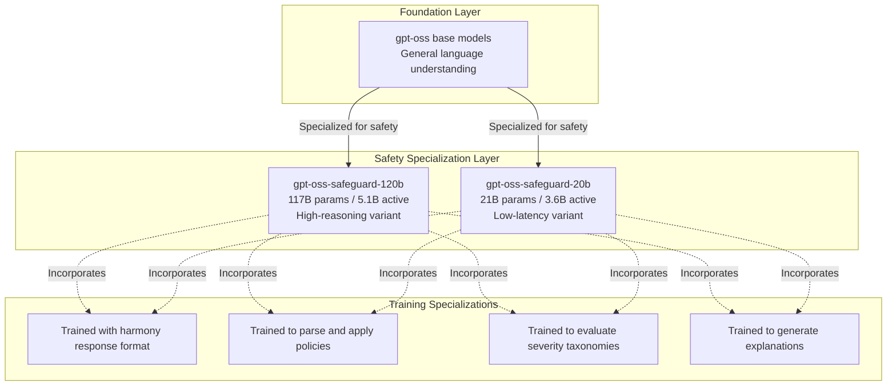
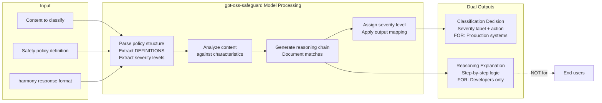
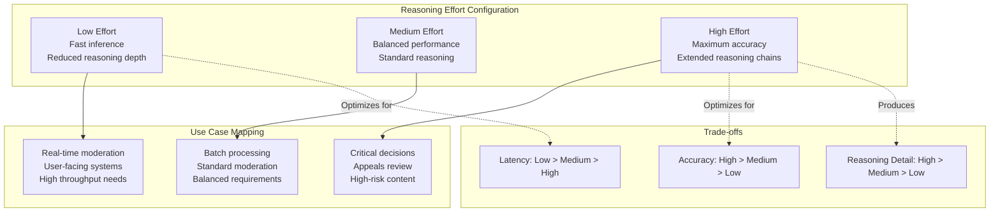
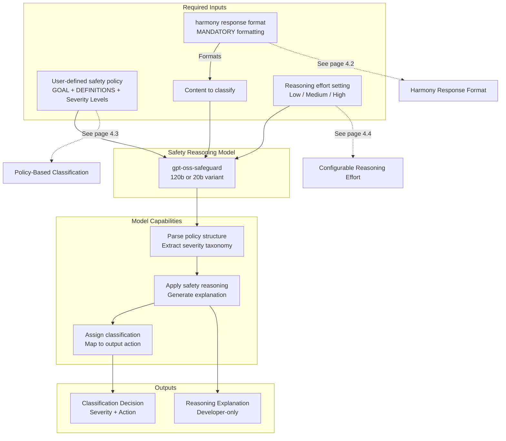
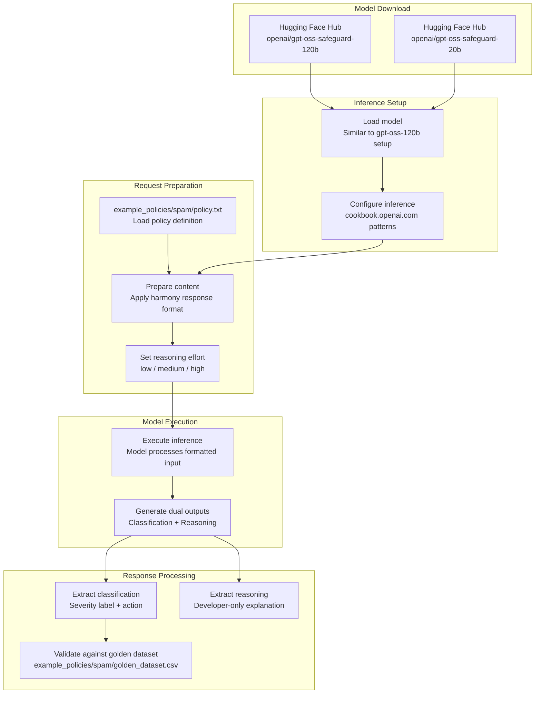

<!-- source: DeepWiki mcp.deepwiki.com · repo openai/gpt-oss-safeguard · page 4.1 Safety Reasoning Models · fetched 2026-10-26 -->

# Safety Reasoning Models

Relevant source files

The following files were used as context for generating this wiki page:

- [README.md](README.md)
- [docs/gpt-oss-safeguard.png](docs/gpt-oss-safeguard.png)

## Purpose and Scope

This page explains what safety reasoning models are, how they differ from traditional classification systems, and how they produce reasoned decisions with detailed explanations. It covers the architectural principles underlying `gpt-oss-safeguard-120b` and `gpt-oss-safeguard-20b`, their dual-output system (classification + reasoning), and how reasoning effort can be configured.

For information about the specific model variants and their hardware requirements, see [Model Variants](#3). For details on the mandatory input format, see [Harmony Response Format](#4.2). For information on how policies control classification behavior, see [Policy-Based Classification](#4.3).

---

## What is Safety Reasoning?

Safety reasoning refers to the process of evaluating content against safety policies through explicit logical analysis rather than implicit learned patterns alone. Unlike traditional classifiers that output confidence scores or binary decisions, safety reasoning models produce **structured explanations** of their decision-making process.

Traditional safety classifiers typically:
- Output a score (e.g., 0.87 toxicity score)
- Provide a binary label (safe/unsafe)
- Offer limited insight into why a decision was made

Safety reasoning models:
- Analyze content against user-defined policies
- Apply severity taxonomies with explicit characteristics
- Generate step-by-step reasoning about which policy categories apply
- Provide final classifications grounded in documented policy logic

This approach enables developers to understand, validate, and trust model decisions by examining the reasoning chain that led to each classification.

**Sources:** [README.md:24-26]()

---

## Architecture: Built on gpt-oss

The `gpt-oss-safeguard` models are safety-specialized variants built upon the [gpt-oss](https://github.com/openai/gpt-oss) foundation. The architectural relationship is shown below:

### Model Specifications

| Variant | Total Parameters | Active Parameters | Primary Use Case |
|---------|-----------------|-------------------|------------------|
| `gpt-oss-safeguard-120b` | 117B | 5.1B | Production, general purpose, high-reasoning tasks |
| `gpt-oss-safeguard-20b` | 21B | 3.6B | Lower latency, local deployment, specialized tasks |

The active parameter counts (5.1B and 3.6B) relative to total parameters suggest sparse or mixture-of-experts architectures, where only a subset of parameters are activated per forward pass, optimizing inference efficiency.

**Sources:** [README.md:14-18]()

---

## Dual Output System

Safety reasoning models produce two distinct outputs for each classification request:

### 1. Classification Decision

The actionable output that determines content handling:
- **Label**: Severity level from the policy (e.g., `SP0`, `SP2`, `SP3`, `SP4`)
- **Output Mapping**: Policy-defined action (e.g., `VALID`, `INVALID`, `INVALID + ESCALATE`)
- **Structured Format**: Follows the policy's LABEL FORMAT specification

### 2. Detailed Reasoning Explanation

The explanatory output that documents the decision process:
- **Policy Application**: Which policy definitions were considered
- **Characteristic Matching**: Which characteristics from severity levels matched the content
- **Ambiguity Handling**: How unclear cases were resolved
- **Final Rationale**: Why a specific severity level was assigned

**Sources:** [README.md:26]()

---

## Reasoning Visibility and Intended Audience

The reasoning output serves a **developer-only** purpose and has important visibility constraints:

### Developer Use Cases

Reasoning explanations enable developers to:

| Use Case | Description |
|----------|-------------|
| **Debugging** | Trace why specific content received a particular classification |
| **Policy Validation** | Verify that the model interprets policy definitions as intended |
| **Edge Case Analysis** | Understand how the model handles ambiguous or borderline content |
| **Trust Building** | Audit decision logic for fairness, consistency, and correctness |
| **Model Improvement** | Identify patterns where reasoning diverges from expectations |

### End-User Considerations

The reasoning output is **not intended to be shown to end users** because:

1. **Technical complexity**: Explanations reference policy internals and severity taxonomies
2. **Exploitation risk**: Detailed reasoning could inform adversarial attacks on the safety system
3. **User experience**: End users typically need simple decisions, not technical rationales
4. **Policy confidentiality**: Some organizations may not want to expose their exact safety criteria

Production systems should expose only the classification decision (e.g., "This content violates our spam policy") to end users while logging the reasoning internally for operational purposes.

**Sources:** [README.md:26]()

---

## Configurable Reasoning Effort

Safety reasoning models support three levels of reasoning effort, allowing developers to balance accuracy against latency:

### Effort Level Characteristics

| Effort Level | Typical Latency | Reasoning Depth | Best For |
|--------------|----------------|-----------------|----------|
| **Low** | Fastest | Abbreviated reasoning, key points only | Real-time user-facing systems, high-volume screening |
| **Medium** | Moderate | Standard reasoning, covers main policy aspects | General moderation workflows, batch processing |
| **High** | Slowest | Comprehensive reasoning, detailed policy analysis | Critical decisions, appeals, edge case resolution |

The reasoning effort configuration is specified at inference time, allowing the same model to serve different use cases with appropriate speed-accuracy trade-offs.

**Sources:** [README.md:27]()

---

## Integration with Core Concepts

Safety reasoning models operate within a tightly integrated system of related concepts:

### Critical Dependencies

1. **Harmony Response Format** (see [#4.2](#4.2)): The models were trained exclusively with this format and will not function correctly without it.

2. **Policy-Based Classification** (see [#4.3](#4.3)): The "bring your own policy" approach means the model's behavior is entirely determined by the policy provided at inference time.

3. **Configurable Reasoning Effort** (see [#4.4](#4.4)): Reasoning depth directly affects both latency and the quality of explanations produced.

**Sources:** [README.md:20](), [README.md:25-27]()

---

## Safety Reasoning vs. Traditional Classification

The following table contrasts safety reasoning models with traditional content classification approaches:

| Aspect | Traditional Classifiers | Safety Reasoning Models |
|--------|------------------------|-------------------------|
| **Output** | Confidence score or label | Classification + detailed reasoning |
| **Policy Definition** | Fixed, embedded in training | User-defined, provided at inference |
| **Explainability** | Black box or feature weights | Step-by-step reasoning chain |
| **Customization** | Requires retraining | Adjust policy text |
| **Debugging** | Limited visibility into decision logic | Full access to reasoning process |
| **Severity Granularity** | Binary or simple categories | Custom taxonomies with detailed characteristics |
| **Ambiguity Handling** | Implicit in model weights | Explicit rules in policy |
| **Latency Control** | Fixed model inference time | Configurable via reasoning effort |

This architectural shift from fixed classifiers to reasoned policy application enables rapid iteration on safety definitions without model retraining, while maintaining transparency in decision-making.

**Sources:** [README.md:24-27]()

---

## Inference Workflow with Code References

The practical implementation of safety reasoning follows the standard `gpt-oss` inference patterns with safety-specific requirements:

### Key File References

- **Model weights**: Available at Hugging Face collections referenced in [README.md:3]() and [README.md:40]()
- **Example policy**: [example_policies/spam/policy.txt]() provides a reference implementation
- **Golden dataset**: [example_policies/spam/golden_dataset.csv]() offers validation examples
- **Usage guide**: Detailed in OpenAI Cookbook as referenced in [README.md:7]() and [README.md:35]()

**Sources:** [README.md:3](), [README.md:32](), [README.md:35-36](), [README.md:40]()

---

## Key Takeaways

1. **Safety reasoning models generate explanations**, not just scores, enabling trust and debugging
2. **Reasoning is developer-only** and should not be exposed to end users
3. **Built on gpt-oss** with specialized training for policy interpretation
4. **Dual outputs** (classification + reasoning) serve different audiences
5. **Reasoning effort is configurable**, enabling latency-accuracy trade-offs
6. **Harmony response format is mandatory** for correct model operation
7. **Active parameters** (5.1B/3.6B) are much smaller than total parameters, optimizing efficiency

These architectural principles distinguish safety reasoning models from traditional classifiers and enable flexible, transparent, and customizable safety systems.

**Sources:** [README.md:14-27]()

---

