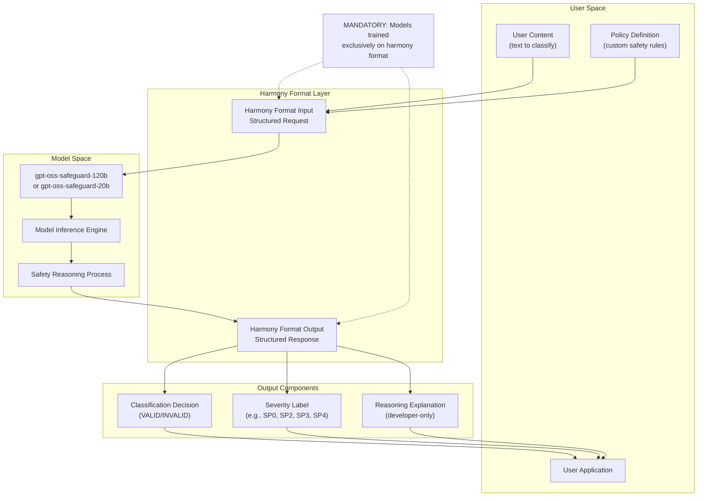
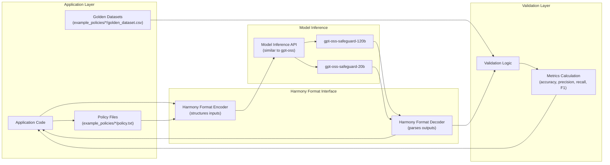
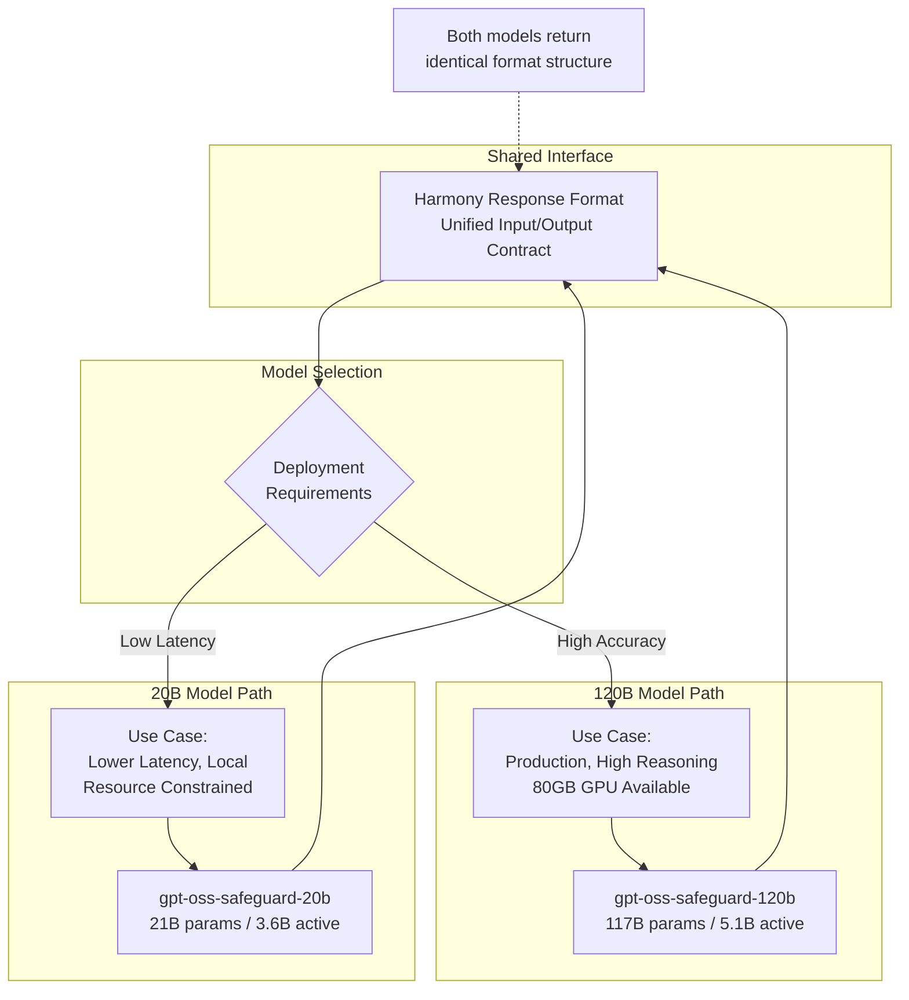
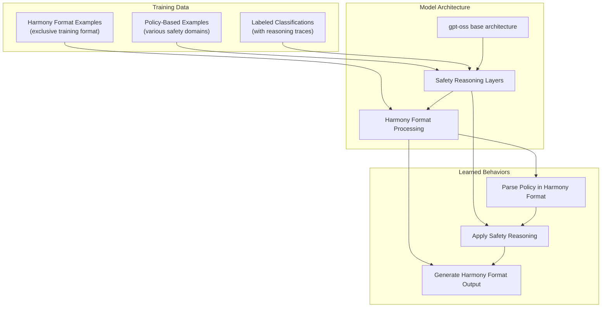

<!-- source: DeepWiki mcp.deepwiki.com · repo openai/gpt-oss-safeguard · page 4.2 Harmony Response Format · fetched 2026-10-26 -->

# Harmony Response Format

Relevant source files

The following files were used as context for generating this wiki page:

- [README.md](README.md)

## Purpose and Scope

This document covers the **harmony response format**, a mandatory structured format required for all interactions with the gpt-oss-safeguard models. The harmony format acts as the input/output contract between user applications and the safety reasoning models, defining how content classification requests must be structured and how model responses are returned.

For information about creating safety policies that work with this format, see [Policy-Based Classification](#4.3). For configuring reasoning effort within the format, see [Configurable Reasoning Effort](#4.4).

---

## Overview

The harmony response format is a structured communication protocol that both gpt-oss-safeguard model variants (120b and 20b) require for correct operation. As stated in [README.md:20](), "Both models were trained using our harmony response format and should only be used with this format; otherwise, they will not work correctly."

This format serves as:

- **Input structure** for classification requests containing content and policy definitions
- **Output structure** for model responses containing classifications, severity labels, and reasoning
- **Training format** that the models were specifically trained to process and generate
- **Integration contract** ensuring consistent behavior across model variants

**Sources:** [README.md:20]()

---

## Critical Requirement

### Training Dependency

The harmony response format is not an optional configuration or suggested best practice—it is a **hard architectural requirement**. The models were trained exclusively on this format, meaning:

| Aspect | Implication |
|--------|-------------|
| Input Processing | The model expects inputs structured according to harmony format conventions |
| Output Generation | The model generates responses in harmony format structure |
| Token Distribution | Model weights are optimized for harmony format token patterns |
| Reasoning Paths | The model's safety reasoning is anchored to harmony format structure |

Using any other format will result in degraded performance, incorrect classifications, or complete failure to produce useful outputs.

### Consequences of Non-Compliance

Without proper harmony format usage:

- **Classification accuracy drops** — The model cannot correctly interpret inputs
- **Reasoning becomes incoherent** — Output explanations may not align with classifications
- **Severity labels malformed** — Labels may not match expected taxonomy (e.g., SP0, SP2, SP3, SP4)
- **Integration failures** — Downstream systems expecting harmony format structure will fail to parse responses

**Sources:** [README.md:20]()

---

## Harmony Format in Classification Workflow

The harmony response format acts as the critical adapter layer between user-defined policies and model inference. The following diagram illustrates its position in the safety classification workflow:

### Data Flow Through Harmony Format

**Sources:** [README.md:14-20](), High-Level Diagram 2

---

## Format Structure and Components

While the complete specification is available in the [OpenAI Cookbook](https://cookbook.openai.com/articles/gpt-oss-safeguard-guide), the harmony response format encompasses the following structural components:

### Input Components

The harmony format structures classification requests to include:

| Component | Purpose | Example Context |
|-----------|---------|-----------------|
| Content Input | The text to be classified | User-generated message, post, or prompt |
| Policy Context | The safety policy rules | Spam policy with SP0-SP4 taxonomy (see [Example: Spam Detection Policy](#6)) |
| Reasoning Effort | Configuration for depth of analysis | Low, Medium, or High (see [Configurable Reasoning Effort](#4.4)) |
| Label Format | Expected output taxonomy | Dual-label system (D-SP#, R-SP#) for depiction vs. request |

### Output Components

The harmony format structures model responses to provide:

| Component | Purpose | Developer Use |
|-----------|---------|---------------|
| Classification | Binary or multi-class decision | VALID/INVALID or custom policy outputs |
| Severity Label | Granular risk assessment | SP0, SP2, SP3, SP4 in spam policy |
| Reasoning Explanation | Model's chain-of-thought | Debugging, auditing, trust building |
| Confidence Indicators | Uncertainty signals | Ambiguity handling and escalation |

**Note:** As stated in [README.md:26](), reasoning explanations are "not intended to be shown to end users" — they are for developer debugging and system auditing only.

**Sources:** [README.md:20-28](), High-Level Diagram 2

---

## Integration Architecture

The harmony response format creates a standardized integration pattern across both model variants and all deployment scenarios:

### System Integration Points

**Sources:** [README.md:32-36](), High-Level Diagram 2, High-Level Diagram 3

---

## Interchangeability Across Model Variants

The harmony response format ensures that `gpt-oss-safeguard-120b` and `gpt-oss-safeguard-20b` are **functionally interchangeable** from an integration perspective. Applications can switch between model variants without modifying code that handles:

- Request formatting
- Response parsing
- Classification interpretation
- Reasoning extraction

This allows users to select models based on deployment constraints (see [Model Variants](#3)) while maintaining consistent application logic:

**Sources:** [README.md:17-18](), High-Level Diagram 3

---

## Format and Policy Integration

The harmony response format is designed to work with the policy-based classification system (see [Policy-Based Classification](#4.3)). The format structures how policies are presented to the model and how policy-aligned outputs are generated:

### Policy-to-Format Mapping

| Policy Component | Harmony Format Element | Example from Spam Policy |
|------------------|------------------------|--------------------------|
| GOAL statement | Classification objective | "Classify as VALID/INVALID" |
| DEFINITIONS | Context for model reasoning | Spam, Bulk Messaging, Unsolicited Promotion |
| Severity levels | Output taxonomy | SP0, SP2, SP3, SP4 |
| LABEL FORMAT | Dual-label structure | D-SP# (depiction) and R-SP# (request) |
| AMBIGUITY rules | Confidence handling | Downgrade severity when uncertain |
| ESCALATION rules | Cross-policy integration | Apply highest severity for combined abuse |

The example spam policy in [example_policies/spam/policy.txt]() demonstrates how policy definitions map to harmony format expectations.

**Sources:** [README.md:34-36](), High-Level Diagram 4

---

## Model Training Context

Understanding the training context clarifies why the harmony response format is non-negotiable:

### Training Characteristics

The models learned to:

1. **Recognize harmony format structure** — Token patterns, delimiters, and semantic markers
2. **Extract policy information** — GOAL, DEFINITIONS, severity levels from formatted input
3. **Apply reasoning within format constraints** — Chain-of-thought aligned to harmony structure
4. **Generate structured outputs** — Classifications, labels, and explanations in expected format

Deviating from this format breaks these learned associations, causing the model to generate unreliable or malformed outputs.

**Sources:** [README.md:14-20](), [README.md:24]()

---

## Accessing Format Specifications

### Primary Documentation

The complete harmony response format specification is documented in the [OpenAI Cookbook guide](https://cookbook.openai.com/articles/gpt-oss-safeguard-guide), referenced in [README.md:36](). This guide provides:

- Detailed format syntax
- Field-by-field specifications
- Example requests and responses
- Integration code samples
- Best practices for format adherence

### Example Implementations

The repository provides concrete examples of harmony format usage:

| Resource | Location | Purpose |
|----------|----------|---------|
| Spam Policy | [example_policies/spam/policy.txt]() | Demonstrates policy structure compatible with harmony format |
| Golden Dataset | [example_policies/spam/golden_dataset.csv]() | Shows expected input/output format alignment |
| Cookbook Integration | [OpenAI Cookbook](https://cookbook.openai.com/articles/gpt-oss-safeguard-guide) | Complete implementation guide |

### Similar to gpt-oss Inference

As noted in [README.md:32](), "You can use gpt-oss-safeguard-120b and gpt-oss-safeguard-20b similar to gpt-oss-120b and gpt-oss-20b as described in our respective cookbooks." This means:

- Inference setup follows [gpt-oss cookbook patterns](https://cookbook.openai.com/topic/gpt-oss)
- Harmony format is applied within the same inference framework
- Model download and initialization procedures are consistent

**Sources:** [README.md:32-36]()

---

## Format Validation and Testing

### Using Golden Datasets

Golden datasets (see [Golden Datasets](#7.1)) serve as format validation tools. The [example_policies/spam/golden_dataset.csv]() demonstrates proper harmony format alignment:

- Input content structured according to format requirements
- Expected classifications and severity labels
- Reasoning traces (for developer validation)

### Metrics for Format Correctness

Performance metrics (see [Performance Metrics](#7.2)) implicitly validate harmony format adherence:

| Metric | Value (Spam Example) | Format Implication |
|--------|----------------------|-------------------|
| Accuracy | 0.9 | Model correctly interprets formatted inputs |
| Precision | 1.0 | Format enables exact classification matching |
| Recall | 0.8 | Format structure supports systematic analysis |
| F1 Score | 0.889 | Balanced performance indicates format effectiveness |

Low metrics may indicate format misalignment rather than policy issues.

**Sources:** [README.md:36](), High-Level Diagram 4

---

## Integration with Reasoning Effort

The harmony response format includes configuration for reasoning effort (low, medium, high), which affects processing depth while maintaining format structure. See [Configurable Reasoning Effort](#4.4) for details on:

- How effort levels are specified within harmony format
- Trade-offs between latency and accuracy
- When to use each configuration

The format ensures that regardless of reasoning effort, outputs maintain consistent structure for reliable parsing.

**Sources:** [README.md:27]()

---

## Developer vs. End-User Outputs

The harmony response format includes reasoning explanations that provide transparency into model decisions. However, as emphasized in [README.md:26]():

> "Provides complete access to the model's reasoning process, facilitating easier debugging and greater trust in outputs. **This information is not intended to be shown to end users.**"

### Output Component Visibility

| Component | Developer Use | End-User Visibility |
|-----------|---------------|---------------------|
| Classification (VALID/INVALID) | Yes | Yes (filtered by application) |
| Severity Label (e.g., SP3) | Yes | Optional (application decision) |
| Reasoning Explanation | **Yes** | **No** |
| Confidence Indicators | Yes | No |

Applications should extract and surface only appropriate components from harmony format responses when presenting results to end users.

**Sources:** [README.md:26]()

---

## Summary

The harmony response format is the **mandatory structured interface** for all gpt-oss-safeguard model interactions. Key points:

- **Training Requirement:** Models trained exclusively on this format
- **Non-Negotiable:** Will not work correctly with other formats
- **Standardized Interface:** Ensures interchangeability between 120b and 20b variants
- **Policy Integration:** Structures how custom policies are processed
- **Developer Tool:** Reasoning outputs for debugging, not end-user display
- **Specification Source:** Complete details in [OpenAI Cookbook](https://cookbook.openai.com/articles/gpt-oss-safeguard-guide)

For implementation guidance, proceed to [Policy-Based Classification](#4.3) to understand how policies work within the harmony format, or skip to [Working with Policies](#5) for practical policy creation.

**Sources:** [README.md:20-36](), All High-Level Diagrams

---

