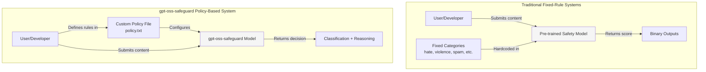
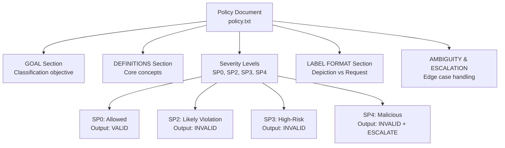
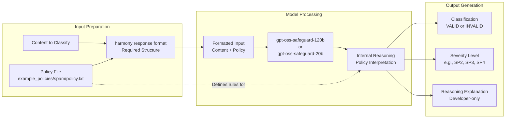
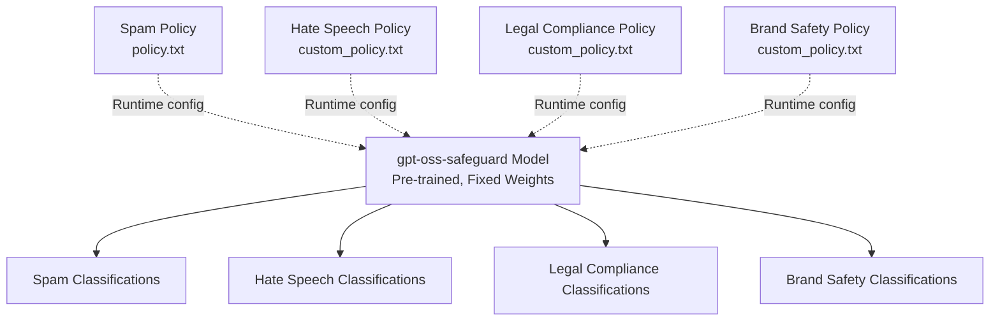
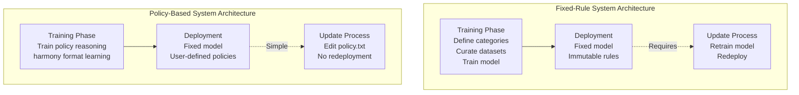

<!-- source: DeepWiki mcp.deepwiki.com · repo openai/gpt-oss-safeguard · page 4.3 Policy-Based Classification · fetched 2026-10-26 -->

# Policy-Based Classification

<details>
<summary>Relevant source files</summary>

The following files were used as context for generating this wiki page:

- [README.md](README.md)
- [example_policies/spam/policy.txt](example_policies/spam/policy.txt)

</details>


## Purpose and Scope

This document explains the policy-based classification approach used by gpt-oss-safeguard models, where users define custom safety policies that control how content is classified. This page covers the "bring your own policy" paradigm, how policies define classification behavior, and the architectural differences from fixed-rule safety systems.

For detailed policy file structure and syntax, see [Policy File Structure](#5.1). For step-by-step instructions on creating policies, see [Creating Custom Policies](#5.5). For a concrete example, see [Example: Spam Detection Policy](#6).

---

## Overview

Policy-based classification is the architectural approach where **users define the classification rules** rather than using pre-built, fixed safety filters. In gpt-oss-safeguard, policies are natural language documents that specify:

- **What to classify** (GOAL statements)
- **Core definitions** of prohibited or allowed content types
- **Severity taxonomies** with specific thresholds
- **Output mappings** (VALID vs INVALID)
- **Ambiguity handling** rules

The models are trained to interpret these policies through the [harmony response format](#4.2) and apply them to classify content with reasoned explanations.

**Sources:** [README.md:24-26](), [example_policies/spam/policy.txt:1-3]()

---

## The "Bring Your Own Policy" Paradigm

### Architectural Distinction

Unlike traditional safety systems that provide fixed classification categories (e.g., "hate speech," "violence," "spam"), gpt-oss-safeguard implements a **policy-as-configuration** architecture:



**Key Differences:**

| Aspect | Fixed-Rule Systems | Policy-Based (gpt-oss-safeguard) |
|--------|-------------------|----------------------------------|
| **Classification Rules** | Hardcoded during training | User-defined in policy files |
| **Customization** | Limited to threshold tuning | Full control over definitions, severity levels, outputs |
| **Domain Adaptation** | Requires model retraining | Update policy text |
| **Reasoning Transparency** | Opaque scoring | Explicit reasoning against policy |
| **Multi-domain Support** | Single fixed taxonomy | Unlimited custom taxonomies |

**Sources:** [README.md:25](), [example_policies/spam/policy.txt:1-107]()

---

## Policy Components

A policy document consists of structured sections that define classification behavior. The spam policy example demonstrates the standard structure:



### GOAL Section

Defines the classification objective and output format. The model uses this to understand what decision to make.

**Example from spam policy:**
```
GOAL: Identify spam. Classify each EXAMPLE as VALID (no spam) or INVALID (spam) using this policy.
```

**Sources:** [example_policies/spam/policy.txt:2]()

### DEFINITIONS Section

Establishes the vocabulary and conceptual boundaries for classification. Definitions provide the semantic foundation the model reasons against.

**Example from spam policy:**
```
Spam: unsolicited, repetitive, deceptive, or low-value promotional content.
Bulk Messaging: Same or similar messages sent repeatedly.
Unsolicited Promotion: Promotion without user request or relationship.
```

**Sources:** [example_policies/spam/policy.txt:4-17]()

### Severity Taxonomy

Graduated levels that map content characteristics to outputs. Each level includes:
- Characteristic description
- Concrete examples
- Output decision (VALID/INVALID)
- Optional escalation triggers

**Sources:** [example_policies/spam/policy.txt:19-79]()

### Label Format

Specifies how to structure classification outputs. The spam policy uses a dual-label system to distinguish between content that depicts violations versus requests to generate violations.

**Sources:** [example_policies/spam/policy.txt:82-93]()

### Ambiguity & Escalation Rules

Guidance for handling uncertain cases and cross-policy interactions.

**Sources:** [example_policies/spam/policy.txt:96-107]()

---

## Policy-Driven Classification Flow

The following diagram shows how policy files integrate with model inference to produce classifications:



### Classification Process

1. **Policy Loading**: The policy text is included in the prompt to the model
2. **Content Formatting**: Input content is structured according to the [harmony response format](#4.2)
3. **Model Reasoning**: The model interprets the policy and evaluates content against it
4. **Decision Generation**: The model outputs a classification (VALID/INVALID) with severity level
5. **Reasoning Export**: The model provides the reasoning chain used to reach the decision

**Key Insight**: The policy acts as a **runtime configuration** that modifies model behavior without retraining.

**Sources:** [README.md:20-26](), [README.md:32]()

---

## Flexibility and Customization

### What Policies Control

Policy-based classification provides control over multiple dimensions:

| Dimension | Customization Method | Example from Spam Policy |
|-----------|---------------------|-------------------------|
| **Classification Domain** | Change GOAL and DEFINITIONS | "Identify spam" vs "Identify harassment" |
| **Severity Granularity** | Define number and types of levels | SP0, SP2, SP3, SP4 (no SP1) |
| **Decision Thresholds** | Set characteristics for each level | SP2: "Unsolicited promotion without deception" |
| **Output Behavior** | Map levels to VALID/INVALID/ESCALATE | SP4 triggers INVALID + ESCALATE |
| **Edge Case Handling** | AMBIGUITY rules | "If unclear → downgrade severity by 1" |
| **Multi-faceted Labels** | LABEL FORMAT structure | Depiction (D-SP#) vs Request (R-SP#) |

**Sources:** [example_policies/spam/policy.txt:1-107]()

### Domain Adaptation Without Retraining

Because policies are text-based configurations, adapting to new domains requires only authoring new policy files:



This architectural pattern enables:
- **Rapid iteration**: Test policy changes in minutes, not days
- **Domain portability**: Same model for spam, toxicity, brand safety, etc.
- **Localization**: Create region-specific policies with local context
- **A/B testing**: Compare policy variants without model changes

**Sources:** [README.md:25]()

---

## Comparison: Policy-Based vs Fixed-Rule Systems

### Architectural Trade-offs



### Operational Characteristics

| Characteristic | Fixed-Rule Systems | Policy-Based (gpt-oss-safeguard) |
|----------------|-------------------|----------------------------------|
| **Initial Setup Complexity** | Low (pre-configured) | Medium (must write policy) |
| **Customization Flexibility** | Low (threshold tuning only) | High (full rule control) |
| **Adaptation Speed** | Weeks-months (retraining) | Minutes-hours (policy edit) |
| **Transparency** | Black-box scores | Reasoned explanations against policy |
| **Consistency** | Fixed taxonomy | User-controlled taxonomy |
| **Deployment Weight** | Model size only | Model + policy text |
| **Version Control** | Model checkpoints | Policy files (standard text) |

### Use Case Alignment

**Fixed-Rule Systems are optimal for:**
- Standardized, industry-wide taxonomies (e.g., CSAM detection)
- High-volume, low-customization scenarios
- Regulatory compliance requiring audited fixed models

**Policy-Based Systems (gpt-oss-safeguard) are optimal for:**
- Custom safety requirements unique to your platform
- Rapidly evolving policy needs (e.g., emerging harms)
- Multi-domain deployments with distinct rules per domain
- Scenarios requiring explainable decisions
- Organizations with legal/safety teams that need policy control

**Sources:** [README.md:24-28](), [example_policies/spam/policy.txt:1-107]()

---

## Integration with Safety Reasoning

Policy-based classification is enabled by the model's training to perform **safety reasoning** rather than pattern matching. The model:

1. **Interprets** policy text as instructions
2. **Evaluates** content against policy definitions
3. **Applies** severity taxonomies
4. **Generates** reasoned explanations

This is documented in detail in [Safety Reasoning Models](#4.1).

The policy must be provided in the [harmony response format](#4.2) for the model to correctly interpret it. The reasoning effort can be tuned using [Configurable Reasoning Effort](#4.4).

**Sources:** [README.md:24-27]()

---

## Summary

Policy-based classification in gpt-oss-safeguard represents an architectural shift from **model-as-solution** to **model-as-platform**:

- **Users define safety rules** through natural language policy files
- **Models interpret and apply** policies at inference time
- **No retraining required** for new domains or rule changes
- **Transparent reasoning** shows how decisions relate to policy
- **Flexible taxonomies** support any classification schema

This approach trades some initial complexity (must write policies) for operational flexibility (rapid adaptation without retraining). It is particularly well-suited for organizations with bespoke safety requirements or rapidly evolving trust and safety needs.

For practical guidance on creating policies, continue to [Working with Policies](#5) and [Example: Spam Detection Policy](#6).

**Sources:** [README.md:1-46](), [example_policies/spam/policy.txt:1-107]()

---

