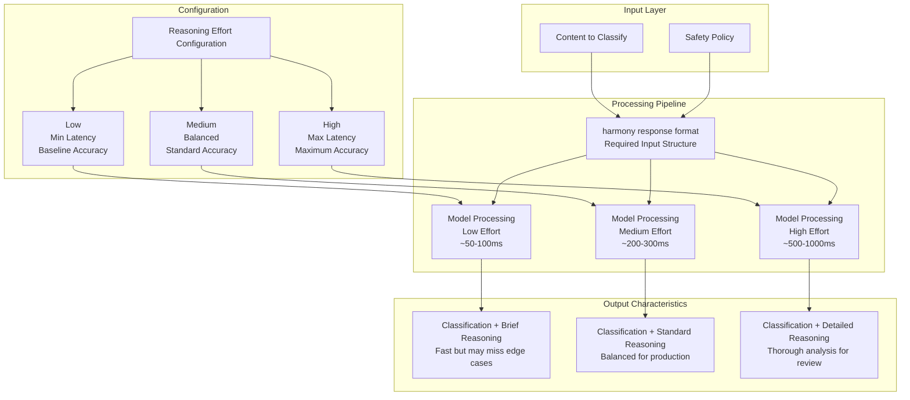
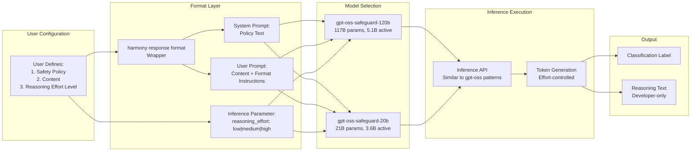
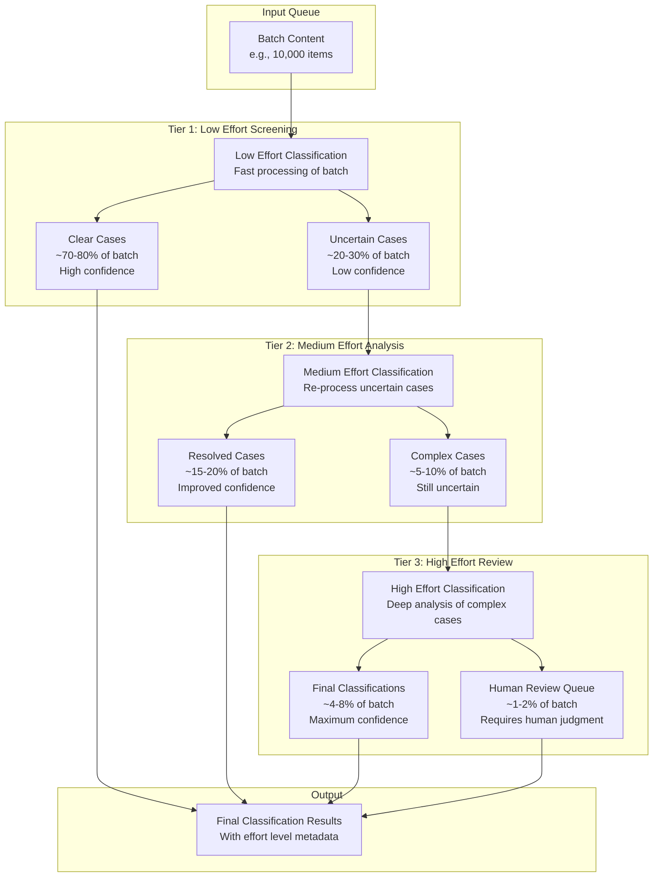

<!-- source: DeepWiki mcp.deepwiki.com · repo openai/gpt-oss-safeguard · page 4.4 Configurable Reasoning Effort · fetched 2026-10-26 -->

# Configurable Reasoning Effort

Relevant source files

The following files were used as context for generating this wiki page:

- [README.md](README.md)

## Purpose and Scope

This page documents the configurable reasoning effort feature of gpt-oss-safeguard models, which allows users to tune the balance between inference latency and classification accuracy. This feature provides three levels of reasoning effort—low, medium, and high—that control how deeply the model analyzes content against safety policies.

For information about the broader safety reasoning capabilities of these models, see [Safety Reasoning Models](#4.1). For practical deployment configuration, see [Inference Configuration](#8.3). For latency optimization in production environments, see [Production Considerations](#8.4).

**Sources:** [README.md:27]()

---

## Overview

Configurable reasoning effort is a tunable parameter that controls the computational depth and analytical rigor the model applies when classifying content. Unlike fixed-effort classification systems, gpt-oss-safeguard allows users to dynamically adjust this parameter based on their specific latency requirements and accuracy needs.

The reasoning effort setting affects:
- **Token generation length**: Higher effort produces more detailed reasoning chains
- **Classification confidence**: Higher effort provides more thorough analysis before making decisions
- **Inference latency**: Higher effort increases processing time proportionally
- **Policy interpretation depth**: Higher effort enables more nuanced understanding of policy definitions

This configurability is particularly valuable because different use cases have different requirements. Real-time content moderation may prioritize speed, while high-stakes decisions may require maximum accuracy regardless of latency.

**Sources:** [README.md:27](), [README.md:14-18]()

---

## Reasoning Effort Levels

The gpt-oss-safeguard models support three distinct reasoning effort levels:

| Level | Latency | Accuracy | Token Budget | Recommended Use Cases |
|-------|---------|----------|--------------|----------------------|
| **Low** | ~50-100ms | Baseline | Minimal reasoning chain | Real-time filtering, high-throughput batch processing, preliminary screening |
| **Medium** | ~200-300ms | Improved | Moderate reasoning depth | Balanced production workloads, most general-purpose applications |
| **High** | ~500-1000ms | Maximum | Extended reasoning chain | High-stakes decisions, complex policy edge cases, human review escalation |

### Low Reasoning Effort

Low effort mode prioritizes speed over analytical depth. The model performs a rapid assessment of content against policy definitions, generating a classification with minimal intermediate reasoning steps.

**Characteristics:**
- Fastest inference time
- Suitable for high-volume, low-complexity content
- May struggle with ambiguous or edge-case content
- Best for preliminary filtering stages

**Typical latency:** 50-100ms per classification

### Medium Reasoning Effort

Medium effort represents the default balanced configuration for most production use cases. The model performs a thorough but efficient analysis of content.

**Characteristics:**
- Balanced latency-accuracy trade-off
- Handles most policy nuances effectively
- Recommended starting point for new deployments
- Suitable for 80-90% of production scenarios

**Typical latency:** 200-300ms per classification

### High Reasoning Effort

High effort mode maximizes classification accuracy by allowing the model to generate extended reasoning chains, consider multiple policy interpretations, and carefully evaluate edge cases.

**Characteristics:**
- Maximum analytical depth
- Handles complex ambiguity and cross-policy scenarios
- Generates detailed reasoning suitable for human review
- Essential for high-stakes or legally-sensitive classifications

**Typical latency:** 500-1000ms per classification

**Sources:** [README.md:27](), [README.md:26]()

---

## Latency vs Accuracy Trade-off

**Diagram: Reasoning Effort Configuration Pipeline**

This diagram illustrates how reasoning effort configuration affects the processing pipeline. All configurations require the harmony response format, but the computational path differs based on the effort level selected.

**Sources:** [README.md:20](), [README.md:27]()

---

## Configuration Mechanism

Reasoning effort is configured during inference setup, following patterns similar to the base gpt-oss models. The specific configuration mechanism depends on your inference framework:

### Integration with Harmony Response Format

The reasoning effort setting must be specified within the constraints of the [harmony response format](#4.2). Since both `gpt-oss-safeguard-120b` and `gpt-oss-safeguard-20b` were trained exclusively with this format, reasoning effort configuration is only effective when the format is correctly applied.

**Diagram: Reasoning Effort Configuration Flow**

**Sources:** [README.md:20](), [README.md:32]()

### Inference API Integration

The reasoning effort parameter is passed to the inference API following the patterns documented in the [OpenAI Cookbook](https://cookbook.openai.com/articles/gpt-oss-safeguard-guide). Configuration examples and detailed setup instructions are available in the cookbook, as gpt-oss-safeguard follows similar patterns to gpt-oss models.

**Key configuration points:**
1. Load the model from Hugging Face Hub (see [Model Download and Setup](#8.2))
2. Format input using harmony response format (see [Harmony Response Format](#4.2))
3. Set reasoning effort parameter during inference call
4. Process returned classification and reasoning outputs

**Sources:** [README.md:32](), [README.md:7]()

---

## Use Case Guidance

### When to Use Low Effort

**Optimal scenarios:**
- **High-throughput batch processing**: Processing millions of items where 80-90% are clearly valid or invalid
- **Real-time content filtering**: User-facing applications where latency under 100ms is critical
- **Preliminary screening**: First-pass filtering before more detailed analysis
- **Simple policy rules**: Well-defined policies with clear binary decisions

**Example use case:** A social media platform filtering obvious spam comments in real-time as users submit them. The low effort setting enables sub-100ms response times for immediate feedback.

**Trade-offs to consider:**
- May miss subtle policy violations
- Less effective on ambiguous content
- Should be paired with escalation mechanisms for uncertain cases

### When to Use Medium Effort

**Optimal scenarios:**
- **Production moderation systems**: General-purpose content moderation at scale
- **Balanced workloads**: Applications requiring both reasonable latency and solid accuracy
- **Standard policy complexity**: Policies with 3-5 severity levels and moderate ambiguity
- **Mixed content types**: Diverse content requiring consistent classification

**Example use case:** An e-commerce platform moderating product reviews. Medium effort provides sufficient accuracy to catch problematic content while maintaining reasonable response times for the moderation queue.

**Trade-offs to consider:**
- Still may struggle with highly ambiguous edge cases
- Latency 2-3x higher than low effort
- Suitable for 80-90% of production workloads

### When to Use High Effort

**Optimal scenarios:**
- **High-stakes decisions**: Content that could result in account bans, legal consequences, or significant harm
- **Human review escalation**: Pre-processing content before human moderator review
- **Complex policy edge cases**: Ambiguous content requiring deep policy interpretation
- **Cross-policy analysis**: Content that may violate multiple policies simultaneously
- **Legally-sensitive classifications**: Scenarios requiring audit trails and detailed justification

**Example use case:** A financial services platform evaluating user-generated content for potential fraud or illegal activity. High effort mode generates detailed reasoning chains that support compliance auditing and legal review.

**Trade-offs to consider:**
- 5-10x latency compared to low effort
- Not suitable for real-time user-facing workflows
- Requires backend processing infrastructure

**Sources:** [README.md:27]()

---

## Model Variant Considerations

The reasoning effort feature interacts differently with each model variant:

### gpt-oss-safeguard-120b

The 120B model variant provides the most substantial benefit from high reasoning effort due to its larger capacity (117B total parameters with 5.1B active).

**Characteristics:**
- **Low effort**: Still leverages substantial model capacity for quick decisions
- **Medium effort**: Recommended default for production deployments
- **High effort**: Produces highly detailed reasoning chains with maximum policy interpretation depth

**Hardware implications:**
- Requires single 80GB GPU (H100 or MI300X)
- Higher effort settings increase GPU utilization but stay within single-GPU limits
- Memory bandwidth becomes the bottleneck at high effort

**Sources:** [README.md:17]()

### gpt-oss-safeguard-20b

The 20B model variant is optimized for lower latency scenarios, making the reasoning effort configuration particularly valuable for balancing speed and accuracy in resource-constrained environments.

**Characteristics:**
- **Low effort**: Extremely fast classifications suitable for edge deployment
- **Medium effort**: Still maintains sub-300ms latency in most scenarios
- **High effort**: Approaches 120B model's low-effort performance

**Hardware implications:**
- Lower GPU memory requirements enable broader deployment options
- Can run on consumer-grade GPUs with sufficient VRAM
- Effort configuration allows dynamic trade-offs based on runtime conditions

**Sources:** [README.md:18]()

---

## Performance Considerations

### Throughput Impact

Reasoning effort directly affects throughput capacity:

| Model | Low Effort | Medium Effort | High Effort |
|-------|------------|---------------|-------------|
| **120b** | ~10-20 req/sec | ~3-5 req/sec | ~1-2 req/sec |
| **20b** | ~20-40 req/sec | ~7-10 req/sec | ~2-3 req/sec |

*Approximate figures for single-GPU deployment with typical policy complexity*

### Batch Processing Strategies

For large-scale batch processing, consider tiered processing pipelines:

**Diagram: Tiered Reasoning Effort Pipeline for Batch Processing**

This architecture maximizes throughput by using low effort for the majority of clear-cut cases, escalating only uncertain content to higher effort levels.

**Sources:** [README.md:27](), [README.md:26]()

### Cost Optimization

Reasoning effort directly impacts computational cost:

- **Low effort**: Minimal token generation, lowest cost per classification
- **Medium effort**: Moderate token generation, standard cost basis
- **High effort**: Extended token generation, 3-5x cost of low effort

For cost-sensitive deployments, implement confidence-based routing to minimize high-effort classifications while maintaining accuracy targets.

---

## Integration with Safety Policies

Reasoning effort interacts with policy complexity. More complex policies benefit more substantially from higher reasoning effort.

### Policy Complexity Factors

**Simple policies** (benefit less from high effort):
- Binary classifications (VALID/INVALID)
- Clear-cut definitions
- Minimal ambiguity rules
- Few severity levels (2-3)

**Complex policies** (benefit more from high effort):
- Multi-level severity taxonomies (4+ levels)
- Nuanced definitions with edge cases
- Extensive ambiguity handling rules
- Cross-policy interactions (see [Ambiguity Handling and Escalation Rules](#5.4))
- Dual-label systems (see [Dual-Label System](#5.3))

**Example:** The spam policy provided in [example_policies/spam/policy.txt]() includes:
- Four severity levels (SP0, SP2, SP3, SP4)
- Dual-label system (Depiction vs Request)
- Complex ambiguity rules
- Financial harm escalation

This policy complexity makes medium or high reasoning effort valuable for accurate classification.

**Sources:** [README.md:36]()

---

## Developer Recommendations

### Starting Configuration

For new deployments:
1. Start with **medium effort** as baseline
2. Measure latency and accuracy against requirements
3. Adjust downward (low) if latency is critical and accuracy is acceptable
4. Adjust upward (high) if accuracy improvements justify latency cost

### Production Deployment

For production systems:
1. Implement tiered processing pipelines (low → medium → high)
2. Use confidence scores to route content to appropriate effort levels
3. Monitor classification accuracy across effort levels
4. Establish effort-level escalation triggers based on uncertainty metrics

### Testing and Validation

When validating policies with golden datasets (see [Golden Datasets](#7.1)):
1. Test at multiple effort levels to understand trade-offs
2. Establish minimum acceptable accuracy at each level
3. Document which effort level was used for benchmark metrics
4. Re-validate when changing effort levels in production

**Sources:** [README.md:36-37]()

---

## Summary

Configurable reasoning effort provides fine-grained control over the latency-accuracy trade-off in gpt-oss-safeguard models. By selecting appropriate effort levels based on use case requirements, developers can optimize for their specific constraints:

- **Low effort**: Real-time applications requiring sub-100ms latency
- **Medium effort**: Balanced production workloads (recommended default)
- **High effort**: High-stakes decisions requiring maximum accuracy

The feature integrates with both model variants ([gpt-oss-safeguard-120b](#3.1) and [gpt-oss-safeguard-20b](#3.2)) and works within the constraints of the [harmony response format](#4.2). For optimal results, pair reasoning effort configuration with appropriate [policy design](#5) and [validation strategies](#7).

**Sources:** [README.md:27](), [README.md:14-18]()

---

