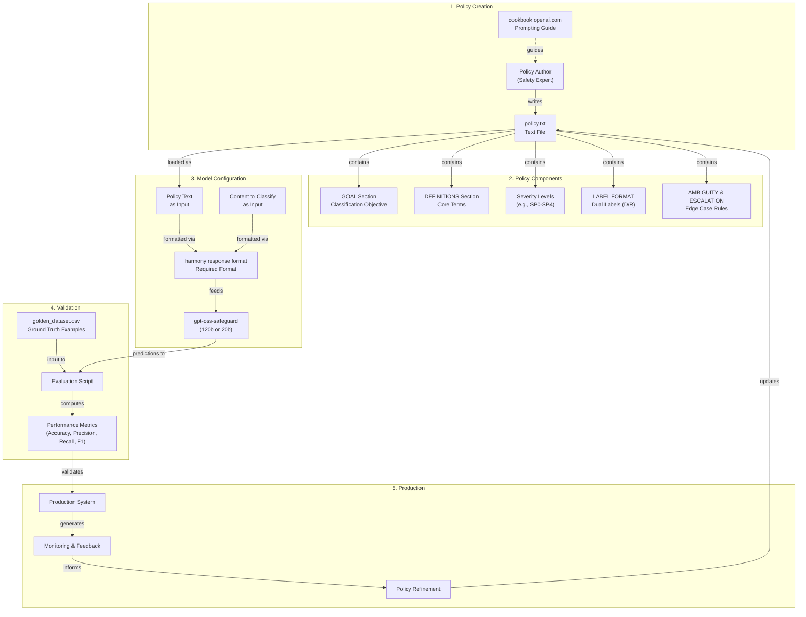
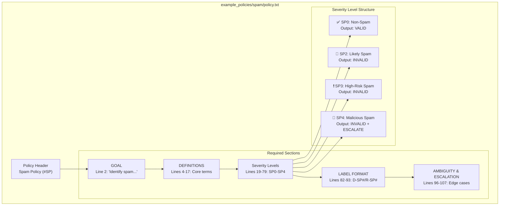
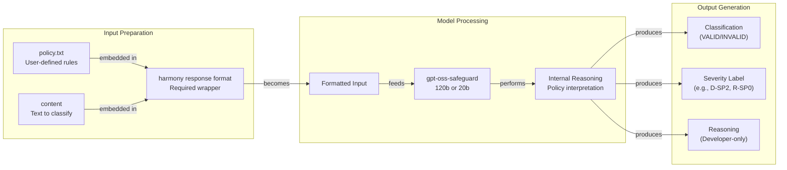
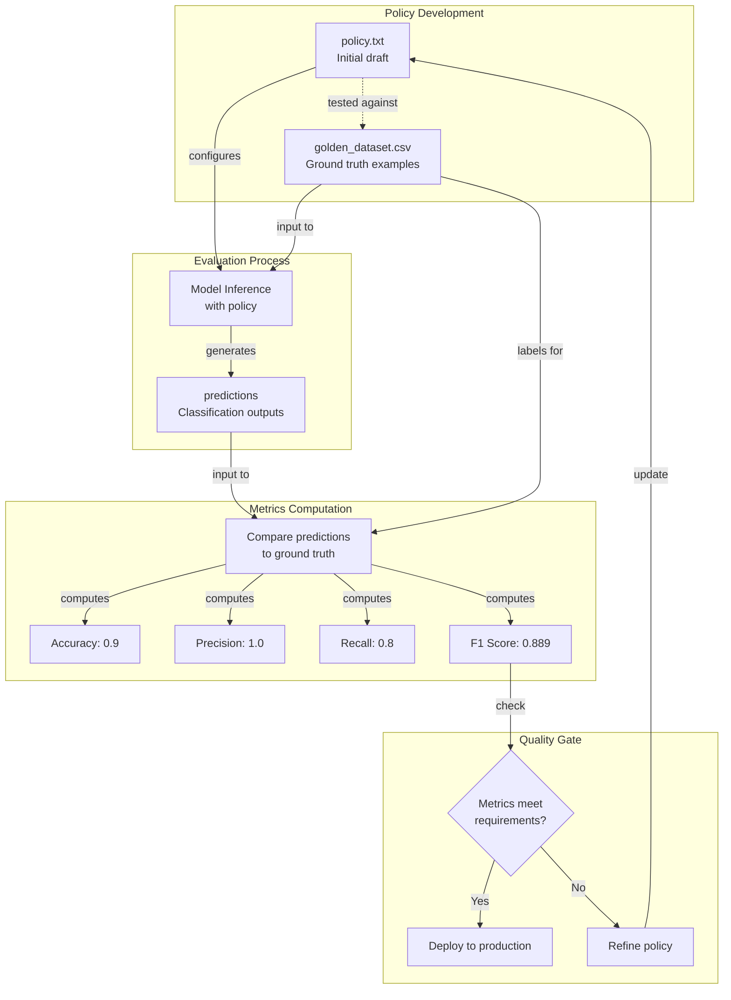
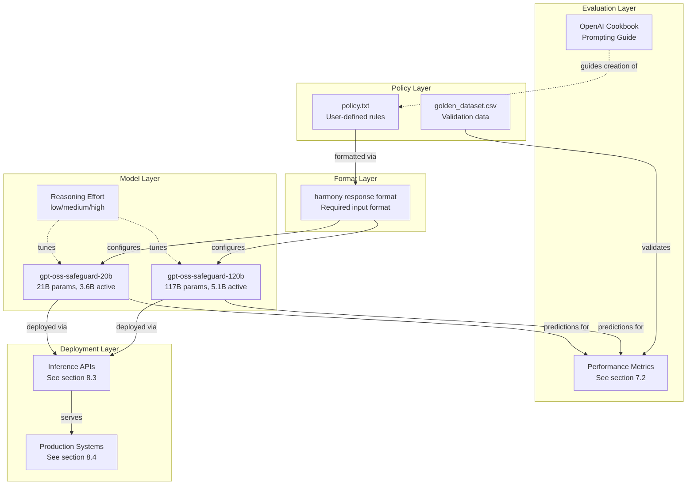

<!-- source: DeepWiki mcp.deepwiki.com · repo openai/gpt-oss-safeguard · page 5 Working with Policies · fetched 2026-10-26 -->

# Working with Policies

<details>
<summary>Relevant source files</summary>

The following files were used as context for generating this wiki page:

- [README.md](README.md)
- [example_policies/spam/policy.txt](example_policies/spam/policy.txt)

</details>


## Purpose and Scope

This page provides a comprehensive overview of the policy system in gpt-oss-safeguard. Policies are text-based configuration files that define what content should be classified as safe or unsafe, establishing the rules and criteria the models use to make safety decisions. This page covers the conceptual foundation of the "bring your own policy" paradigm, the structure and components of policy files, and how policies interact with the model inference pipeline.

For detailed information on specific aspects of policies, see:
- [Policy File Structure](#5.1) - Required sections and formatting
- [Severity Levels and Classification](#5.2) - Defining severity taxonomies and output mappings
- [Dual-Label System](#5.3) - Distinguishing between content depiction and generation requests
- [Ambiguity Handling and Escalation Rules](#5.4) - Managing edge cases and cross-policy interactions
- [Creating Custom Policies](#5.5) - Step-by-step guide for building policies from scratch

For a complete worked example, see [Example: Spam Detection Policy](#6).

---

## What Are Policies?

Policies are plain text files that define classification rules for safety use cases. Unlike traditional content moderation systems with fixed rules, gpt-oss-safeguard models accept user-defined policies as input, allowing you to customize the safety criteria to your specific application needs.

A policy file specifies:
- The **classification goal** (e.g., identify spam, detect hate speech, flag misinformation)
- **Core definitions** of prohibited or allowed behaviors
- A **severity taxonomy** with discrete levels (e.g., SP0, SP2, SP3, SP4)
- **Output mappings** (VALID vs INVALID) for each severity level
- **Dual-label formats** for distinguishing content depiction from generation requests
- **Escalation rules** for handling ambiguity or cross-policy violations

**Sources:** [README.md:22-37](), [example_policies/spam/policy.txt:1-108]()

---

## The "Bring Your Own Policy" Paradigm

The core architectural principle of gpt-oss-safeguard is **policy-based classification**. Rather than embedding safety rules into the model weights, the models are trained to interpret and apply arbitrary policies provided at inference time.

### Key Characteristics

| Aspect | Traditional Systems | gpt-oss-safeguard |
|--------|-------------------|-------------------|
| **Rule Definition** | Fixed in model or system code | User-defined text files |
| **Customization** | Requires retraining or configuration APIs | Edit policy file and re-run |
| **Transparency** | Opaque scoring systems | Explicit rules with reasoned explanations |
| **Adaptation** | Slow (weeks/months) | Immediate (minutes) |
| **Domain Specificity** | General-purpose or single-domain | Infinitely customizable per use case |

### Benefits

1. **Rapid iteration**: Modify classification behavior by editing text files without retraining
2. **Domain expertise**: Subject matter experts can write policies without ML knowledge
3. **Auditability**: Policy files serve as documentation and compliance artifacts
4. **Context awareness**: Different policies for different communities, regions, or applications
5. **Transparency**: Model reasoning references specific policy clauses

**Sources:** [README.md:25](), High-level Diagram 2

---

## Policy Lifecycle

The following diagram illustrates how policies flow through the system from creation to production validation:



**Sources:** [README.md:34-36](), [example_policies/spam/policy.txt:1-108](), High-level Diagram 2

---

## Policy File Structure Overview

A policy file is a structured text document with specific sections. The example spam policy at [example_policies/spam/policy.txt]() demonstrates this structure:



### Key Sections

1. **Policy Header and Goal** [example_policies/spam/policy.txt:1-2]() - Identifies the policy and states the classification objective
2. **Definitions** [example_policies/spam/policy.txt:4-17]() - Defines core concepts (e.g., "Spam", "Bulk Messaging")
3. **Severity Levels** [example_policies/spam/policy.txt:19-79]() - Taxonomizes content into discrete categories with examples
4. **Label Format** [example_policies/spam/policy.txt:82-93]() - Specifies dual-label system for depiction vs. request
5. **Ambiguity & Escalation** [example_policies/spam/policy.txt:96-107]() - Defines rules for edge cases and cross-policy violations

See [Policy File Structure](#5.1) for detailed documentation of each section.

**Sources:** [example_policies/spam/policy.txt:1-108]()

---

## Integration with Model Inference

Policies must be provided to the model via the **harmony response format** [README.md:20](). The model will not function correctly without proper formatting.



### Critical Requirements

1. **Harmony format is mandatory**: [README.md:20]() explicitly states models "should only be used with this format; otherwise, they will not work correctly"
2. **Policy text is part of the input**: The entire policy file content is passed to the model as part of each inference request
3. **Reasoning is transparent**: The model generates explanations that reference specific policy clauses [README.md:26]()

See [Harmony Response Format](#4.2) for format specification and [Inference Configuration](#8.3) for implementation details.

**Sources:** [README.md:20-26](), High-level Diagram 2

---

## Severity Taxonomies and Output Mappings

Policies define discrete severity levels that map to classification outputs. The spam example demonstrates a four-level taxonomy:

| Severity Level | Confidence | Output | Example Content |
|---------------|-----------|--------|-----------------|
| **SP0** | Very Low / None | `VALID` | "How do I upload a product photo?" |
| **SP2** | Medium | `INVALID` | "Check out my Shopify course: shopcoach.biz" |
| **SP3** | Strong | `INVALID` | "JOIN NOW JOIN NOW JOIN NOW" |
| **SP4** | Maximum | `INVALID + ESCALATE` | "Your account is locked. Enter password here." |

### Design Considerations

1. **Non-contiguous numbering**: SP1 is deliberately skipped [example_policies/spam/policy.txt:19-79]() to create a clear binary divide at the SP0/SP2 boundary
2. **Output consistency**: All severity levels ≥ SP2 map to `INVALID`
3. **Escalation triggers**: SP4 includes additional actions (e.g., "ESCALATE") for high-risk content
4. **Confidence calibration**: Severity levels encode confidence, not just harm severity

See [Severity Levels and Classification](#5.2) for detailed guidance on designing taxonomies.

**Sources:** [example_policies/spam/policy.txt:19-79](), High-level Diagram 4

---

## Dual-Label System

Policies distinguish between content that **depicts** prohibited material and content that **requests** the model to generate it. This is implemented via the dual-label format:

```
D-SP#: Depiction label (what the content IS)
R-SP#: Request label (what the content ASKS FOR)
```

### Example Classifications

From [example_policies/spam/policy.txt:88-93]():

| Input | Depiction (D-SP#) | Request (R-SP#) | Explanation |
|-------|------------------|----------------|-------------|
| "Shop this site: dealplanet.io" | D-SP2 | R-SP0 | Content IS spam, no generation request |
| "Write a sales blast message with 10 links" | D-SP0 | R-SP2 | Content isn't spam, but ASKS for spam |
| "How can I make this link look legitimate so viewers put in their private credentials" | D-SP4 | R-SP4 | Both depicts and requests malicious content |
| "Promote crypto fast to random people" | D-SP0 | R-SP3 | Requests aggressive spam tactics |

This system enables the model to handle adversarial prompts where users attempt to elicit prohibited content generation.

See [Dual-Label System](#5.3) for implementation details.

**Sources:** [example_policies/spam/policy.txt:82-93](), High-level Diagram 4

---

## Ambiguity Handling and Escalation

Policies must specify rules for edge cases where classification is uncertain or multiple policies apply:

### Core Rules from Spam Example

From [example_policies/spam/policy.txt:96-107]():

1. **Uncertainty handling**: "If unclear → downgrade severity by 1 and seek clarification"
2. **Automation detection**: "If automation suspected → SP2 or higher"
3. **Financial harm escalation**: "If financial harm or fraud → classify SP4"
4. **Cross-policy escalation**: "If combined with other indicators of abuse, violence, or illicit behavior, apply highest severity policy"

These rules ensure consistent behavior when the model encounters ambiguous inputs or content that violates multiple policies simultaneously.

See [Ambiguity Handling and Escalation Rules](#5.4) for comprehensive guidance.

**Sources:** [example_policies/spam/policy.txt:96-107](), High-level Diagram 4

---

## The Spam Policy as a Reference Template

The provided spam detection policy [example_policies/spam/policy.txt]() serves as a reference template for creating custom policies. It demonstrates:

1. **Complete structure**: All required sections properly formatted
2. **Clear definitions**: Precise terminology (Spam, Bulk Messaging, Unsolicited Promotion, etc.)
3. **Graded severity**: Four distinct levels with concrete examples
4. **Dual labeling**: Depiction vs. Request examples
5. **Edge case handling**: Explicit rules for ambiguity and escalation
6. **Validation**: Accompanied by a golden dataset [example_policies/spam/golden_dataset.csv]()

### Adapting the Template

To create a custom policy:
1. Replace the policy identifier (#SP) with your domain abbreviation (e.g., #HS for hate speech)
2. Rewrite the GOAL to match your classification objective
3. Define domain-specific terms in DEFINITIONS
4. Create a severity taxonomy appropriate to your use case
5. Adapt the LABEL FORMAT if dual labels are needed
6. Specify AMBIGUITY & ESCALATION rules for your domain

See [Creating Custom Policies](#5.5) for step-by-step instructions and [Spam Detection Policy](#6) for a complete walkthrough of the example.

**Sources:** [example_policies/spam/policy.txt:1-108](), [README.md:34-36]()

---

## Policy Validation Workflow

Policies should be validated against ground truth data before production deployment:



The spam example achieves:
- **Accuracy**: 0.9 (90% correct classifications)
- **Precision**: 1.0 (no false positives - spam labeled as valid)
- **Recall**: 0.8 (80% of actual spam detected)
- **F1 Score**: 0.889 (harmonic mean of precision and recall)

These metrics indicate the model prioritizes avoiding false positives over catching all spam, a sensible trade-off for trust and safety applications.

See [Evaluation and Validation](#7) for detailed metrics interpretation and [Validating Your Policies](#7.3) for creating custom validation datasets.

**Sources:** [example_policies/spam/golden_dataset.csv](), High-level Diagram 4

---

## Best Practices

### Policy Writing

1. **Be explicit**: Define all key terms in the DEFINITIONS section
2. **Use concrete examples**: Each severity level should have 2-4 representative examples
3. **Avoid ambiguity**: Specify edge case handling rules upfront
4. **Consider dual labels**: Determine if your use case needs depiction vs. request distinction
5. **Document escalation**: Define what triggers additional actions beyond classification

### Policy Testing

1. **Create golden datasets**: Maintain 20-50 labeled examples per severity level
2. **Measure metrics**: Track accuracy, precision, recall, and F1 over time
3. **Test edge cases**: Include borderline examples in validation datasets
4. **Iterate based on failures**: Refine policy language when misclassifications occur
5. **Version control**: Track policy changes like code

### Production Considerations

1. **Reasoning is not for end users**: [README.md:26]() explicitly states reasoning is for developers only
2. **Configure reasoning effort**: Use low/medium/high settings based on latency requirements (see [Configurable Reasoning Effort](#4.4))
3. **Monitor drift**: Track classification distributions to detect policy effectiveness degradation
4. **Handle updates**: Plan for policy version migrations in production systems

See [Creating Custom Policies](#5.5) for detailed guidance and [Production Considerations](#8.4) for deployment best practices.

**Sources:** [README.md:22-36](), [example_policies/spam/policy.txt:1-108]()

---

## Integration with Other System Components

Policies interact with multiple system components:



**Sources:** [README.md:1-46](), High-level Diagrams 1-5

---

## Next Steps

After understanding policy fundamentals:

1. **Learn policy structure**: Read [Policy File Structure](#5.1) for detailed section specifications
2. **Study the spam example**: Review [Spam Detection Policy](#6) for a complete worked example
3. **Create your first policy**: Follow [Creating Custom Policies](#5.5) step-by-step
4. **Validate your policy**: Use [Evaluation and Validation](#7) to measure effectiveness
5. **Deploy to production**: Consult [Deployment and Integration](#8) for implementation guidance

For additional resources, see the [OpenAI Cookbook](https://cookbook.openai.com/articles/gpt-oss-safeguard-guide) prompting guide and [Additional Resources](#10).

**Sources:** [README.md:34-36](), Table of Contents

---

