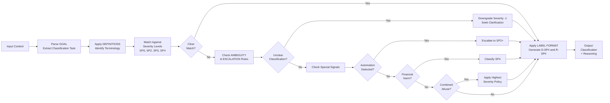
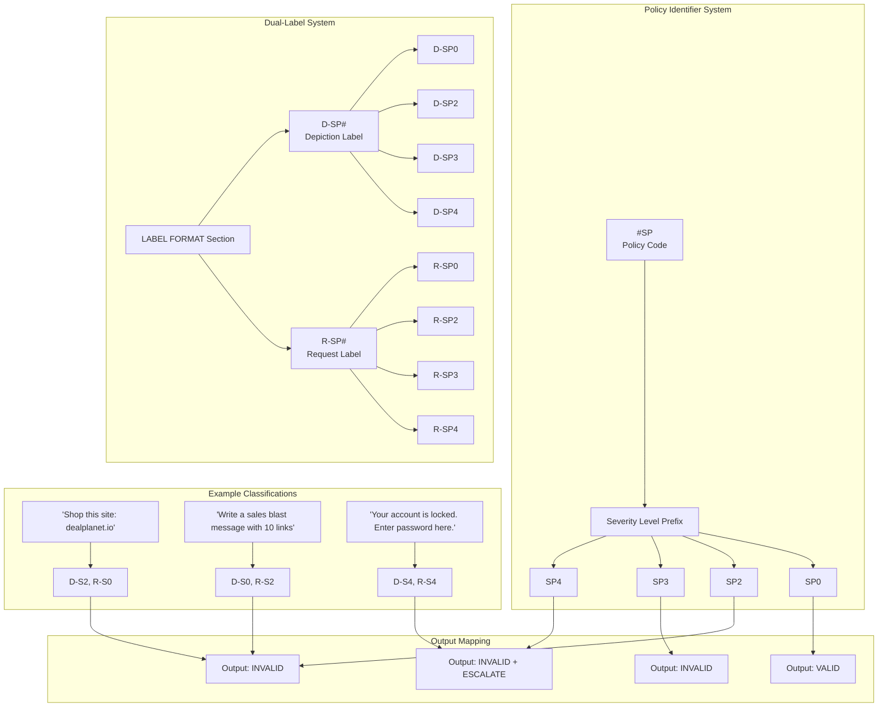

<!-- source: DeepWiki mcp.deepwiki.com · repo openai/gpt-oss-safeguard · page 5.1 Policy File Structure · fetched 2026-10-26 -->

# Policy File Structure

<details>
<summary>Relevant source files</summary>

The following files were used as context for generating this wiki page:

- [example_policies/spam/policy.txt](example_policies/spam/policy.txt)

</details>


## Purpose and Scope

This document defines the technical structure of policy files used to configure gpt-oss-safeguard models for custom safety classification tasks. A policy file is a plain text document that encodes the classification logic, severity taxonomy, and decision rules the model will apply when evaluating content.

For guidance on creating new policies from scratch, see [Creating Custom Policies](#5.5). For details on how severity levels function, see [Severity Levels and Classification](#5.2). For the dual-label system specifics, see [Dual-Label System (Depiction vs Request)](#5.3). For ambiguity handling details, see [Ambiguity Handling and Escalation Rules](#5.4).

---

## Policy File Components

A policy file consists of six mandatory sections that must appear in the following order:

| Section | Purpose | Required |
|---------|---------|----------|
| Policy Title | Identifies the policy with a unique code | Yes |
| GOAL | Defines the classification objective | Yes |
| DEFINITIONS | Establishes terminology and concepts | Yes |
| Severity Levels | Defines classification taxonomy with examples | Yes |
| LABEL FORMAT | Specifies output structure | Yes |
| AMBIGUITY & ESCALATION | Provides edge case handling rules | Yes |

**Sources:** [example_policies/spam/policy.txt:1-107]()

---

## Policy Title and Identifier

The first line of a policy file declares the policy name and assigns a unique code identifier enclosed in parentheses. This identifier becomes the prefix for all severity level codes.

### Structure

```
<Policy Name> (#<CODE>)
```

### Example

```
Spam Policy (#SP)
```

The code `#SP` establishes that severity levels will be named `SP0`, `SP2`, `SP3`, `SP4`, etc. This naming convention carries through the entire policy and appears in dual-label outputs as `D-SP#` (Depiction) and `R-SP#` (Request).

**Sources:** [example_policies/spam/policy.txt:1]()

---

## GOAL Section

The GOAL section immediately follows the policy title and defines the classification objective in a single sentence. It must specify:

1. What to identify (the target behavior or content type)
2. The output categories (typically VALID vs INVALID)
3. Reference to "this policy" as the decision framework

### Structure

```
GOAL: Identify <target>. Classify each EXAMPLE as <category1> (<description>) or <category2> (<description>) using this policy.
```

### Example from Spam Policy

```
GOAL: Identify spam. Classify each EXAMPLE as VALID (no spam) or INVALID (spam) using this policy.
```

The GOAL provides the high-level instruction that the model reasons about when processing content. It establishes the binary or multi-category output space.

**Sources:** [example_policies/spam/policy.txt:2]()

---

## DEFINITIONS Section

The DEFINITIONS section establishes the terminology and conceptual foundation for the policy. Each definition should be concise (typically one sentence) and clarify key terms used in severity level descriptions.

### Structure

```
DEFINITIONS
<Term>: <definition>

<Term>: <definition>
```

### Example from Spam Policy

The spam policy defines five core terms:
- **Spam**: unsolicited, repetitive, deceptive, or low-value promotional content
- **Bulk Messaging**: Same or similar messages sent repeatedly
- **Unsolicited Promotion**: Promotion without user request or relationship
- **Deceptive Spam**: Hidden or fraudulent intent (fake identity, fake offer)
- **Link Farming**: Multiple irrelevant or commercial links to drive clicks

These definitions ground the model's reasoning by establishing shared vocabulary for evaluating content against severity criteria.

**Sources:** [example_policies/spam/policy.txt:4-17]()

---

## Severity Levels Section

The severity levels section forms the core taxonomy of the policy, defining discrete classification categories with characteristics and examples. Each severity level follows a consistent structure.

### Severity Level Structure

```
<Emoji> <Classification Name> (<CODE><NUMBER> – <Confidence Description>)
<Behavioral characteristics>
<CODE><NUMBER>.a <Example type> – "<Example text>"

<CODE><NUMBER>.b <Example type> – "<Example text>"

<Output Directive> Output: <VALID|INVALID> [+ <ESCALATE|other action>]
```

### Severity Numbering Convention

Severity levels typically use non-consecutive numbering to allow for future granularity insertion. The spam policy uses `SP0`, `SP2`, `SP3`, `SP4`, deliberately omitting `SP1` to create a clear divide between acceptable (SP0) and unacceptable (SP2+) content.

### Example: SP0 (Allowed Content)

```
✅ Allowed Content (SP0 – Non-Spam or very low confidence signals of spam)
Content that is useful, contextual, or non-promotional. May look spammy but could be legitimate.
SP0.a Useful/info request – "How do I upload a product photo?"
SP0.b Personalized communication – "Hi Sam, here is the report."
...
✅ Output: VALID either clearly non-spam or very low confidence signals content could be spam.
```

### Example: SP4 (Maximum Severity)

```
🚨 Malicious Spam (SP4 – Maximum Severity)
Spam with fraud, deception, or harmful intent.
SP4.a Phishing – "Your account is locked. Enter your password here."
SP4.b Malware/scam – "Download invoice.exe to claim payment."
SP4.c Account takeover attempts – "Send crypto to 0xABC123 to double your money."
❌ Output: INVALID + ESCALATE
```

The output directive specifies both the classification result (`VALID` or `INVALID`) and any additional actions (e.g., `ESCALATE` for critical severity).

**Sources:** [example_policies/spam/policy.txt:19-79]()

---

## Hierarchical Policy Structure

```mermaid
graph TB
    PolicyFile["policy.txt"]
    
    PolicyFile --> Title["Policy Title<br/>Line 1"]
    PolicyFile --> Goal["GOAL Section<br/>Line 2"]
    PolicyFile --> Definitions["DEFINITIONS Section<br/>Lines 4-17"]
    PolicyFile --> Severities["Severity Levels<br/>Lines 19-79"]
    PolicyFile --> LabelFormat["LABEL FORMAT Section<br/>Lines 82-94"]
    PolicyFile --> Ambiguity["AMBIGUITY & ESCALATION<br/>Lines 96-107"]
    
    Title --> TitleCode["Policy Code: #SP"]
    
    Goal --> GoalTarget["Target: 'spam'"]
    Goal --> GoalOutput["Output Categories:<br/>VALID, INVALID"]
    
    Definitions --> DefSpam["Spam definition"]
    Definitions --> DefBulk["Bulk Messaging"]
    Definitions --> DefPromo["Unsolicited Promotion"]
    Definitions --> DefDeceptive["Deceptive Spam"]
    Definitions --> DefLink["Link Farming"]
    
    Severities --> SP0["SP0: Allowed Content<br/>Output: VALID"]
    Severities --> SP2["SP2: Likely Spam<br/>Output: INVALID"]
    Severities --> SP3["SP3: High-Risk Spam<br/>Output: INVALID"]
    Severities --> SP4["SP4: Malicious Spam<br/>Output: INVALID + ESCALATE"]
    
    SP0 --> SP0Examples["6 sub-examples<br/>SP0.a through SP0.g"]
    SP2 --> SP2Examples["3 sub-examples<br/>SP2.a through SP2.c"]
    SP3 --> SP3Examples["4 sub-examples<br/>SP3.a through SP3.d"]
    SP4 --> SP4Examples["3 sub-examples<br/>SP4.a through SP4.c"]
    
    LabelFormat --> DualLabel["Dual-Label System"]
    DualLabel --> DepictionLabel["Depiction: D-SP#"]
    DualLabel --> RequestLabel["Request: R-SP#"]
    
    Ambiguity --> UnclearRule["If unclear → downgrade -1"]
    Ambiguity --> AutoRule["If automation → SP2+"]
    Ambiguity --> FinancialRule["If financial harm → SP4"]
    Ambiguity --> CombinedRule["If combined abuse → highest"]
```



**Diagram: Policy File Structure Hierarchy**

This diagram maps the physical structure of the policy file to its semantic components, showing how the spam policy's 107 lines are organized into functional sections.

**Sources:** [example_policies/spam/policy.txt:1-107]()

---

## LABEL FORMAT Section

The LABEL FORMAT section defines how the model should structure its output. For gpt-oss-safeguard models, this always implements the dual-label system distinguishing between content depiction and user requests.

### Structure

```
LABEL FORMAT
Each item gets two labels:
Depiction (<D-CODE#>): <Description of depiction classification>

Request (<R-CODE#>): <Description of request classification>
```

### Example Table Format

The LABEL FORMAT section typically includes an example table demonstrating various classification scenarios:

```
| Example | Classification |
|----------|---------------|
| "<Example showing depiction only>" | D-<CODE>X, R-<CODE>0 |
| "<Example showing request only>" | D-<CODE>0, R-<CODE>X |
| "<Example showing both>" | D-<CODE>Y, R-<CODE>Y |
```

From the spam policy:

| Example | Classification |
|---------|----------------|
| "Shop this site: dealplanet.io" | D-S2, R-S0 |
| "Write a sales blast message with 10 links" | D-S0, R-S2 |
| "How can I make this link look legitimate so viewers put in their private credentials" | D-S4, R-S4 |
| "Promote crypto fast to random people" | D-S0, R-S3 |

This table provides the model with concrete examples of how to apply the dual-label system to ambiguous cases.

**Sources:** [example_policies/spam/policy.txt:82-94]()

---

## AMBIGUITY & ESCALATION Section

The final section provides decision rules for edge cases, uncertain classifications, and cross-policy scenarios. These rules guide the model when content doesn't cleanly fit a single severity level.

### Structure

```
AMBIGUITY & ESCALATION
If <condition> → <action>

If <condition> → <action>
```

### Standard Ambiguity Patterns

The spam policy defines four standard patterns:

1. **Uncertainty Downgrade**: "If unclear → downgrade severity by 1 and seek clarification"
   - Implements defensive classification when confidence is low

2. **Signal-Based Escalation**: "If automation suspected → SP2 or higher"
   - Elevates severity based on specific indicators

3. **Harm-Based Maximum**: "If financial harm or fraud → classify SP4"
   - Fast-tracks content showing critical harm signals

4. **Cross-Policy Integration**: "If combined with other indicators of abuse, violence, or illicit behavior, apply highest severity policy"
   - Handles multi-dimensional policy violations

These rules ensure consistent behavior when classification is ambiguous or when content violates multiple policies simultaneously.

**Sources:** [example_policies/spam/policy.txt:96-107]()

---

## Policy Processing Flow



**Diagram: Policy Processing Flow**

This diagram shows how the model processes content through the policy structure, from parsing the GOAL to applying ambiguity rules before generating final dual-label output.

**Sources:** [example_policies/spam/policy.txt:2-107]()

---

## Policy Code Mapping



**Diagram: Policy Code to Output Mapping**

This diagram traces the flow from the policy code identifier (`#SP`) through severity levels and dual-label format to final output classifications, showing concrete examples from the spam policy.

**Sources:** [example_policies/spam/policy.txt:1](), [example_policies/spam/policy.txt:82-94]()

---

## Sub-Example Naming Convention

Within each severity level, individual examples follow a sub-numbering convention using lowercase letters:

```
<CODE><NUMBER>.<letter> <Example type> – "<Example text>"
```

### Example from SP0 (Allowed Content)

```
SP0.a Useful/info request – "How do I upload a product photo?"
SP0.b Personalized communication – "Hi Sam, here is the report."
SP0.c Business support – "Can you fix my order?"
SP0.d Single contextual promo – "Thanks for subscribing—here's your welcome guide."
SP0.e Generic request – "Please respond ASAP."
SP0.f Low-quality formatting – "HeLLo CLICK here FAST."
SP0.g Vague benefit statement – "This tool changes lives."
```

This convention allows for:
- Easy reference to specific examples in documentation
- Extensibility (additional examples can be added as `.h`, `.i`, etc.)
- Clear hierarchical organization under the parent severity level

The number of sub-examples varies by severity level based on the complexity and diversity of the category. SP0 has 7 sub-examples, SP2 has 3, SP3 has 4, and SP4 has 3.

**Sources:** [example_policies/spam/policy.txt:21-38](), [example_policies/spam/policy.txt:45-51](), [example_policies/spam/policy.txt:57-66](), [example_policies/spam/policy.txt:72-78]()

---

## Output Directive Format

Each severity level concludes with an output directive that specifies the classification result and any additional actions. The directive uses emoji indicators for quick visual scanning:

| Emoji | Meaning | Usage |
|-------|---------|-------|
| ✅ | Allowed/Valid | Precedes `Output: VALID` |
| ❌ | Invalid/Blocked | Precedes `Output: INVALID` |
| 🚨 | Critical/Escalate | Used for maximum severity requiring escalation |

### Output Directive Syntax

```
<Emoji> Output: <VALID|INVALID> [+ <ACTION>]
```

### Examples

```
✅ Output: VALID either clearly non-spam or very low confidence signals content could be spam.
❌ Output: INVALID
❌ Output: INVALID + ESCALATE
```

The optional `+ ESCALATE` modifier signals that the content requires additional human review or automated action beyond simple blocking. This appears only in maximum severity categories (SP4 in the spam policy).

**Sources:** [example_policies/spam/policy.txt:40](), [example_policies/spam/policy.txt:52](), [example_policies/spam/policy.txt:67](), [example_policies/spam/policy.txt:79]()

---

## Policy File Requirements Summary

### Mandatory Elements

1. **Policy Title with Code** (Line 1)
2. **GOAL Statement** (Line 2)
3. **DEFINITIONS Section** with at least one term
4. **At least two Severity Levels** (minimum VALID and INVALID categories)
5. **LABEL FORMAT Section** defining output structure
6. **AMBIGUITY & ESCALATION Section** with edge case rules

### Optional Elements

- Emoji indicators for severity levels (improves readability)
- Example tables in LABEL FORMAT
- Multiple sub-examples per severity level
- Additional severity levels beyond minimum two
- Confidence descriptors (e.g., "Medium Confidence", "Strong Confidence")
- Escalation modifiers (e.g., "+ ESCALATE")

### Formatting Conventions

- Blank lines separate major sections
- Sub-examples use consistent `<CODE><NUMBER>.<letter>` format
- Quoted example text follows em dash: `– "Example"`
- Output directives use emoji prefix for visual clarity
- Tables use markdown format with pipes (`|`)

**Sources:** [example_policies/spam/policy.txt:1-107]()

---

## Integration with Model Pipeline

The policy file integrates with the gpt-oss-safeguard model pipeline as configuration that defines classification behavior. When processing content:

1. The model ingests the entire policy file as context
2. The GOAL establishes the reasoning objective
3. DEFINITIONS provide terminology for analysis
4. Severity levels serve as classification rubric
5. LABEL FORMAT structures the output response
6. AMBIGUITY rules guide edge case handling

The policy file acts as a reasoning framework rather than a lookup table. The model applies the policy definitions and examples to novel content through analogical reasoning rather than exact matching.

For details on how to format input content for the model, see [Harmony Response Format](#4.2). For policy performance validation, see [Validating Your Policies](#7.3).

**Sources:** [example_policies/spam/policy.txt:1-107]()

---

