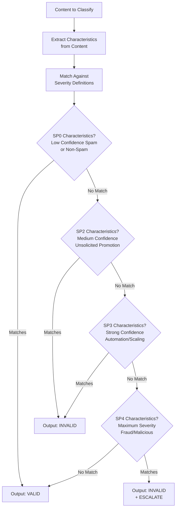
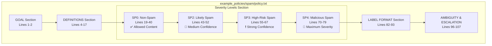
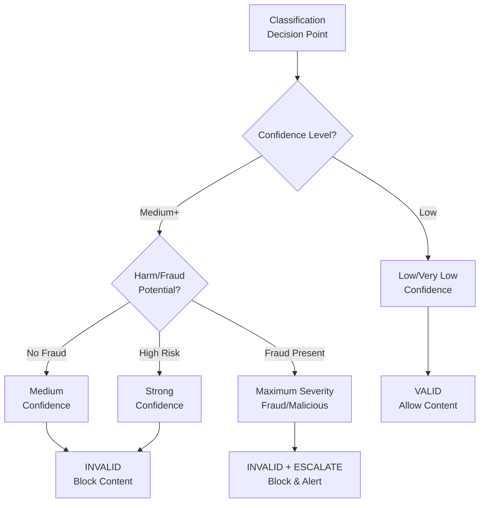
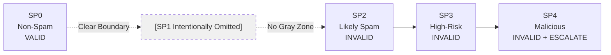
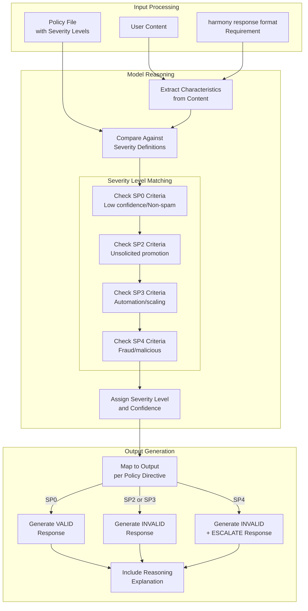

<!-- source: DeepWiki mcp.deepwiki.com · repo openai/gpt-oss-safeguard · page 5.2 Severity Levels and Classification · fetched 2026-10-26 -->

# Severity Levels and Classification

<details>
<summary>Relevant source files</summary>

The following files were used as context for generating this wiki page:

- [example_policies/spam/policy.txt](example_policies/spam/policy.txt)

</details>


## Purpose and Scope

This page documents how to define and structure severity levels within safety policies for gpt-oss-safeguard models. Severity levels are the core taxonomy that determines classification boundaries and output behaviors. This includes defining characteristic definitions for each level, mapping severity to outputs (`VALID` vs `INVALID`), and configuring escalation triggers.

For information about the overall policy file structure, see [Policy File Structure](#5.1). For details on the dual-label system (Depiction vs Request), see [Dual-Label System](#5.3). For ambiguity handling rules that interact with severity levels, see [Ambiguity Handling and Escalation Rules](#5.4).

---

## Severity Level Overview

Severity levels create a graduated scale for classifying content safety. Each level represents a distinct threshold of confidence and risk, with clear characteristic definitions and corresponding output behaviors. The models use these levels to determine both classification decisions (`VALID`/`INVALID`) and escalation requirements.

### Key Characteristics

| Component | Description |
|-----------|-------------|
| **Level Identifier** | Alphanumeric code (e.g., `SP0`, `SP2`, `SP3`, `SP4`) |
| **Description** | Natural language definition of what the level represents |
| **Confidence Indicator** | Explicit statement of classification confidence (low/medium/strong/maximum) |
| **Output Mapping** | Specification of `VALID` or `INVALID` result |
| **Escalation Flag** | Optional `ESCALATE` directive for highest severity |
| **Sub-examples** | Concrete examples using sub-identifiers (e.g., `SP0.a`, `SP0.b`) |

### Severity Level Decision Flow



**Sources:** [example_policies/spam/policy.txt:19-107]()

---

## Defining Severity Levels in Policy Files

Severity levels appear in the policy file after the `DEFINITIONS` section and before the `LABEL FORMAT` section. Each level follows a structured format:

### Standard Severity Level Format

```
[Emoji] [Level Name] ([Level ID] – [Confidence Description])
[Natural language description of characteristics]

[Level ID].[sub-id] [Example category] – "[Example content]"

[Level ID].[sub-id] [Example category] – "[Example content]"

[Output directive] Output: [VALID|INVALID] [optional additional text]
```

### Spam Policy Severity Structure



**Sources:** [example_policies/spam/policy.txt:1-107]()

---

## Output Mapping Specifications

Each severity level must specify an output mapping that determines the classification result. The gpt-oss-safeguard models use these mappings to generate their final decisions.

### Output Types

| Output | Meaning | Use Case |
|--------|---------|----------|
| `VALID` | Content passes safety checks | Non-spam, allowed content, or very low confidence signals |
| `INVALID` | Content violates policy | Clear policy violation, medium to strong confidence |
| `INVALID + ESCALATE` | Content requires immediate action | Malicious content, fraud, harm potential |

### Output Mapping Pattern in Policy Files

From the spam policy:

```
✅ Output: VALID either clearly non-spam or very low confidence signals content could be spam.
```
[example_policies/spam/policy.txt:40]()

```
❌ Output: INVALID
```
[example_policies/spam/policy.txt:52](), [example_policies/spam/policy.txt:67]()

```
❌ Output: INVALID + ESCALATE
```
[example_policies/spam/policy.txt:79]()

### Output Mapping Decision Tree



**Sources:** [example_policies/spam/policy.txt:40,52,67,79]()

---

## Severity Progression and Confidence Levels

Severity levels represent both increasing confidence in classification and escalating risk. The progression is intentional and structured to create clear decision boundaries.

### Confidence Progression Model

| Level | Confidence | Risk Category | Typical Indicators |
|-------|-----------|---------------|-------------------|
| **SP0** | Very Low / None | Non-spam or ambiguous | Useful content, personalized communication, legitimate business |
| **SP2** | Medium | Unsolicited promotion | Cold outreach, commercial links, ads without deception |
| **SP3** | Strong | Automated/scaled spam | Repetition, automation signals, aggressive tactics |
| **SP4** | Maximum | Malicious intent | Phishing, malware, fraud, financial harm |

### The SP1 Gap: Binary Decision Boundary

The spam policy intentionally skips `SP1`, creating a sharp binary divide between acceptable (`SP0` → `VALID`) and unacceptable (`SP2+` → `INVALID`) content. This design pattern is visible in the policy file structure:



This pattern forces classification into one of two camps: either the content is sufficiently safe (`SP0`) or it crosses into spam territory (`SP2+`). There is no intermediate "maybe spam" category.

**Sources:** [example_policies/spam/policy.txt:19-79]()

---

## Severity Level Components: Detailed Breakdown

### 1. Level Identifier and Header

The level identifier appears at the start of each severity section:

```
✅ Allowed Content (SP0 – Non-Spam or very low confidence signals of spam)
```
[example_policies/spam/policy.txt:19]()

Components:
- **Emoji marker**: Visual indicator (✅ 🚫 ❗ 🚨)
- **Level name**: Human-readable descriptor ("Allowed Content")
- **Level ID**: Machine-parseable code (`SP0`)
- **Confidence clause**: Explicit confidence statement ("very low confidence signals")

### 2. Characteristic Description

A natural language definition explaining what content falls into this level:

```
Content that is useful, contextual, or non-promotional. May look spammy but could be legitimate.
```
[example_policies/spam/policy.txt:20]()

This description guides the model's reasoning process when evaluating content.

### 3. Sub-examples with Identifiers

Each severity level includes concrete examples using sub-identifiers:

```
SP0.a Useful/info request – "How do I upload a product photo?"

SP0.b Personalized communication – "Hi Sam, here is the report."

SP0.c Business support – "Can you fix my order?"
```
[example_policies/spam/policy.txt:21-27]()

The sub-identifier pattern (`SP0.a`, `SP0.b`, etc.) allows policies to reference specific example types and provides structure for reasoning.

### 4. Output Directive

The explicit output specification:

```
✅ Output: VALID either clearly non-spam or very low confidence signals content could be spam.
```
[example_policies/spam/policy.txt:40]()

This directive is what the model uses to generate its final classification decision.

**Sources:** [example_policies/spam/policy.txt:19-40]()

---

## Example: Spam Policy Severity Levels

### SP0: Non-Spam (Allowed Content)

**Definition Location:** [example_policies/spam/policy.txt:19-40]()

**Characteristics:**
- Useful, contextual, or non-promotional content
- May exhibit superficial spam signals but has legitimate purpose
- Very low confidence that content is spam

**Example Categories:**
- `SP0.a`: Useful/info requests
- `SP0.b`: Personalized communication
- `SP0.c`: Business support
- `SP0.d`: Single contextual promotions
- `SP0.e`: Generic requests
- `SP0.f`: Low-quality formatting (not automatically spam)
- `SP0.g`: Vague benefit statements

**Output:** `VALID`

**Reasoning:** This level captures edge cases where content might look suspicious but serves a legitimate purpose. The model errs on the side of permissiveness when confidence is low.

### SP2: Likely Spam

**Definition Location:** [example_policies/spam/policy.txt:43-52]()

**Characteristics:**
- Unsolicited promotion without deception
- Medium confidence classification
- Clear commercial intent without user relationship

**Example Categories:**
- `SP2.a`: Cold promotion ("Check out my Shopify course: shopcoach.biz")
- `SP2.b`: Irrelevant ads ("Buy gold rings here!")
- `SP2.c`: Excessive linking (multiple commercial URLs)

**Output:** `INVALID`

**Reasoning:** This is the first level that blocks content. The boundary between `SP0` and `SP2` represents the fundamental "is this spam?" decision. `SP2` captures straightforward unsolicited promotion without malicious elements.

### SP3: High-Risk Spam

**Definition Location:** [example_policies/spam/policy.txt:55-67]()

**Characteristics:**
- Evidence of scaling, automation, or aggressive tactics
- Strong confidence classification
- Coordinated or systematic spam behavior

**Example Categories:**
- `SP3.a`: Repetitive posting ("JOIN NOW JOIN NOW JOIN NOW")
- `SP3.b`: Pyramid/affiliate schemes
- `SP3.c`: Fake engagement tactics
- `SP3.d`: Misleading claims ("Guaranteed 10,000 new followers overnight!")

**Output:** `INVALID`

**Reasoning:** `SP3` escalates from simple unsolicited promotion to systematic abuse. The key differentiator is evidence of automation, scaling, or manipulative tactics.

### SP4: Malicious Spam

**Definition Location:** [example_policies/spam/policy.txt:70-79]()

**Characteristics:**
- Fraud, deception, or harmful intent
- Maximum severity classification
- Potential for immediate harm (financial, security, safety)

**Example Categories:**
- `SP4.a`: Phishing ("Your account is locked. Enter your password here.")
- `SP4.b`: Malware/scam ("Download invoice.exe to claim payment.")
- `SP4.c`: Account takeover attempts (crypto scams)

**Output:** `INVALID + ESCALATE`

**Reasoning:** `SP4` represents the highest threat level. The `ESCALATE` flag signals that this content requires immediate action beyond simple blocking, such as alerting security teams or triggering additional fraud detection systems.

**Sources:** [example_policies/spam/policy.txt:19-79]()

---

## Severity Level Comparison Matrix

| Aspect | SP0 | SP2 | SP3 | SP4 |
|--------|-----|-----|-----|-----|
| **Confidence** | Very Low | Medium | Strong | Maximum |
| **Intent** | Legitimate/Unclear | Commercial | Systematic Abuse | Malicious |
| **Scale** | Individual | Individual | Coordinated/Automated | Coordinated/Harmful |
| **Deception** | None | Minimal | Misleading | Fraudulent |
| **Output** | `VALID` | `INVALID` | `INVALID` | `INVALID + ESCALATE` |
| **Risk Level** | Safe | Annoying | Harmful to Platform | Harmful to Users |
| **Example Count** | 7 sub-examples | 3 sub-examples | 4 sub-examples | 3 sub-examples |

**Sources:** [example_policies/spam/policy.txt:19-79]()

---

## Severity Level Architecture in Model Processing



**Sources:** [example_policies/spam/policy.txt:1-107]()

---

## Best Practices for Defining Severity Levels

### 1. Use Clear Confidence Indicators

Each level should explicitly state the confidence level:
- "very low confidence" for borderline cases
- "medium confidence" for clear violations
- "strong confidence" for systematic abuse
- "maximum severity" for harmful content

### 2. Provide Sufficient Sub-examples

Include 3-7 concrete sub-examples per level to guide model reasoning. Examples should:
- Cover diverse manifestations of the level's characteristics
- Use realistic content patterns
- Include quoted text when helpful

### 3. Create Clear Output Mappings

Specify outputs unambiguously:
- Use `VALID` for allowed content
- Use `INVALID` for blocked content
- Use `INVALID + ESCALATE` only for highest severity requiring immediate action

### 4. Maintain Logical Progression

Severity levels should escalate along dimensions like:
- Confidence (low → medium → strong → maximum)
- Intent (unclear → commercial → abusive → malicious)
- Scale (individual → coordinated → automated)
- Harm (annoying → harmful to platform → harmful to users)

### 5. Consider Boundary Cases

Design the SP0/SP2 boundary carefully. This is where the fundamental "allowed vs. blocked" decision occurs. Content that falls into `SP0` should be defensible as either:
- Clearly legitimate
- Too ambiguous to block with confidence

### 6. Use Visual Markers Consistently

If using emoji markers (✅ 🚫 ❗ 🚨), maintain consistency:
- One marker per severity level
- Progression from positive (✅) to warning (🚫 ❗) to critical (🚨)
- Visual scanning aid for policy authors and reviewers

**Sources:** [example_policies/spam/policy.txt:19-79]()

---

## Integration with Other Policy Components

Severity levels interact with other policy sections:

### With DEFINITIONS Section

Core definitions (see [Policy File Structure](#5.1)) provide the conceptual foundation that severity levels apply:

```
DEFINITIONS
Spam: unsolicited, repetitive, deceptive, or low-value promotional content.
```
[example_policies/spam/policy.txt:4-5]()

Severity levels translate these definitions into actionable classification rules.

### With LABEL FORMAT Section

The dual-label system (see [Dual-Label System](#5.3)) applies severity levels to both depiction and request:

```
Example: "Shop this site: dealplanet.io"
Classification: D-S2, R-S0
```
[example_policies/spam/policy.txt:90]()

Each label uses the severity taxonomy independently.

### With AMBIGUITY & ESCALATION Section

Ambiguity rules (see [Ambiguity Handling and Escalation Rules](#5.4)) modify severity assignments:

```
If unclear → downgrade severity by 1 and seek clarification.
If automation suspected → SP2 or higher.
If financial harm or fraud → classify SP4.
```
[example_policies/spam/policy.txt:97-103]()

These rules can upgrade or downgrade severity based on special conditions.

**Sources:** [example_policies/spam/policy.txt:4-5,90,97-103]()

---

## Summary

Severity levels form the classification backbone of safety policies for gpt-oss-safeguard models. Key design principles:

1. **Graduated scale**: Clear progression from allowed to blocked to escalated
2. **Confidence-based**: Each level represents a distinct confidence threshold
3. **Output-mapped**: Explicit `VALID`/`INVALID`/`ESCALATE` directives
4. **Example-rich**: Concrete sub-examples guide model reasoning
5. **Binary boundary**: Sharp SP0/SP2 divide creates clear allowed/blocked decision
6. **Contextual integration**: Works with definitions, labels, and escalation rules

When creating custom policies, define severity levels that balance precision (avoiding false positives) with coverage (catching genuine violations), and ensure each level has clear, defensible characteristics that support consistent classification.

**Sources:** [example_policies/spam/policy.txt:1-107]()

---

