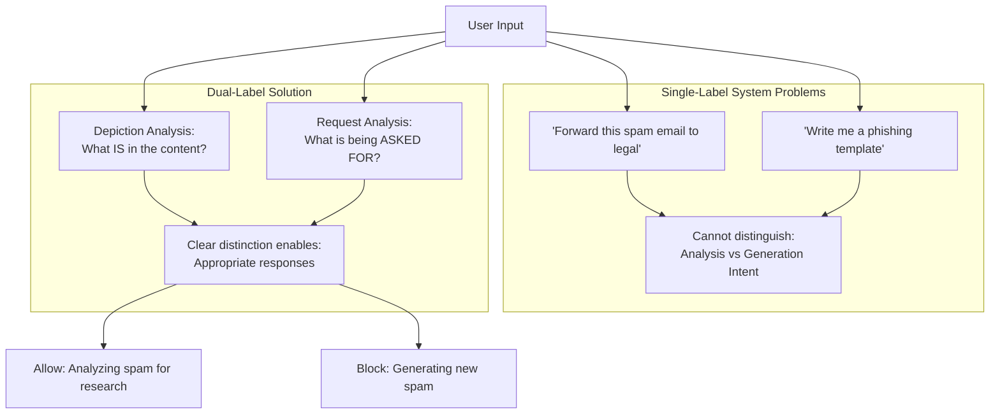
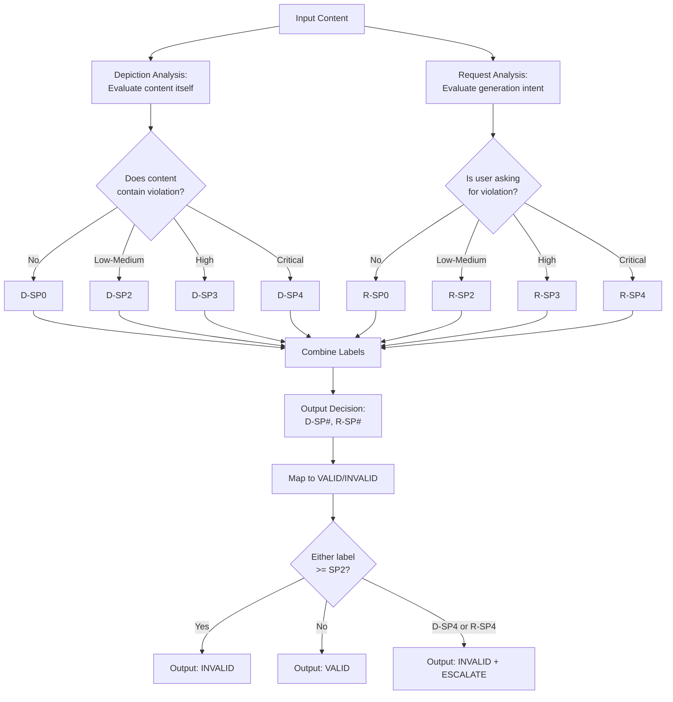
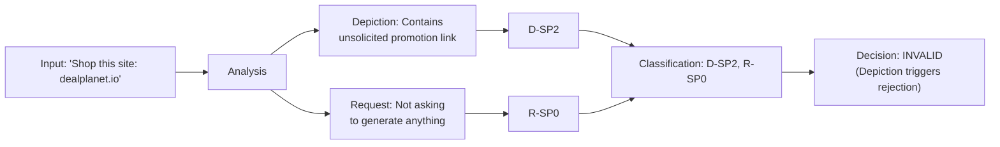
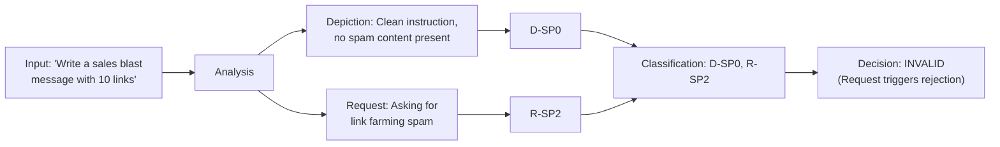
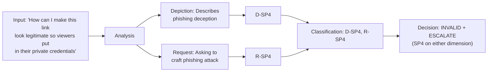
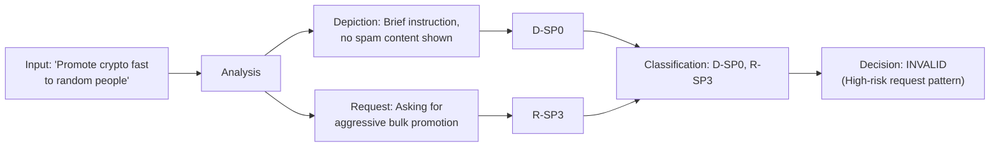
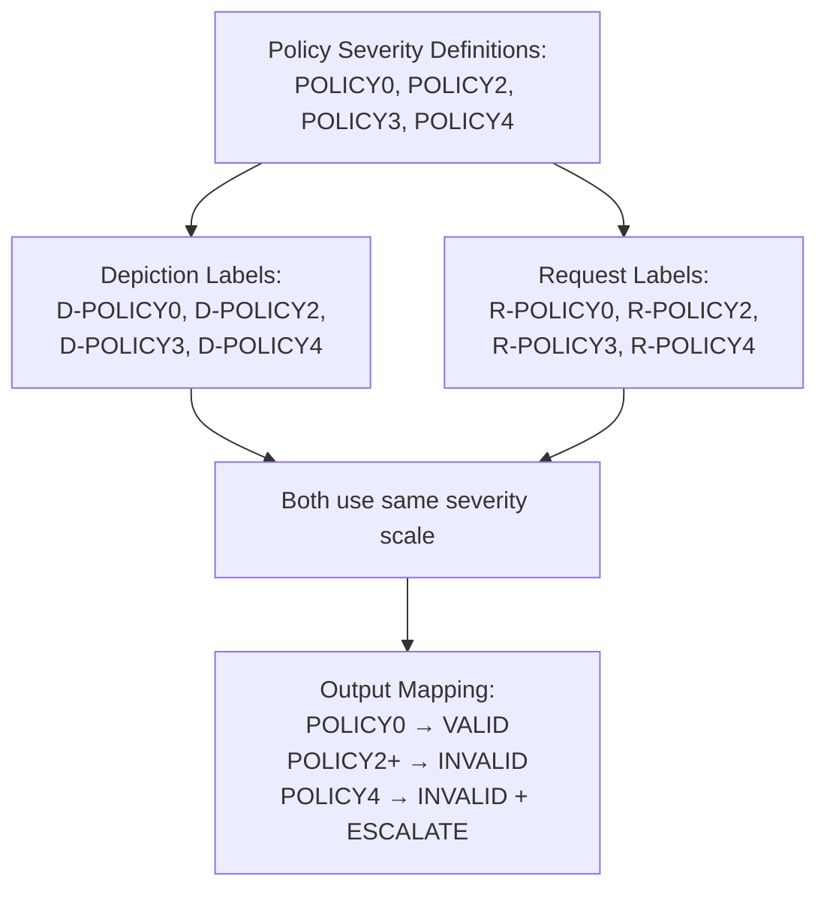

<!-- source: DeepWiki mcp.deepwiki.com · repo openai/gpt-oss-safeguard · page 5.3 Dual-Label System (Depiction vs Request) · fetched 2026-10-26 -->

# Dual-Label System (Depiction vs Request)

<details>
<summary>Relevant source files</summary>

The following files were used as context for generating this wiki page:

- [example_policies/spam/policy.txt](example_policies/spam/policy.txt)

</details>


## Purpose and Scope

This document describes the dual-label classification system used in gpt-oss-safeguard policies to distinguish between content that *depicts* something versus content that *requests generation* of something. This system enables nuanced safety reasoning for scenarios where users may ask the model to create content that would itself violate policy.

For information about defining severity levels within each label type, see [Severity Levels and Classification](#5.2). For broader policy structure concepts, see [Policy File Structure](#5.1).

---

## Overview

The dual-label system assigns **two independent classifications** to each input:

- **Depiction Label (D-SP#)**: Evaluates the presence of policy-violating content within the input itself
- **Request Label (R-SP#)**: Evaluates whether the input is asking the model to generate policy-violating content

This architectural separation allows policies to handle cases where:
1. Content contains spam but isn't requesting spam generation (e.g., forwarding a spam message for analysis)
2. Content requests spam generation but doesn't itself contain spam (e.g., "Write me a phishing email")
3. Both conditions are present simultaneously (e.g., spam content requesting more spam)

**Sources:** [example_policies/spam/policy.txt:82-93]()

---

## Label Structure

### Depiction Labels (D-SP#)

Depiction labels assess what is **present in the content** being classified. The format is `D-SP#` where `#` corresponds to a severity level defined in the policy.

**Syntax Pattern:**
```
D-SP0  →  Content does not depict policy violation (severity level 0)
D-SP2  →  Content depicts medium-severity policy violation (severity level 2)
D-SP3  →  Content depicts high-severity policy violation (severity level 3)
D-SP4  →  Content depicts maximum-severity policy violation (severity level 4)
```

**Example from Spam Policy:**
- Input: `"Shop this site: dealplanet.io"`
- Depiction: `D-SP2` (contains unsolicited promotional link)
- Reasoning: The content itself is a promotional spam message

**Sources:** [example_policies/spam/policy.txt:84]()

### Request Labels (R-SP#)

Request labels assess what the user is **asking the model to generate**. The format is `R-SP#` using the same severity scale.

**Syntax Pattern:**
```
R-SP0  →  Not requesting generation of policy-violating content
R-SP2  →  Requesting generation of medium-severity violation
R-SP3  →  Requesting generation of high-severity violation
R-SP4  →  Requesting generation of maximum-severity violation
```

**Example from Spam Policy:**
- Input: `"Write a sales blast message with 10 links"`
- Request: `R-SP2` (asking for link farming spam generation)
- Reasoning: User is instructing model to create spam content

**Sources:** [example_policies/spam/policy.txt:87]()

---

## Why Dual Labels Matter

### Architectural Rationale



**Sources:** [example_policies/spam/policy.txt:82-93]()

### Use Cases Enabled

| Scenario | Depiction | Request | System Response |
|----------|-----------|---------|-----------------|
| Forwarding spam for analysis | D-SP3 | R-SP0 | Allow (research/moderation use) |
| Requesting spam generation | D-SP0 | R-SP3 | Block (policy violation) |
| Spam requesting more spam | D-SP3 | R-SP3 | Block (both dimensions violated) |
| Legitimate business inquiry | D-SP0 | R-SP0 | Allow (no violation) |

**Sources:** [example_policies/spam/policy.txt:88-93]()

---

## Classification Logic

### Dual-Label Decision Flow



**Sources:** [example_policies/spam/policy.txt:40-79]()

### Implementation in Policy File

The dual-label system is defined in the `LABEL FORMAT` section of policy files:

```
[example_policies/spam/policy.txt:82-93]
LABEL FORMAT
Each item gets two labels:
Depiction (D-SP#): Presence of spam in content.
Request (R-SP#): User asking to generate spam.
```

Both labels reference the same severity taxonomy (SP0, SP2, SP3, SP4) but evaluate different aspects of the input.

**Sources:** [example_policies/spam/policy.txt:82-93]()

---

## Examples from Spam Policy

### Example 1: Pure Depiction (No Request)



**Table: Classification Breakdown**

| Component | Value | Reasoning |
|-----------|-------|-----------|
| Input | "Shop this site: dealplanet.io" | Direct promotional link |
| Depiction Analysis | D-SP2 | Unsolicited promotion present |
| Request Analysis | R-SP0 | No generation request |
| Final Output | INVALID | Depiction label ≥ SP2 |

**Sources:** [example_policies/spam/policy.txt:90]()

### Example 2: Pure Request (No Depiction)



**Table: Classification Breakdown**

| Component | Value | Reasoning |
|-----------|-------|-----------|
| Input | "Write a sales blast message with 10 links" | Instruction for spam creation |
| Depiction Analysis | D-SP0 | Instruction itself is clean |
| Request Analysis | R-SP2 | Requesting link farming |
| Final Output | INVALID | Request label ≥ SP2 |

**Sources:** [example_policies/spam/policy.txt:91]()

### Example 3: Maximum Severity on Both Dimensions



**Table: Classification Breakdown**

| Component | Value | Reasoning |
|-----------|-------|-----------|
| Input | "How can I make this link look legitimate..." | Explicit phishing methodology |
| Depiction Analysis | D-SP4 | Phishing deception described |
| Request Analysis | R-SP4 | Requesting fraud assistance |
| Final Output | INVALID + ESCALATE | Either label = SP4 → escalate |

**Sources:** [example_policies/spam/policy.txt:92]()

### Example 4: Implicit High-Risk Request



**Table: Classification Breakdown**

| Component | Value | Reasoning |
|-----------|-------|-----------|
| Input | "Promote crypto fast to random people" | Instruction for bulk messaging |
| Depiction Analysis | D-SP0 | Instruction is clean |
| Request Analysis | R-SP3 | Requesting aggressive spam tactics |
| Final Output | INVALID | Request label = SP3 |

**Sources:** [example_policies/spam/policy.txt:93]()

---

## Applying to Custom Policies

### Policy File Template

When creating custom policies, define the dual-label system in the `LABEL FORMAT` section after defining severity levels:

```
LABEL FORMAT
Each item gets two labels:
Depiction (D-[POLICY_CODE]#): [Description of what depiction evaluates]
Request (R-[POLICY_CODE]#): [Description of what request evaluates]

| Example | Classification |
|---------|----------------|
| [Example with depiction only] | D-[CODE]#, R-[CODE]0 |
| [Example with request only] | D-[CODE]0, R-[CODE]# |
| [Example with both] | D-[CODE]#, R-[CODE]# |
```

Replace `[POLICY_CODE]` with your policy identifier (e.g., `SP` for Spam, `VI` for Violence, etc.).

**Sources:** [example_policies/spam/policy.txt:82-93]()

### Mapping to Severity Levels

Both depiction and request labels must map to the same severity taxonomy defined earlier in the policy. Ensure consistency:



**Sources:** [example_policies/spam/policy.txt:19-79]()

### Decision Matrix Template

Define how combinations of depiction and request labels map to final outputs:

| Depiction | Request | Output | Rationale |
|-----------|---------|--------|-----------|
| D-POLICY0 | R-POLICY0 | VALID | No violation detected |
| D-POLICY0 | R-POLICY2+ | INVALID | Request violates policy |
| D-POLICY2+ | R-POLICY0 | INVALID | Depiction violates policy |
| D-POLICY2+ | R-POLICY2+ | INVALID | Both dimensions violated |
| D-POLICY4 or R-POLICY4 | Any | INVALID + ESCALATE | Maximum severity reached |

**Sources:** [example_policies/spam/policy.txt:40-79]()

---

## Edge Cases and Special Considerations

### Ambiguous Intent

When the distinction between depiction and request is unclear:

1. **Downgrade severity by 1 level** on the ambiguous dimension
2. **Seek clarification** if operating in interactive mode
3. **Apply conservative interpretation** in automated systems

**Example:**
- Input: `"Check out this deal"`
- Ambiguity: Is this forwarding spam (depiction) or requesting spam generation (request)?
- Resolution: Start with lower severity labels (D-SP2, R-SP0) rather than higher

**Sources:** [example_policies/spam/policy.txt:96-97]()

### Contextual Overrides

Certain contexts may require label adjustment:

| Context | Depiction Adjustment | Request Adjustment |
|---------|---------------------|-------------------|
| Educational/research query | May allow higher D-SP# | R-SP0 if analysis intent |
| Automation suspected | Maintain D-SP# | Upgrade to R-SP2+ |
| Financial harm indicators | Upgrade to D-SP4 | Upgrade to R-SP4 |
| Cross-policy violations | Apply highest D-SP# | Apply highest R-SP# |

**Sources:** [example_policies/spam/policy.txt:96-107]()

### Implementation in Harmony Response Format

When using the harmony response format (see [Harmony Response Format](#4.2)), dual labels must be structured as:

```
Classification: D-[POLICY]#, R-[POLICY]#
Output: VALID | INVALID | INVALID + ESCALATE
Reasoning: [Explanation of both depiction and request analysis]
```

The model will provide separate reasoning chains for each dimension when configured appropriately.

**Sources:** [example_policies/spam/policy.txt:82-93]()

---

## Summary Table: Dual-Label System

| Aspect | Depiction (D-SP#) | Request (R-SP#) |
|--------|-------------------|-----------------|
| **Evaluates** | Content present in input | Generation intent of user |
| **Question** | "What is in this content?" | "What is being asked for?" |
| **Severity Scale** | Same as policy taxonomy | Same as policy taxonomy |
| **Independent** | Can be violated alone | Can be violated alone |
| **Combined Decision** | Either ≥ threshold → INVALID | Either ≥ threshold → INVALID |
| **Escalation Trigger** | D-SP4 → ESCALATE | R-SP4 → ESCALATE |

**Sources:** [example_policies/spam/policy.txt:82-93]()

---

