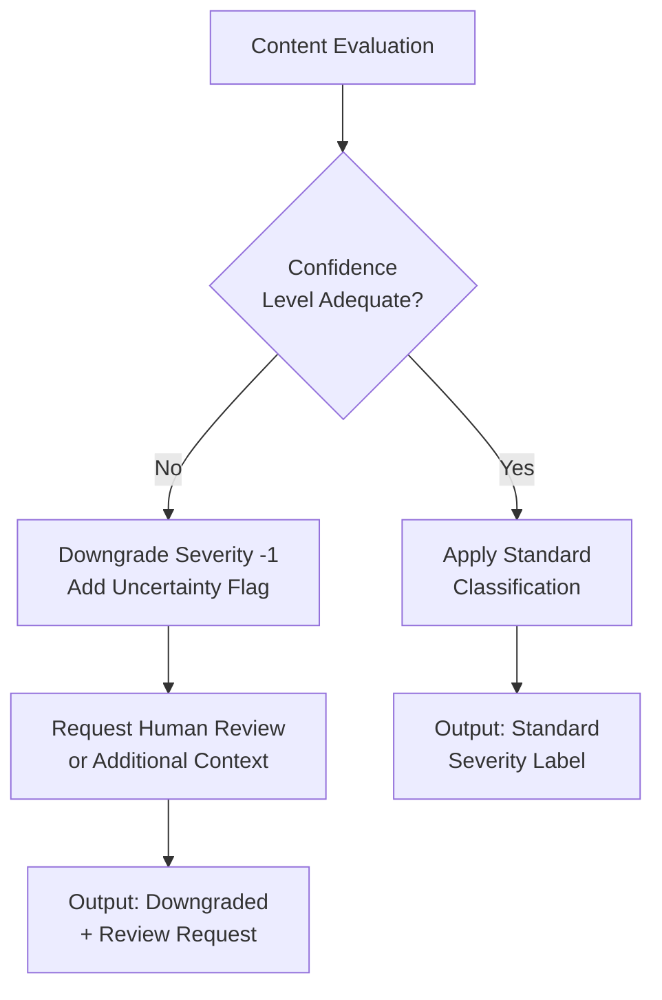
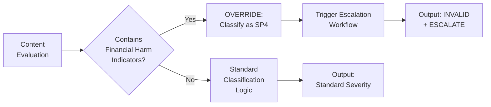
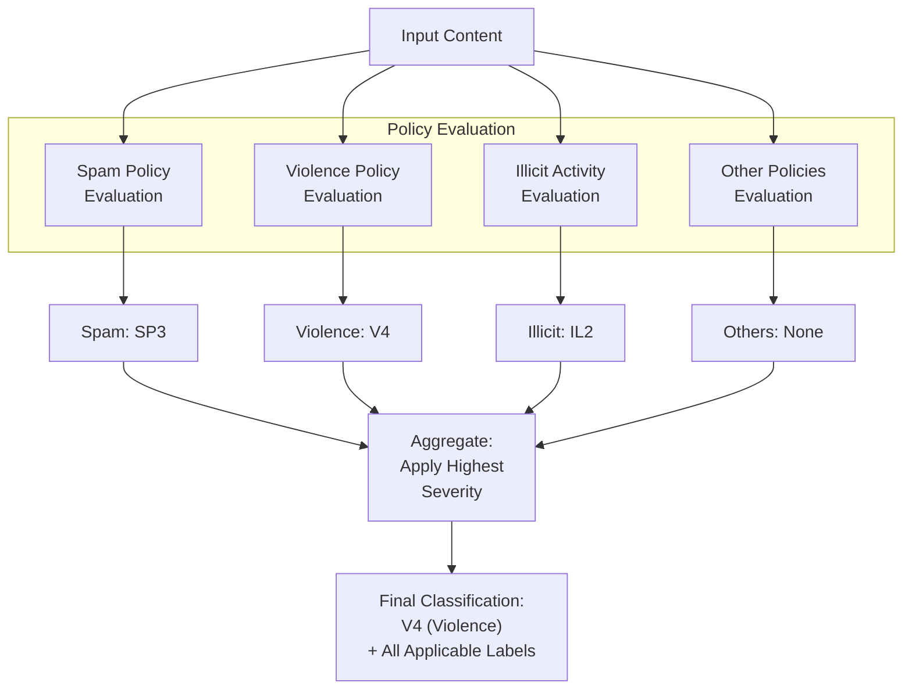
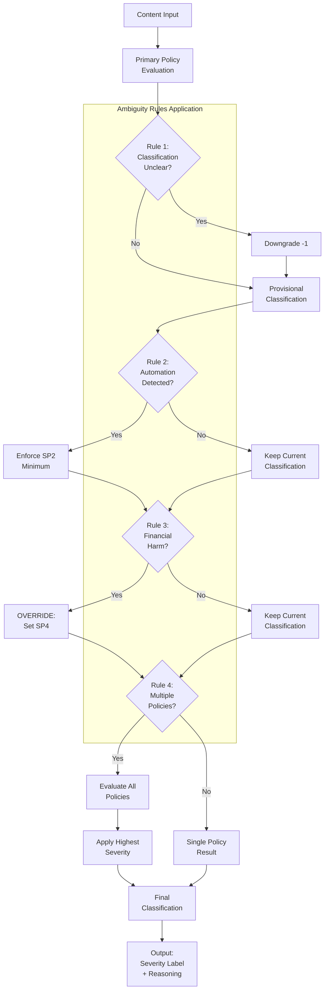
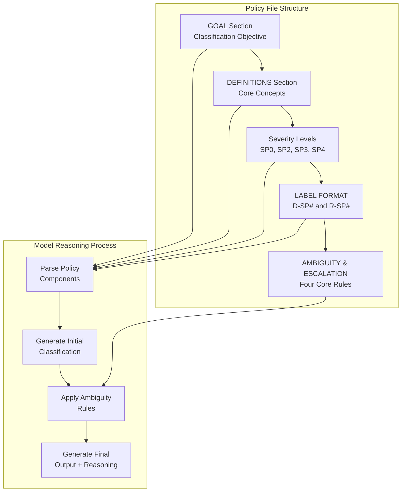

<!-- source: DeepWiki mcp.deepwiki.com · repo openai/gpt-oss-safeguard · page 5.4 Ambiguity Handling and Escalation Rules · fetched 2026-10-26 -->

# Ambiguity Handling and Escalation Rules

<details>
<summary>Relevant source files</summary>

The following files were used as context for generating this wiki page:

- [example_policies/spam/policy.txt](example_policies/spam/policy.txt)

</details>


## Purpose and Scope

This page documents the ambiguity handling and escalation rules that govern edge cases and uncertain classifications in gpt-oss-safeguard policies. These rules define how the model should respond when content classification is unclear, when multiple severity indicators are present, or when cross-policy considerations apply.

For information about the overall policy file structure, see [Policy File Structure](#5.1). For details on defining severity levels, see [Severity Levels and Classification](#5.2). For guidance on creating complete policies, see [Creating Custom Policies](#5.5).

**Sources:** [example_policies/spam/policy.txt:96-107]()

---

## Overview

Ambiguity handling rules address scenarios where straightforward classification is difficult or impossible. These rules provide defensive strategies to avoid misclassification while maintaining safety. The gpt-oss-safeguard models apply these rules during the safety reasoning process to produce consistent, conservative decisions when facing uncertain inputs.

The system defines four core rule types, documented in the `AMBIGUITY & ESCALATION` section of policy files.

**Sources:** [example_policies/spam/policy.txt:96-107]()

---

## The Four Core Rules

### Rule 1: Uncertain Classifications - Severity Downgrade

**Definition:** When the model cannot confidently determine the correct severity level, it should downgrade the classification by one level and seek clarification.

**Rule Statement:** `If unclear → downgrade severity by 1 and seek clarification.`

**Purpose:** This rule implements a conservative approach that reduces false positives. By downgrading uncertain classifications, the system avoids over-enforcement while still flagging potentially problematic content for review.

#### Application Logic



**Diagram: Uncertain Classification Decision Flow**

#### Examples

| Original Suspected Level | Confidence Issue | Downgraded To | Action |
|-------------------------|------------------|---------------|---------|
| SP3 (High-Risk Spam) | Unclear intent in promotional message | SP2 (Likely Spam) | Flag for review, but still mark INVALID |
| SP2 (Likely Spam) | Could be legitimate business outreach | SP0 (Non-Spam) | Mark VALID, log for pattern analysis |
| SP4 (Malicious Spam) | Possible phishing but domain unclear | SP3 (High-Risk Spam) | Mark INVALID, escalate for investigation |

**Sources:** [example_policies/spam/policy.txt:97]()

---

### Rule 2: Automation Detection - Minimum SP2

**Definition:** When the model detects indicators of automated spam generation or bulk messaging, classify the content as at least SP2 (Likely Spam) severity, regardless of other characteristics.

**Rule Statement:** `If automation suspected → SP2 or higher.`

**Purpose:** Automated spam poses inherent risks due to scale. Even if individual messages might be borderline, automation amplifies harm potential and justifies stricter classification.

#### Automation Indicators

The model looks for patterns suggesting automated generation:

- **Repetitive patterns** - Identical or near-identical messages
- **Scale indicators** - References to bulk sending, mass distribution
- **Bot-like language** - Formulaic structure, template placeholders
- **API/scripting mentions** - Explicit discussion of automation tools

#### Classification Matrix

| Content Type | Automation Detected? | Base Severity | Applied Severity |
|-------------|---------------------|---------------|------------------|
| Cold outreach email | No | SP0 | SP0 |
| Cold outreach email | Yes | SP0 | SP2 |
| Generic promotion | No | SP2 | SP2 |
| Generic promotion | Yes | SP2 | SP3 |
| Phishing attempt | Yes | SP4 | SP4 |

**Sources:** [example_policies/spam/policy.txt:100]()

---

### Rule 3: Financial Harm Detection - Automatic SP4

**Definition:** When the model identifies financial fraud, monetary deception, or potential for financial harm, automatically classify as SP4 (Malicious Spam) regardless of other factors.

**Rule Statement:** `If financial harm or fraud → classify SP4.`

**Purpose:** Financial fraud represents the highest severity risk category. This rule ensures that phishing, scams, and fraudulent financial schemes receive maximum severity classification and trigger escalation workflows.

#### Financial Harm Categories

1. **Phishing** - Credential theft, account takeover attempts
2. **Payment fraud** - Fake invoices, fraudulent payment requests
3. **Investment scams** - Ponzi schemes, fake investment opportunities
4. **Cryptocurrency fraud** - Fake wallet addresses, crypto doubling scams
5. **Identity theft** - Social security number collection, impersonation

#### Classification Override Behavior



**Diagram: Financial Harm Override Logic**

#### Examples from Spam Policy

| Content | Standard Classification | Financial Harm Detected? | Final Classification |
|---------|------------------------|-------------------------|---------------------|
| "Download invoice.exe to claim payment" | SP3 | Yes (malware + payment fraud) | SP4 + ESCALATE |
| "Your account is locked. Enter your password here" | SP3 | Yes (credential phishing) | SP4 + ESCALATE |
| "Send crypto to 0xABC123 to double your money" | SP3 | Yes (cryptocurrency fraud) | SP4 + ESCALATE |
| "Buy gold rings here!" | SP2 | No | SP2 |

**Sources:** [example_policies/spam/policy.txt:103](), [example_policies/spam/policy.txt:72-79]()

---

### Rule 4: Cross-Policy Escalation - Highest Severity Wins

**Definition:** When content violates multiple policies or shows indicators of abuse across different categories, apply the highest severity level from any applicable policy.

**Rule Statement:** `If combined with other indicators of abuse, violence, or illicit behavior, apply highest severity policy.`

**Purpose:** Real-world harmful content often spans multiple violation categories. This rule ensures comprehensive harm detection by considering all applicable policies and applying the most severe classification.

#### Multi-Policy Evaluation Flow



**Diagram: Cross-Policy Severity Aggregation**

#### Combined Violation Examples

| Content Characteristics | Spam Policy | Violence Policy | Illicit Policy | Applied Severity |
|------------------------|-------------|-----------------|----------------|------------------|
| Mass-sent phishing for stolen credentials | SP4 | - | IL4 | IL4 (highest) |
| Promotion of violent extremist recruitment | SP3 | V5 | - | V5 (highest) |
| Bulk drug sales advertising | SP3 | - | IL3 | IL3 (highest) |
| Single promotional email | SP2 | - | - | SP2 (only one) |

**Sources:** [example_policies/spam/policy.txt:106]()

---

## Decision Flow Integration

The four rules operate in a specific evaluation sequence to produce consistent classifications:



**Diagram: Complete Ambiguity Rule Application Sequence**

**Sources:** [example_policies/spam/policy.txt:96-107]()

---

## Policy File Implementation

### AMBIGUITY & ESCALATION Section Structure

In policy files, the ambiguity rules are defined in a dedicated section following the severity level definitions. The structure mirrors the four core rules:

```
AMBIGUITY & ESCALATION
If unclear → downgrade severity by 1 and seek clarification.

If automation suspected → SP2 or higher.

If financial harm or fraud → classify SP4.

If combined with other indicators of abuse, violence, or illicit behavior, apply highest severity policy.
```

### Integration with Policy Components



**Diagram: Ambiguity Rules in Policy Processing Pipeline**

**Sources:** [example_policies/spam/policy.txt:1-107]()

---

## Practical Examples

### Example 1: Uncertain Promotional Message

**Content:** "Hi! I saw your profile and thought you might be interested in our marketing tool. Let me know if you'd like details."

**Analysis:**
- Could be legitimate networking (SP0)
- Could be cold promotional outreach (SP2)
- No automation indicators
- No financial harm
- Single policy applies (Spam)

**Rule 1 Application:** Classification unclear → Downgrade from SP2 to SP0

**Final Classification:** `D-SP0, R-SP0` (VALID)

**Reasoning Output:** "Content shows promotional language but appears personalized and non-aggressive. Due to uncertainty, downgraded from potential SP2 to SP0. Recommend monitoring for repeat patterns."

---

### Example 2: Automated Bulk Promotion

**Content:** "Shop now at mega-deals.com! Limited time only! Forward to 10 friends to get bonus points!"

**Analysis:**
- Clear promotional content (SP2)
- Forwarding request suggests bulk messaging intent
- No financial harm
- Single policy applies (Spam)

**Rule 2 Application:** Automation suspected → Enforce minimum SP2

**Final Classification:** `D-SP3, R-SP0` (INVALID)

**Reasoning Output:** "Unsolicited promotion with viral forwarding mechanism detected. Automation suspected based on 'forward to friends' language. Upgraded from SP2 to SP3 due to scale indicators."

---

### Example 3: Phishing with Uncertain Domain

**Content:** "Your PayPal account requires verification. Click here: paypa1-secure.com/verify (note: domain uses '1' instead of 'l')"

**Analysis:**
- High-risk spam indicators (SP3)
- Clear financial fraud attempt
- Domain spoofing detected
- Single policy applies (Spam)

**Rule 3 Application:** Financial harm detected → Override to SP4

**Final Classification:** `D-SP4, R-SP0` (INVALID + ESCALATE)

**Reasoning Output:** "Credential phishing attempt detected. Domain spoofing (paypa1 vs paypal) combined with payment verification request constitutes financial fraud. Automatically classified as SP4 per financial harm rule."

---

### Example 4: Multi-Policy Violation

**Content:** "Make $5000/day selling these totally legal substances! No questions asked! Message me to join our network. Forward to everyone you know!"

**Analysis:**
- Spam indicators: Bulk forwarding request (SP3)
- Illicit activity: Unregulated substance sales (hypothetical IL4)
- Financial fraud: Unrealistic income claims
- Multiple policies apply

**Rule 4 Application:** Multiple policies → Apply highest severity

**Final Classification:** `D-SP4, R-SP0` (via spam) + `D-IL4, R-SP0` (via illicit) = Final: IL4

**Reasoning Output:** "Content violates multiple policies. Spam policy: SP4 (financial fraud + automation). Illicit activity policy: IL4 (controlled substance sales). Applied highest severity (IL4). Both labels included in output."

---

## Rule Interaction Matrix

Understanding how rules interact when multiple apply:

| Scenario | Rule 1 | Rule 2 | Rule 3 | Rule 4 | Resulting Classification |
|----------|--------|--------|--------|--------|------------------------|
| Unclear promotion | Applied | - | - | - | Downgraded (e.g., SP2→SP0) |
| Clear automated spam | - | Applied | - | - | Minimum SP2 enforced |
| Phishing attempt | - | - | Applied | - | Override to SP4 |
| Spam + Violence | - | - | - | Applied | Highest severity wins |
| Unclear phishing | Applied | - | Applied | - | Rule 3 overrides Rule 1 |
| Automated phishing | - | Applied | Applied | - | Rule 3 wins (SP4 > SP2) |
| Multi-policy unclear | Applied | - | - | Applied | Downgrade each, then take highest |

**Sources:** [example_policies/spam/policy.txt:96-107]()

---

## Implementation Considerations

### Model Reasoning Process

The gpt-oss-safeguard models apply these rules during the safety reasoning phase. The models generate explicit reasoning that references which rules were triggered:

**Typical Reasoning Structure:**
1. Initial classification analysis
2. Ambiguity rule evaluation
3. Rule application justification
4. Final classification determination

### Policy Author Responsibilities

When creating custom policies (see [Creating Custom Policies](#5.5)), authors should:

1. **Include the AMBIGUITY & ESCALATION section** - The four rules should be present in all policies
2. **Customize rules if needed** - Adapt thresholds and behaviors to domain-specific needs
3. **Document edge cases** - Provide examples in golden datasets that test ambiguity handling
4. **Align with severity definitions** - Ensure downgrade behavior produces meaningful outputs

### Testing Ambiguity Handling

Golden datasets (see [Golden Datasets](#7.1)) should include edge cases that trigger each rule:

| Rule to Test | Dataset Examples Needed |
|-------------|------------------------|
| Rule 1: Uncertain | Borderline cases at each severity boundary |
| Rule 2: Automation | Content with/without automation indicators |
| Rule 3: Financial | Clear financial harm + borderline cases |
| Rule 4: Multi-policy | Content spanning multiple violation categories |

**Sources:** [example_policies/spam/policy.txt:96-107]()

---

## Code Integration Points

### Policy File Parsing

The model processes the `AMBIGUITY & ESCALATION` section as part of policy ingestion:

```
example_policies/spam/policy.txt:96-107
├── Line 97: Rule 1 definition
├── Line 100: Rule 2 definition  
├── Line 103: Rule 3 definition
└── Line 106: Rule 4 definition
```

### Harmony Response Format

When ambiguity rules are triggered, the reasoning output (see [Harmony Response Format](#4.2)) includes:

- **Rule identification** - Which rule(s) were applied
- **Original vs. adjusted severity** - For downgrade scenarios
- **Escalation flags** - For SP4 classifications
- **Cross-policy labels** - When Rule 4 applies

**Sources:** [example_policies/spam/policy.txt:96-107]()

---

## Best Practices

### 1. Conservative Default Behavior

Always prefer **Rule 1 (downgrade)** when genuinely uncertain. False positives damage user trust more than false negatives in most safety systems.

### 2. Explicit Escalation Triggers

Define clear thresholds for **Rule 3 (financial harm)** to avoid over-escalation. Document what constitutes "financial harm" in your policy definitions.

### 3. Cross-Policy Coordination

When implementing **Rule 4 (multi-policy)**, maintain consistent severity scales across policies. An SP3 in one policy should represent comparable risk to an equivalent level in another.

### 4. Audit Trail

Log all ambiguity rule applications for analysis. Pattern analysis may reveal:
- Overly aggressive classifications requiring policy adjustment
- Edge cases requiring explicit handling
- Automation detection false positives

### 5. Human Review Integration

For production systems, route downgraded classifications (Rule 1) and multi-policy violations (Rule 4) to human review queues to improve policy definitions over time.

**Sources:** [example_policies/spam/policy.txt:96-107]()

---

## Summary

The four ambiguity handling and escalation rules provide a systematic framework for managing uncertain and complex classifications:

1. **Downgrade uncertain classifications** - Conservative false positive avoidance
2. **Enforce automation minimums** - Scale-based risk escalation
3. **Override for financial harm** - Maximum severity for fraud
4. **Apply highest across policies** - Comprehensive harm detection

These rules integrate with policy definitions to produce consistent, explainable safety classifications even in edge cases. Policy authors should include the `AMBIGUITY & ESCALATION` section in all custom policies and test rule behavior with representative golden dataset examples.

**Sources:** [example_policies/spam/policy.txt:96-107]()

---

