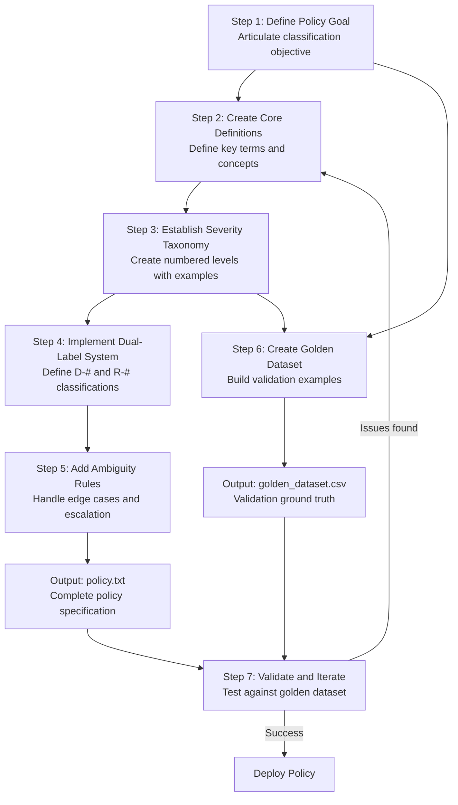
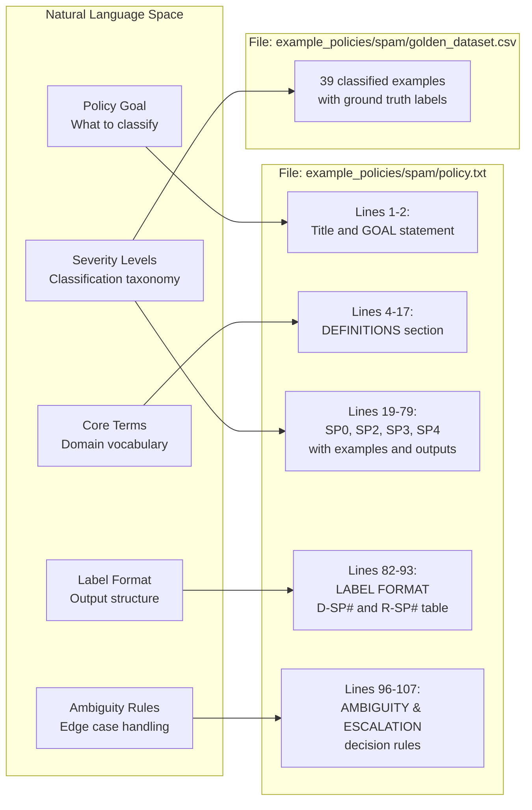
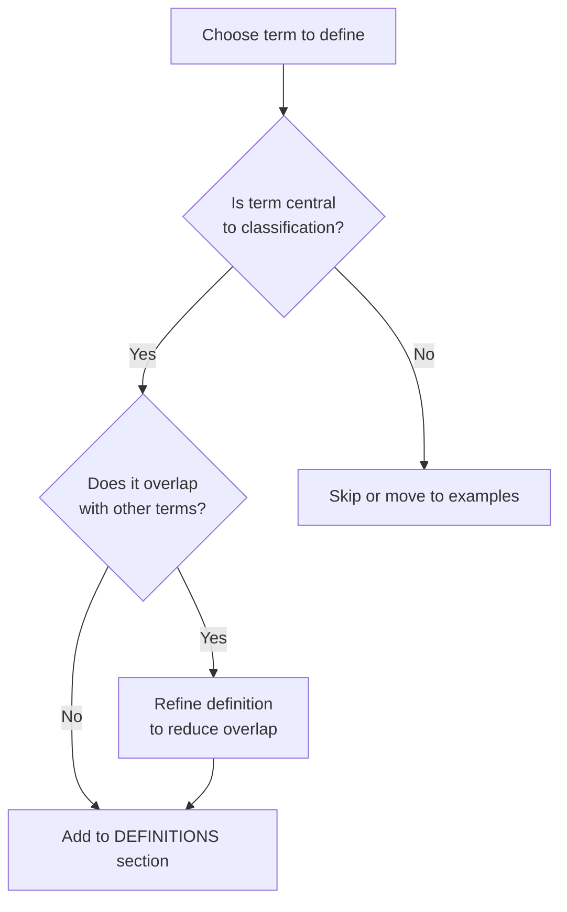
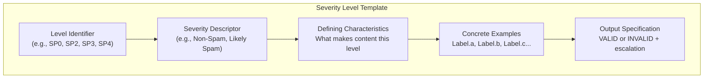
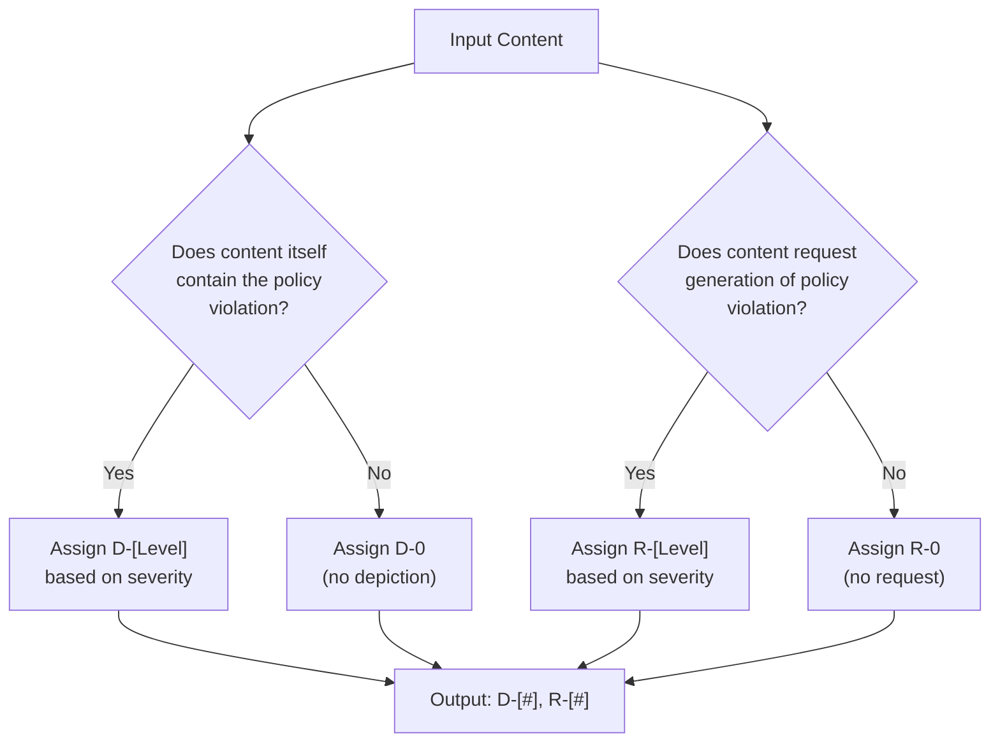
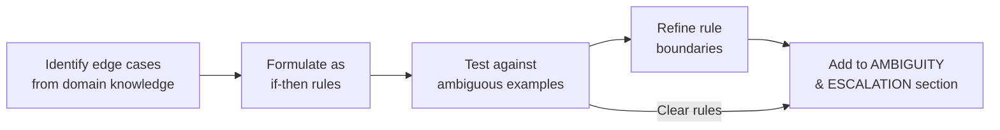
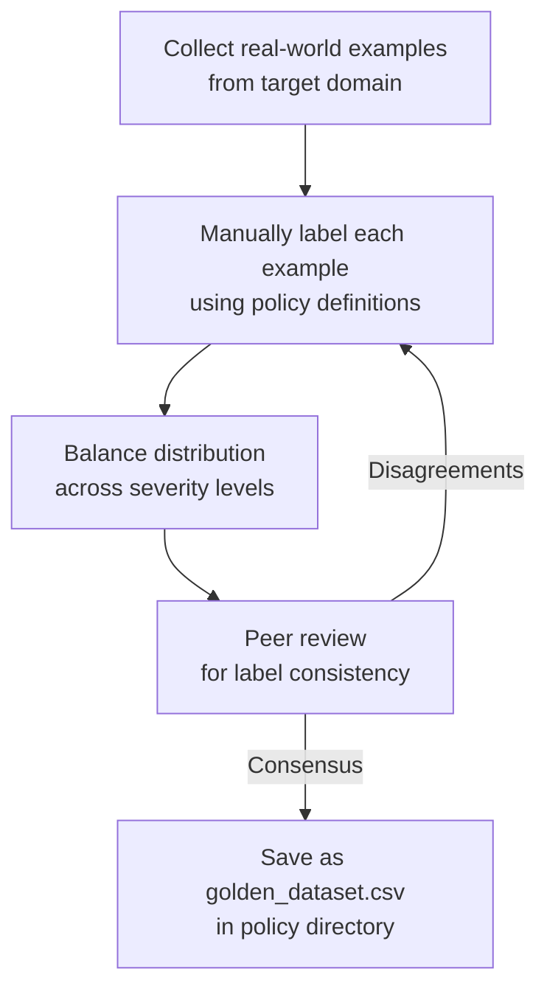
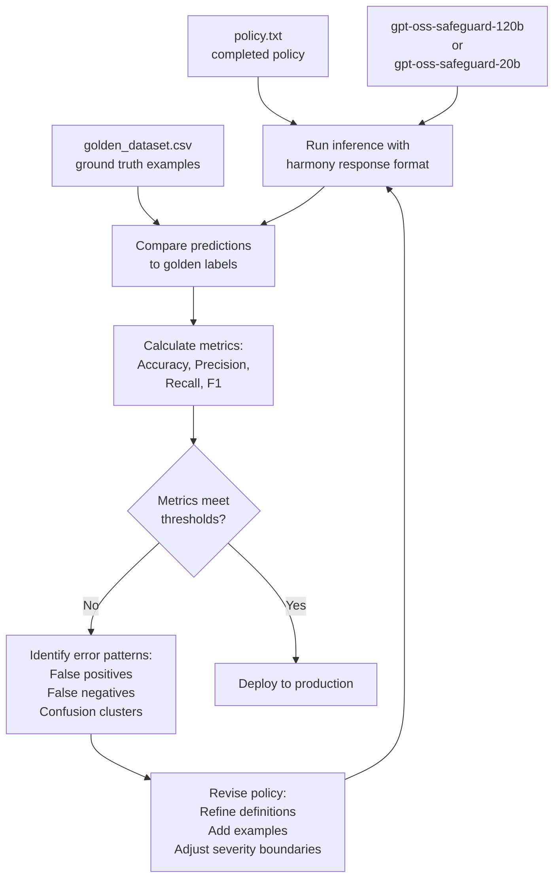

<!-- source: DeepWiki mcp.deepwiki.com · repo openai/gpt-oss-safeguard · page 5.5 Creating Custom Policies · fetched 2026-10-26 -->

# Creating Custom Policies

<details>
<summary>Relevant source files</summary>

The following files were used as context for generating this wiki page:

- [README.md](README.md)
- [example_policies/spam/policy.txt](example_policies/spam/policy.txt)

</details>


## Purpose and Scope

This page provides a step-by-step guide for creating custom safety policies from scratch for use with gpt-oss-safeguard models. It covers the complete workflow from defining policy goals to validation with golden datasets. 

For information about the structure of existing policy files, see [Policy File Structure](#5.1). For details on severity level design, see [Severity Levels and Classification](#5.2). For the complete spam detection policy example, see [Example: Spam Detection Policy](#6).

**Sources:** [README.md:1-46]()

---

## Policy Creation Workflow

Creating a custom policy involves a structured process that moves from high-level goals to executable specifications. The following diagram illustrates the end-to-end workflow:

### Workflow Overview



**Sources:** [example_policies/spam/policy.txt:1-108](), [README.md:34-36]()

---

## Policy File Structure Mapping

The following diagram maps policy concepts to concrete file structures in the repository:

### Policy Components to File Structure



**Sources:** [example_policies/spam/policy.txt:1-108]()

---

## Step 1: Define Policy Goal

Begin by articulating the classification objective in a single, clear statement. This goal appears at the top of your policy file and guides all subsequent decisions.

### Goal Statement Format

```
[Policy Name] Policy (#[Abbreviation])
GOAL: [Action verb] [what to classify]. Classify each EXAMPLE as [OUTPUT_1] ([meaning]) or [OUTPUT_2] ([meaning]) using this policy.
```

### Example from Spam Policy

The spam policy demonstrates this pattern:

[example_policies/spam/policy.txt:1-2]()

```
Spam Policy (#SP) 
GOAL: Identify spam. Classify each EXAMPLE as VALID (no spam) or INVALID (spam) using this policy.
```

### Key Components

| Component | Purpose | Example |
|-----------|---------|---------|
| Policy Name | Identifies the policy domain | `Spam Policy` |
| Abbreviation | Creates short severity codes | `#SP` → `SP0`, `SP2`, etc. |
| Action Verb | Defines classification task | `Identify`, `Detect`, `Flag` |
| Output Labels | Specifies binary outcomes | `VALID` / `INVALID` |

**Sources:** [example_policies/spam/policy.txt:1-2]()

---

## Step 2: Create Core Definitions

Define key terms that establish the conceptual boundaries of your policy. These definitions inform how the model reasons about classifications.

### Definition Structure

Each definition should be concise and domain-specific. The spam policy provides five core definitions:

[example_policies/spam/policy.txt:4-17]()

```
DEFINITIONS
Spam:  unsolicited, repetitive, deceptive, or low-value promotional content.

Bulk Messaging: Same or similar messages sent repeatedly.

Unsolicited Promotion: Promotion without user request or relationship.

Deceptive Spam: Hidden or fraudulent intent (fake identity, fake offer).

Link Farming: Multiple irrelevant or commercial links to drive clicks.
```

### Definition Guidelines



### Best Practices

- **Precision over length**: Use 1-2 sentences maximum per definition
- **Avoid circular definitions**: Don't define spam using the word "spam"
- **Domain-specific language**: Use terminology your target users understand
- **Measurable criteria**: Include observable characteristics when possible

**Sources:** [example_policies/spam/policy.txt:4-17]()

---

## Step 3: Establish Severity Taxonomy

Create numbered severity levels that form a classification hierarchy. Each level should have distinct characteristics, examples, and output specifications.

### Severity Level Structure



### Spam Policy Severity Levels

The spam policy uses four levels (SP0, SP2, SP3, SP4), deliberately skipping SP1:

| Level | Name | Confidence | Output | Lines |
|-------|------|------------|--------|-------|
| SP0 | Non-Spam or very low confidence | Low | `VALID` | [19-41]() |
| SP2 | Likely Spam | Medium | `INVALID` | [43-52]() |
| SP3 | High-Risk Spam | Strong | `INVALID` | [55-67]() |
| SP4 | Malicious Spam | Maximum | `INVALID + ESCALATE` | [70-79]() |

### SP0 Example Structure

[example_policies/spam/policy.txt:19-41]()

```
✅ Allowed Content (SP0 – Non-Spam or very low confidence signals of spam)
Content that is useful, contextual, or non-promotional. May look spammy but could be legitimate. 
SP0.a Useful/info request – "How do I upload a product photo?"
SP0.b Personalized communication – "Hi Sam, here is the report."
SP0.c Business support – "Can you fix my order?"
SP0.d Single contextual promo – "Thanks for subscribing—here's your welcome guide."
SP0.e Generic request – "Please respond ASAP."
SP0.f Low-quality formatting – "HeLLo CLICK here FAST."
SP0.g Vague benefit statement – "This tool changes lives."
 ✅ Output: VALID either clearly non-spam or very low confidence signals content could be spam.
```

### Example Sub-Labeling Pattern

Use alphabetic sub-labels (`.a`, `.b`, `.c`) to provide diverse examples within each severity level:

```
[Level].[a-z] [Example category] – "[Quoted example text]"
```

This pattern appears throughout [example_policies/spam/policy.txt:21-78]().

**Sources:** [example_policies/spam/policy.txt:19-79]()

---

## Step 4: Implement Dual-Label System

The dual-label system distinguishes between content that **depicts** something versus content that **requests** generation of something. This is critical for handling adversarial prompts.

### Dual-Label Format

[example_policies/spam/policy.txt:82-93]()

```
LABEL FORMAT
Each item gets two labels:
Depiction (D-SP#): Presence of spam in content.
Request (R-SP#): User asking to generate spam.
```

### Example Classifications

The spam policy provides a reference table:

| Example | Classification | Interpretation |
|---------|---------------|----------------|
| "Shop this site: dealplanet.io" | `D-S2, R-S0` | Content IS spam, not requesting spam generation |
| "Write a sales blast message with 10 links" | `D-S0, R-S2` | Content NOT spam, but requesting spam generation |
| "How can I make this link look legitimate so viewers put in their private credentials" | `D-S4, R-S4` | Content discusses malicious spam AND requests it |
| "Promote crypto fast to random people" | `D-S0, R-S3` | Content NOT spam, but requesting high-risk spam |

### Dual-Label Decision Flow



**Sources:** [example_policies/spam/policy.txt:82-93]()

---

## Step 5: Add Ambiguity Handling Rules

Define explicit rules for edge cases, uncertain classifications, and cross-policy escalation scenarios.

### Ambiguity Rules from Spam Policy

[example_policies/spam/policy.txt:96-107]()

```
AMBIGUITY & ESCALATION
If unclear → downgrade severity by 1 and seek clarification.

If automation suspected → SP2 or higher.

If financial harm or fraud → classify SP4.

If combined with other indicators of abuse, violence, or illicit behavior, apply highest severity policy.
```

### Rule Categories

| Rule Type | Purpose | Example |
|-----------|---------|---------|
| Uncertainty Handling | Reduce false positives | "If unclear → downgrade severity by 1" |
| Automation Detection | Catch scaled abuse | "If automation suspected → SP2 or higher" |
| Harm Escalation | Flag dangerous content | "If financial harm or fraud → classify SP4" |
| Cross-Policy Rules | Handle multi-violation cases | "Apply highest severity policy" |

### Implementing Custom Ambiguity Rules



**Sources:** [example_policies/spam/policy.txt:96-107]()

---

## Step 6: Create Golden Dataset

A golden dataset provides ground truth examples for validation. It should cover all severity levels with diverse, realistic cases.

### Golden Dataset Structure

Create a CSV file with the following structure:

```
classification,example
D-SP0,R-SP0,"[Example content]"
D-SP2,R-SP0,"[Example content]"
...
```

### Distribution Guidelines

The spam policy golden dataset contains 39 examples:

| Level | Count | Purpose |
|-------|-------|---------|
| SP0 | 17 | Majority class (non-spam baseline) |
| SP2 | 7 | Likely spam (medium confidence) |
| SP3 | 8 | High-risk spam (strong confidence) |
| SP4 | 7 | Malicious spam (maximum severity) |

### Golden Dataset Creation Workflow



### Best Practices

- **Minimum 30 examples**: Provides statistical significance for metrics
- **Diverse edge cases**: Include borderline classifications
- **Real-world scenarios**: Avoid synthetic or obvious examples
- **Balanced distribution**: Ensure minority classes have adequate representation
- **Consistent labeling**: Use multiple reviewers for contentious cases

**Sources:** [README.md:34-36](), [example_policies/spam/golden_dataset.csv]()

---

## Step 7: Validation and Iteration

Test your policy against the golden dataset and iterate based on performance metrics.

### Validation Process



### Metric Interpretation

For reference, the spam policy achieves:

| Metric | Value | Interpretation |
|--------|-------|----------------|
| Accuracy | 0.9 | 90% of all predictions correct |
| Precision | 1.0 | 100% of spam predictions are actual spam (no false positives) |
| Recall | 0.8 | 80% of actual spam is detected (some false negatives) |
| F1 | 0.889 | Harmonic mean balancing precision and recall |

For detailed metric interpretation, see [Performance Metrics](#7.2).

**Sources:** [README.md:34-36]()

---

## Policy File Template

Use this template to structure your custom policy:

```
[Policy Name] Policy (#[ABBR])
GOAL: [Classification objective]. Classify each EXAMPLE as [OUTPUT_1] ([meaning]) or [OUTPUT_2] ([meaning]) using this policy.

DEFINITIONS
[Term 1]: [Definition]

[Term 2]: [Definition]

[Term 3]: [Definition]

✅ [Severity Level 0 Name] ([ABBR]0 – [Description])
[Characteristics]
[ABBR]0.a [Category] – "[Example]"
[ABBR]0.b [Category] – "[Example]"
[ABBR]0.c [Category] – "[Example]"
✅ Output: [OUTPUT_1] [additional criteria]

🚫 [Severity Level 2 Name] ([ABBR]2 – [Description])
[Characteristics]
[ABBR]2.a [Category] – "[Example]"
[ABBR]2.b [Category] – "[Example]"
❌ Output: [OUTPUT_2]

[Additional severity levels...]

LABEL FORMAT
Each item gets two labels:
Depiction (D-[ABBR]#): [Presence of violation in content]
Request (R-[ABBR]#): [User asking to generate violation]
| Example | Classification |
|----------|---------------|
| "[Example 1]" | D-[Level], R-[Level] |
| "[Example 2]" | D-[Level], R-[Level] |

AMBIGUITY & ESCALATION
If [condition] → [action]

If [condition] → [action]

If [condition] → [action]
```

**Sources:** [example_policies/spam/policy.txt:1-108]()

---

## Integration with Harmony Response Format

All policies must be used with the harmony response format. The models were trained specifically on this format and will not function correctly without it.

### Required Format Constraint

From [README.md:20]():

> Both models were trained using our harmony response format and should only be used with this format; otherwise, they will not work correctly.

### Integration Steps

1. **Policy Definition**: Create `policy.txt` following the structure above
2. **Format Wrapping**: Embed policy in harmony response format (see [Harmony Response Format](#4.2))
3. **Model Inference**: Pass formatted input to model
4. **Parse Output**: Extract classification and reasoning from harmony format response

For complete inference examples, see the [OpenAI Cookbook guide](https://cookbook.openai.com/articles/gpt-oss-safeguard-guide).

**Sources:** [README.md:20](), [README.md:32-36]()

---

## Complete Policy Creation Checklist

| Step | Component | Completed |
|------|-----------|-----------|
| 1 | Policy goal statement with clear outputs | ☐ |
| 2 | Core definitions (3-7 terms recommended) | ☐ |
| 3 | Severity taxonomy with at least 3 levels | ☐ |
| 4 | Examples for each severity level (3-7 per level) | ☐ |
| 5 | Output specifications for each level | ☐ |
| 6 | Dual-label system (D-# and R-#) | ☐ |
| 7 | Dual-label example table | ☐ |
| 8 | Ambiguity handling rules | ☐ |
| 9 | Escalation rules for cross-policy cases | ☐ |
| 10 | Golden dataset with 30+ examples | ☐ |
| 11 | Balanced distribution across severity levels | ☐ |
| 12 | Validation against golden dataset | ☐ |
| 13 | Metrics meet quality thresholds | ☐ |
| 14 | Integration with harmony response format | ☐ |

**Sources:** [example_policies/spam/policy.txt:1-108](), [README.md:20](), [README.md:34-36]()

---

## Additional Resources

- **Detailed Prompting Guide**: [OpenAI Cookbook - gpt-oss-safeguard Guide](https://cookbook.openai.com/articles/gpt-oss-safeguard-guide)
- **Example Policy**: [example_policies/spam/policy.txt:1-108]()
- **Example Golden Dataset**: [example_policies/spam/golden_dataset.csv]()
- **Harmony Response Format**: See [Harmony Response Format](#4.2)
- **Validation Methods**: See [Validating Your Policies](#7.3)

**Sources:** [README.md:32-36]()

---

