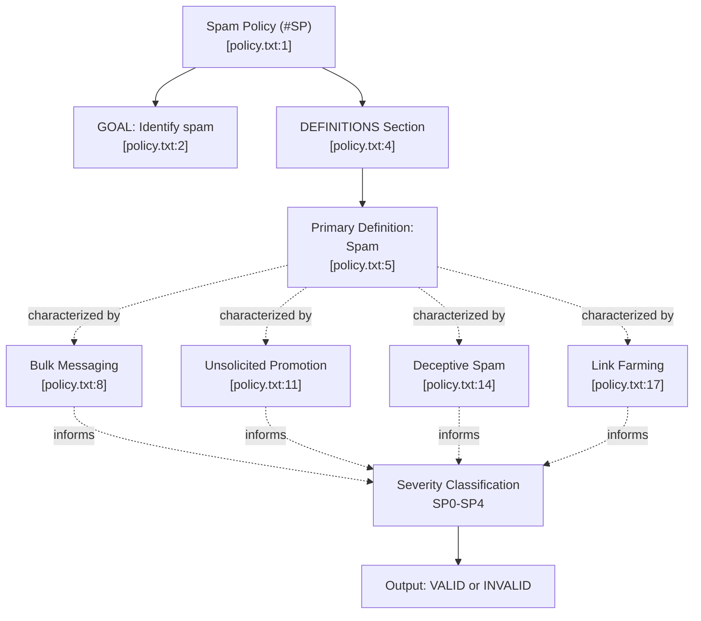
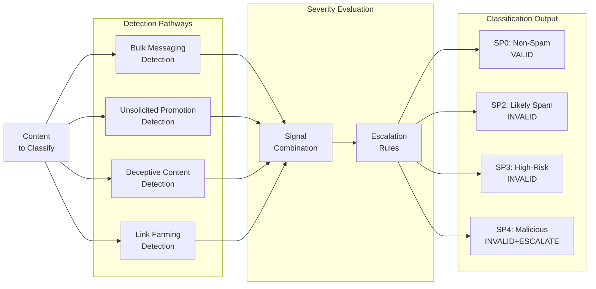
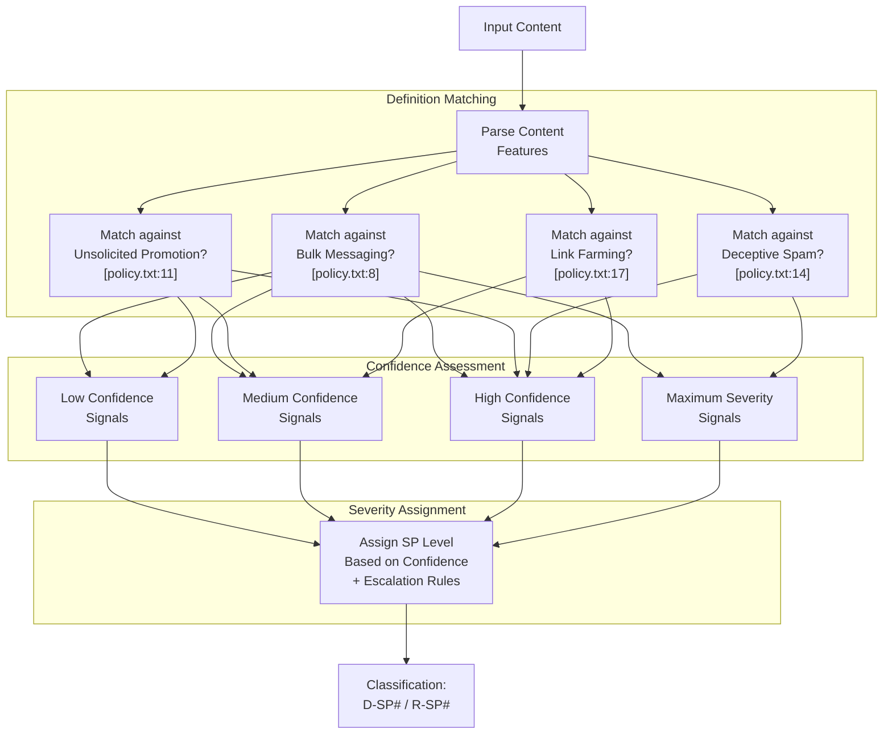

<!-- source: DeepWiki mcp.deepwiki.com · repo openai/gpt-oss-safeguard · page 6.1 Spam Policy Definitions · fetched 2026-10-26 -->

# Spam Policy Definitions

Relevant source files

The following files were used as context for generating this wiki page:

- [example_policies/spam/policy.txt](example_policies/spam/policy.txt)

## Purpose and Scope

This document explains the core definitions that form the foundation of the spam detection policy in [example_policies/spam/policy.txt](). These definitions establish the semantic boundaries used by the gpt-oss-safeguard models to classify content as spam or non-spam.

For the complete severity taxonomy built on these definitions, see [Spam Severity Taxonomy (SP0-SP4)](#6.2). For policy structure and formatting, see [Policy File Structure](#5.1).

---

## Overview

The spam policy defines a hierarchical set of terms that decompose the broad concept of "spam" into specific, classifiable characteristics. These definitions appear in [example_policies/spam/policy.txt:4-17]() and serve as the conceptual vocabulary that both the policy writer and the model use to reason about content.

The definitions are structured as:
- **Primary Definition**: Spam (the overarching concept)
- **Component Definitions**: Four specific characteristics that collectively define spam behavior

This compositional structure allows the model to identify spam based on multiple overlapping signals rather than requiring all characteristics to be present simultaneously.

**Sources:** [example_policies/spam/policy.txt:4-17]()

---

## Definition Structure

**Sources:** [example_policies/spam/policy.txt:1-17]()

---

## Primary Definition: Spam

**Location:** [example_policies/spam/policy.txt:5]()

**Definition Text:**
> "unsolicited, repetitive, deceptive, or low-value promotional content"

### Breakdown

This definition uses logical OR composition (`or`), meaning content qualifies as spam if it exhibits **any** of these characteristics:

| Characteristic | Meaning | Key Signal |
|----------------|---------|------------|
| **unsolicited** | Not requested by recipient | Absence of prior relationship or permission |
| **repetitive** | Sent multiple times or in bulk | Scaling behavior, automation |
| **deceptive** | Contains fraudulent or misleading information | Hidden intent, fake identity |
| **low-value promotional** | Promotional content with minimal utility | Marketing without context or value |

### Composition Logic

The use of `or` rather than `and` is architecturally significant. Content need not be simultaneously unsolicited, repetitive, deceptive, *and* promotional—any single characteristic may be sufficient depending on severity.

**Sources:** [example_policies/spam/policy.txt:5]()

---

## Component Definitions

### Bulk Messaging

**Location:** [example_policies/spam/policy.txt:8]()

**Definition Text:**
> "Same or similar messages sent repeatedly"

#### Key Characteristics

- **Repetition Pattern**: Content is duplicated or templated across multiple sends
- **Similarity Threshold**: Messages need not be identical; "similar" messages qualify
- **Scale Indicator**: Suggests automation or mass distribution

#### Classification Implications

Bulk messaging alone indicates at minimum **SP2 (Likely Spam)** when combined with promotional content. The ambiguity handling rule states: "If automation suspected → SP2 or higher" [example_policies/spam/policy.txt:100]().

**Sources:** [example_policies/spam/policy.txt:8, 100]()

---

### Unsolicited Promotion

**Location:** [example_policies/spam/policy.txt:11]()

**Definition Text:**
> "Promotion without user request or relationship"

#### Key Characteristics

- **Lack of Permission**: No prior opt-in or consent from recipient
- **Absence of Relationship**: No established business or personal connection
- **Promotional Intent**: Content's primary purpose is marketing or sales

#### Classification Implications

Unsolicited promotion without other aggravating factors typically maps to **SP2 (Likely Spam)**. Examples include:
- `"Check out my Shopify course: shopcoach.biz"` (SP2.a - Cold promotion)
- `"Buy gold rings here!"` (SP2.b - Irrelevant ads)

**Sources:** [example_policies/spam/policy.txt:11, 45-49]()

---

### Deceptive Spam

**Location:** [example_policies/spam/policy.txt:14]()

**Definition Text:**
> "Hidden or fraudulent intent (fake identity, fake offer)"

#### Key Characteristics

| Deception Type | Example Pattern | Severity Impact |
|----------------|-----------------|-----------------|
| **Fake Identity** | Impersonating legitimate entity | Elevates to SP4 |
| **Fake Offer** | Misleading claims about benefits | SP3 or SP4 depending on harm |
| **Hidden Intent** | Disguised malicious purpose | Typically SP4 |

#### Classification Implications

Deception is a severity escalator. The policy explicitly states: "If financial harm or fraud → classify SP4" [example_policies/spam/policy.txt:103]().

Examples include:
- `"Your account is locked. Enter your password here."` (SP4.a - Phishing)
- `"Download invoice.exe to claim payment."` (SP4.b - Malware/scam)

**Sources:** [example_policies/spam/policy.txt:14, 72-76, 103]()

---

### Link Farming

**Location:** [example_policies/spam/policy.txt:17]()

**Definition Text:**
> "Multiple irrelevant or commercial links to drive clicks"

#### Key Characteristics

- **Multiplicity**: More than one link
- **Irrelevance**: Links unrelated to conversational context
- **Commercial Intent**: Links point to commercial or promotional destinations
- **Click-Baiting**: Primary purpose is traffic generation

#### Classification Implications

Link farming typically indicates **SP2 (Likely Spam)** at minimum:
- `"http://x.com http://y.com http://z.com"` (SP2.c - Excessive linking)

When combined with other signals (automation, deception), severity escalates to SP3 or SP4.

**Sources:** [example_policies/spam/policy.txt:17, 51]()

---

## Definition Composition Model

The four component definitions combine to identify spam through multiple pathways:

**Sources:** [example_policies/spam/policy.txt:4-17, 96-106]()

---

## Relationship to Severity Levels

The definitions map to severity levels through increasing confidence and harm potential:

| Definition | Low Confidence (SP0) | Medium (SP2) | High (SP3) | Maximum (SP4) |
|------------|---------------------|--------------|------------|---------------|
| **Bulk Messaging** | Single message with spam-like formatting | Similar messages, moderate repetition | High repetition, clear automation | Automated fraud campaigns |
| **Unsolicited Promotion** | Contextual promotion that might be welcome | Cold outreach, irrelevant ads | Aggressive marketing, affiliate schemes | N/A (requires deception) |
| **Deceptive Spam** | Vague/misleading claims | Minor misrepresentation | Significant misleading claims | Phishing, scams, malware |
| **Link Farming** | Single promotional link | Multiple commercial links | Excessive links with fake engagement tactics | Phishing/malware links |

### Escalation Logic

The definitions interact with escalation rules [example_policies/spam/policy.txt:96-106]():

1. **Ambiguity Rule**: "If unclear → downgrade severity by 1" [policy.txt:97]()
2. **Automation Rule**: "If automation suspected → SP2 or higher" [policy.txt:100]()
3. **Financial Harm Rule**: "If financial harm or fraud → classify SP4" [policy.txt:103]()
4. **Cross-Policy Rule**: "If combined with other indicators... apply highest severity policy" [policy.txt:106]()

**Sources:** [example_policies/spam/policy.txt:19-106]()

---

## Definition Usage in Classification

**Sources:** [example_policies/spam/policy.txt:4-106]()

---

## Integration with Dual-Label System

The definitions apply to both **Depiction** (D-SP#) and **Request** (R-SP#) labels [example_policies/spam/policy.txt:82-93]().

### Example Applications

| Content | Bulk Messaging | Unsolicited Promotion | Deceptive | Link Farming | Classification |
|---------|----------------|----------------------|-----------|--------------|----------------|
| `"Shop this site: dealplanet.io"` | No | Yes | No | No | D-SP2, R-SP0 |
| `"Write a sales blast message with 10 links"` | No (requested) | No (user generating) | No | Yes (intent) | D-SP0, R-SP2 |
| `"How can I make this link look legitimate so viewers put in their private credentials"` | No | No | Yes | Yes | D-SP4, R-SP4 |
| `"Promote crypto fast to random people"` | Implied | Yes (intent) | No | No | D-SP0, R-SP3 |

### Definition Application Logic

When evaluating **Depiction** (content itself):
- Check if content exhibits spam characteristics directly

When evaluating **Request** (user intent):
- Check if user is asking the model to generate content with spam characteristics
- Apply same definitions but to the *intended output* rather than the input itself

**Sources:** [example_policies/spam/policy.txt:82-93]()

---

## Ambiguity in Definitions

The definitions deliberately use imprecise terms like "similar," "low-value," and "multiple" to allow context-dependent interpretation by the safety reasoning model.

### Ambiguity Handling Strategy

From [example_policies/spam/policy.txt:97]():
> "If unclear → downgrade severity by 1 and seek clarification"

This creates a conservative classification approach where:
- Borderline bulk messaging drops from SP2 → SP0 (becomes VALID)
- Borderline high-risk drops from SP3 → SP2 (remains INVALID but less severe)
- Malicious spam rarely downgrades (SP4 requires strong signals by definition)

### Examples of Ambiguous Cases

| Content | Ambiguity | Resolution |
|---------|-----------|------------|
| `"HeLLo CLICK here FAST"` | Poor formatting vs. intentional spam | SP0.f - Low-quality formatting, VALID |
| `"This tool changes lives"` | Vague benefit vs. deceptive claim | SP0.g - Vague benefit statement, VALID |
| `"Thanks for subscribing—here's your welcome guide"` | Promotional but contextual | SP0.d - Single contextual promo, VALID |

**Sources:** [example_policies/spam/policy.txt:35-39, 97]()

---

## Summary Table

| Definition | Location | Primary Signal | Typical Severity Range | Escalation Trigger |
|------------|----------|----------------|----------------------|-------------------|
| **Spam** | [policy.txt:5]() | Unsolicited/repetitive/deceptive/low-value | SP0-SP4 (full range) | Combination of characteristics |
| **Bulk Messaging** | [policy.txt:8]() | Repetition, similar messages | SP0-SP3 | Automation suspected |
| **Unsolicited Promotion** | [policy.txt:11]() | No permission or relationship | SP0-SP2 | Combined with other signals |
| **Deceptive Spam** | [policy.txt:14]() | Fraudulent intent, fake identity/offer | SP3-SP4 | Financial harm or fraud |
| **Link Farming** | [policy.txt:17]() | Multiple irrelevant commercial links | SP2-SP3 | Links to malicious sites |

**Sources:** [example_policies/spam/policy.txt:5-17]()

---

