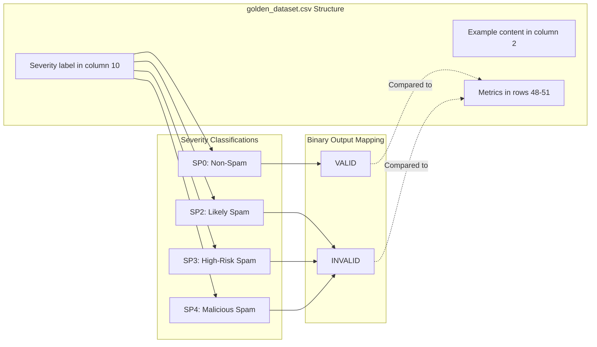
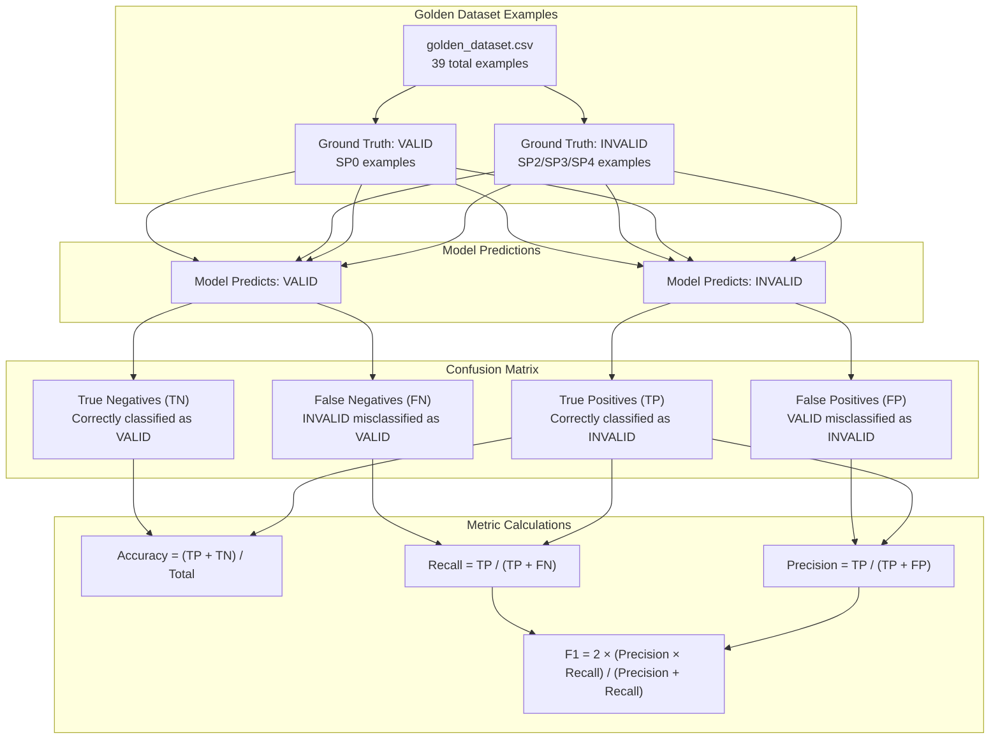
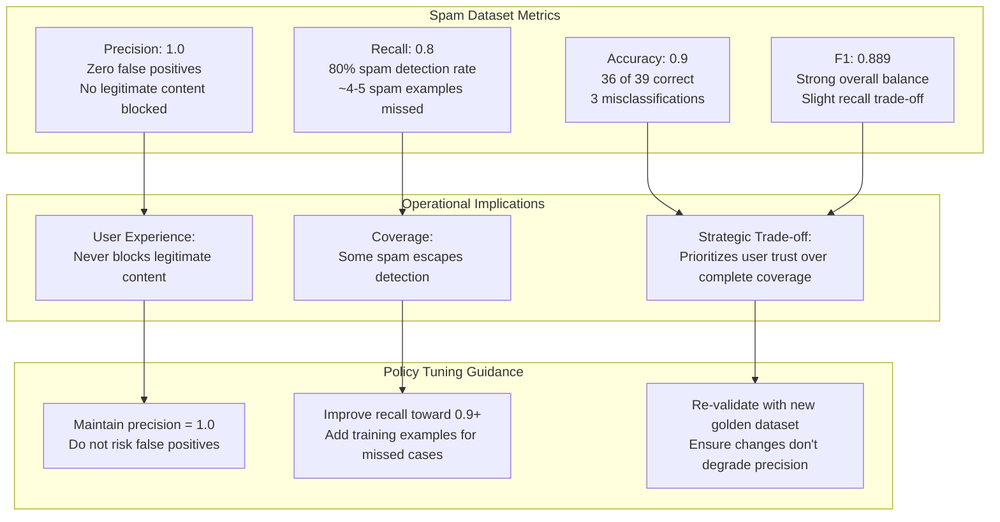
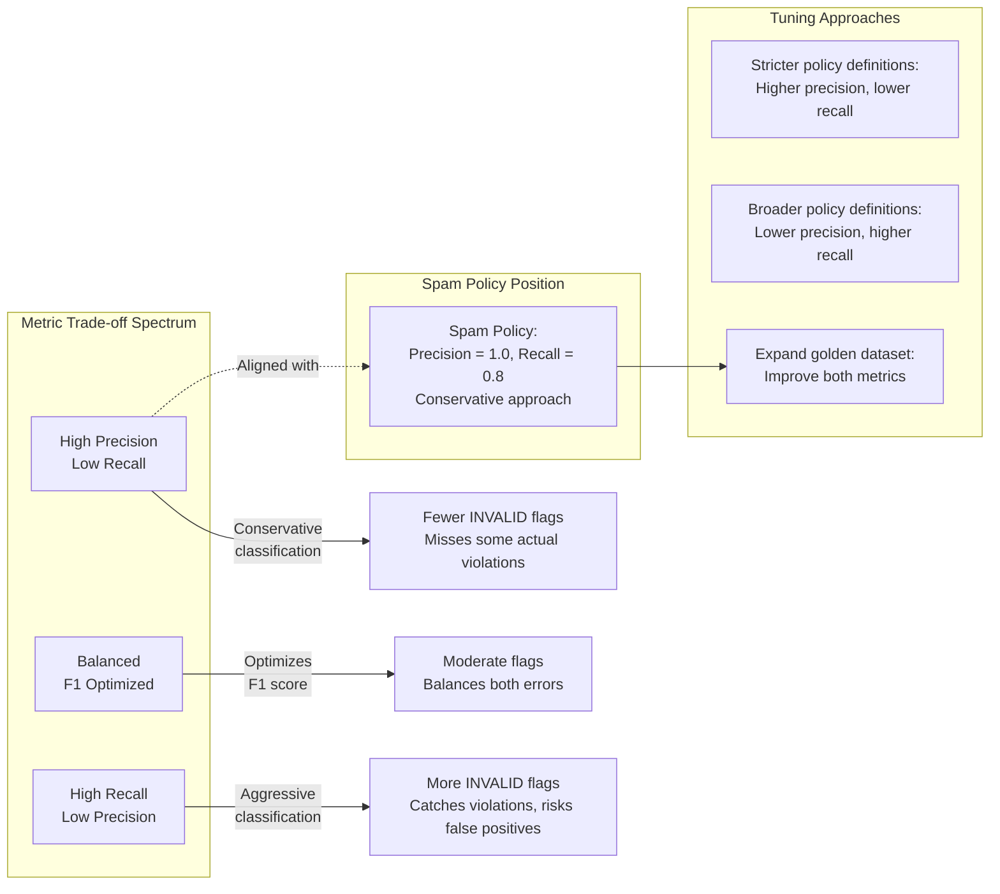
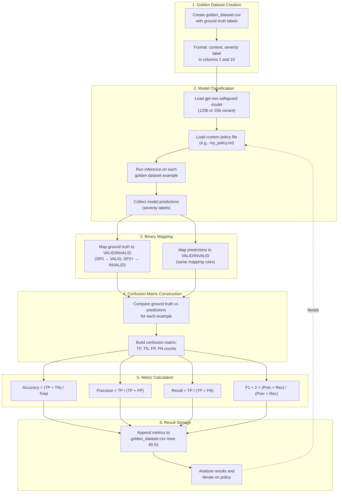

<!-- source: DeepWiki mcp.deepwiki.com · repo openai/gpt-oss-safeguard · page 7.2 Performance Metrics · fetched 2026-10-26 -->

# Performance Metrics

<details>
<summary>Relevant source files</summary>

The following files were used as context for generating this wiki page:

- [example_policies/spam/golden_dataset.csv](example_policies/spam/golden_dataset.csv)

</details>


## Purpose and Scope

This page documents the four key performance metrics used to evaluate gpt-oss-safeguard model classifications: Accuracy, Precision, Recall, and F1 Score. These metrics are computed by comparing model outputs against golden datasets and provide quantitative measures of classification quality. For information about creating and structuring golden datasets, see [Golden Datasets](#7.1). For guidance on using these metrics to validate custom policies, see [Validating Your Policies](#7.3).

---

## Overview of Classification Metrics

Performance metrics quantify how well the model's classifications align with ground truth labels in golden datasets. The gpt-oss-safeguard evaluation framework computes four standard binary classification metrics:

| Metric | Spam Example Value | Interpretation |
|--------|-------------------|----------------|
| **Accuracy** | 0.9 | Overall correctness across all classifications |
| **Precision** | 1.0 | Accuracy of INVALID predictions (no false positives) |
| **Recall** | 0.8 | Coverage of actual INVALID content (some false negatives) |
| **F1 Score** | 0.889 | Harmonic mean balancing precision and recall |

These metrics are stored directly in golden dataset files alongside test examples, as seen in [example_policies/spam/golden_dataset.csv:48-51]().

**Sources:** [example_policies/spam/golden_dataset.csv:48-51]()

---

## Metric Computation from Golden Datasets

### Classification Binary Mapping

Golden datasets contain severity-level classifications (e.g., SP0, SP2, SP3, SP4) which are mapped to binary outputs:



### Confusion Matrix Foundation

All four metrics derive from a confusion matrix constructed by comparing model predictions against ground truth labels:



**Sources:** [example_policies/spam/golden_dataset.csv:1-51]()

---

## Metric Definitions

### Accuracy

**Definition:** The proportion of all classifications (both VALID and INVALID) that are correct.

**Formula:** `Accuracy = (TP + TN) / (TP + TN + FP + FN)`

**Spam Example:** 0.9 indicates 90% of all 39 examples in [example_policies/spam/golden_dataset.csv]() were classified correctly.

**Interpretation:** Accuracy provides a single number representing overall correctness but can be misleading when classes are imbalanced. In safety contexts where INVALID content is rarer than VALID content, a model could achieve high accuracy by simply classifying everything as VALID.

### Precision

**Definition:** Among all content classified as INVALID, what proportion is actually invalid.

**Formula:** `Precision = TP / (TP + FP)`

**Spam Example:** 1.0 (perfect precision) means every piece of content the model flagged as spam was genuinely spam—zero false positives.

**Interpretation:** High precision is critical for trust and safety applications where false positives damage user experience. A precision of 1.0 means users never see legitimate content incorrectly blocked.

### Recall

**Definition:** Among all actually INVALID content, what proportion was correctly identified.

**Formula:** `Recall = TP / (TP + FN)`

**Spam Example:** 0.8 means the model correctly identified 80% of actual spam but missed 20% (false negatives).

**Interpretation:** Recall measures coverage—how much harmful content escapes detection. Lower recall means more spam slips through, but this trade-off is often acceptable when paired with perfect precision.

### F1 Score

**Definition:** The harmonic mean of precision and recall, providing a single metric that balances both.

**Formula:** `F1 = 2 × (Precision × Recall) / (Precision + Recall)`

**Spam Example:** 0.889 reflects the balance between perfect precision (1.0) and good recall (0.8).

**Interpretation:** F1 score is useful for comparing models or policy versions holistically, though in safety contexts, precision and recall should often be analyzed independently due to their different operational impacts.

**Sources:** [example_policies/spam/golden_dataset.csv:48-51]()

---

## Spam Policy Metrics Analysis

### Dataset Composition

The spam golden dataset demonstrates metric computation across 39 examples distributed across severity levels:

| Severity Level | Example Count | Binary Mapping | Example Line Range |
|---------------|--------------|----------------|-------------------|
| SP0 (Non-Spam) | 17 | VALID | [example_policies/spam/golden_dataset.csv:3-19]() |
| SP2 (Likely Spam) | 7 | INVALID | [example_policies/spam/golden_dataset.csv:22-28]() |
| SP3 (High-Risk Spam) | 8 | INVALID | [example_policies/spam/golden_dataset.csv:30-37]() |
| SP4 (Malicious Spam) | 7 | INVALID | [example_policies/spam/golden_dataset.csv:39-45]() |

### Interpreting the Results



The perfect precision indicates the spam policy definitions in [example_policies/spam/policy.txt]() are well-tuned to avoid over-classification. The 0.8 recall suggests edge cases exist where spam characteristics are subtle enough to evade detection—these are candidates for policy refinement or additional golden dataset examples.

**Sources:** [example_policies/spam/golden_dataset.csv:48-51]()

---

## Interpreting Metrics in Safety Contexts

### Precision vs. Recall Trade-offs

Safety classification contexts differ fundamentally from traditional machine learning scenarios because false positives and false negatives have asymmetric costs:

| Scenario | False Positive Impact | False Negative Impact | Priority |
|----------|---------------------|---------------------|----------|
| **Content Moderation** | Blocks legitimate user content, damages trust, potential legal liability | Harmful content reaches users, potential harm, regulatory issues | Often prioritizes precision |
| **Spam Detection** | Legitimate emails/messages blocked | Spam reaches inboxes, annoyance | Balanced or precision-favored |
| **Malware Detection** | Legitimate software flagged | Malware executes | Often prioritizes recall |
| **Fraud Detection** | Legitimate transactions blocked | Fraudulent transactions succeed | Context-dependent |



### The Value of Perfect Precision

The spam policy's precision of 1.0 is architecturally significant:

1. **Zero User Friction:** No legitimate messages are ever blocked, eliminating user complaints and support burden
2. **Trust Building:** Users trust the system won't incorrectly penalize them
3. **Regulatory Safety:** Minimizes risk of liability for blocking protected speech or business-critical communications
4. **Iteration Safety:** Provides a solid baseline—policy improvements can focus on recall without risking precision degradation

The 0.2 recall gap (missing 20% of spam) is an acceptable trade-off in most contexts, as:
- Users typically prefer some spam over blocked legitimate content
- Missed spam can be addressed through user reporting mechanisms
- Policy refinements can incrementally improve recall while maintaining precision

**Sources:** [example_policies/spam/golden_dataset.csv:48-51]()

---

## Computing Metrics for Custom Policies

### Workflow for Metric Generation



### Golden Dataset Format Requirements

The metrics computation expects golden datasets to follow the format established in [example_policies/spam/golden_dataset.csv]():

- **Column 2:** Example content text
- **Column 10:** Ground truth severity classification (e.g., `SP0`, `SP2`, `SP3`, `SP4`)
- **Rows 48-51:** Performance metrics in format `,,,,,,,,Metric Name,Value`

Example structure:
```
,,,,,,,,,gpt-oss-safeguard classification,
SP0,,,,,,,,,,
1,Example content text,,,,,,,,SP0,
...
,,,,,,,,,Accuracy,0.9
,,,,,,,,,Precision,1.0
,,,,,,,,,Recall,0.8
,,,,,,,,,F1,0.889
```

**Sources:** [example_policies/spam/golden_dataset.csv:1-51]()

---

## Metric-Driven Policy Refinement

### Iterative Improvement Cycle

Performance metrics should guide policy refinement through an iterative process:

1. **Baseline Measurement:** Compute initial metrics on representative golden dataset
2. **Identify Weaknesses:** Analyze false positives (if precision < 1.0) and false negatives (if recall is insufficient)
3. **Policy Adjustment:** Refine severity definitions, add clarifying examples, adjust AMBIGUITY & ESCALATION rules
4. **Re-evaluation:** Run model on updated golden dataset, compare new metrics to baseline
5. **Validation:** Ensure improvements don't introduce regressions (e.g., improved recall shouldn't degrade precision)

### Target Metric Ranges

While optimal metrics depend on use case, general guidance for safety classification:

| Metric | Minimum Acceptable | Good | Excellent | Notes |
|--------|-------------------|------|-----------|-------|
| **Accuracy** | 0.80 | 0.85 | 0.90+ | Baseline correctness |
| **Precision** | 0.95 | 0.98 | 1.0 | Critical for trust—prioritize over recall |
| **Recall** | 0.70 | 0.80 | 0.90+ | Coverage—acceptable to trade for precision |
| **F1** | 0.75 | 0.85 | 0.90+ | Overall balance indicator |

The spam policy achieves "Excellent" precision (1.0), "Good" recall (0.8), and "Excellent" accuracy (0.9), demonstrating a well-tuned production-ready policy.

**Sources:** [example_policies/spam/golden_dataset.csv:48-51]()

---

## Key Takeaways

1. **Four Core Metrics:** Accuracy, Precision, Recall, and F1 Score quantify classification performance against golden datasets
2. **Precision Priority:** In safety contexts, perfect precision (no false positives) is often more valuable than maximum recall
3. **Stored with Data:** Metrics are computed and stored directly in golden dataset files at [example_policies/spam/golden_dataset.csv:48-51]()
4. **Binary Mapping:** Multi-level severity classifications (SP0-SP4) map to binary VALID/INVALID outputs for metric computation
5. **Iterative Refinement:** Metrics guide policy improvements through systematic comparison of baseline and updated performance
6. **Context-Dependent Targets:** Optimal metric values vary by use case—spam detection differs from malware detection in precision vs. recall priorities

For guidance on creating the golden datasets that generate these metrics, see [Golden Datasets](#7.1). To apply these metrics to validate your custom policies, see [Validating Your Policies](#7.3).

**Sources:** [example_policies/spam/golden_dataset.csv:1-51]()

---

