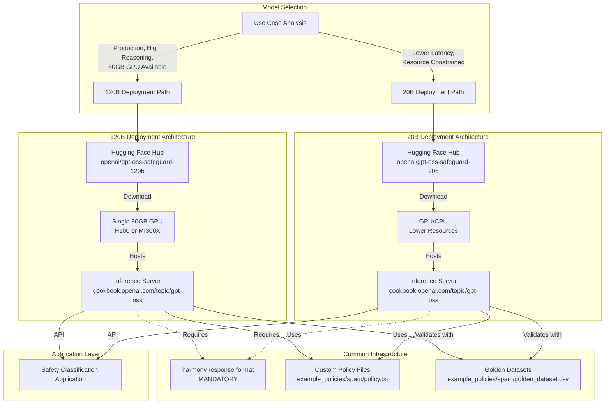
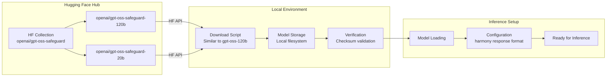
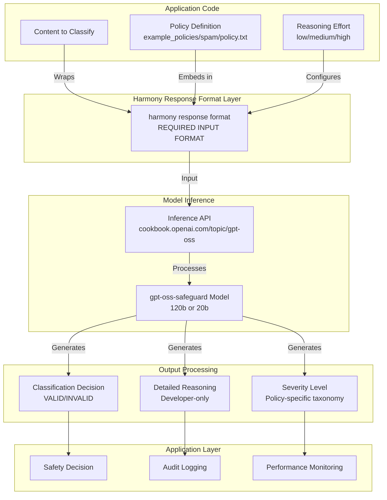
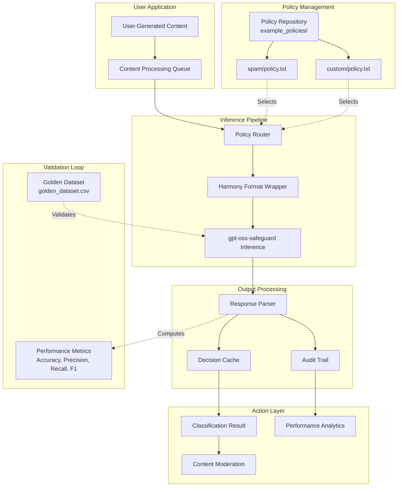
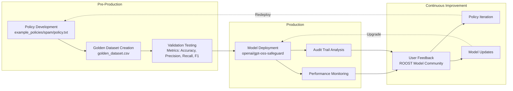
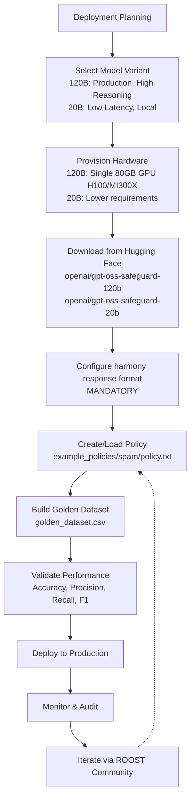

<!-- source: DeepWiki mcp.deepwiki.com · repo openai/gpt-oss-safeguard · page 8 Deployment and Integration · fetched 2026-10-26 -->

# Deployment and Integration

Relevant source files

The following files were used as context for generating this wiki page:

- [README.md](README.md)

This document provides comprehensive technical guidance for deploying `gpt-oss-safeguard-120b` and `gpt-oss-safeguard-20b` models in production environments. It covers hardware requirements, model download procedures, inference configuration, and integration patterns for building safety classification systems.

**Scope:** This page focuses on the operational aspects of deploying the models. For model selection criteria, see [Model Variants](#3). For inference API usage patterns, see [Inference Configuration](#8.3). For policy creation and management, see [Working with Policies](#5).

Sources: [README.md:1-46]()

---

## Deployment Architecture Overview

The gpt-oss-safeguard models support multiple deployment topologies based on resource availability and use case requirements. Both models share common infrastructure patterns but differ in hardware demands and target environments.

### Deployment Topology

**Deployment Architecture:** The 120B model targets centralized deployments with dedicated 80GB GPUs (NVIDIA H100, AMD MI300X), while the 20B model enables distributed or resource-constrained environments. Both variants share identical integration patterns through the harmony response format and policy-based configuration.

Sources: [README.md:17-18](), [README.md:40]()

---

## Hardware Requirements

The two model variants have distinct hardware profiles optimized for different deployment scenarios.

| Component | gpt-oss-safeguard-120b | gpt-oss-safeguard-20b |
|-----------|------------------------|------------------------|
| Total Parameters | 117B | 21B |
| Active Parameters | 5.1B | 3.6B |
| GPU Memory | Single 80GB GPU | Lower requirements |
| Recommended GPUs | NVIDIA H100, AMD MI300X | Various GPU/CPU configurations |
| Target Environment | Production, Cloud, Enterprise | Edge, On-premises, Local |

The 120B model's single-GPU requirement simplifies deployment by avoiding multi-GPU coordination complexity. The sparse architecture (5.1B active of 117B total) enables efficient inference despite the large parameter count.

**Detailed specifications:** See [Hardware Requirements](#8.1) for complete hardware specifications, deployment topology options, and resource planning guidelines.

Sources: [README.md:17-18]()

---

## Model Download and Setup

Both models are distributed through the [Hugging Face Hub](https://huggingface.co/collections/openai/gpt-oss-safeguard) and follow similar download patterns to the base `gpt-oss` models.

### Download Process

**Model URLs:**
- 120B: `https://huggingface.co/openai/gpt-oss-safeguard-120b`
- 20B: `https://huggingface.co/openai/gpt-oss-safeguard-20b`

The download procedure mirrors the `gpt-oss-120b` setup instructions. Models are available through standard Hugging Face transformers library integration.

**Detailed instructions:** See [Model Download and Setup](#8.2) for step-by-step download procedures, authentication requirements, and initial configuration.

Sources: [README.md:3](), [README.md:40]()

---

## Inference Configuration

The models use inference patterns similar to the base `gpt-oss` models, with the critical requirement of the harmony response format.

### Inference Stack

**Critical requirement:** The harmony response format is mandatory. Models trained on this format will not function correctly without it.

**Configuration options:**
- **Reasoning effort:** Adjusts latency vs. accuracy trade-off (`low`, `medium`, `high`)
- **Policy integration:** Custom policies embedded in the inference request
- **Output handling:** Classification decision, detailed reasoning (not for end users), severity levels

The inference API follows patterns documented in the [OpenAI Cookbook](https://cookbook.openai.com/topic/gpt-oss) for `gpt-oss` models, adapted for safety classification.

**Detailed configuration:** See [Inference Configuration](#8.3) for API specifications, harmony format integration, and inference pattern examples.

Sources: [README.md:20](), [README.md:27](), [README.md:32]()

---

## Integration Patterns

### Safety Classification Pipeline

**Integration pattern:** Applications maintain policy repositories, route content through policy-specific inference pipelines, cache decisions for efficiency, and maintain audit trails for compliance and debugging.

**Key components:**
- **Policy Router:** Selects appropriate policy based on content type or context
- **Harmony Format Wrapper:** Ensures all requests conform to required input format
- **Decision Cache:** Reduces redundant inference for identical content
- **Audit Log:** Captures reasoning for developer analysis (not exposed to end users)

Sources: [README.md:26](), [README.md:36]()

---

## Production Considerations

### Deployment Checklist

| Phase | Requirement | Reference |
|-------|-------------|-----------|
| **Infrastructure** | Provision 80GB GPU for 120B or equivalent for 20B | [Hardware Requirements](#8.1) |
| **Model Setup** | Download model from Hugging Face Hub | [Model Download and Setup](#8.2) |
| **Format Integration** | Implement harmony response format wrapper | [Inference Configuration](#8.3) |
| **Policy Definition** | Create and validate custom safety policies | [Working with Policies](#5) |
| **Golden Dataset** | Build validation dataset with ground truth | [Golden Datasets](#7.1) |
| **Performance Validation** | Measure accuracy, precision, recall, F1 | [Performance Metrics](#7.2) |
| **Reasoning Effort** | Calibrate low/medium/high settings for use case | [Configurable Reasoning Effort](#4.4) |
| **Audit Logging** | Capture reasoning outputs for debugging | [Production Considerations](#8.4) |
| **Monitoring** | Track latency, throughput, classification distribution | [Production Considerations](#8.4) |
| **Error Handling** | Implement retry logic and fallback mechanisms | [Production Considerations](#8.4) |

### Operational Workflow

**Operational cycle:** Policies are developed and validated pre-production using golden datasets. Production deployments generate monitoring data and audit trails, which feed back into policy iteration through the ROOST Model Community partnership.

**Critical production aspects:**
1. **Latency optimization:** Reasoning effort configuration balances accuracy and response time
2. **Batch processing:** Group inference requests to maximize throughput
3. **Error handling:** Models require harmony format; malformed inputs will fail
4. **Monitoring:** Track classification distribution to detect policy drift
5. **Reasoning outputs:** Store for debugging but never expose to end users

**Detailed guidance:** See [Production Considerations](#8.4) for comprehensive best practices, including latency optimization, batch processing strategies, error handling patterns, and monitoring model reasoning outputs.

Sources: [README.md:27](), [README.md:44-45]()

---

## Community and Support

The gpt-oss-safeguard models are partner models of the [ROOST Model Community](https://roost.tools/) (Robust Open Online Safety Tools). OpenAI is committed to incorporating user feedback and jointly iterating on future releases.

**Engagement channels:**
- **Feedback submission:** [RMC GitHub repository](https://github.com/roostorg/open-models)
- **Usage examples:** [OpenAI Cookbook](https://cookbook.openai.com/articles/gpt-oss-safeguard-guide)
- **Community discussion:** ROOST Model Community forums
- **Model card:** [arXiv paper](https://arxiv.org/abs/2508.10925)

**Integration support:** The cookbook provides detailed prompting guides, sample policies, and inference examples to accelerate integration.

Sources: [README.md:44-45](), [README.md:7-9]()

---

## Quick Reference

**Deployment sequence:** Model selection → hardware provisioning → download → format configuration → policy creation → validation → production deployment → monitoring → community feedback loop.

Sources: [README.md:1-46]()

---

