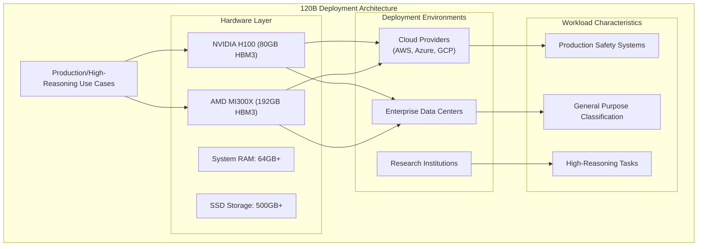
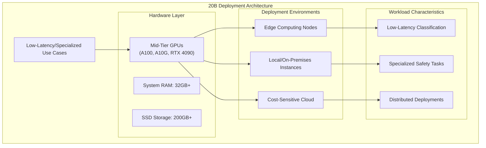
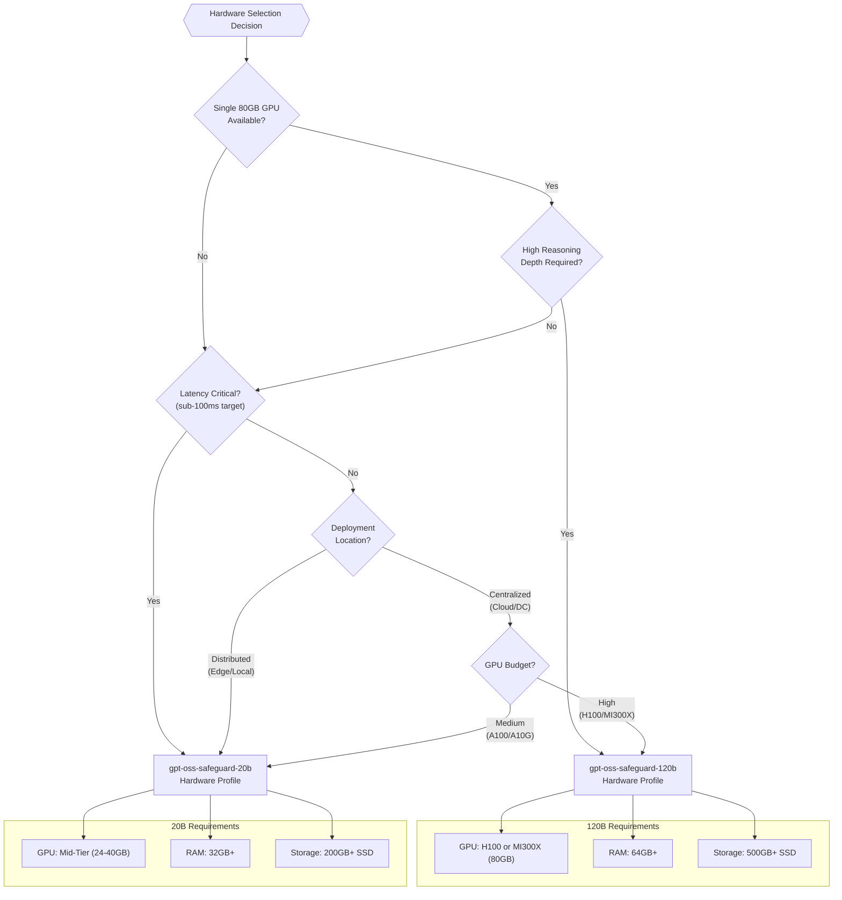
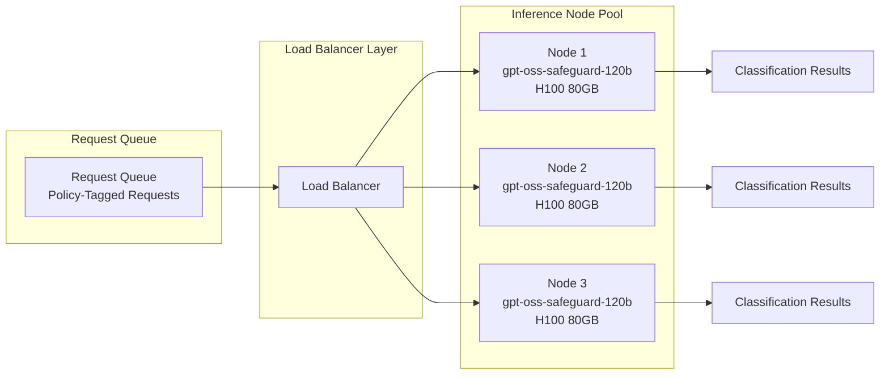
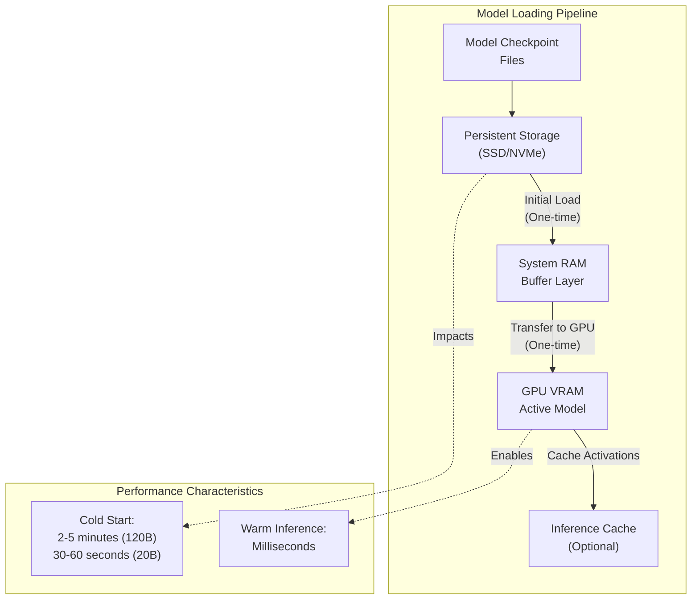
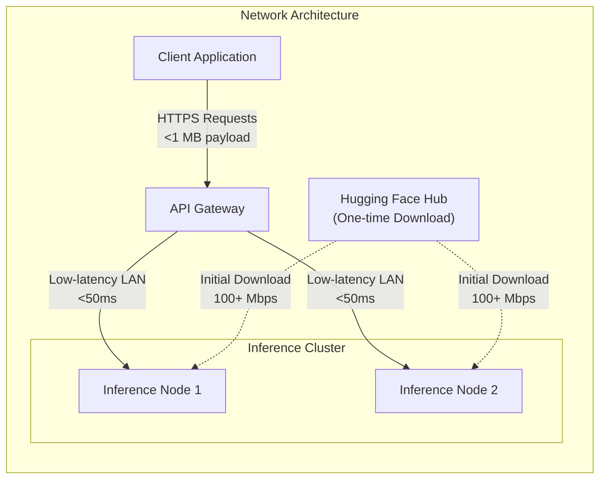
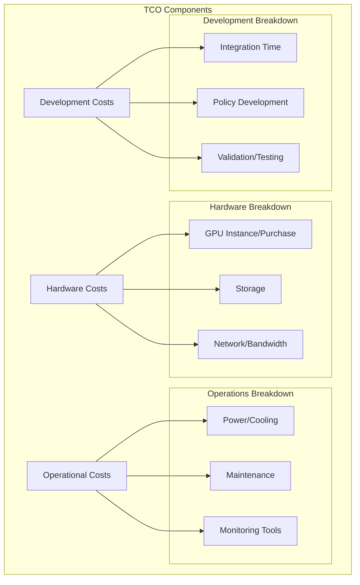

<!-- source: DeepWiki mcp.deepwiki.com · repo openai/gpt-oss-safeguard · page 8.1 Hardware Requirements · fetched 2026-10-26 -->

# Hardware Requirements

Relevant source files

The following files were used as context for generating this wiki page:

- [README.md](README.md)

## Purpose and Scope

This document details the hardware specifications required to deploy and run the `gpt-oss-safeguard` models. It covers GPU requirements, memory specifications, and deployment topology options for both the 120B and 20B model variants. For instructions on downloading and configuring models, see [Model Download and Setup](#8.2). For production deployment best practices, see [Production Considerations](#8.4).

---

## Model Specifications Overview

The `gpt-oss-safeguard` system offers two model variants with distinct hardware profiles optimized for different deployment scenarios. Both models use sparse or mixture-of-experts architectures, where active parameters are significantly fewer than total parameters, enabling efficient inference.

### Specification Comparison

| Specification | gpt-oss-safeguard-120b | gpt-oss-safeguard-20b |
|---------------|------------------------|----------------------|
| **Total Parameters** | 117B | 21B |
| **Active Parameters** | 5.1B | 3.6B |
| **Minimum GPU Memory** | 80GB | Lower (exact requirements not specified) |
| **Recommended GPUs** | NVIDIA H100, AMD MI300X | Standard GPUs (lower tier acceptable) |
| **GPU Count** | Single GPU | Single GPU |
| **Primary Use Cases** | Production, General Purpose, High Reasoning | Low Latency, Local Deployment, Specialized Tasks |
| **Deployment Pattern** | Centralized (Cloud, Enterprise) | Distributed (Edge, On-Premises) |

Sources: [README.md:17-18]()

---

## gpt-oss-safeguard-120b Hardware Requirements

### GPU Specifications

The 120B model variant is explicitly designed to fit on a **single 80GB GPU**, eliminating the need for multi-GPU parallelism and associated complexity.

**Supported GPU Models:**
- **NVIDIA H100** (80GB HBM3)
- **AMD MI300X** (192GB HBM3, though only 80GB minimum required)

The single-GPU constraint is an architectural decision that significantly reduces operational complexity by avoiding:
- Multi-GPU communication overhead
- Tensor parallelism configuration
- Pipeline parallelism management
- Complex distributed inference orchestration

### Memory Requirements

| Memory Type | Requirement | Purpose |
|-------------|-------------|---------|
| **GPU Memory (VRAM)** | 80GB minimum | Model weights, activations, KV cache |
| **System RAM** | 64GB+ recommended | Model loading, preprocessing, I/O buffers |
| **Storage** | 500GB+ SSD | Model checkpoint storage, caching |

### Architecture Characteristics

The 120B model employs a sparse architecture with **5.1B active parameters** out of 117B total. This means:
- Only ~4.4% of parameters are active during inference
- Reduced computational requirements compared to dense models of similar size
- Memory footprint dominated by parameter storage, not computation

### Deployment Topology

Sources: [README.md:17]()

---

## gpt-oss-safeguard-20b Hardware Requirements

### GPU Specifications

The 20B model variant is designed for **resource-constrained environments** where lower latency and operational flexibility are prioritized over maximum reasoning capability.

**GPU Characteristics:**
- Lower memory requirements than 120B variant (exact threshold not specified)
- Compatible with mid-tier datacenter GPUs
- Suitable for consumer-grade high-end GPUs in local deployments
- Single-GPU deployment pattern maintained

**Likely Compatible GPUs** (inferred from 21B total/3.6B active architecture):
- NVIDIA A100 (40GB or 80GB)
- NVIDIA A10G (24GB)
- NVIDIA RTX 4090 (24GB) for local deployment
- AMD Instinct MI210 (64GB)

### Memory Requirements

| Memory Type | Estimated Requirement | Purpose |
|-------------|----------------------|---------|
| **GPU Memory (VRAM)** | 24GB-40GB range | Model weights, activations, KV cache |
| **System RAM** | 32GB+ recommended | Model loading, preprocessing |
| **Storage** | 200GB+ SSD | Model checkpoint storage |

### Architecture Characteristics

The 20B model employs a sparse architecture with **3.6B active parameters** out of 21B total. This represents:
- ~17% active parameter ratio (higher than 120B variant)
- Optimized for lower-latency inference
- Reduced memory footprint for distributed deployment

### Deployment Topology

Sources: [README.md:18]()

---

## Hardware Selection Decision Tree

Selecting the appropriate model variant depends on multiple factors including deployment environment, performance requirements, and resource availability.

### Selection Criteria

| Criterion | Choose 120B | Choose 20B |
|-----------|-------------|------------|
| **GPU Availability** | H100 or MI300X (80GB) available | Mid-tier GPUs (24-40GB) available |
| **Use Case Priority** | Maximum accuracy, complex reasoning | Low latency, cost efficiency |
| **Deployment Pattern** | Centralized, well-resourced | Distributed, edge, local |
| **Latency Tolerance** | 100ms+ acceptable | Sub-100ms target |
| **Budget** | Premium GPU budget | Standard GPU budget |
| **Reasoning Complexity** | High (multi-policy, ambiguous cases) | Standard (clear policy boundaries) |

Sources: [README.md:17-18]()

---

## Multi-GPU and Distributed Inference

### Not Required for Standard Deployment

Both model variants are explicitly designed for **single-GPU deployment**. This architectural decision eliminates common distributed inference challenges:

- No tensor parallelism required
- No pipeline parallelism configuration
- No inter-GPU communication overhead
- Simplified deployment scripts
- Reduced operational complexity

### Optional Scaling Patterns

While single-GPU deployment is standard, horizontal scaling is possible for high-throughput scenarios:

**Horizontal Scaling Use Cases:**
- High request volume (>1000 req/sec)
- Multiple concurrent policies
- Geographic distribution requirements
- High availability requirements

Sources: [README.md:17-18]()

---

## Storage and I/O Considerations

### Model Checkpoint Storage

| Model Variant | Checkpoint Size | Storage Type | Rationale |
|---------------|----------------|--------------|-----------|
| **120B** | ~250GB (estimated) | NVMe SSD | Fast loading, frequent restarts |
| **20B** | ~50GB (estimated) | NVMe/SATA SSD | Moderate I/O requirements |

### I/O Performance Requirements

**Storage Performance Recommendations:**
- **Minimum:** SATA SSD (500 MB/s read)
- **Recommended:** NVMe SSD (3000+ MB/s read)
- **Optimal:** PCIe 4.0 NVMe (7000+ MB/s read) for production environments

Sources: [README.md:17-18]()

---

## Network Requirements

### Model Download

Initial model download from Hugging Face Hub requires:
- **Network bandwidth:** 100 Mbps+ recommended
- **Download time (120B):** ~20-30 minutes @ 100 Mbps
- **Download time (20B):** ~5-10 minutes @ 100 Mbps

### Inference Network Requirements

For inference endpoints:
- **Latency:** <50ms to application layer (same datacenter preferred)
- **Bandwidth:** Minimal (input/output text, typically <1 MB/request)
- **Concurrent connections:** Depends on deployment scale

Sources: [README.md:40]()

---

## Hardware Cost Considerations

### Cloud Deployment Cost Estimates

| Deployment Type | Hardware | Estimated Cost ($/hour)* | Best For |
|-----------------|----------|-------------------------|----------|
| **120B Cloud (H100)** | 1x H100 80GB | $3-$5/hr | Production, high-accuracy |
| **120B Cloud (MI300X)** | 1x MI300X 192GB | $2-$4/hr | Cost-optimized production |
| **20B Cloud (A100)** | 1x A100 40GB | $1-$2/hr | Development, testing |
| **20B Cloud (A10G)** | 1x A10G 24GB | $0.50-$1/hr | Edge, specialized tasks |
| **20B On-Premises** | 1x RTX 4090 24GB | One-time ~$1,600 | Local deployment |

*Estimates based on major cloud provider pricing as of 2025. Actual costs vary by provider, region, and commitment terms.

### Total Cost of Ownership (TCO)

Sources: [README.md:17-18]()

---

## Compatibility with Inference Frameworks

Both model variants are designed for compatibility with standard inference frameworks used by `gpt-oss` models. The specific inference setup is similar to `gpt-oss-120b` and `gpt-oss-20b`.

### Framework Compatibility Matrix

| Framework | 120B Support | 20B Support | Notes |
|-----------|--------------|-------------|-------|
| **vLLM** | Expected | Expected | Standard for large model inference |
| **TensorRT-LLM** | Expected | Expected | Optimized for NVIDIA GPUs |
| **Hugging Face Transformers** | Likely | Likely | Standard PyTorch backend |
| **Custom Inference** | Via Cookbook | Via Cookbook | See inference configuration docs |

For detailed inference setup instructions, refer to the [OpenAI Cookbook](https://cookbook.openai.com/topic/gpt-oss) referenced in [README.md:32]().

Sources: [README.md:32]()

---

## Summary

### Quick Reference: Hardware Selection

**Choose gpt-oss-safeguard-120b when:**
- H100 or MI300X (80GB) GPU available
- Maximum accuracy required for production safety systems
- Budget supports premium GPU infrastructure
- Latency tolerance >100ms
- Centralized deployment pattern

**Choose gpt-oss-safeguard-20b when:**
- Mid-tier GPUs (24-40GB) available
- Low latency (<100ms) required
- Edge, local, or distributed deployment needed
- Cost optimization prioritized
- Specialized or domain-specific safety tasks

Both models maintain single-GPU deployment simplicity while serving distinct performance and operational profiles.

Sources: [README.md:17-18]()

---

