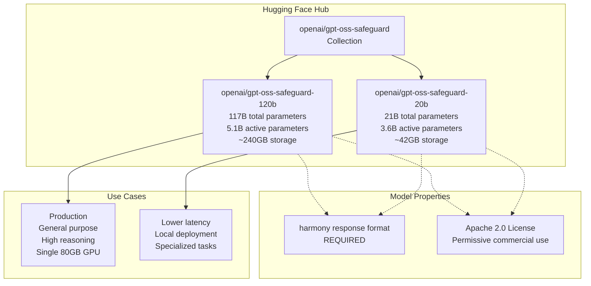
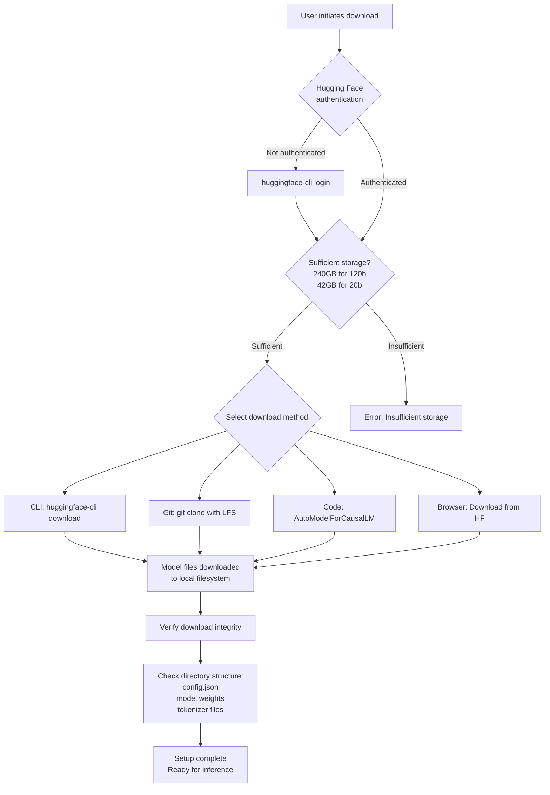
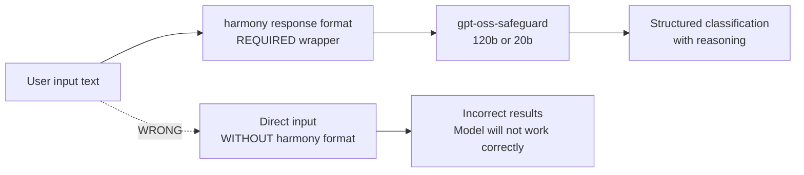
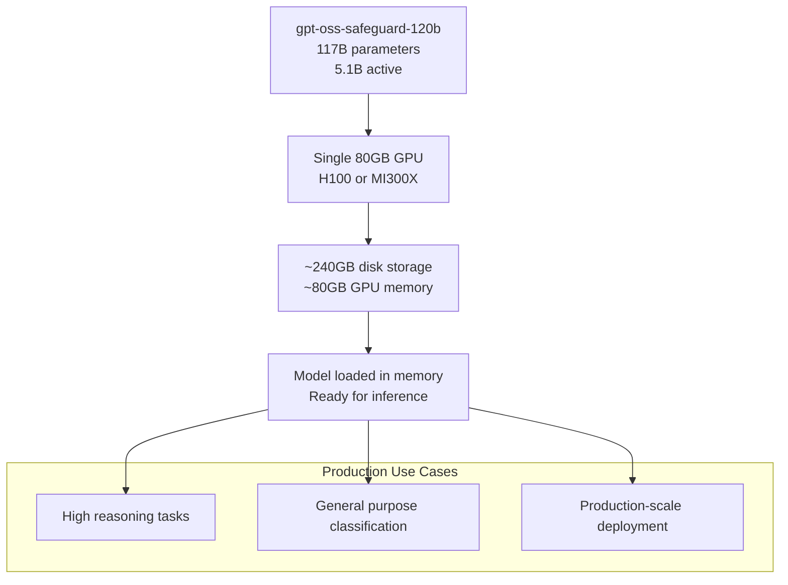
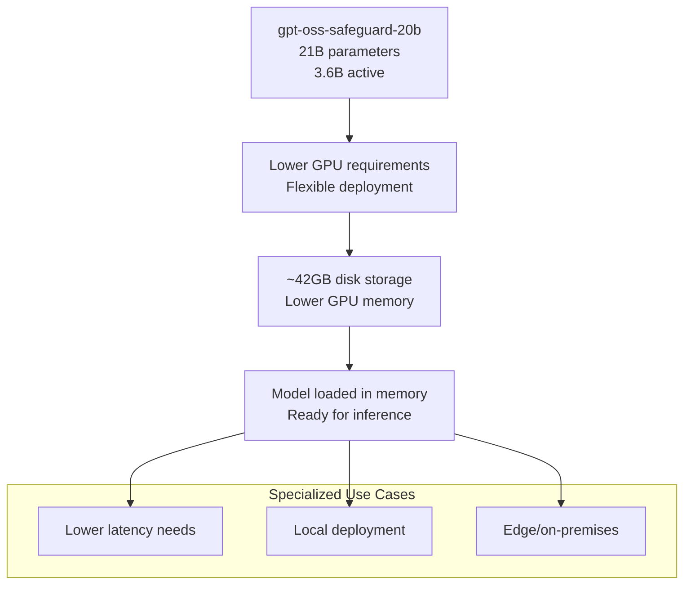

<!-- source: DeepWiki mcp.deepwiki.com · repo openai/gpt-oss-safeguard · page 8.2 Model Download and Setup · fetched 2026-10-26 -->

# Model Download and Setup

<details>
<summary>Relevant source files</summary>

The following files were used as context for generating this wiki page:

- [README.md](README.md)

</details>


## Purpose and Scope

This page provides step-by-step instructions for downloading the `gpt-oss-safeguard` models from Hugging Face and completing initial setup. It covers both the 120B and 20B model variants, download methods, and post-download verification steps.

For detailed hardware requirements before downloading, see [Hardware Requirements](#8.1). For configuring inference after setup, see [Inference Configuration](#8.3). For choosing between model variants, see [Model Variants](#3).

---

## Prerequisites

Before downloading the models, ensure you have:

| Requirement | Description |
|------------|-------------|
| **Hugging Face Account** | Required for downloading model weights |
| **Storage Space** | ~240GB for 120B model, ~42GB for 20B model (approximate, compressed) |
| **Python Environment** | Python 3.8+ with `transformers` library |
| **Git LFS** | For cloning repositories with large files |
| **Hardware** | See [Hardware Requirements](#8.1) for GPU specifications |

The models follow the same download and setup patterns as the base `gpt-oss` models. If you have already set up `gpt-oss-120b` or `gpt-oss-20b`, the process is identical.

**Sources:** [README.md:32-32](), [README.md:40-40]()

---

## Available Models and Download Locations

Both model variants are hosted on the Hugging Face Hub as part of the official OpenAI collection.

### Model Variants



**Diagram: Model variants on Hugging Face Hub and their characteristics**

| Model | Hugging Face Path | Parameters | Use Case |
|-------|------------------|------------|----------|
| **gpt-oss-safeguard-120b** | `openai/gpt-oss-safeguard-120b` | 117B total, 5.1B active | Production, general purpose, high reasoning |
| **gpt-oss-safeguard-20b** | `openai/gpt-oss-safeguard-20b` | 21B total, 3.6B active | Lower latency, local, specialized |

**Sources:** [README.md:3-3](), [README.md:14-18](), [README.md:40-40]()

---

## Download Methods

### Method 1: Hugging Face Hub Collection (Recommended)

The models are organized in a Hugging Face collection for easy access:

```
https://huggingface.co/collections/openai/gpt-oss-safeguard
```

This collection page provides links to both model variants and related resources.

### Method 2: Direct Model Repository Access

Access the model repositories directly:

**For 120B model:**
```
https://huggingface.co/openai/gpt-oss-safeguard-120b
```

**For 20B model:**
```
https://huggingface.co/openai/gpt-oss-safeguard-20b
```

### Method 3: Hugging Face CLI Download

Using the Hugging Face CLI (recommended for programmatic access):

```bash
# Install Hugging Face CLI if not already installed
pip install -U "huggingface_hub[cli]"

# Login to Hugging Face (required)
huggingface-cli login

# Download 120B model
huggingface-cli download openai/gpt-oss-safeguard-120b --local-dir ./models/gpt-oss-safeguard-120b

# Download 20B model
huggingface-cli download openai/gpt-oss-safeguard-20b --local-dir ./models/gpt-oss-safeguard-20b
```

### Method 4: Git Clone with LFS

For users who prefer Git-based workflows:

```bash
# Ensure Git LFS is installed
git lfs install

# Clone 120B model repository
git clone https://huggingface.co/openai/gpt-oss-safeguard-120b

# Clone 20B model repository
git clone https://huggingface.co/openai/gpt-oss-safeguard-20b
```

### Method 5: Programmatic Download via Transformers

Using the Hugging Face Transformers library:

```python
from transformers import AutoModelForCausalLM, AutoTokenizer

# This will cache the model locally
model_name = "openai/gpt-oss-safeguard-120b"  # or "openai/gpt-oss-safeguard-20b"
tokenizer = AutoTokenizer.from_pretrained(model_name)
model = AutoModelForCausalLM.from_pretrained(model_name)
```

**Sources:** [README.md:3-3](), [README.md:40-40]()

---

## Download Workflow



**Diagram: Complete download workflow from authentication to verification**

**Sources:** [README.md:40-40]()

---

## Post-Download Directory Structure

After downloading, the model directory will contain the following files:

```
gpt-oss-safeguard-120b/
├── config.json                  # Model configuration
├── generation_config.json       # Generation parameters
├── model-*.safetensors         # Model weight shards (multiple files)
├── model.safetensors.index.json # Weight shard index
├── special_tokens_map.json     # Special token definitions
├── tokenizer.json              # Tokenizer configuration
├── tokenizer_config.json       # Tokenizer settings
└── vocab.json                  # Vocabulary file
```

### Critical Files

| File | Purpose | Required |
|------|---------|----------|
| `config.json` | Model architecture configuration | Yes |
| `model-*.safetensors` | Model weights (sharded for large models) | Yes |
| `tokenizer.json` | Tokenizer for text encoding/decoding | Yes |
| `generation_config.json` | Default generation parameters | No (but recommended) |

---

## Verification Steps

After download, verify the model is correctly set up:

### Step 1: Check File Integrity

```bash
# Verify all expected files are present
ls -lh gpt-oss-safeguard-120b/

# Check for .safetensors files (model weights)
find gpt-oss-safeguard-120b/ -name "*.safetensors"
```

### Step 2: Load Model Configuration

```python
from transformers import AutoConfig

# Verify config loads correctly
config = AutoConfig.from_pretrained("./gpt-oss-safeguard-120b")
print(f"Model type: {config.model_type}")
print(f"Hidden size: {config.hidden_size}")
print(f"Num layers: {config.num_hidden_layers}")
```

### Step 3: Test Tokenizer

```python
from transformers import AutoTokenizer

# Verify tokenizer loads and encodes correctly
tokenizer = AutoTokenizer.from_pretrained("./gpt-oss-safeguard-120b")
tokens = tokenizer.encode("Test input")
print(f"Tokenized: {tokens}")
print(f"Decoded: {tokenizer.decode(tokens)}")
```

### Step 4: Verify Harmony Response Format Requirement

Both models **require** the harmony response format for correct operation. Attempting to use them without this format will produce incorrect results.



**Diagram: Mandatory harmony response format requirement**

The harmony response format is documented in [Harmony Response Format](#4.2). All inference must use this format.

**Sources:** [README.md:20-20]()

---

## Model-Specific Setup Considerations

### For gpt-oss-safeguard-120b



**Diagram: 120B model setup requirements and target use cases**

The 120B variant requires:
- Single 80GB GPU (NVIDIA H100 or AMD MI300X recommended)
- Approximately 240GB disk storage for model files
- Python environment with appropriate GPU drivers

**Sources:** [README.md:17-17]()

### For gpt-oss-safeguard-20b



**Diagram: 20B model setup requirements and target use cases**

The 20B variant requires:
- More flexible GPU requirements (does not require 80GB GPU)
- Approximately 42GB disk storage for model files
- Suitable for resource-constrained environments

**Sources:** [README.md:18-18]()

---

## Similarity to gpt-oss Setup

Both `gpt-oss-safeguard` models follow the same setup procedures as their base `gpt-oss` counterparts:

| Aspect | gpt-oss-safeguard | gpt-oss |
|--------|-------------------|---------|
| Download location | Hugging Face Hub | Hugging Face Hub |
| Authentication | HF token required | HF token required |
| File structure | Identical | Identical |
| Loading method | `AutoModelForCausalLM` | `AutoModelForCausalLM` |
| Inference API | Similar patterns | Similar patterns |

**Key difference:** The `gpt-oss-safeguard` models require the harmony response format, while base `gpt-oss` models do not have this requirement.

For detailed inference examples, refer to the [OpenAI Cookbook](https://cookbook.openai.com/topic/gpt-oss) which covers inference patterns applicable to both model families.

**Sources:** [README.md:32-32](), [README.md:40-40]()

---

## Next Steps

After successfully downloading and verifying the model setup:

1. **Configure Inference:** Proceed to [Inference Configuration](#8.3) to set up model loading and inference pipelines
2. **Review Hardware:** Ensure your deployment meets requirements in [Hardware Requirements](#8.1)
3. **Understand Harmony Format:** Read [Harmony Response Format](#4.2) to learn the required input format
4. **Explore Policies:** Review [Working with Policies](#5) to understand how to configure classification behavior
5. **Try Examples:** Use the [OpenAI Cookbook guide](https://cookbook.openai.com/articles/gpt-oss-safeguard-guide) for practical examples

**Sources:** [README.md:7-7](), [README.md:20-20](), [README.md:32-32]()

---

## Troubleshooting Common Setup Issues

| Issue | Cause | Solution |
|-------|-------|----------|
| **Authentication failure** | Not logged into Hugging Face | Run `huggingface-cli login` |
| **Download timeout** | Large file size, slow connection | Use `git clone` with resume capability |
| **Insufficient storage** | Not enough disk space | Verify available space matches requirements |
| **Missing LFS files** | Git LFS not installed | Run `git lfs install` before cloning |
| **Version mismatch** | Outdated `transformers` library | Update with `pip install -U transformers` |
| **Import errors** | Missing dependencies | Install required packages: `pip install transformers torch` |

For additional support, consult the [ROOST Model Community](#9.3) or the model repositories on Hugging Face.

**Sources:** [README.md:44-45]()

---

