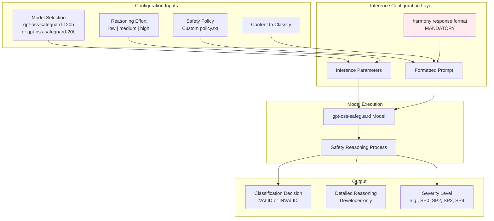
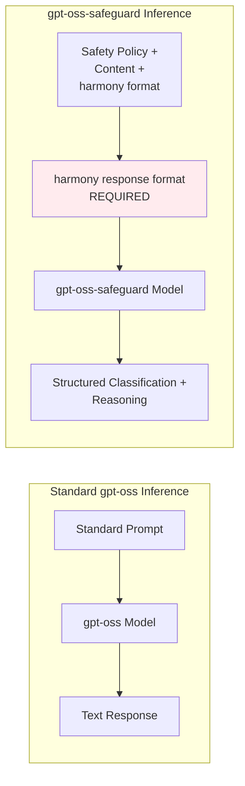
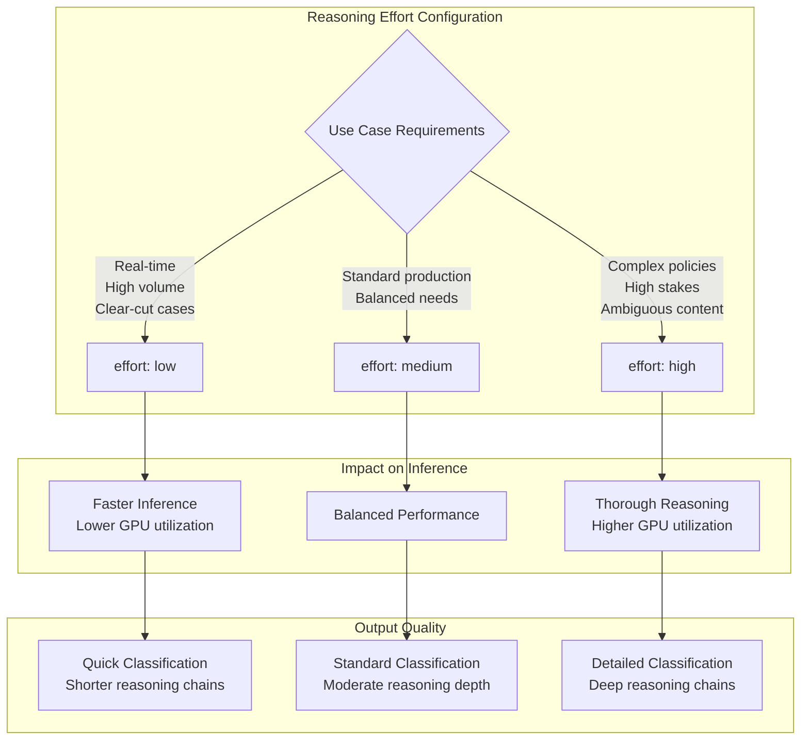
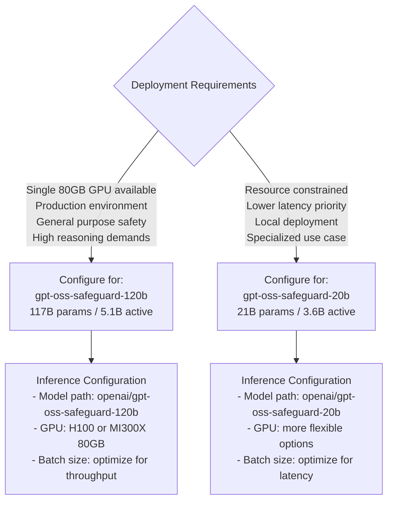
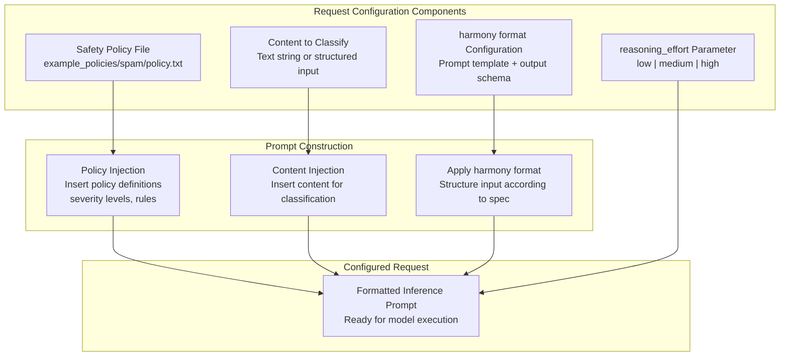
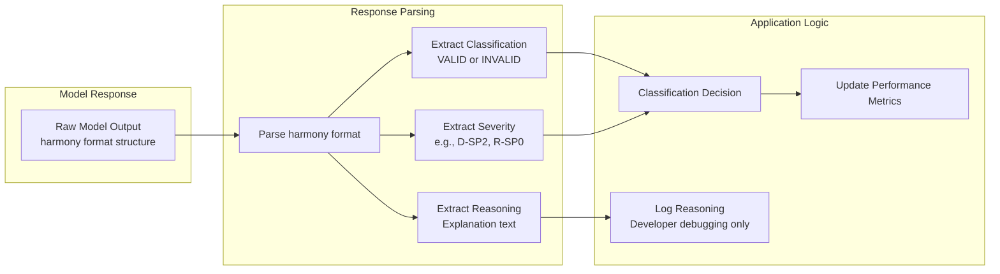
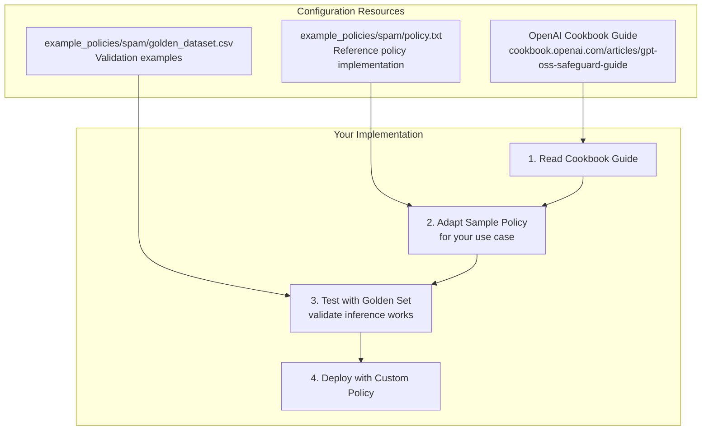
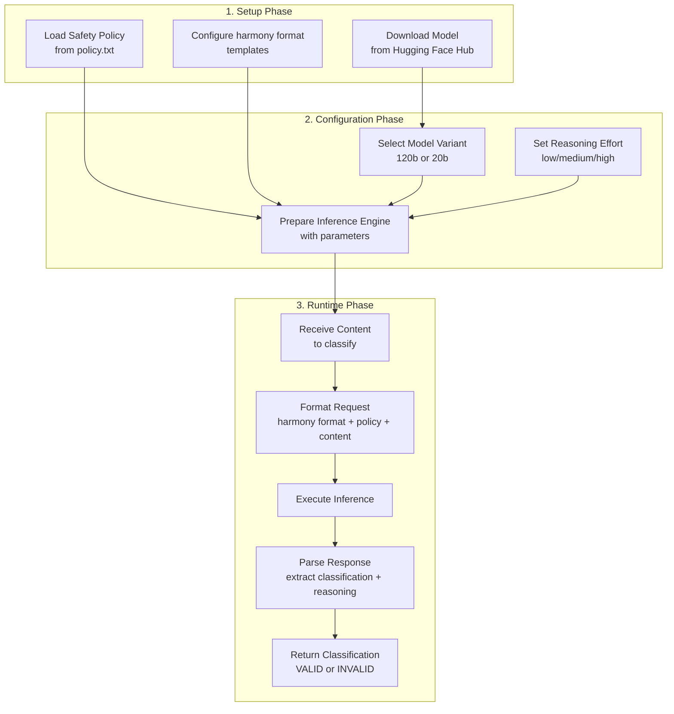

<!-- source: DeepWiki mcp.deepwiki.com · repo openai/gpt-oss-safeguard · page 8.3 Inference Configuration · fetched 2026-10-26 -->

# Inference Configuration

<details>
<summary>Relevant source files</summary>

The following files were used as context for generating this wiki page:

- [README.md](README.md)

</details>


## Purpose and Scope

This page documents how to configure inference for the gpt-oss-safeguard models, including the mandatory harmony response format, reasoning effort settings, and integration patterns. It covers the technical configuration required to perform safety classification using these models.

For information about downloading and initial model setup, see [Model Download and Setup](#8.2). For production deployment best practices including latency optimization and monitoring, see [Production Considerations](#8.4). For understanding the harmony response format itself, see [Harmony Response Format](#4.2).

---

## Overview

The gpt-oss-safeguard models follow similar inference patterns to the gpt-oss models, with a critical requirement: all inference **must** use the harmony response format. Without this format, the models will not function correctly [README.md:20]().



**Sources:** [README.md:14-21](), [README.md:30-32]()

---

## Inference Patterns

### Similarity to gpt-oss Models

The gpt-oss-safeguard models can be used with similar inference patterns to `gpt-oss-120b` and `gpt-oss-20b`, as documented in the [OpenAI Cookbook gpt-oss topic](https://cookbook.openai.com/topic/gpt-oss) [README.md:32]().

Key similarities include:
- Model download from Hugging Face Hub
- Standard transformer inference APIs
- Compatible with common inference frameworks
- Similar computational requirements and optimization strategies

### Critical Difference: Harmony Response Format

The defining difference is the **mandatory** harmony response format. The models were specifically trained using this format and will produce incorrect or unpredictable results if used without it [README.md:20]().



**Sources:** [README.md:20](), [README.md:30-32]()

---

## Harmony Response Format Integration

### Format Requirement

The harmony response format is not optional—it is a training-time constraint that defines how the models understand and respond to safety classification requests. Attempting to use these models without the harmony format will result in:
- Incorrect classifications
- Malformed outputs
- Unpredictable behavior

### Format Structure in Inference

When configuring inference, the harmony response format must structure:
1. **Input**: How the safety policy and content are presented to the model
2. **Output**: The expected structured response format containing classification and reasoning

The detailed structure of the harmony format is documented in the [Harmony Response Format](#4.2) page. For inference configuration, the key requirement is ensuring your inference code properly formats both input prompts and parses output responses according to this specification.

**Sources:** [README.md:20]()

---

## Reasoning Effort Configuration

### Overview

The gpt-oss-safeguard models support configurable reasoning effort, allowing you to balance latency against classification accuracy based on your use case requirements [README.md:27]().

### Effort Levels

| Effort Level | Use Case | Trade-off |
|--------------|----------|-----------|
| **low** | Real-time classification, high-volume processing | Faster response, potentially less nuanced reasoning |
| **medium** | Balanced production workloads | Default trade-off between speed and accuracy |
| **high** | Complex policy decisions, high-stakes classifications | Maximum reasoning depth, higher latency |



### Configuration in Practice

The reasoning effort is specified as a configuration parameter during inference. The exact mechanism depends on your inference framework, but conceptually:

```
inference_config = {
    "reasoning_effort": "medium",  # or "low", "high"
    "harmony_format": true,
    ...
}
```

**Sources:** [README.md:27]()

---

## Model Selection in Inference Configuration

### Choosing Between Model Variants

Your inference configuration begins with selecting the appropriate model variant. The choice affects resource requirements, latency, and classification capabilities.



### Model Path Configuration

Models are downloaded from Hugging Face Hub using collection links:
- `gpt-oss-safeguard-120b`: [https://huggingface.co/openai/gpt-oss-safeguard-120b](https://huggingface.co/openai/gpt-oss-safeguard-120b)
- `gpt-oss-safeguard-20b`: [https://huggingface.co/openai/gpt-oss-safeguard-20b](https://huggingface.co/openai/gpt-oss-safeguard-20b)

Collection: [https://huggingface.co/collections/openai/gpt-oss-safeguard](https://huggingface.co/collections/openai/gpt-oss-safeguard)

**Sources:** [README.md:3](), [README.md:17-18](), [README.md:40]()

---

## Request Configuration Structure

### Input Components

Each inference request must configure several components to properly utilize the model:



### Policy Integration

The safety policy (see [Creating Custom Policies](#5.5) and [Policy File Structure](#5.1)) must be properly integrated into the inference request. This typically involves:

1. Reading the policy file content
2. Parsing severity levels and definitions
3. Injecting policy into the harmony-formatted prompt
4. Ensuring policy formatting matches the model's training distribution

**Sources:** [README.md:36]()

---

## Response Handling and Parsing

### Response Structure

The model's output follows a structured format defined by the harmony response format and includes:

1. **Classification Decision**: VALID or INVALID determination
2. **Severity Level**: The specific policy level (e.g., SP0, SP2, SP3, SP4)
3. **Reasoning Explanation**: Detailed rationale for the classification
4. **Dual Labels**: Separate depiction (D-) and request (R-) labels where applicable



### Developer-Only Reasoning

The reasoning explanation is intended for **developer debugging and system improvement only**. It should not be displayed to end users [README.md:26]().

**Sources:** [README.md:26]()

---

## Cookbook Integration

### Comprehensive Guide

The OpenAI Cookbook provides a [detailed prompting guide](https://cookbook.openai.com/articles/gpt-oss-safeguard-guide) that includes:
- Complete inference examples
- Policy formatting best practices
- Harmony response format templates
- Code samples for various frameworks

### Example Policy and Golden Dataset

The repository includes reference materials for inference configuration:
- **Sample Policy**: [example_policies/spam/policy.txt]() demonstrates proper policy formatting
- **Golden Dataset**: [example_policies/spam/golden_dataset.csv]() provides validation examples

These serve as templates for configuring your own inference pipelines.



**Sources:** [README.md:36](), [README.md:7]()

---

## Configuration Parameters Summary

### Core Parameters

| Parameter | Type | Values | Required | Purpose |
|-----------|------|--------|----------|---------|
| `model_path` | string | `openai/gpt-oss-safeguard-120b` or `openai/gpt-oss-safeguard-20b` | Yes | Specifies which model variant to use |
| `harmony_format` | boolean | `true` | Yes | Enables harmony response format (must be true) |
| `reasoning_effort` | string | `low`, `medium`, `high` | Yes | Controls reasoning depth vs. latency trade-off |
| `policy_content` | string | Policy file contents | Yes | Defines classification rules and severity levels |
| `content` | string | Text to classify | Yes | The input content for safety evaluation |

### Optional Parameters

| Parameter | Type | Purpose |
|-----------|------|---------|
| `temperature` | float | Controls output randomness (typically 0 for deterministic classification) |
| `max_tokens` | integer | Limits response length (ensure sufficient for reasoning output) |
| `batch_size` | integer | Number of concurrent classifications (hardware dependent) |

---

## Inference Pipeline Flow

### End-to-End Configuration



**Sources:** [README.md:30-40]()

---

## Key Configuration Requirements Checklist

Before deploying inference, verify:

- [ ] **Model downloaded** from Hugging Face Hub ([Model Download and Setup](#8.2))
- [ ] **harmony response format** properly configured (mandatory [README.md:20]())
- [ ] **Safety policy** loaded and formatted correctly ([Policy File Structure](#5.1))
- [ ] **Reasoning effort** level selected based on use case requirements
- [ ] **Hardware requirements** met for chosen model variant ([Hardware Requirements](#8.1))
- [ ] **Response parsing** implemented to extract classification and reasoning
- [ ] **Reasoning output** restricted to developer access only (not shown to end users [README.md:26]())
- [ ] **Validation testing** completed using golden dataset ([Golden Datasets](#7.1))

**Sources:** [README.md:17-27]()

---

