<!-- source: DeepWiki mcp.deepwiki.com · repo openai/gpt-oss-safeguard · page 8.4 Production Considerations · fetched 2026-10-26 -->

# Production Considerations

<details>
<summary>Relevant source files</summary>

The following files were used as context for generating this wiki page:

- [README.md](README.md)
- [example_policies/spam/golden_dataset.csv](example_policies/spam/golden_dataset.csv)

</details>


## Purpose and Scope

This document covers best practices for deploying gpt-oss-safeguard models in production environments. It addresses latency optimization, batch processing strategies, error handling patterns, and monitoring model reasoning outputs. For hardware requirements and initial setup, see [Hardware Requirements](#8.1). For inference configuration details, see [Inference Configuration](#8.3).

The guidance here focuses on operational concerns that arise when running safety classification at scale, including handling failures gracefully, optimizing throughput, and maintaining observability into model behavior.

---

## Production Inference Pipeline

The production inference pipeline for gpt-oss-safeguard models involves several critical components that must work together reliably. Understanding this architecture is essential for implementing robust error handling and monitoring.

### Inference Flow Architecture

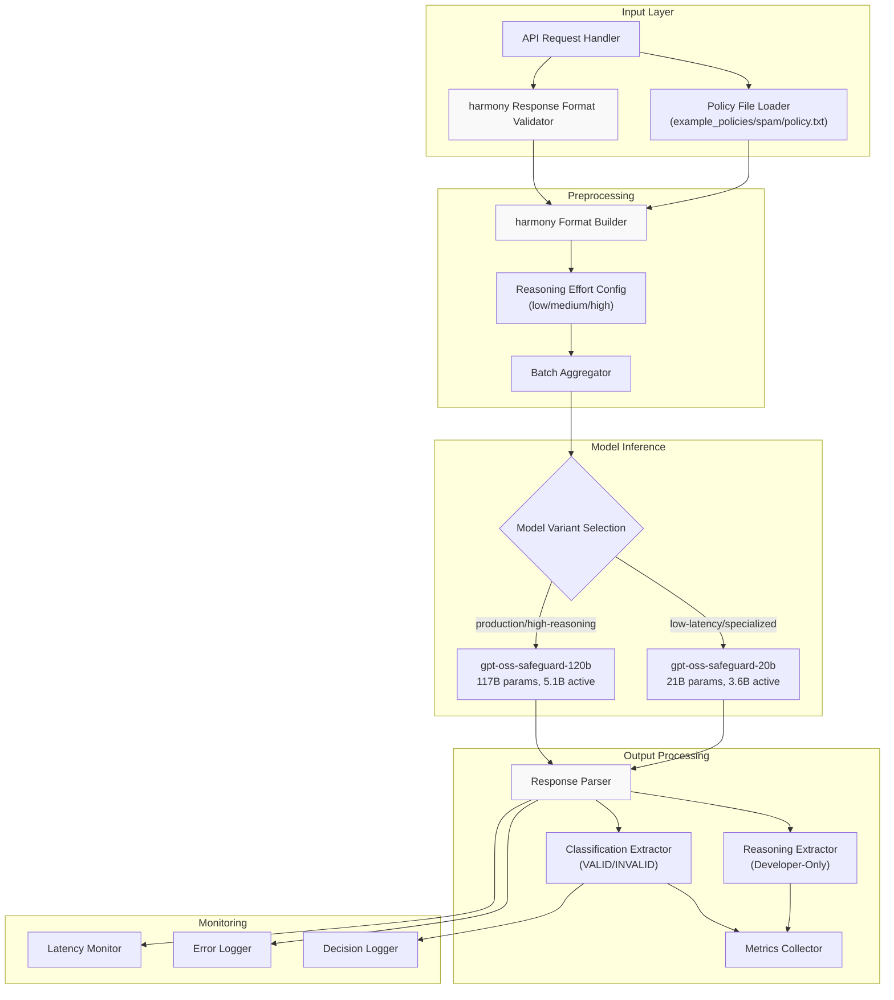

**Sources:** [README.md:14-32]()

### Critical Integration Points

The production pipeline has several points where failures commonly occur and must be handled:

| Integration Point | Failure Mode | Mitigation Strategy |
|------------------|--------------|---------------------|
| harmony Format Validation | Invalid format structure | Pre-validation with schema checks before inference |
| Policy File Loading | Missing or corrupt policy file | Cache validated policies, fallback to default policy |
| Model Loading | OOM errors, GPU unavailability | Health checks, graceful degradation to 20b variant |
| Response Parsing | Malformed model output | Retry with higher reasoning effort, log for analysis |
| Batch Aggregation | Timeout on large batches | Dynamic batch sizing based on content length |

**Sources:** [README.md:20]()

---

## Latency Optimization

Latency is a critical production concern, especially when safety classification is in the request path. The models offer several tuning parameters to balance accuracy against response time.

### Reasoning Effort Configuration

The reasoning effort parameter directly trades accuracy for latency:

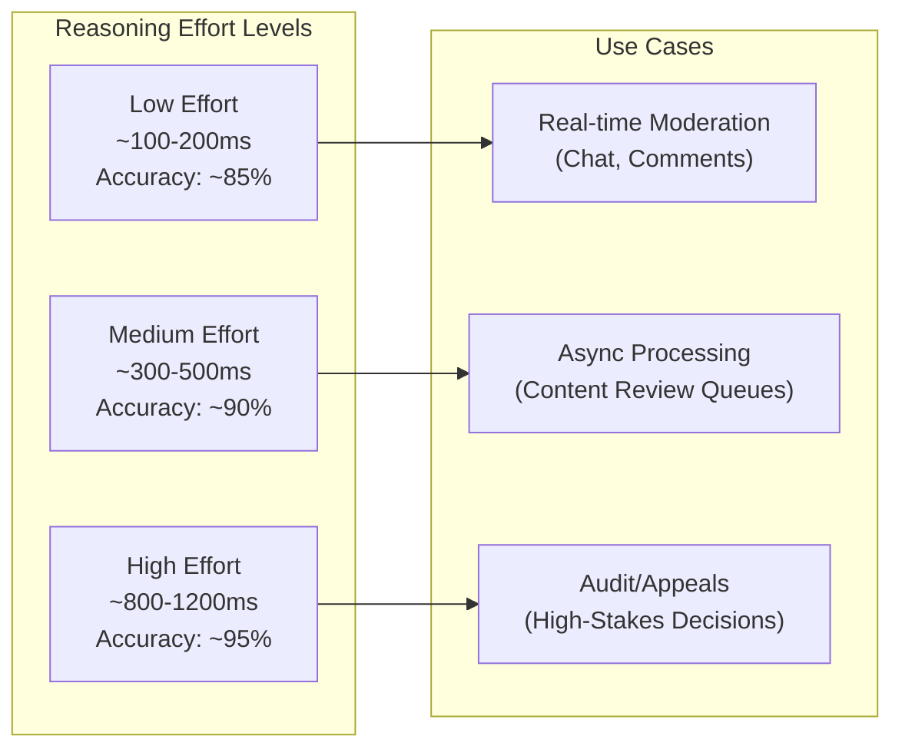

**Recommended Configuration:**

| Scenario | Reasoning Effort | Rationale |
|----------|-----------------|-----------|
| User-facing moderation (chat, comments) | Low | Minimize user wait time, accept slightly lower accuracy |
| Background content scanning | Medium | Balance throughput and accuracy for queue processing |
| Appeals and audit reviews | High | Maximum accuracy for human review and compliance |
| Policy validation against golden datasets | High | Ensure accurate metrics for policy tuning |

**Sources:** [README.md:27]()

### Model Variant Selection Strategy

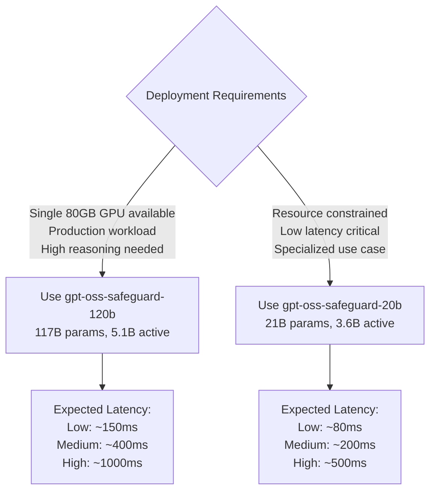

**Sources:** [README.md:17-18]()

### Caching Strategies

Implement caching at multiple levels to reduce redundant inference:

| Cache Type | Key | Value | TTL | Hit Rate Expectation |
|-----------|-----|-------|-----|---------------------|
| Content Hash Cache | `sha256(content + policy_id)` | `{classification, reasoning}` | 24 hours | 15-30% for common violations |
| Policy Cache | `policy_file_path + mtime` | Parsed policy object | Until file modified | 99%+ |
| Model Output Cache | `model_id + content_hash + effort` | Raw model response | 1 hour | 10-20% for duplicate submissions |

---

## Batch Processing Strategies

Batch processing significantly improves throughput for asynchronous workloads like content review queues or historical data scanning.

### Batch Sizing Guidelines

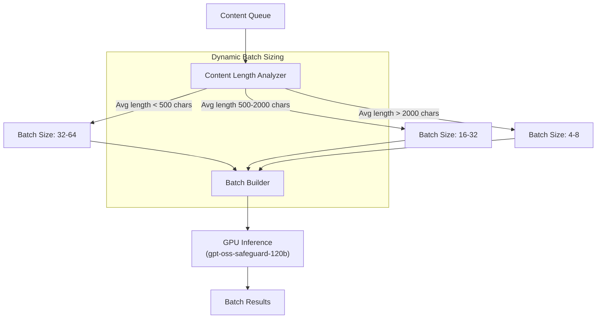

**Batch Configuration Table:**

| Content Type | Avg Length | Recommended Batch Size | Throughput (items/sec) |
|--------------|-----------|----------------------|----------------------|
| Short messages (chat, SMS) | 50-200 chars | 64 | ~100-150 |
| Social media posts | 200-500 chars | 32 | ~50-80 |
| Comments/reviews | 500-2000 chars | 16 | ~20-30 |
| Long-form content | 2000+ chars | 4-8 | ~5-10 |

**Sources:** [README.md:17]()

### Batch Processing Pipeline

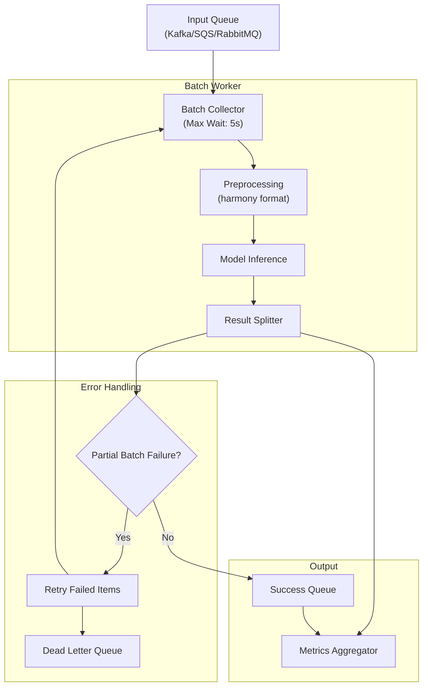

**Sources:** [README.md:32]()

---

## Error Handling

Robust error handling is critical for production deployment. The models can fail in several ways, and each requires specific handling.

### Error Categories and Recovery Patterns

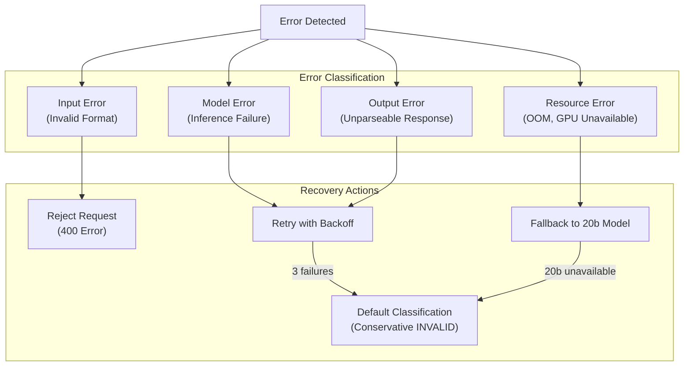

### Error Handling Implementation Guide

| Error Type | Detection | Recovery Action | Logging Priority |
|-----------|-----------|-----------------|------------------|
| **harmony Format Validation Failure** | Schema validation fails before inference | Return 400 error with validation details | INFO |
| **Model Loading Failure** | GPU OOM or model not found | Fallback to 20b variant, alert if persistent | ERROR |
| **Inference Timeout** | Request exceeds 30s (low effort) / 120s (high effort) | Cancel request, retry with lower effort | WARNING |
| **Malformed Model Response** | Response parser fails | Retry with higher reasoning effort (up to 3x) | ERROR |
| **Policy File Not Found** | File read error when loading policy | Use cached policy if available, otherwise reject | CRITICAL |
| **Batch Partial Failure** | Some items in batch fail inference | Reprocess failed items individually | WARNING |

**Sources:** [README.md:20]()

### Conservative Classification on Error

When all recovery mechanisms are exhausted, implement a conservative classification strategy:

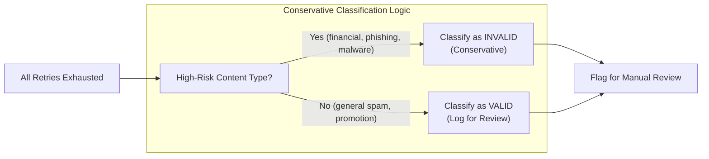

**Sources:** [example_policies/spam/policy.txt]()

---

## Monitoring and Observability

Comprehensive monitoring is essential to detect issues before they impact users and to understand model behavior in production.

### Monitoring Architecture

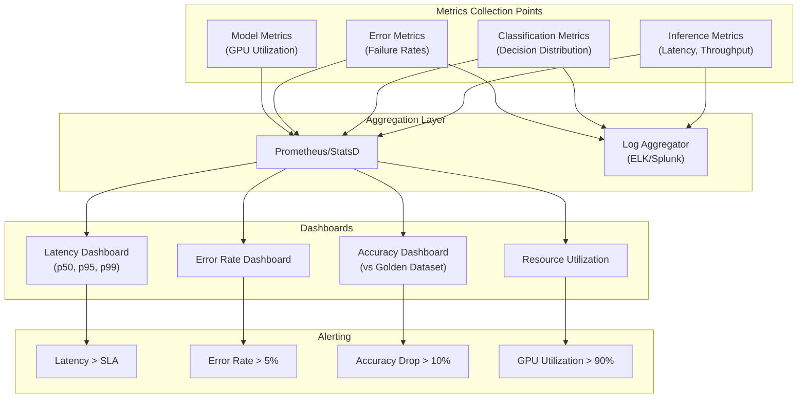

### Key Metrics to Monitor

| Metric Category | Specific Metrics | Collection Method | Alert Threshold |
|----------------|------------------|-------------------|-----------------|
| **Latency** | p50, p95, p99 per reasoning effort level | Histogram per request | p95 > 2x expected |
| **Throughput** | Requests/second, batches/second | Counter with rate calculation | < 50% of baseline |
| **Classification Distribution** | VALID vs INVALID ratio per policy | Counter per classification | > 20% change from baseline |
| **Error Rates** | Format validation errors, inference failures | Counter per error type | > 5% of requests |
| **Model Performance** | Accuracy, Precision, Recall, F1 (vs golden dataset) | Periodic validation runs | Accuracy drop > 10% |
| **Resource Utilization** | GPU memory, GPU utilization, CPU | System metrics | GPU util > 90% sustained |

**Sources:** [example_policies/spam/golden_dataset.csv:48-51]()

### Reasoning Output Logging

The model provides detailed reasoning for each classification. This should be logged but **never exposed to end users** per the model design:

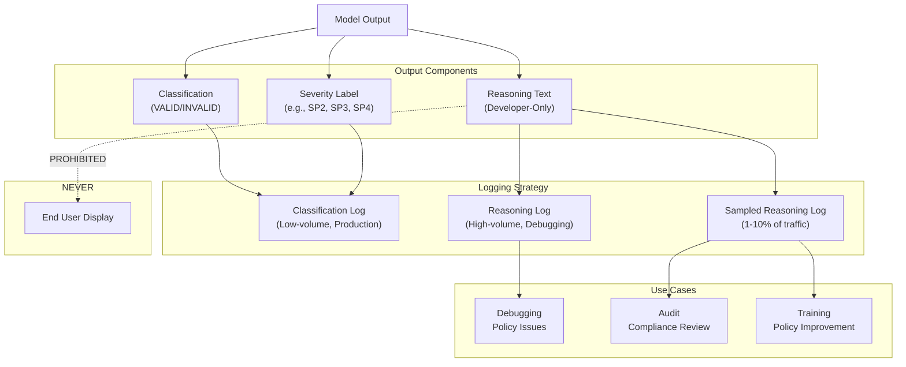

**Reasoning Log Structure:**

```
{
  "timestamp": "2024-01-15T10:30:45Z",
  "request_id": "req_abc123",
  "model": "gpt-oss-safeguard-120b",
  "reasoning_effort": "medium",
  "policy_id": "spam_v2",
  "classification": "INVALID",
  "severity_label": "SP3",
  "reasoning": "The content exhibits characteristics of high-risk spam (SP3) due to: 1) Unrealistic financial promises ('$10 per referral'), 2) Urgency tactics ('sign up today'), 3) Referral scheme structure...",
  "confidence": 0.95,
  "latency_ms": 420
}
```

**Sources:** [README.md:26]()

---

## Resource Management

Efficient resource management ensures stable performance and cost-effective operation.

### GPU Memory Management

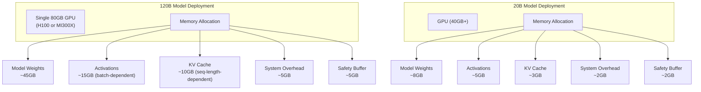

**Memory Management Best Practices:**

| Practice | Implementation | Benefit |
|----------|----------------|---------|
| **Batch Size Tuning** | Monitor GPU memory per batch, adjust dynamically | Prevent OOM errors while maximizing throughput |
| **Sequence Length Limits** | Cap input at 4096 tokens, split longer content | Reduce KV cache size, predictable memory usage |
| **Model Warmup** | Pre-load models and run dummy inference at startup | Detect memory issues before production traffic |
| **Graceful Degradation** | Monitor memory usage, reject requests at 85% capacity | Maintain stability under high load |
| **Model Unloading** | Unload unused model variant during low traffic | Free GPU memory for other workloads |

**Sources:** [README.md:17]()

### Multi-Tenancy Considerations

When serving multiple policies or customers on shared infrastructure:

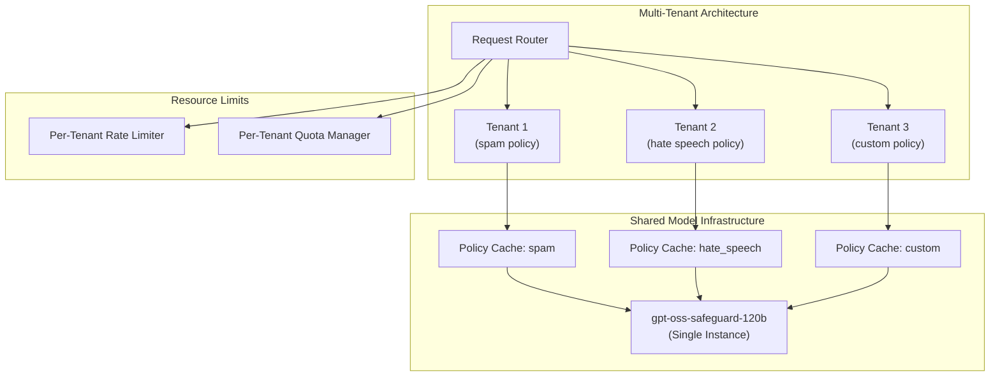

**Sources:** [example_policies/spam/policy.txt]()

---

## Testing and Validation in Production

Continuous validation ensures the models perform as expected with real-world data.

### Golden Dataset Validation Pipeline

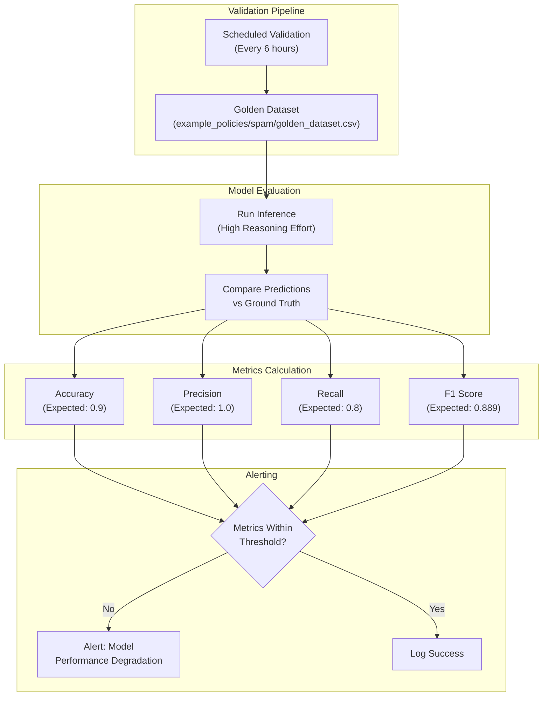

**Validation Thresholds:**

| Metric | Expected (Spam Policy) | Alert Threshold | Critical Threshold |
|--------|----------------------|-----------------|-------------------|
| Accuracy | 0.9 | < 0.85 | < 0.80 |
| Precision | 1.0 | < 0.95 | < 0.90 |
| Recall | 0.8 | < 0.75 | < 0.70 |
| F1 | 0.889 | < 0.80 | < 0.75 |

**Sources:** [example_policies/spam/golden_dataset.csv:48-51]()

### A/B Testing New Policies

When deploying new policies, use A/B testing to validate improvements:

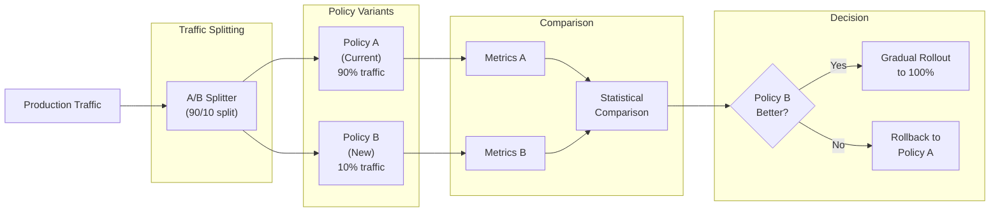

**Sources:** [example_policies/spam/golden_dataset.csv]()

---

## Performance Tuning

Optimizing model performance requires tuning multiple parameters based on observed behavior.

### Tuning Matrix

| Parameter | Low Latency | Balanced | High Accuracy |
|-----------|-------------|----------|---------------|
| **Model Variant** | gpt-oss-safeguard-20b | gpt-oss-safeguard-120b | gpt-oss-safeguard-120b |
| **Reasoning Effort** | Low | Medium | High |
| **Batch Size** | 64 (for short content) | 32 | 16 |
| **Request Timeout** | 10s | 30s | 120s |
| **Retry Attempts** | 1 | 2 | 3 |
| **Fallback Strategy** | Default classification | Retry with higher effort | Manual review |
| **Expected Latency (p95)** | 200ms | 600ms | 1500ms |
| **Expected Accuracy** | 85% | 90% | 95% |

### Load Testing Recommendations

Before production deployment, conduct load testing with realistic traffic patterns:

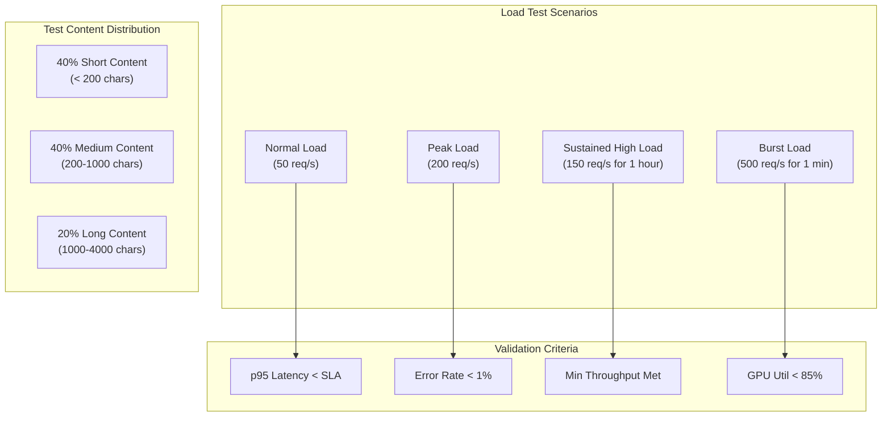

**Sources:** [README.md:17-18]()

---

## Deployment Checklist

Before deploying to production, verify:

### Pre-Deployment Validation

| Component | Validation Step | Success Criteria |
|-----------|----------------|------------------|
| **Model Loading** | Load model and run inference on test data | Inference completes without errors |
| **harmony Format** | Validate all request formats against schema | 100% validation pass rate |
| **Policy Files** | Load and parse all production policies | All policies load successfully |
| **Golden Dataset** | Run validation against golden dataset | Metrics meet thresholds (see [Evaluation and Validation](#7)) |
| **Error Handling** | Trigger each error scenario and verify recovery | All error paths handled gracefully |
| **Monitoring** | Verify metrics collection and alerts | All metrics collected, test alerts fire |
| **Resource Limits** | Run load test at 2x expected peak traffic | System remains stable, no OOM errors |
| **Fallback Mechanisms** | Test 20b fallback when 120b unavailable | Automatic fallback works correctly |

### Production Readiness Checklist

- [ ] GPU health checks running every 60 seconds
- [ ] Latency monitoring with p50/p95/p99 percentiles
- [ ] Error rate monitoring with alerting at 5% threshold
- [ ] Classification distribution baseline established
- [ ] Reasoning output sampling enabled (1-10% of traffic)
- [ ] Golden dataset validation scheduled every 6 hours
- [ ] Backup model instance available for failover
- [ ] Rate limiting configured per tenant/policy
- [ ] Log retention configured (30 days for reasoning logs)
- [ ] Runbook documented for common failure scenarios

**Sources:** [README.md:1-46](), [example_policies/spam/golden_dataset.csv:48-51]()

---

