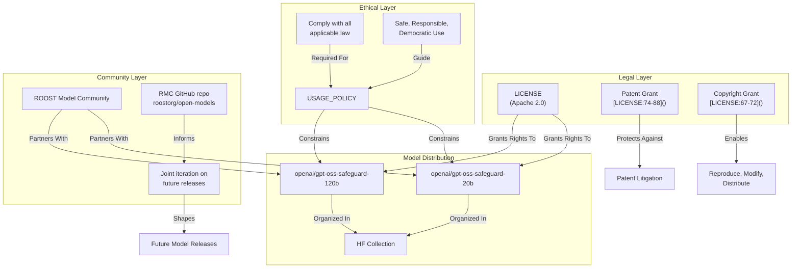
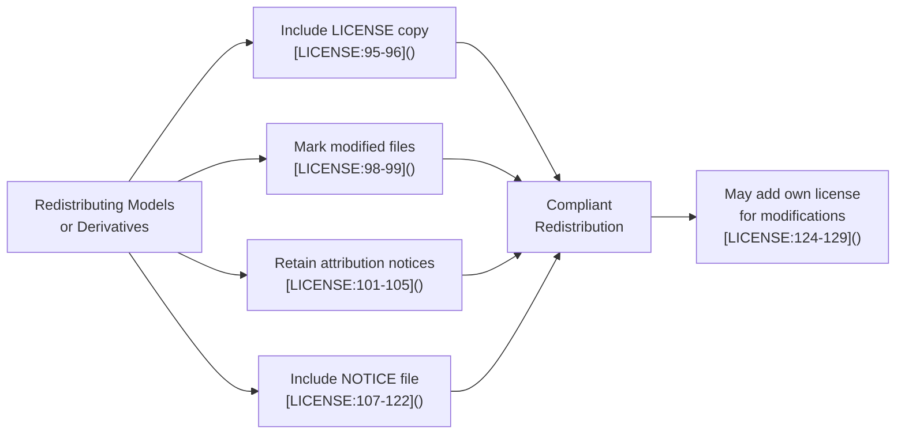
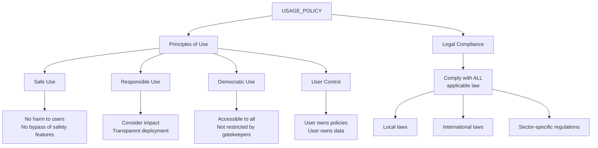
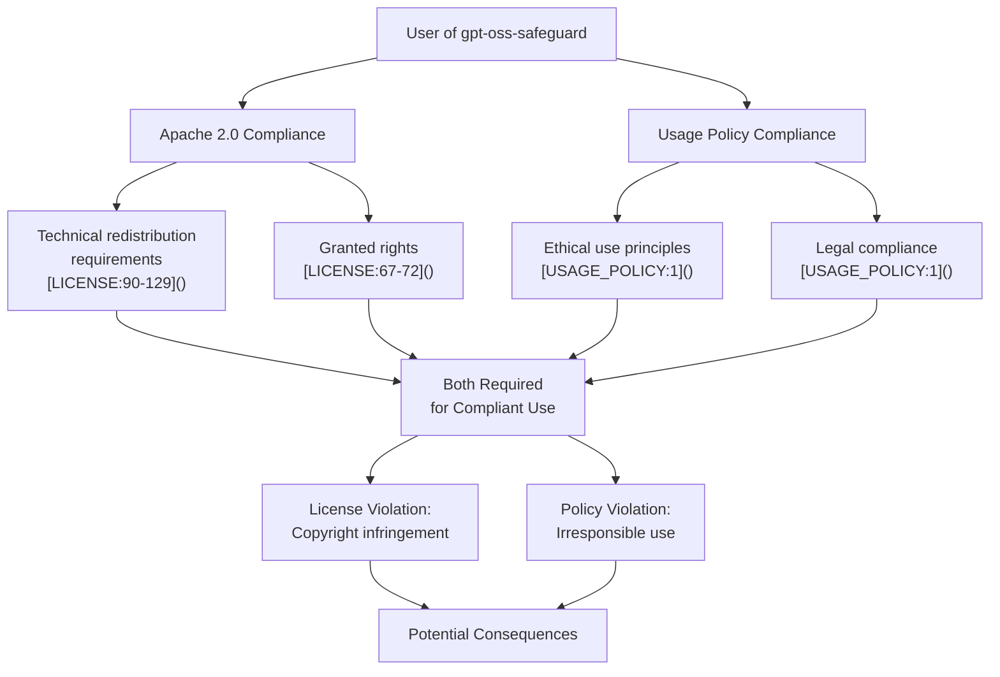
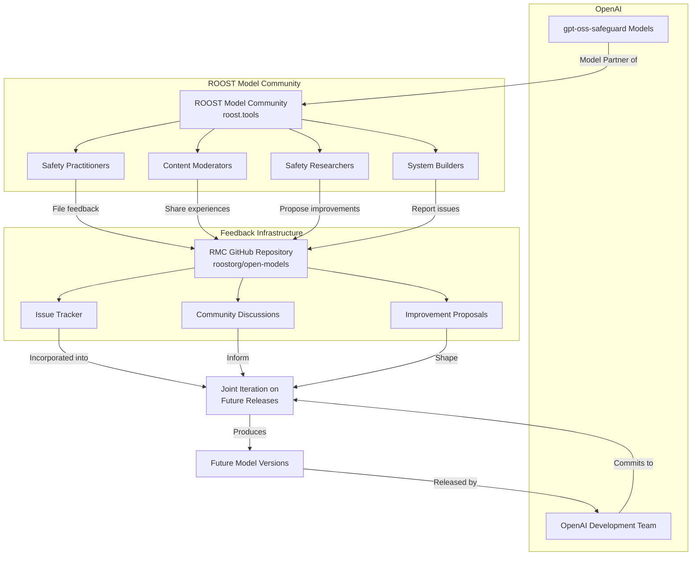
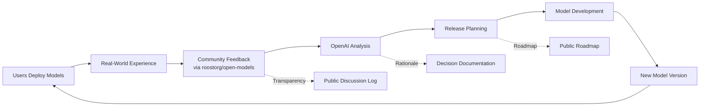
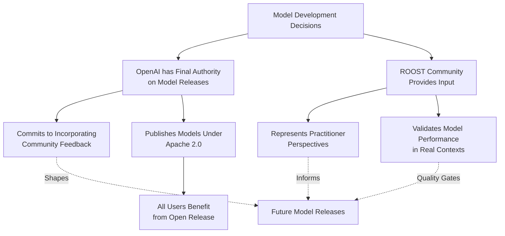

<!-- source: DeepWiki mcp.deepwiki.com · repo openai/gpt-oss-safeguard · page 9 Licensing and Governance · fetched 2026-10-26 -->

# Licensing and Governance

Relevant source files

The following files were used as context for generating this wiki page:

- [LICENSE](LICENSE)
- [README.md](README.md)
- [USAGE_POLICY](USAGE_POLICY)

This document describes the legal and governance framework that governs the use, modification, and distribution of the gpt-oss-safeguard models. It covers the Apache 2.0 license terms, usage policy requirements, and the ROOST Model Community partnership that shapes the project's development and evolution.

For information about model deployment and technical setup, see [Deployment and Integration](#8). For information about joining the broader safety practitioner community, see [Additional Resources](#10).

---

## Overview

The gpt-oss-safeguard project operates under a dual-layer governance framework:

1. **Legal Framework**: Apache 2.0 license for permissive open-source distribution
2. **Ethical Framework**: Usage policy requiring safe, responsible, and democratic use
3. **Community Governance**: ROOST Model Community partnership for collaborative development

This structure enables commercial use while maintaining safety standards and incorporating practitioner feedback into future releases.

**Sources**: [LICENSE](), [USAGE_POLICY](), [README.md:42-45]()

---

## Apache 2.0 License

The gpt-oss-safeguard models are released under the Apache License, Version 2.0, as specified in the [LICENSE]() file at the repository root. This is a permissive open-source license that enables broad commercial and non-commercial use.

### Key Rights Granted

The Apache 2.0 license provides the following rights to users:

| Right | Description | License Section |
|-------|-------------|-----------------|
| **Reproduction** | Copy the models and associated materials | [LICENSE:67-72]() |
| **Derivative Works** | Create modified versions and adaptations | [LICENSE:67-72]() |
| **Public Display** | Publicly showcase the models | [LICENSE:67-72]() |
| **Public Performance** | Operate the models in public-facing systems | [LICENSE:67-72]() |
| **Sublicensing** | Grant sublicenses to downstream users | [LICENSE:67-72]() |
| **Distribution** | Distribute copies in Source or Object form | [LICENSE:67-72]() |

These rights are:
- **Perpetual**: No expiration date
- **Worldwide**: Valid in all jurisdictions
- **Non-exclusive**: Multiple parties can exercise these rights simultaneously
- **No-charge**: No royalty payments required
- **Irrevocable**: Cannot be taken back (except under patent termination conditions)

**Sources**: [LICENSE:67-72]()

### Patent Grant

The license includes an explicit patent grant at [LICENSE:74-88]() that protects users from patent litigation. Key provisions:

- Contributors grant patent licenses covering claims necessarily infringed by their contributions
- Patent licenses cover making, using, selling, offering to sell, and importing the work
- **Patent Termination Clause**: If you initiate patent litigation claiming the Work infringes, your patent license terminates as of the litigation filing date

This means you can use, modify, and distribute the models without fear of patent claims from contributors, as long as you don't sue over patent infringement yourself.

**Sources**: [LICENSE:74-88]()

### Redistribution Requirements

When redistributing the models or derivative works, you must comply with conditions specified in [LICENSE:90-129]():

**Important**: You may add your own license terms for your modifications, but the original Work must remain under Apache 2.0 terms.

**Sources**: [LICENSE:90-129]()

### No Copyleft Restrictions

Unlike GPL or LGPL licenses, Apache 2.0 does not require derivative works to be open-sourced. This means:

- You can integrate the models into proprietary systems
- You can create closed-source derivatives
- You can commercialize without sharing modifications
- You can combine with other licensed code

This permissive nature is explicitly highlighted in [README.md:28]() as enabling "experimentation, customization, and commercial deployment."

**Sources**: [LICENSE:1-203](), [README.md:28]()

### Disclaimer of Warranty

The models are provided "AS IS" without warranties of any kind, as stated in [LICENSE:144-152](). This includes:

- No warranty of MERCHANTABILITY
- No warranty of FITNESS FOR A PARTICULAR PURPOSE
- No warranty of TITLE or NON-INFRINGEMENT
- No express or implied warranties

Users are "solely responsible for determining the appropriateness of using or redistributing the Work" and must "assume any risks associated" with use.

**Sources**: [LICENSE:144-152]()

### Limitation of Liability

Contributors have no liability for damages arising from use of the models, as specified in [LICENSE:154-164](). This includes protection from:

- Direct damages
- Indirect damages
- Special, incidental, or consequential damages
- Loss of goodwill, work stoppage, computer failure
- Any commercial damages or losses

This applies regardless of the legal theory (tort, contract, negligence) unless required by applicable law or agreed to in writing.

**Sources**: [LICENSE:154-164]()

### Trademark Restrictions

The Apache 2.0 license does NOT grant permission to use OpenAI's trademarks, service marks, or product names, as clarified in [LICENSE:139-142](). You may only use these:

- For reasonable and customary description of the Work's origin
- When reproducing the content of the NOTICE file

This means you cannot imply endorsement or official relationship with OpenAI without permission.

**Sources**: [LICENSE:139-142]()

---

## Usage Policy

In addition to the Apache 2.0 license, users must comply with the usage policy specified in [USAGE_POLICY]().

### Policy Requirements

The complete usage policy states:

> "We aim for our tools to be used safely, responsibly, and democratically, while maximizing your control over how you use them. By using OpenAI gpt-oss-safeguard-120b and gpt-oss-safeguard-20b, you agree to comply with all applicable law."

This policy establishes two core requirements:

**Sources**: [USAGE_POLICY:1-2]()

### Legal Compliance Requirement

The policy explicitly requires compliance with "all applicable law" [USAGE_POLICY:1](), which includes but is not limited to:

- **Data Protection Laws**: GDPR, CCPA, and other privacy regulations
- **Content Regulations**: Laws governing harmful content in your jurisdiction
- **Sector-Specific Rules**: HIPAA (healthcare), FERPA (education), GLBA (financial services)
- **Export Controls**: If deploying internationally
- **Consumer Protection**: False advertising, deceptive practices
- **Accessibility Requirements**: ADA, WCAG compliance where applicable

Users are responsible for identifying which laws apply to their specific use case and ensuring compliance.

**Sources**: [USAGE_POLICY:1]()

### Principles of Use

The policy aims for "safe, responsible, and democratic" use [USAGE_POLICY:1](). While not legally binding definitions, these principles guide proper use:

| Principle | Interpretation | Implementation Considerations |
|-----------|----------------|------------------------------|
| **Safe** | Models should not cause harm to users or systems | Test policies thoroughly before production; monitor for false positives that block legitimate content |
| **Responsible** | Consider societal and individual impact | Document decision-making processes; enable appeals for classification decisions |
| **Democratic** | Maximize accessibility and user control | Don't restrict access based on arbitrary criteria; allow users to customize policies |

**Sources**: [USAGE_POLICY:1]()

### User Control Philosophy

The policy emphasizes "maximizing your control over how you use them" [USAGE_POLICY:1](). This aligns with the "bring your own policy" architecture documented in [Core Concepts](#4) where:

- Users define their own safety criteria (not OpenAI)
- Users own their classification policies
- Users control reasoning effort parameters
- Users validate performance against their own golden datasets

This control-first approach distinguishes gpt-oss-safeguard from fixed-rule safety systems.

**Sources**: [USAGE_POLICY:1](), [README.md:25]()

### Relationship to Apache 2.0 License

The usage policy and Apache 2.0 license operate in different legal domains:

The Apache 2.0 license governs **how** you can redistribute and modify the models. The usage policy governs **what** you do with them in production.

**Sources**: [LICENSE:1-203](), [USAGE_POLICY:1-2]()

---

## ROOST Model Community Partnership

The gpt-oss-safeguard project is a model partner of the Robust Open Online Safety Tools (ROOST) Model Community, establishing a community governance structure for ongoing development.

### Partnership Structure

The partnership is documented in [README.md:42-45]() and establishes the following relationship:

**Sources**: [README.md:42-45]()

### What is ROOST?

The Robust Open Online Safety Tools (ROOST) Model Community is "a group of safety practitioners exploring open source AI models to protect online spaces" [README.md:44](). This includes:

- Trust & safety professionals at platforms
- Content moderation teams
- Community managers
- Safety researchers
- Policy designers
- Developers building safety systems

The community explores how open-source models can be adapted to diverse safety contexts while sharing learnings and best practices.

**Sources**: [README.md:44]()

### OpenAI's Commitment

As an RMC model partner, OpenAI has made specific commitments documented in [README.md:44-45]():

1. **Incorporating User Feedback**: OpenAI commits to integrating feedback from ROOST community members into model development
2. **Joint Iteration**: Future releases will be shaped collaboratively, not unilaterally decided by OpenAI
3. **Open Safety Pursuit**: The partnership is explicitly "in pursuit of open safety," prioritizing transparency and community needs

This represents a departure from typical model release patterns where development is closed and user input is limited.

**Sources**: [README.md:44-45]()

### How to Participate

The [README.md:45]() directs users to the RMC GitHub repository at `roostorg/open-models` to:

1. **Learn More**: Understand the partnership structure and governance model
2. **Get Involved**: Join the community of safety practitioners
3. **Provide Feedback**: Submit issues, participate in discussions, or propose improvements

This repository serves as the primary interface between the community and OpenAI's development process.

**Sources**: [README.md:45]()

### Feedback Loop Architecture

The governance model establishes a continuous feedback loop:

This loop ensures that practitioner needs and field experiences directly influence model evolution, creating accountability and responsiveness.

**Sources**: [README.md:42-45]()

---

## Governance Model Summary

The gpt-oss-safeguard project operates under a multi-stakeholder governance model:

| Layer | Mechanism | Authority | Documentation |
|-------|-----------|-----------|---------------|
| **Legal** | Apache 2.0 License | Standard OSS terms | [LICENSE]() |
| **Ethical** | Usage Policy | OpenAI requirements | [USAGE_POLICY]() |
| **Community** | ROOST Partnership | Collaborative input | [README.md:42-45]() |

### Decision-Making Authority

While OpenAI retains final decision-making authority, the ROOST partnership creates accountability and ensures community needs are systematically considered.

**Sources**: [README.md:42-45](), [LICENSE](), [USAGE_POLICY]()

### Compliance Hierarchy

Users must comply with requirements at all three governance layers:

1. **Must comply with Apache 2.0**: Attribution, license inclusion, modification notices when redistributing
2. **Must comply with Usage Policy**: Safe, responsible, democratic use; all applicable laws
3. **Should participate in ROOST**: Provide feedback to improve future releases (optional but encouraged)

Failure to comply with Apache 2.0 or Usage Policy may result in loss of rights or legal consequences. ROOST participation is voluntary but benefits the entire community.

**Sources**: [LICENSE](), [USAGE_POLICY](), [README.md:42-45]()

---

