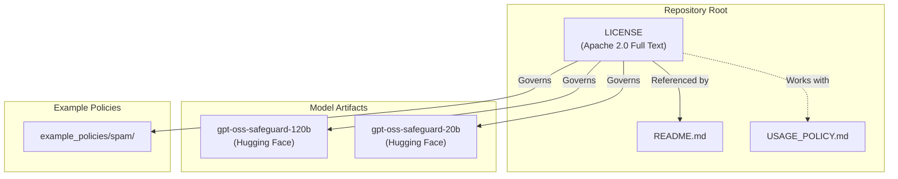
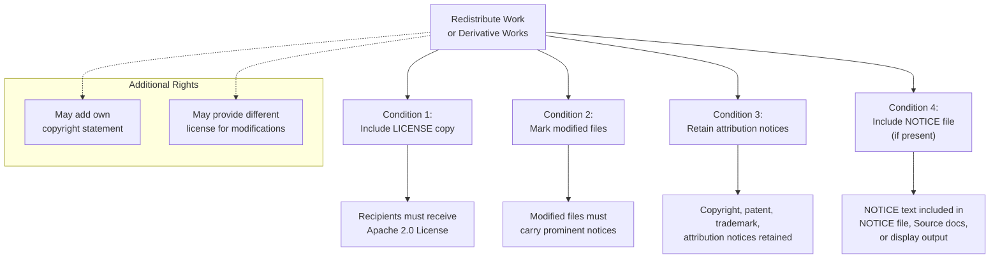
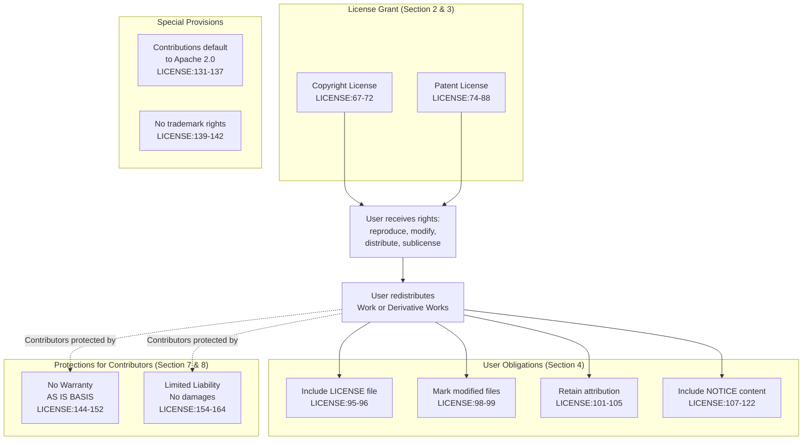
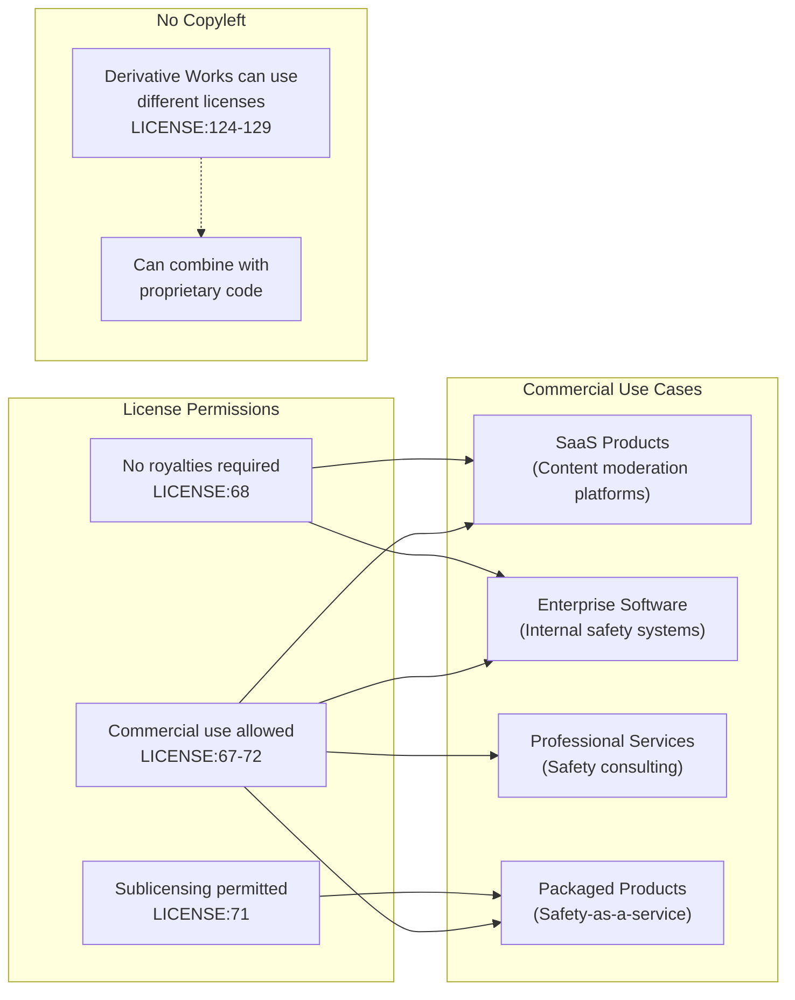

<!-- source: DeepWiki mcp.deepwiki.com · repo openai/gpt-oss-safeguard · page 9.1 Apache 2.0 License · fetched 2026-10-26 -->

# Apache 2.0 License

Relevant source files

The following files were used as context for generating this wiki page:

- [LICENSE](LICENSE)

## Purpose and Scope

This document explains the Apache License, Version 2.0 that governs the gpt-oss-safeguard repository and its models. The Apache 2.0 license is a permissive open-source software license that grants broad rights to users while protecting contributors from liability.

This page focuses on the legal framework and licensing terms. For information about usage requirements and responsible use policies, see [Usage Policy](#9.2). For information about the community governance model and feedback mechanisms, see [ROOST Model Community Partnership](#9.3).

**Sources:** [LICENSE:1-204]()

---

## License Overview

The gpt-oss-safeguard repository is licensed under the Apache License, Version 2.0, January 2004. This license provides:

- **Permissive rights**: Users can reproduce, modify, and distribute the work
- **Commercial use**: No restrictions on commercial applications
- **Patent protection**: Explicit patent license grant from contributors
- **No copyleft**: Derivative works can use different licenses
- **Liability protection**: Contributors are protected from legal liability

The full license text is located in the repository root: [LICENSE:1-204]()

**Sources:** [LICENSE:1-6]()

---

## License File Location in Repository

**Sources:** [LICENSE:1-204]()

---

## Key Terms and Definitions

The Apache 2.0 license defines specific terms that govern its interpretation:

| Term | Definition | Line Reference |
|------|------------|----------------|
| **License** | Terms and conditions for use, reproduction, and distribution | [LICENSE:10-11]() |
| **Licensor** | Copyright owner or authorized entity granting the license | [LICENSE:13-14]() |
| **Legal Entity** | Individual or organization exercising license permissions, including entities under common control | [LICENSE:17-22]() |
| **You/Your** | Individual or Legal Entity exercising permissions | [LICENSE:24-25]() |
| **Source** | Preferred form for modifications (source code, documentation, configuration files) | [LICENSE:27-29]() |
| **Object** | Form resulting from mechanical transformation (compiled code, generated docs) | [LICENSE:31-34]() |
| **Work** | Work of authorship available under the license | [LICENSE:36-39]() |
| **Derivative Works** | Work based on or derived from the original Work | [LICENSE:41-47]() |
| **Contribution** | Work intentionally submitted to Licensor for inclusion | [LICENSE:49-61]() |
| **Contributor** | Licensor or entity whose Contribution was incorporated | [LICENSE:63-65]() |

**Sources:** [LICENSE:8-65]()

---

## Granted Rights

### Copyright License Grant

The Apache 2.0 license grants a **perpetual, worldwide, non-exclusive, no-charge, royalty-free, irrevocable copyright license** with the following permissions:

1. **Reproduce** the Work
2. **Prepare Derivative Works** of the Work
3. **Publicly display** the Work
4. **Publicly perform** the Work
5. **Sublicense** the Work
6. **Distribute** the Work and Derivative Works in Source or Object form

This grant applies to all Contributors and covers both the original Work and Derivative Works.

**Sources:** [LICENSE:67-72]()

### Patent License Grant

Contributors grant a **perpetual, worldwide, non-exclusive, no-charge, royalty-free, irrevocable patent license** for:

- **Making** the Work
- **Using** the Work
- **Offering to sell** the Work
- **Selling** the Work
- **Importing** the Work
- **Transferring** the Work

**Patent termination clause**: If you institute patent litigation alleging that the Work infringes a patent, your patent licenses terminate as of the litigation filing date.

**Sources:** [LICENSE:74-88]()

---

## Redistribution Requirements

When redistributing the Work or Derivative Works, you must comply with these conditions:

**Detailed requirements:**

1. **Include License** ([LICENSE:95-96]()): Provide a copy of the Apache 2.0 License to all recipients
2. **Mark Modifications** ([LICENSE:98-99]()): Modified files must carry prominent change notices
3. **Retain Notices** ([LICENSE:101-105]()): Keep all copyright, patent, trademark, and attribution notices from the Source form
4. **Include NOTICE** ([LICENSE:107-122]()): If a NOTICE file exists, include its attribution notices in distributed Derivative Works

You may add your own copyright statement and provide additional license terms for your modifications, provided the original Work's license terms are respected.

**Sources:** [LICENSE:90-129]()

---

## Permissions vs. Restrictions

### What You CAN Do

| Permission | Description | Applies To |
|------------|-------------|------------|
| Commercial use | Use the models in commercial products and services | All model variants |
| Modification | Modify model architectures, fine-tune, or adapt | All files and models |
| Distribution | Redistribute original or modified versions | All files and models |
| Private use | Use internally without disclosure | All files and models |
| Patent use | Use any patents contributed by Contributors | Work and Contributions |
| Sublicense | Grant licenses to downstream users | Work and Derivative Works |

### What You MUST Do

| Requirement | Description | Reference |
|-------------|-------------|-----------|
| Include license | Provide Apache 2.0 License text with distributions | [LICENSE:95-96]() |
| State changes | Mark modified files with change notices | [LICENSE:98-99]() |
| Preserve notices | Retain copyright and attribution notices | [LICENSE:101-105]() |
| Include NOTICE | Include NOTICE file content if present | [LICENSE:107-122]() |
| Comply with usage policy | Follow usage requirements for safe, responsible use | See [Usage Policy](#9.2) |

### What You CANNOT Do

| Restriction | Description | Reference |
|-------------|-------------|-----------|
| Use trademarks | Use Licensor's trademarks except for origin description | [LICENSE:139-142]() |
| Sue for patents | Patent license terminates if you sue claiming infringement | [LICENSE:82-88]() |
| Hold liable | Contributors cannot be held liable for damages | [LICENSE:154-164]() |
| Expect warranty | Work is provided "AS IS" without warranties | [LICENSE:144-152]() |

**Sources:** [LICENSE:67-175]()

---

## License Terms Flow

**Sources:** [LICENSE:1-177]()

---

## Warranties and Liability

### Disclaimer of Warranty

The Apache 2.0 license provides the Work on an **"AS IS" BASIS** with no warranties:

- No warranty of **TITLE**
- No warranty of **NON-INFRINGEMENT**
- No warranty of **MERCHANTABILITY**
- No warranty of **FITNESS FOR A PARTICULAR PURPOSE**

Users are **solely responsible** for determining the appropriateness of using or redistributing the Work and assume all risks.

**Sources:** [LICENSE:144-152]()

### Limitation of Liability

Contributors are **not liable** for any damages, including:

- Direct damages
- Indirect damages
- Special damages
- Incidental damages
- Consequential damages (loss of goodwill, work stoppage, computer failure, commercial losses)

This applies regardless of legal theory (tort, negligence, contract) unless required by applicable law or agreed to in writing.

**Sources:** [LICENSE:154-164]()

### Optional Additional Liability

When redistributing, you may choose to offer support, warranty, or indemnity for a fee. However, you accept such obligations **only on your own behalf**, not on behalf of other Contributors, and you must **indemnify and hold harmless** other Contributors.

**Sources:** [LICENSE:166-175]()

---

## Commercial Use Implications

The Apache 2.0 license enables broad commercial use without copyleft restrictions:

### Key Commercial Benefits

1. **No revenue sharing**: No royalties or revenue sharing required
2. **Integration flexibility**: Can integrate with proprietary systems
3. **Sublicensing**: Can redistribute as part of commercial products
4. **Competitive neutrality**: Same terms for all users (no discrimination)

### Important Considerations

- You must still comply with the [Usage Policy](#9.2) requiring safe, responsible, and democratic use
- You must comply with all applicable laws regardless of license terms
- Trademark restrictions prevent using OpenAI's trademarks without permission ([LICENSE:139-142]())

**Sources:** [LICENSE:67-72](), [LICENSE:124-129](), [LICENSE:139-142]()

---

## Application to gpt-oss-safeguard

### What is Licensed

The Apache 2.0 license applies to:

| Component | License Coverage | Location |
|-----------|------------------|----------|
| Model weights | gpt-oss-safeguard-120b (117B params, 5.1B active) | Hugging Face Hub |
| Model weights | gpt-oss-safeguard-20b (21B params, 3.6B active) | Hugging Face Hub |
| Documentation | README, usage guides, policy examples | Repository files |
| Example policies | Spam detection policy (SP0-SP4 taxonomy) | `example_policies/spam/` |
| Golden datasets | Spam validation dataset (39 examples) | `example_policies/spam/golden_dataset.csv` |

### What You Can Build

Under the Apache 2.0 license, you can:

1. **Deploy models**: Run inference for production applications
2. **Fine-tune models**: Adapt models for specific domains or policies
3. **Create derivative models**: Build new models based on these architectures
4. **Integrate commercially**: Incorporate into SaaS products, enterprise software, or consulting services
5. **Redistribute**: Share original or modified versions with others
6. **Create custom policies**: Define your own safety taxonomies (e.g., beyond the spam example)
7. **Combine with other software**: Mix with proprietary or differently-licensed code

### Attribution Requirements

When redistributing gpt-oss-safeguard models or derivatives:

1. Include the [LICENSE]() file
2. If you modify files, add notices describing changes
3. Retain copyright notices from the original repository
4. Do not use OpenAI trademarks except to describe the origin

**Sources:** [LICENSE:1-204]()

---

## Relationship to Usage Policy

The Apache 2.0 license grants **legal permissions**, while the Usage Policy sets **ethical and practical requirements**:

| Aspect | Apache 2.0 License | Usage Policy |
|--------|-------------------|--------------|
| Nature | Legal framework | Ethical framework |
| Enforceability | Copyright and patent law | Terms of service |
| Scope | What you *can* do legally | What you *should* do responsibly |
| Violations | Copyright infringement | Policy violation |
| Requirements | Include license, mark changes | Safe, responsible, democratic use |

Both must be followed when using gpt-oss-safeguard. The license provides broad freedoms, while the usage policy ensures those freedoms are exercised responsibly.

For detailed usage requirements, see [Usage Policy](#9.2).

**Sources:** [LICENSE:1-204]()

---

## Comparison to Other Open Source Licenses

| Feature | Apache 2.0 | GPL 2.0/3.0 | MIT | Proprietary |
|---------|-----------|-------------|-----|-------------|
| Commercial use | ✅ Yes | ✅ Yes | ✅ Yes | ⚠️ Varies |
| Modification | ✅ Yes | ✅ Yes | ✅ Yes | ❌ Usually No |
| Distribution | ✅ Yes | ✅ Yes | ✅ Yes | ❌ No |
| Copyleft (must share modifications) | ❌ No | ✅ Yes | ❌ No | N/A |
| Patent grant | ✅ Explicit | ⚠️ Implicit (GPL 3.0) | ❌ No | ❌ No |
| Attribution required | ✅ Yes | ✅ Yes | ✅ Yes | N/A |
| Trademark protection | ✅ Yes | ⚠️ Varies | ❌ No | ✅ Yes |

**Key differentiator**: Apache 2.0 provides **explicit patent grants** ([LICENSE:74-88]()) while allowing **non-copyleft derivatives** ([LICENSE:124-129]()), making it more permissive for commercial use than GPL while providing more patent protection than MIT.

**Sources:** [LICENSE:67-88](), [LICENSE:124-129]()

---

## Frequently Asked Questions

### Can I use gpt-oss-safeguard in a commercial product?

Yes. The Apache 2.0 license explicitly permits commercial use without royalties ([LICENSE:67-72]()). You must include the LICENSE file and comply with the Usage Policy.

### Do I need to open-source my modifications?

No. Unlike GPL licenses, Apache 2.0 does not require you to release modifications under the same license ([LICENSE:124-129]()). You can keep modifications proprietary.

### Can I charge for services built on these models?

Yes. You can charge for SaaS products, consulting services, or any commercial offering that uses gpt-oss-safeguard.

### What if I contribute improvements back to the project?

Contributions are assumed to be under Apache 2.0 terms unless explicitly stated otherwise ([LICENSE:131-137]()). See [ROOST Model Community Partnership](#9.3) for contribution mechanisms.

### Am I protected if the models infringe someone's patent?

Yes, to the extent the patent is held by a Contributor. Contributors grant patent licenses for their contributions ([LICENSE:74-88]()). However, if you sue claiming infringement, your patent license terminates.

### Can I use the "OpenAI" or "gpt" trademarks?

No, except for reasonable description of the Work's origin ([LICENSE:139-142]()). You cannot use trademarks in ways that suggest endorsement or affiliation.

### What happens if the models cause damage in my application?

Contributors are not liable for damages ([LICENSE:154-164]()). The Work is provided "AS IS" without warranties ([LICENSE:144-152]()). You are solely responsible for determining appropriateness of use.

**Sources:** [LICENSE:67-175]()

---

## Summary

The Apache 2.0 license provides a **permissive legal framework** for using, modifying, and distributing gpt-oss-safeguard models:

- ✅ **Broad permissions**: Commercial use, modification, distribution, sublicensing
- ✅ **Patent protection**: Explicit patent license grants from contributors
- ✅ **No copyleft**: Derivatives can use different licenses
- ⚠️ **Attribution required**: Must include license and mark changes
- ⚠️ **No warranty**: Provided "AS IS" without guarantees
- ⚠️ **Limited liability**: Contributors not liable for damages

This license enables the open-source safety AI ecosystem by removing legal barriers while protecting contributors. When combined with the [Usage Policy](#9.2), it creates a framework for responsible innovation in AI safety.

**Sources:** [LICENSE:1-204]()

---

