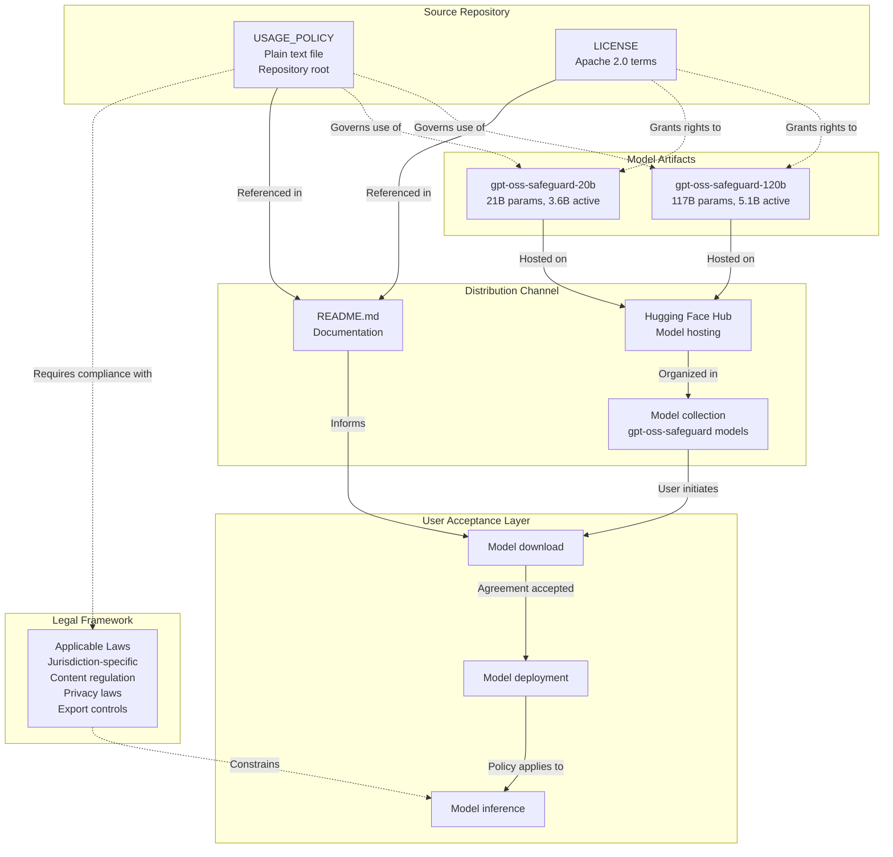
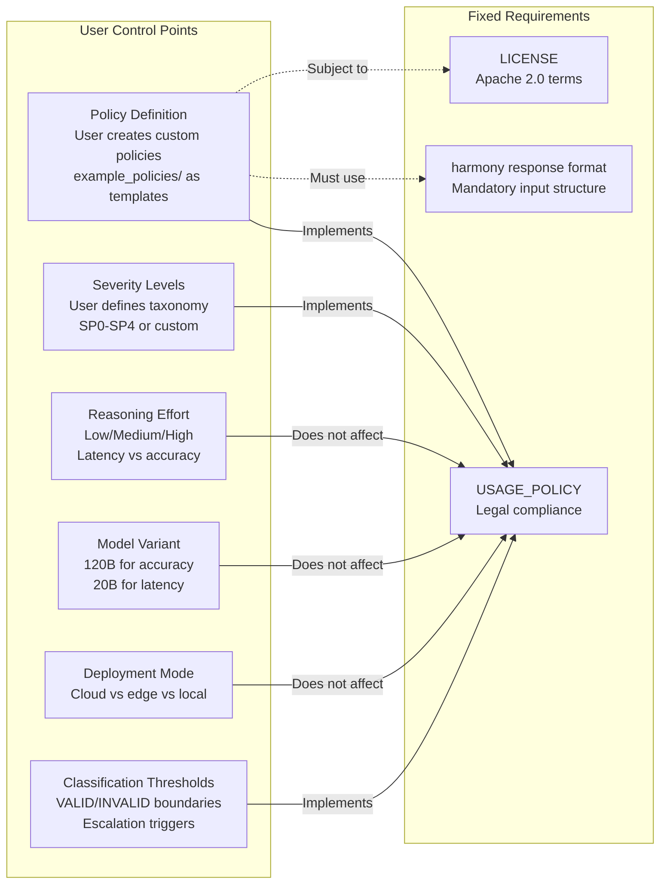
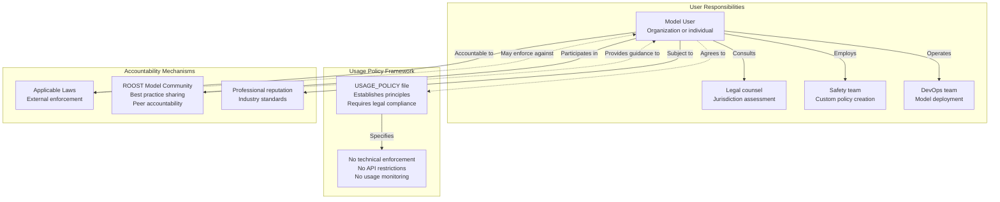
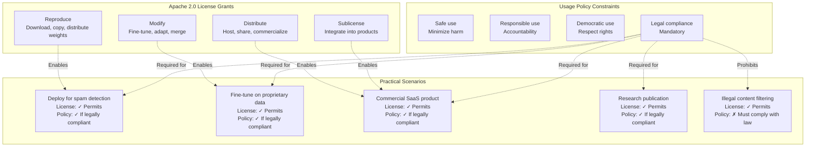

<!-- source: DeepWiki mcp.deepwiki.com · repo openai/gpt-oss-safeguard · page 9.2 Usage Policy · fetched 2026-10-26 -->

# Usage Policy

Relevant source files

The following files were used as context for generating this wiki page:

- [USAGE_POLICY](USAGE_POLICY)

## Purpose and Scope

This document details the usage policy that governs all deployments of the gpt-oss-safeguard models. The policy establishes behavioral expectations and legal obligations for users of both the 120B and 20B model variants. This policy works in conjunction with the Apache 2.0 license (see [Apache 2.0 License](#9.1)), which grants broad technical rights, while the usage policy defines responsible use boundaries.

For information about community governance mechanisms and feedback processes, see [ROOST Model Community Partnership](#9.3).

---

## Policy Statement

The complete usage policy is defined in the repository root:

**File Location:** [USAGE_POLICY:1-2]()

The policy consists of a single, clear statement:

> "We aim for our tools to be used safely, responsibly, and democratically, while maximizing your control over how you use them. By using OpenAI gpt-oss-safeguard-120b and gpt-oss-safeguard-20b, you agree to comply with all applicable law."

This statement establishes a dual framework:
1. **Aspirational principles**: Safe, responsible, and democratic use with user control
2. **Legal requirement**: Mandatory compliance with applicable law

**Sources:** [USAGE_POLICY:1-2]()

---

## Policy Scope and Application

The following diagram shows how the usage policy applies across the model distribution and deployment chain:

### Usage Policy Application Architecture

**Key Points:**
- The policy applies at the moment of use ("by using OpenAI gpt-oss-safeguard-120b and gpt-oss-safeguard-20b")
- Both model variants are equally constrained by the same policy
- Policy acceptance is implicit in model use, not model download
- The policy delegates to jurisdiction-specific laws rather than enumerating specific prohibitions

**Sources:** [USAGE_POLICY:1-2]()

---

## Core Principles

The usage policy establishes three foundational principles:

### 1. Safe Use

**Definition:** Operating the models in ways that minimize harm to individuals, communities, and systems.

**Implications:**
- Users must consider downstream safety impacts of their safety reasoning systems
- Safety reasoning outputs should not be used to amplify harmful content
- Model-generated classifications should include human review for high-stakes decisions

**Example Applications:**
- Using the spam detection policy to protect users from malicious content
- Implementing reasoning effort levels appropriate to risk (see [Configurable Reasoning Effort](#4.4))
- Maintaining developer-only access to reasoning explanations to prevent gaming

### 2. Responsible Use

**Definition:** Operating the models with appropriate accountability, transparency, and consideration of societal impact.

**Implications:**
- Users must understand and document how their custom policies affect different populations
- Golden datasets should be validated for bias and representation (see [Golden Datasets](#7.1))
- Organizations deploying the models should establish governance processes for policy updates

**Example Applications:**
- Creating golden datasets with diverse examples across protected categories
- Publishing transparency reports about classification decisions
- Implementing appeal mechanisms for contested classifications

### 3. Democratic Use

**Definition:** Operating the models in ways that respect individual rights, democratic processes, and equitable access.

**Implications:**
- Policies should not be designed to suppress legitimate speech or democratic participation
- The "bring your own policy" approach enables diverse values rather than imposing a single worldview
- Users retain control over classification thresholds and escalation criteria

**Example Applications:**
- Designing spam policies that distinguish legitimate bulk communication (e.g., union organizing) from abuse
- Allowing users to define their own severity taxonomies (see [Severity Levels and Classification](#5.2))
- Enabling local deployment for organizations with data sovereignty requirements (see [gpt-oss-safeguard-20b](#3.2))

**Sources:** [USAGE_POLICY:1]()

---

## Legal Compliance Requirement

### Mandatory Obligation

The policy states: "you agree to comply with all applicable law." This is the only enforceable requirement in the usage policy.

**Binding Nature:**
- Agreement is formed through use, not through explicit signature
- "Applicable law" includes all laws in the user's jurisdiction plus laws governing affected users
- Non-compliance may result in legal liability independent of OpenAI

### Applicable Law Categories

The following diagram maps the types of laws that typically apply to safety reasoning systems:

### Legal Compliance Domain Map

```mermaid
graph TB
    subgraph "User Obligations"
        COMPLIANCE["Legal Compliance<br/>Mandatory requirement<br/>USAGE_POLICY line 1"]
    end
    
    subgraph "Content Regulation Laws"
        CONTENT_HARM["Illegal content laws<br/>CSAM, terrorism, etc."]
        PLATFORM_DUTY["Platform duty of care<br/>Online Safety Act (UK)<br/>DSA (EU)"]
        DEFAMATION["Defamation and libel<br/>Jurisdiction-specific"]
    end
    
    subgraph "Privacy and Data Protection"
        GDPR["GDPR (EU)<br/>Right to explanation<br/>Automated decision-making"]
        CCPA["CCPA/CPRA (California)<br/>Consumer data rights"]
        SECTOR_PRIVACY["Sector-specific<br/>HIPAA, FERPA, FCRA"]
    end
    
    subgraph "Non-Discrimination Laws"
        CIVIL_RIGHTS["Civil Rights Act (US)<br/>Protected classes"]
        EQUALITY_ACT["Equality Act (UK)<br/>Protected characteristics"]
        AI_ACT["AI Act (EU)<br/>High-risk AI systems"]
    end
    
    subgraph "Export and Trade"
        EXPORT_CONTROL["Export controls<br/>ITAR, EAR"]
        SANCTIONS["Sanctions programs<br/>OFAC, UN"]
    end
    
    subgraph "Model Deployment Context"
        INFERENCE_120["gpt-oss-safeguard-120b<br/>Inference operations"]
        INFERENCE_20["gpt-oss-safeguard-20b<br/>Inference operations"]
        CUSTOM_POLICY["Custom safety policies<br/>User-defined classification"]
        GOLDEN_DATA["Golden datasets<br/>Training/validation data"]
    end
    
    COMPLIANCE -.->|"Requires adherence to"| CONTENT_HARM
    COMPLIANCE -.->|"Requires adherence to"| PLATFORM_DUTY
    COMPLIANCE -.->|"Requires adherence to"| DEFAMATION
    COMPLIANCE -.->|"Requires adherence to"| GDPR
    COMPLIANCE -.->|"Requires adherence to"| CCPA
    COMPLIANCE -.->|"Requires adherence to"| SECTOR_PRIVACY
    COMPLIANCE -.->|"Requires adherence to"| CIVIL_RIGHTS
    COMPLIANCE -.->|"Requires adherence to"| EQUALITY_ACT
    COMPLIANCE -.->|"Requires adherence to"| AI_ACT
    COMPLIANCE -.->|"Requires adherence to"| EXPORT_CONTROL
    COMPLIANCE -.->|"Requires adherence to"| SANCTIONS
    
    INFERENCE_120 -.->|"Subject to"| COMPLIANCE
    INFERENCE_20 -.->|"Subject to"| COMPLIANCE
    CUSTOM_POLICY -.->|"Must comply via"| COMPLIANCE
    GOLDEN_DATA -.->|"Must comply via"| COMPLIANCE
```

**Compliance Considerations by Component:**

| Component | Primary Legal Concerns | Example Requirements |
|-----------|----------------------|---------------------|
| **Custom Policy Files** | Non-discrimination, protected speech | Severity levels must not discriminate based on protected classes |
| **Golden Datasets** | Privacy, consent, representation | Cannot include PII without consent; must be representative |
| **Model Inference** | Automated decision-making, transparency | GDPR Art. 22 requires human review for legal/significant decisions |
| **Classification Outputs** | Accountability, explainability | Must retain reasoning outputs for audit (see [Evaluation and Validation](#7)) |
| **Deployment Location** | Export controls, data sovereignty | 120B/20B variants may have different export restrictions |

**Sources:** [USAGE_POLICY:1-2]()

---

## User Control and Flexibility

The policy emphasizes "maximizing your control over how you use them." This principle is operationalized through the architecture:

### Control Mechanisms

**Flexibility Guarantees:**

1. **Policy Autonomy**: No OpenAI-imposed content restrictions beyond legal requirements
2. **Deployment Freedom**: Choose hardware, geography, and hosting based on your requirements (see [Hardware Requirements](#8.1))
3. **Performance Tuning**: Adjust reasoning effort without policy approval
4. **Commercial Use**: Apache 2.0 permits commercial applications without royalties (see [Apache 2.0 License](#9.1))

**Flexibility Constraints:**

1. **Input Format**: Must use harmony response format (see [Harmony Response Format](#4.2))
2. **Model Modifications**: While permitted by Apache 2.0, modified models must still comply with usage policy
3. **Legal Boundaries**: Cannot use control mechanisms to violate applicable law

**Sources:** [USAGE_POLICY:1]()

---

## Enforcement and Accountability

### No Technical Enforcement

The usage policy is **not technically enforced** by the models themselves:

- Models do not refuse requests based on policy violations
- No API-level restrictions or usage monitoring
- No content filtering applied to inputs or outputs
- No telemetry or reporting to OpenAI

### Accountability Model

**Accountability is achieved through:**

1. **Legal System**: Violations of applicable law may result in civil or criminal liability
2. **Community Standards**: ROOST Model Community establishes best practices (see [ROOST Model Community Partnership](#9.3))
3. **Professional Ethics**: Organizations deploying safety systems have reputational incentives for responsible use
4. **Internal Governance**: Users establish their own review and approval processes

**Sources:** [USAGE_POLICY:1-2]()

---

## Relationship to Apache 2.0 License

The usage policy and Apache 2.0 license serve different functions and must be understood together:

### License vs Policy Comparison

| Aspect | Apache 2.0 License | Usage Policy |
|--------|-------------------|--------------|
| **Legal Nature** | Copyright and patent license | Terms of use agreement |
| **Grants** | Rights to reproduce, modify, distribute | None (constrains rather than grants) |
| **Restrictions** | Minimal (attribution, no trademark use) | Legal compliance requirement |
| **Enforcement** | Copyright/patent law | Contract law, applicable regulations |
| **File Reference** | `LICENSE` | `USAGE_POLICY` |
| **Scope** | Code and model weights | Use of models in deployment |

### Interaction Between License and Policy

**Key Principle:** The Apache 2.0 license grants broad technical permissions. The usage policy does not revoke these permissions but establishes that their exercise must be legally compliant.

**Sources:** [USAGE_POLICY:1-2]()

---

## Practical Implications for Developers

### Pre-Deployment Checklist

Before deploying either `gpt-oss-safeguard-120b` or `gpt-oss-safeguard-20b`, developers should:

**Legal Assessment:**
- [ ] Identify all jurisdictions where the system will operate
- [ ] Review content regulation laws (platform liability, illegal content)
- [ ] Assess privacy laws (GDPR, CCPA, sector-specific)
- [ ] Verify export control compliance if deploying outside home country
- [ ] Consult legal counsel for high-risk applications

**Policy Design:**
- [ ] Review example policies in `example_policies/spam/` for structure (see [Example: Spam Detection Policy](#6))
- [ ] Create custom policy aligned with organizational values and legal requirements (see [Creating Custom Policies](#5.5))
- [ ] Define severity levels with clear output mappings (see [Severity Levels and Classification](#5.2))
- [ ] Establish escalation criteria for edge cases (see [Ambiguity Handling and Escalation Rules](#5.4))

**Validation:**
- [ ] Create golden dataset with diverse, representative examples (see [Golden Datasets](#7.1))
- [ ] Measure baseline performance metrics (see [Performance Metrics](#7.2))
- [ ] Test for bias across protected categories
- [ ] Document policy rationale and test results

**Deployment:**
- [ ] Configure hardware according to model requirements (see [Hardware Requirements](#8.1))
- [ ] Implement harmony response format in input pipeline (see [Harmony Response Format](#4.2))
- [ ] Set up monitoring for reasoning outputs (developer-only access)
- [ ] Establish human review processes for high-stakes decisions

### Usage Scenarios

**Permitted Uses (with legal compliance):**
- Content moderation for online platforms
- Spam and abuse detection
- Brand safety classification
- Custom trust and safety systems
- Research on safety reasoning systems
- Commercial SaaS products incorporating the models
- Fine-tuning on domain-specific data

**Requires Careful Legal Review:**
- Employment screening or hiring decisions (may trigger FCRA, civil rights laws)
- Credit or financial decisions (may trigger FCRA, ECOA)
- Healthcare applications (HIPAA compliance required)
- Educational applications (FERPA compliance required)
- Cross-border data transfers (adequacy decisions, BCRs)

**Sources:** [USAGE_POLICY:1-2]()

---

## Policy Updates and Versioning

The usage policy is located at [USAGE_POLICY:1-2]() in the repository root. Policy updates will be tracked through:

1. **Git History**: Changes to `USAGE_POLICY` file are version-controlled
2. **README Announcements**: Material changes will be documented in `README.md`
3. **ROOST Community**: Policy evolution will be discussed with community partners (see [ROOST Model Community Partnership](#9.3))

**Current Version:** The policy has remained unchanged since initial release. Any future changes will:
- Maintain the core principles (safe, responsible, democratic use)
- Preserve the legal compliance requirement
- Not retroactively apply to models already downloaded
- Be announced through official OpenAI channels

**Sources:** [USAGE_POLICY:1-2]()

---

## Summary

The gpt-oss-safeguard usage policy establishes a lightweight governance framework:

**Core Requirements:**
1. Comply with all applicable law (mandatory)
2. Strive for safe, responsible, and democratic use (aspirational)
3. Exercise maximum user control within legal boundaries

**What the Policy Is:**
- A terms-of-use agreement formed through model use
- A statement of principles guiding responsible deployment
- A legal compliance delegation to jurisdiction-specific laws

**What the Policy Is Not:**
- A technical restriction on model capabilities
- An enumeration of specific prohibited uses
- A substitute for legal counsel or risk assessment

Users accept the full responsibility for ensuring their deployments comply with applicable law and align with the stated principles. The permissive Apache 2.0 license (see [Apache 2.0 License](#9.1)) combined with this minimal usage policy maximizes user autonomy while establishing clear legal boundaries.

**Sources:** [USAGE_POLICY:1-2]()

---

