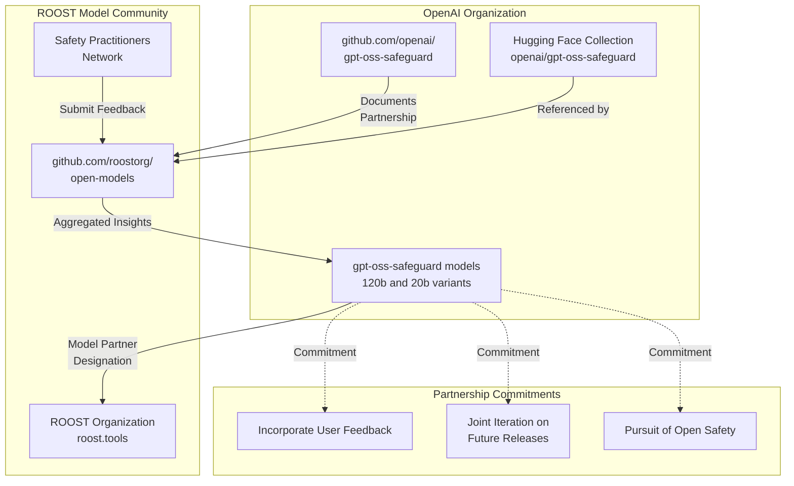
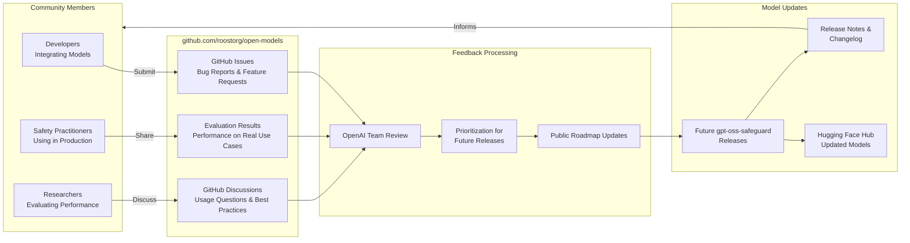
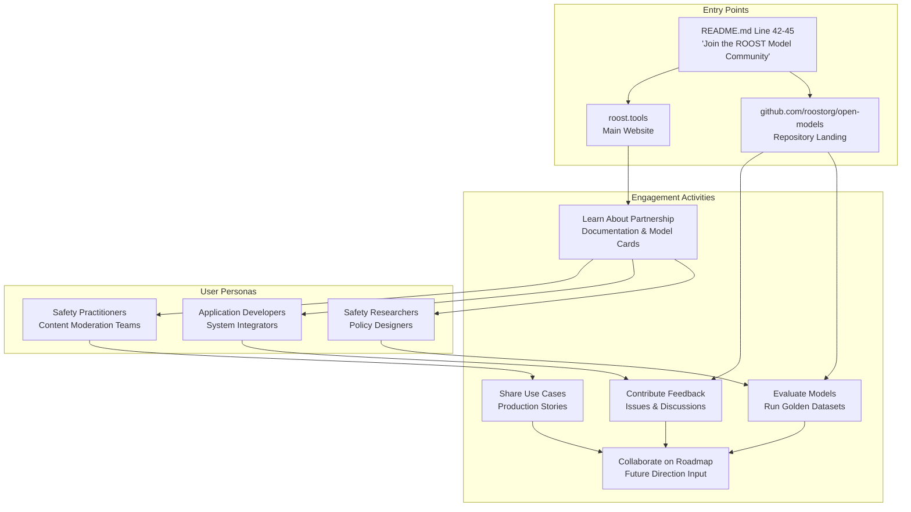
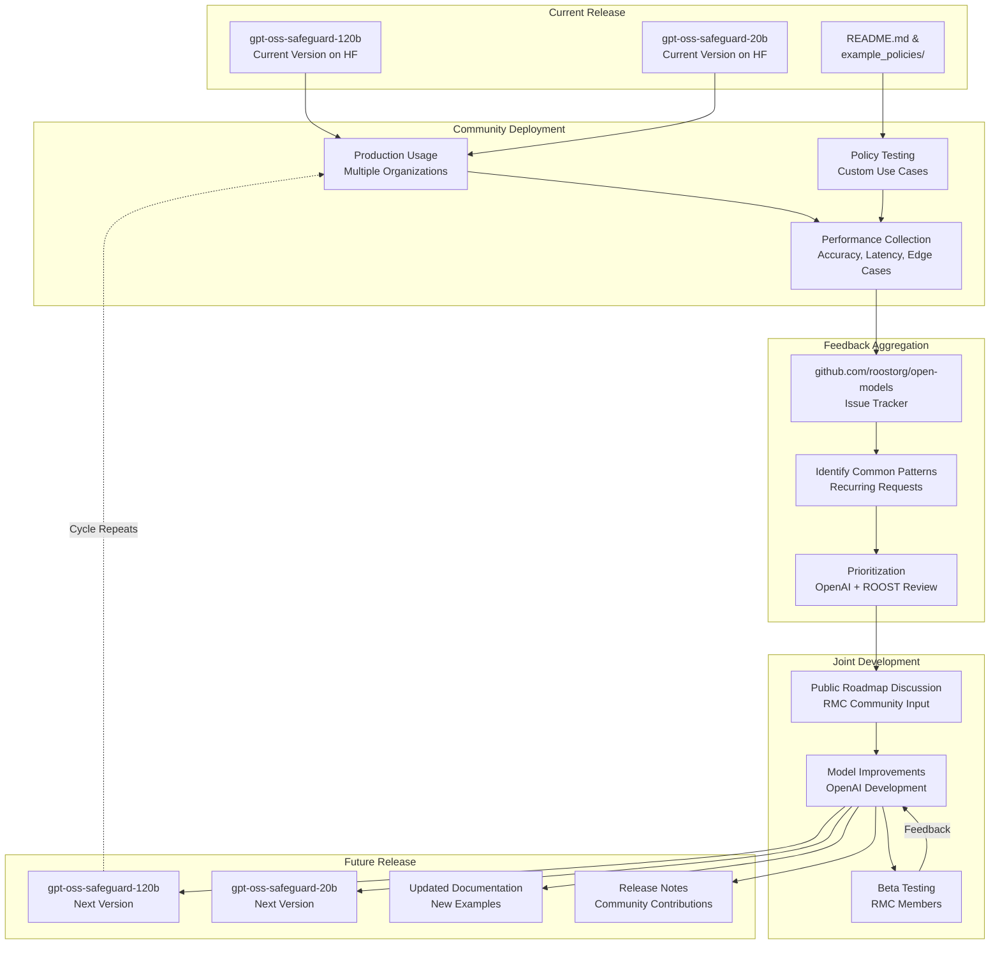
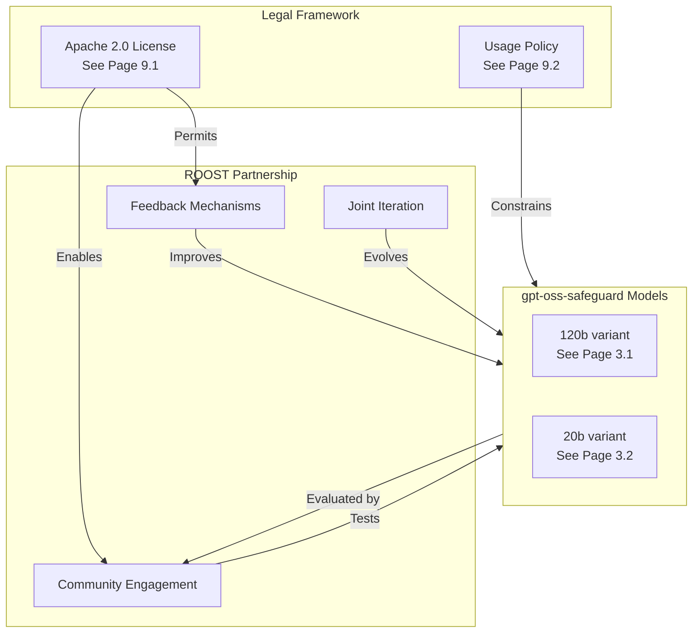

<!-- source: DeepWiki mcp.deepwiki.com · repo openai/gpt-oss-safeguard · page 9.3 ROOST Model Community Partnership · fetched 2026-10-26 -->

# ROOST Model Community Partnership

Relevant source files

The following files were used as context for generating this wiki page:

- [README.md](README.md)

## Purpose and Scope

This document describes the partnership between `gpt-oss-safeguard` and the ROOST Model Community (RMC), including the feedback mechanisms, community engagement channels, and joint iteration process. This partnership establishes a bidirectional relationship where safety practitioners, developers, and researchers can influence future model development.

For information about the permissive licensing that enables this partnership, see [Apache 2.0 License](#9.1). For the usage requirements that govern model deployment, see [Usage Policy](#9.2).

**Sources:** [README.md:42-45]()

---

## What is ROOST?

**ROOST** (Robust Open Online Safety Tools) Model Community is a collaborative network of safety practitioners exploring open source AI models for protecting online spaces. The RMC serves as a bridge between model developers (like OpenAI) and the community of users deploying safety systems in production environments.

### Core Mission

The ROOST Model Community focuses on:

- **Safety Practitioner Support**: Providing tools and guidance for content moderators and trust & safety teams
- **Open Source Exploration**: Evaluating and improving open models for safety applications
- **Cross-Organization Collaboration**: Enabling knowledge sharing across different safety use cases
- **Model Partnership Program**: Working directly with model developers to incorporate real-world feedback

**Sources:** [README.md:44]()

---

## Partnership Structure

The `gpt-oss-safeguard` models are designated **model partners** of the ROOST Model Community. This partnership establishes formal channels for feedback collection and joint development.

### Partnership Diagram

### Key Partnership Commitments

| Commitment | Description | Implementation |
|------------|-------------|----------------|
| **User Feedback Incorporation** | OpenAI commits to integrating feedback from ROOST community members | Feedback submitted via RMC GitHub repository is reviewed and prioritized for model updates |
| **Joint Iteration** | Future model releases are developed collaboratively with ROOST | RMC members participate in testing pre-release versions and contribute to roadmap planning |
| **Open Safety Pursuit** | Partnership advances open-source safety infrastructure | Models remain Apache 2.0 licensed with transparent documentation and reproducible evaluation methods |

**Sources:** [README.md:44-45]()

---

## Feedback Mechanisms

The primary feedback channel is the **RMC GitHub repository** located at `github.com/roostorg/open-models`. This repository serves as the centralized collection point for all model partner feedback.

### Feedback Collection Workflow

### Feedback Categories

The ROOST feedback system accepts several types of input:

**Bug Reports**
- Unexpected model behavior with specific policies
- Issues with the `harmony response format` [README.md:20]()
- Evaluation metric discrepancies

**Feature Requests**
- New policy template examples (beyond spam detection)
- Additional reasoning effort configurations
- Integration patterns for specific deployment scenarios

**Performance Evaluations**
- Results from production deployments
- Golden dataset validation against custom policies
- Latency and accuracy measurements in real-world conditions

**Best Practice Documentation**
- Successful policy design patterns
- Deployment configuration templates
- Integration with existing safety stacks

**Sources:** [README.md:44-45]()

---

## Community Engagement Channels

The ROOST Model Community provides multiple channels for different types of engagement.

### Engagement Architecture

### Persona-Specific Entry Points

| Persona | Primary Interest | Recommended Action |
|---------|------------------|-------------------|
| **Safety Practitioners** | Real-world effectiveness of policies | Visit `roost.tools` to connect with other practitioners; share production metrics via RMC repository |
| **Application Developers** | Integration patterns and API usage | Review [Inference Configuration](#8.3) then contribute deployment templates to RMC repository |
| **Safety Researchers** | Model capabilities and limitations | Evaluate models with custom policies (see [Validating Your Policies](#7.3)); publish results via RMC discussions |

**Sources:** [README.md:42-45]()

---

## Joint Iteration Process

The partnership enables a **joint iteration process** where community feedback directly influences the model development roadmap.

### Iteration Lifecycle

### Transparency Mechanisms

The joint iteration process maintains transparency through:

1. **Public Issue Tracking**: All feedback is visible in the RMC repository issue tracker
2. **Roadmap Visibility**: Planned improvements are documented in public roadmap discussions
3. **Release Attribution**: Release notes acknowledge community contributions
4. **Open Evaluation**: Performance metrics and golden datasets remain publicly accessible

**Sources:** [README.md:44-45]()

---

## Getting Involved

### Step-by-Step Engagement Guide

**Step 1: Review Current Documentation**
- Read [README.md:42-45]() for partnership overview
- Explore [example_policies/spam/]() for policy examples
- Review the [OpenAI Cookbook guide](https://cookbook.openai.com/articles/gpt-oss-safeguard-guide) for best practices

**Step 2: Visit ROOST Resources**
- Navigate to `roost.tools` to learn about the organization
- Browse `github.com/roostorg/open-models` to see existing discussions
- Identify which model partner topics are most relevant to your use case

**Step 3: Deploy and Evaluate**
- Download models from [Hugging Face Hub](https://huggingface.co/collections/openai/gpt-oss-safeguard)
- Create custom policies for your use case (see [Creating Custom Policies](#5.5))
- Run evaluations with golden datasets (see [Golden Datasets](#7.1))

**Step 4: Share Feedback**
- Open issues for bugs or unexpected behavior
- Start discussions for best practice questions
- Share evaluation results and production metrics

**Step 5: Participate in Roadmap Discussions**
- Engage with roadmap proposals
- Vote on feature prioritization
- Contribute to beta testing programs

### Code References for Partnership Documentation

The partnership is primarily documented in external resources, with the repository serving as a reference point:

| Location | Content | Purpose |
|----------|---------|---------|
| [README.md:42-45]() | Partnership announcement and links | Primary in-repository documentation |
| `roost.tools` (external) | ROOST organization information | Community landing page |
| `github.com/roostorg/open-models` (external) | Feedback repository | Central feedback collection |
| [example_policies/]() | Policy examples | Demonstrates model capabilities for community evaluation |

**Sources:** [README.md:42-45]()

---

## Benefits of the Partnership

### For the Community

| Benefit | Description |
|---------|-------------|
| **Influence on Development** | Direct input into model roadmap and feature prioritization |
| **Shared Learning** | Access to aggregated best practices from multiple safety practitioners |
| **Early Access** | Opportunity to participate in beta testing of future releases |
| **Attribution** | Public recognition of contributions in release notes |

### For OpenAI

| Benefit | Description |
|---------|-------------|
| **Real-World Validation** | Access to diverse deployment scenarios and edge cases |
| **Community Testing** | Broader evaluation coverage than internal testing alone |
| **Use Case Discovery** | Understanding of novel safety applications and policy patterns |
| **Trust Building** | Transparent development process increases adoption confidence |

### For the Safety Ecosystem

| Benefit | Description |
|---------|-------------|
| **Open Standards** | Collaborative development of policy templates and evaluation methods |
| **Reproducibility** | Public golden datasets enable comparable benchmarking |
| **Knowledge Transfer** | Documentation and examples benefit entire safety community |
| **Sustainable Development** | Community support ensures long-term model maintenance |

**Sources:** [README.md:44-45]()

---

## Relationship to Other Governance Components

The ROOST partnership complements the legal and policy framework:

- **Apache 2.0 License** ([#9.1]()): Enables open participation by removing commercial restrictions
- **Usage Policy** ([#9.2]()): Establishes responsible use requirements that feedback must respect
- **Model Variants** ([#3.1](), [#3.2]()): Subject to improvement through community feedback

**Sources:** [README.md:42-45](), [README.md:28]()

---

## Summary

The ROOST Model Community partnership establishes a **bidirectional development model** where:

1. Community members deploy `gpt-oss-safeguard` in production environments
2. Feedback is collected via `github.com/roostorg/open-models`
3. OpenAI and ROOST jointly prioritize improvements
4. Future releases incorporate community contributions
5. The cycle repeats with increased model effectiveness

This partnership distinguishes `gpt-oss-safeguard` from traditional model releases by embedding community governance into the development process itself. The commitment to joint iteration ensures the models evolve based on real-world safety practitioner needs rather than isolated development assumptions.

To participate, visit the [RMC GitHub repository](https://github.com/roostorg/open-models) and begin by reviewing existing discussions or sharing your deployment experiences.

**Sources:** [README.md:42-45]()

---

