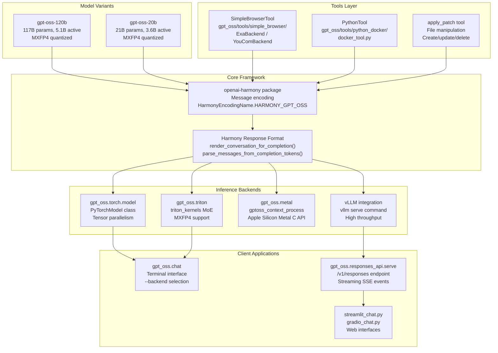
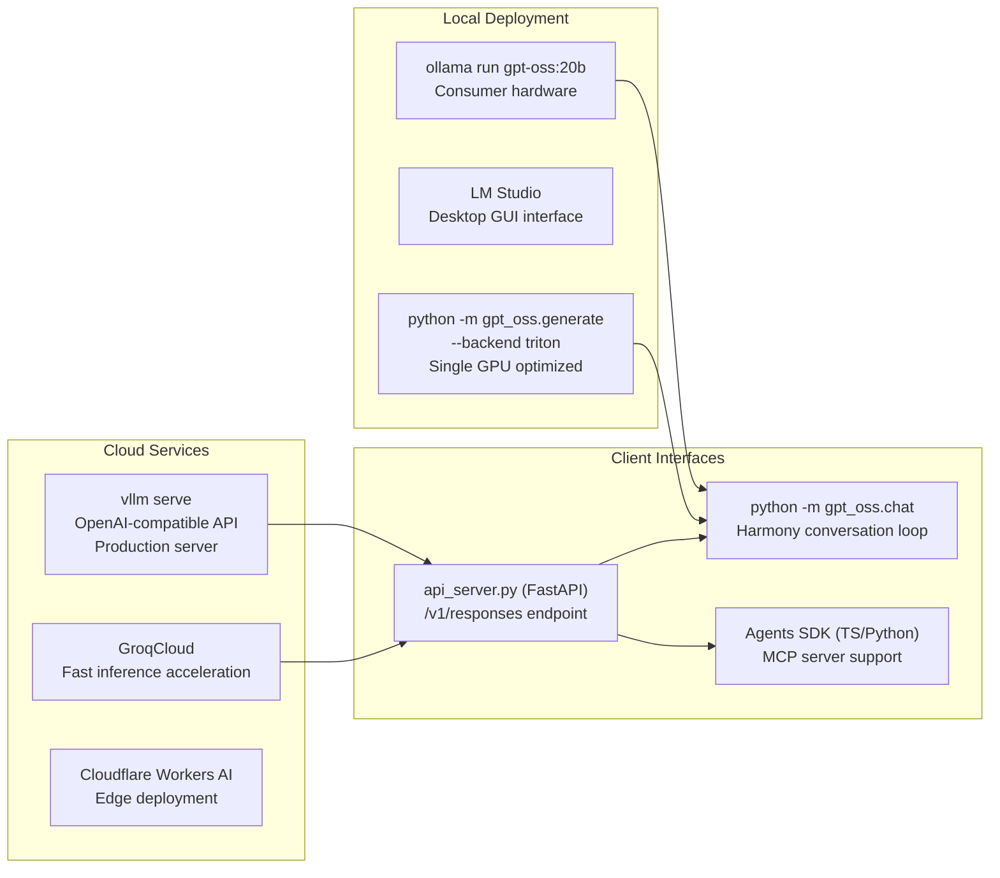
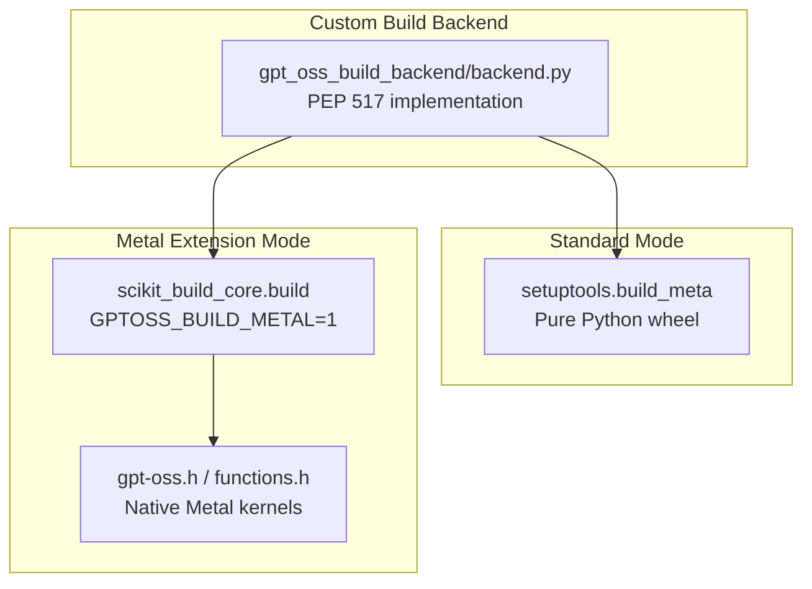

<!-- source: DeepWiki mcp.deepwiki.com · repo openai/gpt-oss · page 1 Overview · fetched 2026-10-26 -->

# Overview

Relevant source files

The following files were used as context for generating this wiki page:

- [README.md](README.md)
- [awesome-gpt-oss.md](awesome-gpt-oss.md)
- [examples/reinforcement-fine-tuning.ipynb](examples/reinforcement-fine-tuning.ipynb)

This document provides a technical overview of the gpt-oss repository, which implements OpenAI's open-weight language models and supporting infrastructure. The repository contains two sparse mixture-of-experts (MoE) models (`gpt-oss-120b` and `gpt-oss-20b`), multiple inference backends, integrated tools, client applications, and evaluation frameworks.

For detailed model specifications, see [Models](#2). For deployment instructions, see [Getting Started](#3). For tool integration details, see [Tools and Capabilities](#5).

## System Architecture

The following diagram maps the high-level system components to their corresponding code entities:

**System Component Map**

Sources: [README.md:14-46](), [README.md:104-168](), [README.md:300-335](), [awesome-gpt-oss.md:83-86]()

## Core Components

The gpt-oss system consists of several interconnected components that work together to provide a complete language model inference and interaction platform:

| Component | Purpose | Key Code Entities |
|-----------|---------|-------------------|
| **Model Variants** | Two sparse MoE models with different parameter counts | `openai/gpt-oss-120b`, `openai/gpt-oss-20b` |
| **Harmony Framework** | Essential message encoding and tool integration | `openai_harmony`, `load_harmony_encoding` |
| **Inference Backends** | Multiple computational backends for model execution | `gpt_oss.torch`, `gpt_oss.triton`, `gpt_oss.metal` |
| **Tools Ecosystem** | Integrated capabilities for web browsing and code execution | `SimpleBrowserTool`, `PythonTool`, `gpt-oss-mcp-server` |
| **Client Applications** | Various interfaces for model interaction | `gpt_oss.chat`, `api_server.py`, `streamlit_chat.py` |
| **Evaluation System** | Benchmarking and testing framework | `gpt_oss.evals`, `HealthBenchEval`, `GPQAEval` |

Sources: [README.md:16-19](), [README.md:104-118](), [awesome-gpt-oss.md:7-13]()

## Model Variants

The repository provides two model variants optimized for different use cases:

### gpt-oss-120b
- **Parameters**: 117B total, 5.1B active per forward pass [README.md:18-18]()
- **Memory**: Fits on a single 80GB GPU (NVIDIA H100 or AMD MI300X) [README.md:18-18]()
- **Quantization**: MXFP4 quantization of the MoE weights [README.md:45-45]()
- **Use Case**: Production, general purpose, high reasoning use cases [README.md:18-18]()

### gpt-oss-20b  
- **Parameters**: 21B total, 3.6B active per forward pass [README.md:19-19]()
- **Memory**: Runs within 16GB of memory [README.md:45-45]()
- **Quantization**: MXFP4 quantization of the MoE weights [README.md:45-45]()
- **Use Case**: Lower latency, local or specialized use cases [README.md:19-19]()

Both models were trained using the Harmony response format and require it for correct operation [README.md:21-21](). They support configurable reasoning effort (low, medium, high) and provide full access to the chain-of-thought process [README.md:41-42]().

## Deployment Ecosystem

The following diagram illustrates the deployment options and their corresponding code integration points:

**Deployment and Client Flow**

Sources: [README.md:79-92](), [README.md:176-183](), [awesome-gpt-oss.md:17-76]()

## Build System Architecture

The repository uses a custom PEP 517 build backend that supports dynamic selection between standard Python packaging and native Metal compilation for Apple Silicon.

**Build Pipeline**

The build system automatically delegates to `scikit-build-core` when building with Metal support, which handles the compilation of `.metallib` files and the C++ Python bindings [README.md:31-31]().

Sources: [README.md:31-31](), [awesome-gpt-oss.md:39-40]()

## Key Technologies

- **MXFP4 Quantization**: Native quantization format for MoE weights, enabling large models to run on significantly reduced hardware footprints (e.g., 120b on a single 80GB GPU) [README.md:45-45]().
- **Harmony Response Format**: A specialized chat format library (`openai-harmony`) required for model operation. It manages `Conversation`, `Message`, and `Role` objects, and handles the rendering of tool descriptions and stop tokens [README.md:104-168]().
- **Sparse MoE Architecture**: Efficient mixture-of-experts design where only a small subset of parameters (5.1B for the 120b model) are active during any single inference step [README.md:18-19]().
- **Multi-Backend Support**: Pluggable inference backends ranging from educational PyTorch implementations to high-performance Triton kernels and native Metal implementations for Apple Silicon [README.md:29-31]().
- **Agentic Capabilities**: Native support for tool calling, including web browsing via `SimpleBrowserTool` and secure code execution via `PythonTool` [README.md:44-44](), [awesome-gpt-oss.md:83-86]().
- **Reinforcement Fine-Tuning**: Support for training models using GRPO (Group Relative Policy Optimization) for strategy-based tasks like the 2048 game [examples/reinforcement-fine-tuning.ipynb:19-35]().

Sources: [README.md:18-46](), [README.md:104-168](), [examples/reinforcement-fine-tuning.ipynb:19-35]()

---

