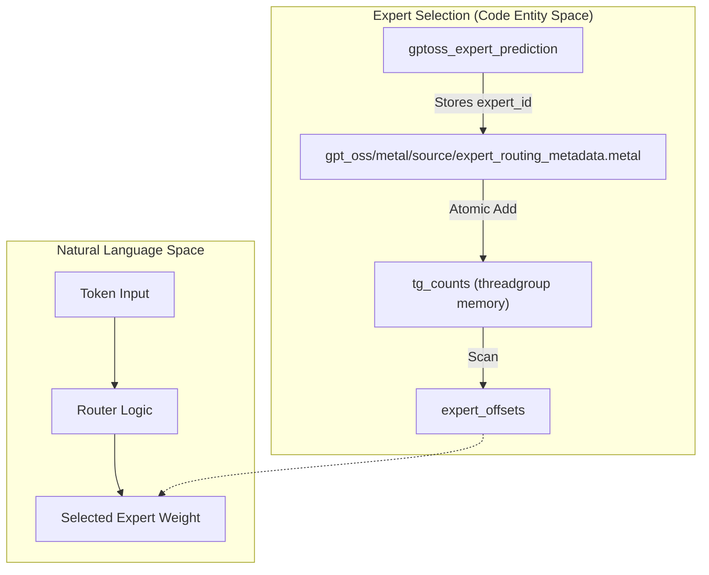
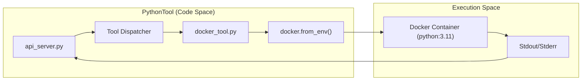

<!-- source: DeepWiki mcp.deepwiki.com · repo openai/gpt-oss · page 10 Glossary · fetched 2026-10-26 -->

# Glossary

Relevant source files

The following files were used as context for generating this wiki page:

- [README.md](README.md)
- [_build/gpt_oss_build_backend/backend.py](_build/gpt_oss_build_backend/backend.py)
- [awesome-gpt-oss.md](awesome-gpt-oss.md)
- [examples/reinforcement-fine-tuning.ipynb](examples/reinforcement-fine-tuning.ipynb)
- [gpt_oss/metal/CMakeLists.txt](gpt_oss/metal/CMakeLists.txt)
- [gpt_oss/metal/source/context.c](gpt_oss/metal/source/context.c)
- [gpt_oss/metal/source/expert_routing_metadata.metal](gpt_oss/metal/source/expert_routing_metadata.metal)
- [gpt_oss/metal/source/moematmul.metal](gpt_oss/metal/source/moematmul.metal)
- [gpt_oss/tools/python_docker/docker_tool.py](gpt_oss/tools/python_docker/docker_tool.py)
- [gpt_oss/triton/attention.py](gpt_oss/triton/attention.py)
- [pyproject.toml](pyproject.toml)

This glossary defines technical terms, architectural concepts, and domain-specific jargon used within the `gpt-oss` codebase.

## Core Architectural Terms

### Harmony
The mandatory response format and message protocol used by `gpt-oss` models. It defines how conversations are structured, how tools are called, and how thoughts (Chain-of-Thought) are delimited. Models will not function correctly if this format is bypassed [README.md:21-22]().
*   **Implementation:** `openai-harmony` package [pyproject.toml:6-6]().
*   **Key Class:** `Conversation` [README.md:120-121]().
*   **Encoding:** `HarmonyEncodingName.HARMONY_GPT_OSS` [README.md:118-118]().

### MXFP4 (Microscaling Formats)
A specialized 4-bit quantization format used for the Mixture-of-Experts (MoE) weights. This allows the 117B parameter model (`gpt-oss-120b`) to fit within a single 80GB GPU memory [README.md:45-46]().
*   **Code Pointer:** `gptoss_f32_mf4w_moe_matmul` in [gpt_oss/metal/source/moematmul.metal:129-130]().

### Mixture-of-Experts (MoE)
An architecture where only a subset of the model's parameters (the "active" parameters) are triggered for any given token.
*   **Active Parameters:** `gpt-oss-120b` has 117B total but only 5.1B active parameters per token [README.md:18-18]().
*   **Routing:** The process of selecting which experts to activate [gpt_oss/metal/source/context.c:97-98]().

---

## Technical Concepts and Data Flow

### Expert Routing
The mechanism by which the model determines which experts should process specific tokens. In the Metal implementation, this involves calculating offsets and predictions.

**Expert Metadata Flow**

*   **Sources:** [gpt_oss/metal/source/expert_routing_metadata.metal:8-14](), [gpt_oss/metal/source/context.c:88-91]()

### Learned Sinks
A feature in the attention mechanism that allows the model to "dump" attention scores into specific tokens (sinks) to maintain stability over long contexts without overflowing softmax values.
*   **Kernel:** `_attn_fwd` [gpt_oss/triton/attention.py:19-24]().
*   **Logic:** `sink = tl.load(Sinks + off_h)` [gpt_oss/triton/attention.py:45-46]().

---

## Codebase Definitions

| Term | Definition | Code Pointer |
| :--- | :--- | :--- |
| `gptoss_context_t` | An opaque handle to the inference state, containing activation buffers and KV cache. | [gpt_oss/metal/source/context.c:19-23]() |
| `SwiGLU` | The activation function used in the MoE experts, combining Swish and Gated Linear Units. | [gpt_oss/metal/source/moematmul.metal:118-126]() |
| `Responses API` | The FastAPI-based server that provides an OpenAI-compatible interface for the models. | [pyproject.toml:11-11]() |
| `KV Cache` | Memory buffer storing Key and Value vectors to avoid re-computing self-attention for previous tokens. | [gpt_oss/metal/source/context.c:139-142]() |
| `RMSNorm` | Root Mean Square Layer Normalization used before attention and MoE blocks. | [gpt_oss/metal/source/context.c:72-73]() |

---

## Tooling and Execution

### Python Execution Tool
A capability allowing the model to write and execute Python code. It supports multiple backends for isolation.
*   **Docker Backend:** Runs code in a `python:3.11` container [gpt_oss/tools/python_docker/docker_tool.py:45-52]().
*   **UV Backend:** Uses the `uv` tool for fast, ephemeral script execution [gpt_oss/tools/python_docker/docker_tool.py:82-83]().
*   **Jupyter Backend:** Uses `jupyter_client` for stateful execution [gpt_oss/tools/python_docker/docker_tool.py:101-102]().

**Tool Execution Architecture**

*   **Sources:** [gpt_oss/tools/python_docker/docker_tool.py:41-47](), [pyproject.toml:10-10]()

### Metal Build System
The custom build process for Apple Silicon that compiles `.metal` shaders into a `.metallib` using `xcrun`.
*   **Environment Variable:** `GPTOSS_BUILD_METAL` [\_build/gpt_oss_build_backend/backend.py:8-10]().
*   **Compiler:** `xcrun -sdk macosx metal` [gpt_oss/metal/CMakeLists.txt:39-40]().

---

## Summary of File Roles
*   `README.md`: High-level overview and model specifications [1-46]().
*   `pyproject.toml`: Dependency management and build system configuration [1-50]().
*   `gpt_oss/metal/source/context.c`: Memory management and lifecycle for inference contexts [19-156]().
*   `gpt_oss/triton/attention.py`: Optimized GPU kernels for attention with sinks [1-162]().
*   `gpt_oss/tools/python_docker/docker_tool.py`: Implementation of secure code execution [1-102]().