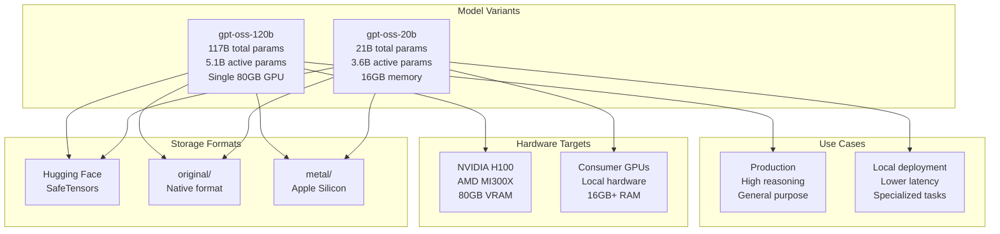
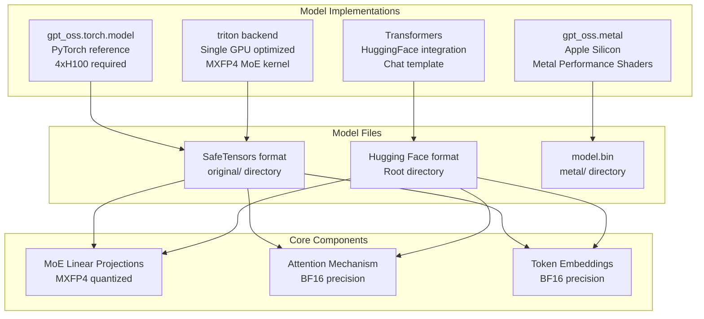
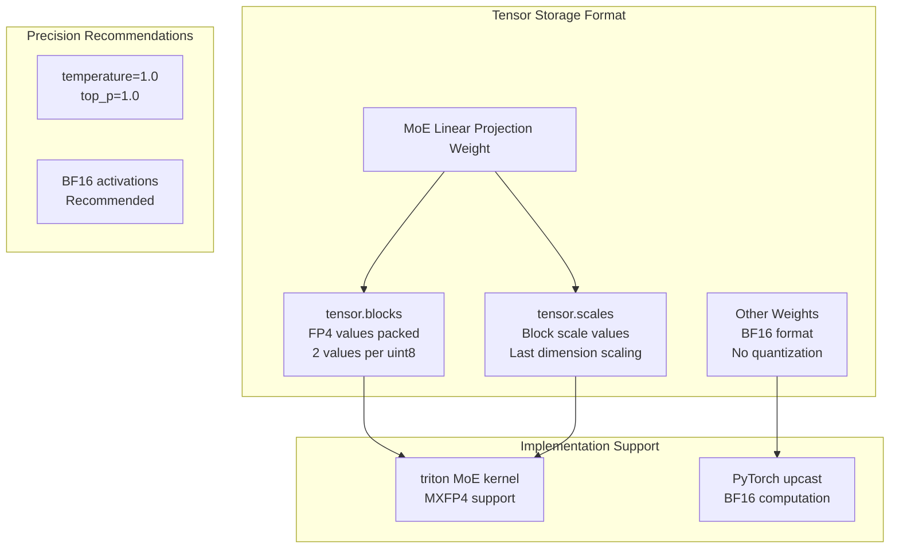
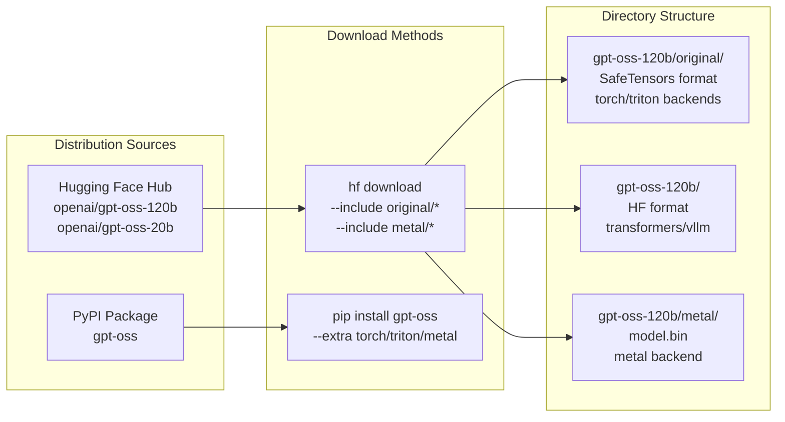

<!-- source: DeepWiki mcp.deepwiki.com · repo openai/gpt-oss · page 2 Models · fetched 2026-10-26 -->

# Models

Relevant source files

The following files were used as context for generating this wiki page:

- [README.md](README.md)
- [awesome-gpt-oss.md](awesome-gpt-oss.md)
- [examples/reinforcement-fine-tuning.ipynb](examples/reinforcement-fine-tuning.ipynb)

This section covers the two open-weight language model variants in the `gpt-oss` repository: `gpt-oss-120b` and `gpt-oss-20b`. It details their technical specifications, architectural characteristics, quantization schemes, and deployment considerations. For information about inference backends and runtime implementations, see [Inference Backends](#4). For deployment guides and platform-specific setup, see [Getting Started](#3).

## Model Variants

The gpt-oss repository provides two model variants optimized for different use cases and hardware constraints:

Sources: [README.md:16-19](), [README.md:175-183](), [README.md:246-251]()

## Technical Specifications

| Specification | gpt-oss-120b | gpt-oss-20b |
|---------------|--------------|-------------|
| **Total Parameters** | 117B | 21B |
| **Active Parameters** | 5.1B | 3.6B |
| **Architecture** | Mixture of Experts (MoE) | Mixture of Experts (MoE) |
| **Quantization** | MXFP4 (MoE weights) | MXFP4 (MoE weights) |
| **Base Precision** | BF16 | BF16 |
| **Memory Requirement** | Single 80GB GPU | 16GB |
| **Target Hardware** | H100, MI300X | Consumer GPUs (e.g. T4, RTX) |
| **License** | Apache 2.0 | Apache 2.0 |
| **Response Format** | Harmony (required) | Harmony (required) |

Sources: [README.md:18-19](), [README.md:45](), [README.md:40](), [README.md:21](), [examples/reinforcement-fine-tuning.ipynb:63-65]()

## Architecture and Implementation

The models are implemented across multiple backends with different optimization strategies. The repository provides reference code for PyTorch, Triton, and Metal.

Sources: [README.md:185-187](), [README.md:204](), [README.md:232](), [README.md:51]()

## Quantization Format

The models use MXFP4 quantization specifically for Mixture of Experts (MoE) weights. This allows the 120B model to fit on a single 80GB GPU. Other weights like attention and embeddings remain in higher precision (BF16).

Sources: [README.md:45](), [README.md:485-490](), [README.md:494](), [README.md:204]()

## Model Distribution and Access

The models are available through multiple distribution channels with different format requirements. The "original" format is used for the native PyTorch and Triton backends, while the root directory format is compatible with Hugging Face Transformers and vLLM.

Sources: [README.md:175-183](), [README.md:246-251](), [README.md:155-171]()

## Sampling and Configuration

Both models require specific configuration for optimal performance. They are trained with the [Harmony Response Format](#5.1) and will not function correctly without it.

| Parameter | Recommended Value | Purpose |
|-----------|------------------|---------|
| `temperature` | 1.0 | Sampling randomness |
| `top_p` | 1.0 | Nucleus sampling |
| `reasoning_effort` | low/medium/high | Configurable reasoning depth |
| `max_context` | 8192 (default) | Context window size |
| `precision` | BF16 | Activation precision |

The models support configurable reasoning effort levels, allowing users to trade between response quality and latency.

Sources: [README.md:494](), [README.md:41](), [README.md:21](), [README.md:272-294]()

## Child Pages

- [gpt-oss-120b](#2.1) — Detailed specifications for the 117B parameter MoE model.
- [gpt-oss-20b](#2.2) — Detailed specifications for the 21B parameter model optimized for latency.

---

