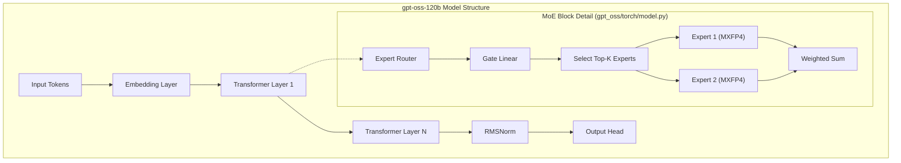
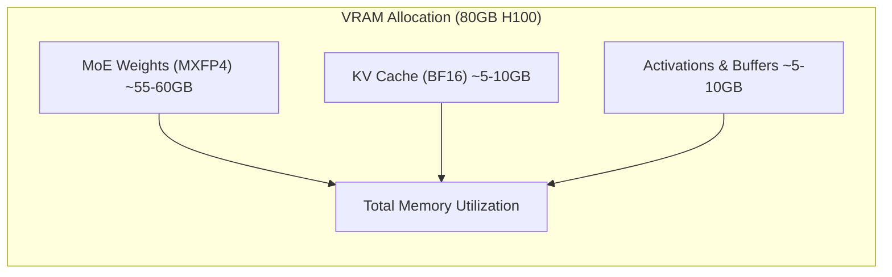
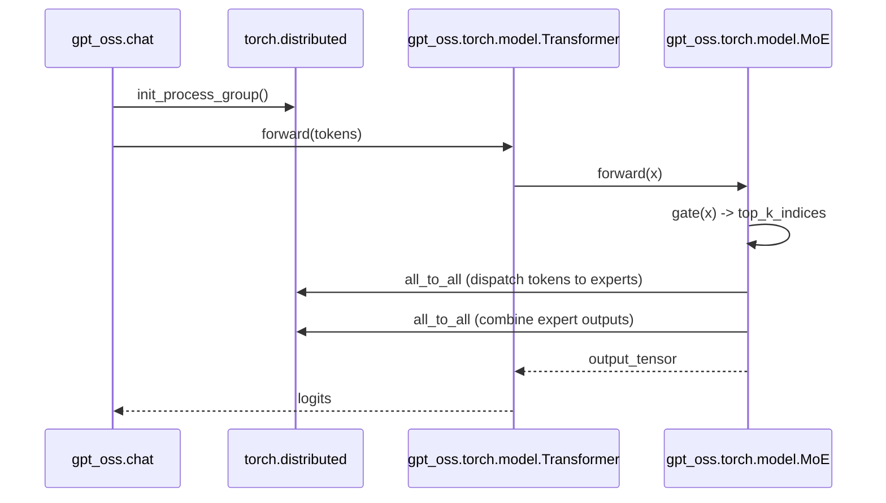

<!-- source: DeepWiki mcp.deepwiki.com · repo openai/gpt-oss · page 2.1 gpt-oss-120b · fetched 2026-10-26 -->

# gpt-oss-120b

<details>
<summary>Relevant source files</summary>

The following files were used as context for generating this wiki page:

- [README.md](README.md)

</details>


This document covers the technical specifications, architecture, and deployment options for the `gpt-oss-120b` model, the larger variant in the gpt-oss series. This page focuses specifically on the 117B parameter model optimized for production use cases.

## Model Specifications

The `gpt-oss-120b` model is designed for production environments requiring high reasoning capabilities while maintaining single-GPU deployment feasibility. It is a Mixture-of-Experts (MoE) model where only a fraction of parameters are active for any given token. [README.md:18-19]()

| Specification | Value |
|---------------|-------|
| Total Parameters | 117B |
| Active Parameters | 5.1B |
| Architecture | Mixture of Experts (MoE) |
| Quantization | MXFP4 for MoE weights |
| Minimum GPU Memory | 80GB (Quantized) |
| Target Hardware | NVIDIA H100, AMD MI300X |
| Precision | BF16 activations |
| License | Apache 2.0 |

Sources: [README.md:18-19](), [README.md:40-46]()

## Architecture and Quantization

### MoE Architecture

The model implements a sparse Mixture of Experts design. Routing decisions activate only 5.1B parameters per token, significantly reducing the FLOPs required for inference compared to a dense 117B model. [README.md:18-19]()

### MXFP4 Quantization Details

The model employs MXFP4 (Microscaling FP4) quantization specifically for the MoE expert weights. This allows the 117B parameter model to fit within 80GB of VRAM. [README.md:45-46]()

The quantization format splits weights into:
- **Blocks**: The actual FP4 values, packed into `uint8` containers.
- **Scales**: Shared exponents/scaling factors used to dequantize blocks during the forward pass.



Sources: [README.md:45-46](), [README.md:185-188]()

## Hardware Requirements and Memory Profile

### Memory Optimization

The primary constraint for `gpt-oss-120b` is VRAM. While the total parameter count is high, the MXFP4 quantization reduces the weight footprint to approximately 60GB, leaving room for KV cache and activations on an 80GB card. [README.md:45-46]()



### Tensor Parallelism Requirements

When running the **PyTorch Reference Implementation**, the model requires tensor parallelism because it upcasts weights to BF16 for computation if optimized kernels are not used. This increases the memory requirement to approximately 4x H100 (80GB) or 2x H200 (141GB). [README.md:187-188]()

Sources: [README.md:18-19](), [README.md:187-188]()

## Inference Implementations

### vLLM (Production Recommended)

For production, vLLM is the recommended backend. It supports the model through a specialized fork that handles the architecture and quantization. [README.md:81-92]()

```python
# vLLM Configuration for 120b
llm = LLM(
    model="openai/gpt-oss-120b",
    tensor_parallel_size=1, # Fits on 1x 80GB GPU with quantization
    gpu_memory_utilization=0.95,
    max_model_len=8192
)
```
Sources: [README.md:137-144]()

### Triton Optimized Backend

The Triton backend (`gpt_oss/triton`) is a single-GPU optimized implementation. It uses specialized kernels to perform dequantization and matrix multiplication in a single step, avoiding the memory overhead of upcasting the entire weight matrix. [README.md:204-210]()

Key components include:
- `FlashAttention v2` with learned sinks. [README.md:213-214]()
- `MXFP4 MoE` kernel for efficient expert routing and execution. [README.md:215-216]()
- CUDA graph capture to minimize CPU launch overhead. [README.md:217-218]()

### PyTorch Reference Implementation

Located in `gpt_oss/torch/model.py`, this implementation provides the most readable version of the MoE logic. It uses `torch.distributed` for tensor parallelism across multiple GPUs. [README.md:185-190]()



Sources: [README.md:185-200](), [README.md:337-342]()

## Integration with Harmony Format

The `gpt-oss-120b` model **must** be used with the Harmony response format. Failure to use the `openai-harmony` package for rendering prompts and parsing completions will result in degraded performance or nonsensical output. [README.md:21-22]()

The model is trained to recognize specific control tokens and structures defined in `HarmonyEncodingName.HARMONY_GPT_OSS`. [README.md:118-131]()

Sources: [README.md:21-22](), [README.md:104-131]()

---

