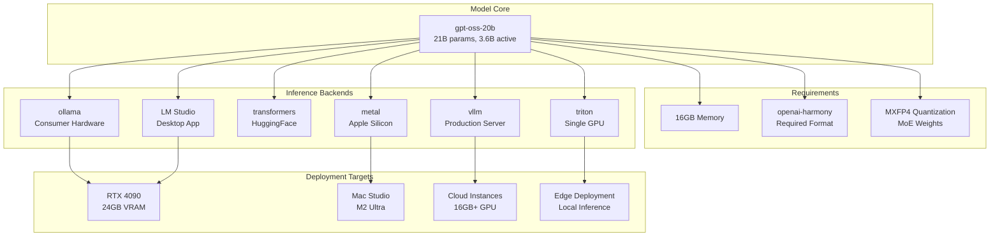
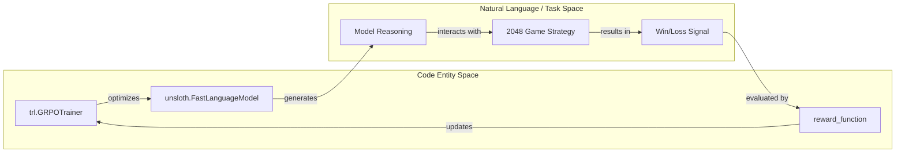
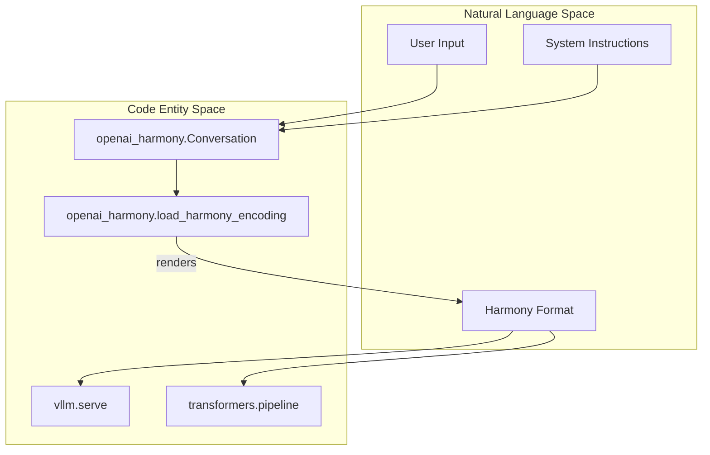

<!-- source: DeepWiki mcp.deepwiki.com · repo openai/gpt-oss · page 2.2 gpt-oss-20b · fetched 2026-10-26 -->

# gpt-oss-20b

<details>
<summary>Relevant source files</summary>

The following files were used as context for generating this wiki page:

- [README.md](README.md)
- [awesome-gpt-oss.md](awesome-gpt-oss.md)
- [examples/reinforcement-fine-tuning.ipynb](examples/reinforcement-fine-tuning.ipynb)

</details>


This document covers the `gpt-oss-20b` model, the smaller variant in the gpt-oss series optimized for lower latency and local deployment scenarios. For information about the larger production model, see [gpt-oss-120b](). For details about inference backends, see [Inference Backends](). For deployment guidance, see [Getting Started]().

## Overview

The `gpt-oss-20b` model is a 21-billion parameter sparse mixture-of-experts (MoE) model with 3.6 billion active parameters [README.md:19](). It is specifically designed for scenarios requiring lower latency inference, local deployment, and specialized use cases where the full computational capacity of the 120B model is not required. It is released under the permissive Apache 2.0 license [README.md:40]().

## Model Specifications

| Specification | Value |
|---------------|-------|
| Total Parameters | 21 billion [README.md:19]() |
| Active Parameters | 3.6 billion [README.md:19]() |
| Memory Requirements | 16GB [README.md:45]() |
| Architecture | Sparse Mixture-of-Experts [README.md:19]() |
| Quantization | MXFP4 for MoE weights [README.md:45]() |
| License | Apache 2.0 [README.md:40]() |
| Required Format | Harmony response format [README.md:21]() |

The model implements the same architectural patterns as `gpt-oss-120b` but with reduced scale to enable deployment on consumer hardware and edge computing environments.

**gpt-oss-20b System Architecture**

Sources: [README.md:18-19](), [README.md:40-45]()

## Reinforcement Fine-Tuning Support

A key feature of `gpt-oss-20b` is its support for reinforcement learning (RL) fine-tuning on consumer-grade hardware. Using the [Unsloth](https://github.com/unslothai/unsloth) library and the GRPO algorithm, the model can be trained to develop complex strategies in sandboxed environments [examples/reinforcement-fine-tuning.ipynb:23-35]().

### Fine-Tuning Hardware Configurations
The model can be fine-tuned on varying hardware by adjusting quantization and memory offloading:
*   **Tesla T4 (15GB VRAM):** Requires `load_in_4bit = True`, `max_seq_length = 768`, and `offload_embedding = True` [examples/reinforcement-fine-tuning.ipynb:63-66]().
*   **H100/B200 (80GB VRAM):** Can use `load_in_16bit` for faster training and higher accuracy [examples/reinforcement-fine-tuning.ipynb:65]().

**Fine-Tuning Data Flow (RL Sandbox)**

Sources: [examples/reinforcement-fine-tuning.ipynb:23-56](), [examples/reinforcement-fine-tuning.ipynb:62-67]()

## Deployment and Inference

The `gpt-oss-20b` model supports multiple deployment strategies optimized for different hardware configurations.

### Local Deployment Platforms
*   **Ollama:** Recommended for consumer hardware [README.md:176-182]().
*   **LM Studio:** Desktop GUI for model interaction [awesome-gpt-oss.md:23-25]().
*   **Apple Silicon:** Native Metal implementation for Mac hardware [README.md:31]().

### Production and Cloud
*   **vLLM:** Recommended for high-throughput OpenAI-compatible servers [README.md:81-89]().
*   **GroqCloud:** Offers low-latency hosted inference with built-in tool support [awesome-gpt-oss.md:55-61]().
*   **Cloudflare Workers AI:** Serverless deployment option [awesome-gpt-oss.md:66-69]().

**Inference Stack Mapping**

Sources: [README.md:53-75](), [README.md:104-131](), [awesome-gpt-oss.md:17-76]()

## Usage Examples

### vLLM Offline Inference
The following example demonstrates how to use the `openai-harmony` package to render a conversation for `gpt-oss-20b` before passing it to the vLLM engine:

```python
from openai_harmony import load_harmony_encoding, Conversation, Role, HarmonyEncodingName
from vllm import LLM, SamplingParams

# Render the prefill with Harmony
encoding = load_harmony_encoding(HarmonyEncodingName.HARMONY_GPT_OSS)
convo = Conversation.from_messages([...])
prefill_ids = encoding.render_conversation_for_completion(convo, Role.ASSISTANT)

# Initialize vLLM for gpt-oss-20b
llm = LLM(
    model="openai/gpt-oss-20b",
    tensor_parallel_size=1,
    gpu_memory_utilization=0.95
)

outputs = llm.generate(prompt_token_ids=[prefill_ids], sampling_params=SamplingParams(...))
```
Sources: [README.md:118-155]()

### Hardware-Specific Optimization
*   **NVIDIA RTX:** Optimized via TensorRT-LLM [awesome-gpt-oss.md:48-49]().
*   **AMD Ryzen AI:** Support for local execution on NPU/GPU [awesome-gpt-oss.md:33-35]().
*   **Apple Silicon:** Uses `GPTOSS_BUILD_METAL` for native compilation [gpt_oss_build_backend/backend.py]().

Sources: [README.md:143](), [awesome-gpt-oss.md:32-35](), [awesome-gpt-oss.md:48-51]()

---

