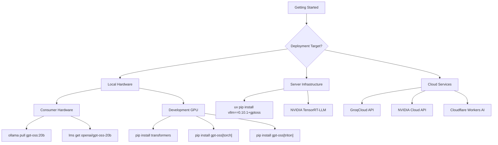
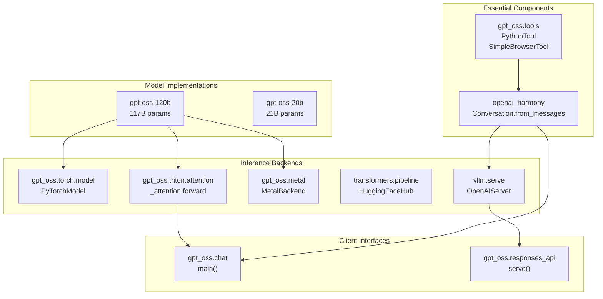

<!-- source: DeepWiki mcp.deepwiki.com · repo openai/gpt-oss · page 3 Getting Started · fetched 2026-10-26 -->

# Getting Started

<details>
<summary>Relevant source files</summary>

The following files were used as context for generating this wiki page:

- [MANIFEST.in](MANIFEST.in)
- [README.md](README.md)
- [_build/gpt_oss_build_backend/__init__.py](_build/gpt_oss_build_backend/__init__.py)
- [_build/gpt_oss_build_backend/backend.py](_build/gpt_oss_build_backend/backend.py)
- [gpt_oss/triton/attention.py](gpt_oss/triton/attention.py)
- [pyproject.toml](pyproject.toml)

</details>


This guide provides essential information for quickly deploying and using the gpt-oss models. It covers installation prerequisites, multiple deployment options, and basic usage patterns to get you running with either `gpt-oss-120b` or `gpt-oss-20b` models.

For detailed model specifications, see [Models](#2). For production deployment guidance, see [Local Deployment](#3.1) and [Cloud Deployment](#3.2). For tool integration, see [Tools and Capabilities](#5).

## Prerequisites

### System Requirements

The gpt-oss models have specific system requirements that vary by deployment method:

| Requirement | Details |
|-------------|---------|
| Python | >= 3.12 [pyproject.toml:23]() |
| macOS | Xcode CLI tools (`xcode-select --install`) |
| Linux | CUDA support required for Triton and PyTorch backends |
| Build System | Custom PEP 517 backend in `gpt_oss_build_backend.backend` [pyproject.toml:35]() |

### Hardware Requirements by Model

| Model | Parameters | Active Parameters | Memory Requirements |
|-------|-----------|------------------|-------------------|
| `gpt-oss-120b` | 117B | 5.1B | Single 80GB GPU (H100/MI300X) [README.md:18]() |
| `gpt-oss-20b` | 21B | 3.6B | 16GB memory (MXFP4) [README.md:45]() |

Sources: [README.md:16-19](), [README.md:45]()

### Critical Dependency: Harmony Format

Both models require the `openai-harmony` response format for correct operation. The models will not work correctly without proper harmony formatting.

Sources: [README.md:21](), [pyproject.toml:6]()

## Installation Options

### PyPI Installation

The package supports several optional dependency groups defined in `pyproject.toml` [pyproject.toml:26-31]():

```bash
# Basic tools only (includes fastapi, docker, aiohttp)
pip install gpt-oss

# Include PyTorch reference implementation
pip install gpt-oss[torch]

# Include Triton optimized implementation  
pip install gpt-oss[triton]

# Include Apple Silicon Metal implementation
GPTOSS_BUILD_METAL=1 pip install gpt-oss[metal]
```

Sources: [pyproject.toml:5-21](), [pyproject.toml:26-31](), [_build/gpt_oss_build_backend/backend.py:9-12]()

### Local Development Installation

For development or building the native Metal extension, use the `GPTOSS_BUILD_METAL` environment variable to trigger the `scikit-build-core` delegation in the build backend [_build/gpt_oss_build_backend/backend.py:49-54]():

```bash
git clone https://github.com/openai/gpt-oss.git
cd gpt-oss
GPTOSS_BUILD_METAL=1 pip install -e ".[metal]"
```

Sources: [_build/gpt_oss_build_backend/backend.py:39-41](), [pyproject.toml:41-47]()

## Quick Start Options

### Installation and Deployment Flow



Sources: [README.md:47-127]()

### Model Download

Download model weights from Hugging Face:

```bash
# For most deployment methods (Transformers, vLLM, Ollama, LM Studio)
hf download openai/gpt-oss-120b --local-dir gpt-oss-120b/
hf download openai/gpt-oss-20b --local-dir gpt-oss-20b/

# For reference implementations (PyTorch, Triton)  
hf download openai/gpt-oss-120b --include "original/*" --local-dir gpt-oss-120b/
hf download openai/gpt-oss-20b --include "original/*" --local-dir gpt-oss-20b/
```

Sources: [README.md:9-10](), [README.md:175-183]()

## Quick Start Examples

### Transformers (Recommended for Development)

```python
from transformers import pipeline
import torch

model_id = "openai/gpt-oss-120b"

pipe = pipeline(
    "text-generation",
    model=model_id,
    torch_dtype="auto",
    device_map="auto",
)

messages = [
    {"role": "user", "content": "Explain quantum mechanics clearly and concisely."},
]

outputs = pipe(messages, max_new_tokens=256)
print(outputs[0]["generated_text"][-1])
```

Sources: [README.md:53-75]()

### vLLM (Recommended for Production)

vLLM provides an OpenAI-compatible web server. Note the use of `openai-harmony` for manual rendering when not using the high-level server [README.md:117-131]().

```bash
# Install vLLM with gpt-oss support
uv pip install --pre vllm==0.10.1+gptoss \
    --extra-index-url https://wheels.vllm.ai/gpt-oss/ \
    --extra-index-url https://download.pytorch.org/whl/nightly/cu128 \
    --index-strategy unsafe-best-match

# Start OpenAI-compatible server
vllm serve openai/gpt-oss-20b
```

Sources: [README.md:81-90]()

## Backend Architecture and Code Mapping



Sources: [gpt_oss/triton/attention.py:104-106](), [README.md:120-131](), [pyproject.toml:10-12]()

## Terminal Chat Quick Test

Use the built-in terminal chat client to verify your installation:

```bash
# Basic chat with Triton backend
python -m gpt_oss.chat gpt-oss-20b/original/

# Chat with tools enabled (requires docker and aiohttp)
python -m gpt_oss.chat gpt-oss-20b/original/ --python --browser
```

### Chat Client Options

| Option | Purpose |
|--------|---------|
| `--reasoning-effort` | Reasoning depth (low/medium/high) |
| `--backend` | Inference backend (triton/torch/vllm) |
| `--python` | Enable `PythonTool` execution [pyproject.toml:10]() |
| `--browser` | Enable `SimpleBrowserTool` [pyproject.toml:12]() |

Sources: [README.md:272-295](), [pyproject.toml:5-21]()

## Next Steps

### For Local Deployment
- Detailed hardware setup for consumer GPUs and Apple Silicon.
- For details, see [Local Deployment](#3.1).

### For Cloud Deployment
- Integration with GroqCloud, NVIDIA Cloud, and Cloudflare.
- For details, see [Cloud Deployment](#3.2).

---

