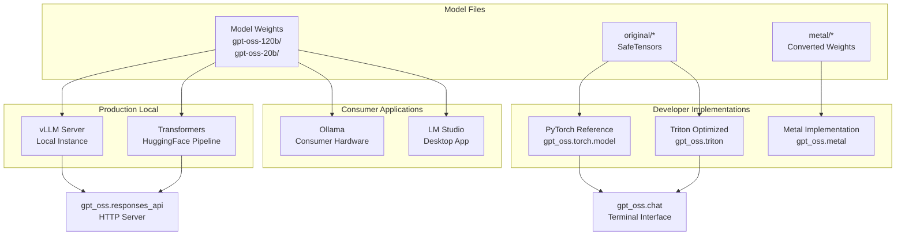
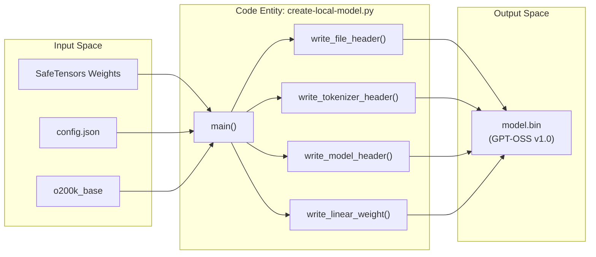
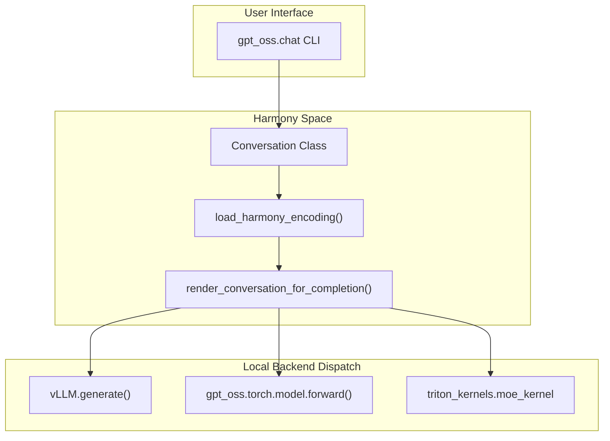

<!-- source: DeepWiki mcp.deepwiki.com · repo openai/gpt-oss · page 3.1 Local Deployment · fetched 2026-10-26 -->

# Local Deployment

<details>
<summary>Relevant source files</summary>

The following files were used as context for generating this wiki page:

- [README.md](README.md)
- [awesome-gpt-oss.md](awesome-gpt-oss.md)
- [examples/reinforcement-fine-tuning.ipynb](examples/reinforcement-fine-tuning.ipynb)
- [gpt_oss/metal/scripts/create-local-model.py](gpt_oss/metal/scripts/create-local-model.py)

</details>


This page covers setting up and running gpt-oss models on local hardware, including consumer devices, development environments, and local production deployments. For cloud-based deployment options, see [Cloud Deployment](3.2). For details about specific inference backends, see [Inference Backends](4).

## Overview

The gpt-oss models support multiple local deployment options, ranging from simple consumer-friendly applications to optimized development environments. The choice depends on your hardware, use case, and technical requirements.

**Local Deployment Architecture**



Sources: [README.md:100-127](), [README.md:185-258]()

## Consumer Hardware Solutions

### Ollama

Ollama provides the simplest path to running gpt-oss models on consumer hardware with automatic optimization for available resources.

**Installation and Usage:**

```bash
# Install Ollama first from ollama.com/download
ollama pull gpt-oss:20b
ollama run gpt-oss:20b

ollama pull gpt-oss:120b  
ollama run gpt-oss:120b
```

The Ollama integration handles model downloading, quantization, and memory management automatically. It supports both model variants with appropriate resource allocation.

**Integration with gpt-oss Tools:**

The responses API server can use Ollama as a backend:

```bash
python -m gpt_oss.responses_api.serve --inference-backend ollama
```

Sources: [README.md:176-183](), [awesome-gpt-oss.md:19-22]()

### LM Studio

LM Studio provides a desktop application interface for local model deployment with graphical model management.

**Model Download:**

```bash
lms get openai/gpt-oss-20b
lms get openai/gpt-oss-120b
```

LM Studio automatically handles model conversion and provides a chat interface. It can also serve as an OpenAI-compatible API endpoint for integration with other applications.

Sources: [awesome-gpt-oss.md:23-26]()

## Developer Reference Implementations

### PyTorch Reference Implementation

The PyTorch implementation provides an educational reference showing the exact model architecture.

**System Requirements:**
- 4× H100 GPUs or 2× H200 GPUs for gpt-oss-120b
- CUDA-compatible system
- Python 3.12

**Installation:**

```bash
pip install -e ".[torch]"
```

**Model Download and Setup:**

```bash
hf download openai/gpt-oss-120b --include "original/*" --local-dir gpt-oss-120b/
hf download openai/gpt-oss-20b --include "original/*" --local-dir gpt-oss-20b/
```

**Usage:**

```bash
torchrun --nproc-per-node=4 -m gpt_oss.generate gpt-oss-120b/original/
```

The implementation uses tensor parallelism for MoE layers and upcasts all weights to BF16 for computation.

Sources: [README.md:185-200](), [README.md:29]()

### Triton Optimized Implementation

The Triton backend provides single-GPU optimization for gpt-oss-120b using optimized kernels and memory management.

**Installation:**

```bash
# Install Triton from source
git clone https://github.com/triton-lang/triton
cd triton/
pip install -r python/requirements.txt
pip install -e . --verbose --no-build-isolation
pip install -e python/triton_kernels

# Install gpt-oss triton implementation
pip install -e ".[triton]"
```

**Usage:**

```bash
export PYTORCH_CUDA_ALLOC_CONF=expandable_segments:True
python -m gpt_oss.generate --backend triton gpt-oss-120b/original/
```

The expandable allocator prevents OOM errors during weight loading. The implementation uses MXFP4-optimized MoE kernels and attention optimizations.

Sources: [README.md:202-228](), [README.md:30]()

### Metal Implementation (Apple Silicon)

The Metal implementation enables local deployment on Apple Silicon hardware using Metal Performance Shaders.

**Build Configuration:**

The Metal backend requires compilation during installation:

```bash
GPTOSS_BUILD_METAL=1 pip install -e ".[metal]"
```

**Model Conversion:**

Weight conversion is handled by `create-local-model.py`, which transforms Hugging Face checkpoints into the proprietary `.bin` format required by the Metal C++ runtime. This script handles the conversion of `tiktoken` vocabularies and `safetensors` weights.

```bash
# Convert SafeTensors to Metal format
python gpt_oss/metal/scripts/create-local-model.py -s <model_dir> -d <output_file>
```

**Conversion Data Flow**



Sources: [gpt_oss/metal/scripts/create-local-model.py:17-50](), [gpt_oss/metal/scripts/create-local-model.py:83-132](), [README.md:230-257]()

## Production-Ready Local Solutions

### Transformers Integration

Hugging Face Transformers provides production-ready local inference with automatic harmony format handling.

**Installation:**

```bash
pip install transformers torch
```

**Usage:**

```python
from transformers import pipeline
import torch

model_id = "openai/gpt-oss-120b"

pipe = pipeline(
    "text-generation",
    model=model_id,
    torch_dtype="auto", 
    device_map="auto",
)

messages = [
    {"role": "user", "content": "Explain quantum mechanics clearly and concisely."},
]

outputs = pipe(messages, max_new_tokens=256)
print(outputs[0]["generated_text"][-1])
```

The pipeline automatically applies the harmony response format when using the chat template.

Sources: [README.md:49-77]()

### vLLM Local Server

vLLM provides high-throughput local inference with OpenAI-compatible API endpoints.

**Installation:**

```bash
uv pip install --pre vllm==0.10.1+gptoss \
    --extra-index-url https://wheels.vllm.ai/gpt-oss/ \
    --extra-index-url https://download.pytorch.org/whl/nightly/cu128 \
    --index-strategy unsafe-best-match
```

**Server Startup:**

```bash
vllm serve openai/gpt-oss-20b
```

This creates an OpenAI-compatible server that automatically downloads and serves the model with optimized batching and memory management.

Sources: [README.md:79-92]()

## System Requirements and Hardware Considerations

### Memory Requirements

| Model | Configuration | Memory Requirement | Hardware Examples |
|-------|--------------|-------------------|-------------------|
| gpt-oss-20b | Standard | 16GB | RTX 4090, RTX A6000 |
| gpt-oss-120b | MXFP4 Quantized | 80GB | H100, MI300X |
| gpt-oss-120b | PyTorch Reference | 320GB+ | 4× H100, 2× H200 |

### MXFP4 Quantization

The models use native MXFP4 quantization for MoE weights to fit large parameter counts into limited VRAM.
- `gpt-oss-120b`: 117B parameters (5.1B active) optimized for 80GB GPUs.
- `gpt-oss-20b`: 21B parameters (3.6B active) optimized for 16GB GPUs.

All evaluations and reference implementations assume MXFP4 quantization for the MoE layers.

Sources: [README.md:18-19](), [README.md:45](), [examples/reinforcement-fine-tuning.ipynb:65]()

## Terminal Chat Integration

The terminal chat client provides a unified interface across all local backends with tool integration.

**Inference Request Flow**



**Usage Examples:**

```bash
# Triton backend with browser tool
python -m gpt_oss.chat --backend triton -b gpt-oss-120b/original/

# PyTorch backend with Python tool
python -m gpt_oss.chat --backend torch -p gpt-oss-20b/original/
```

Sources: [README.md:94-168](), [README.md:267-299]()

---

