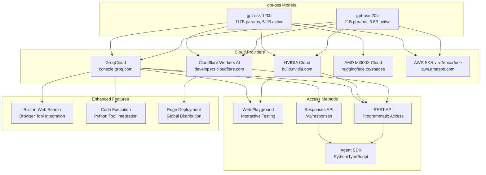
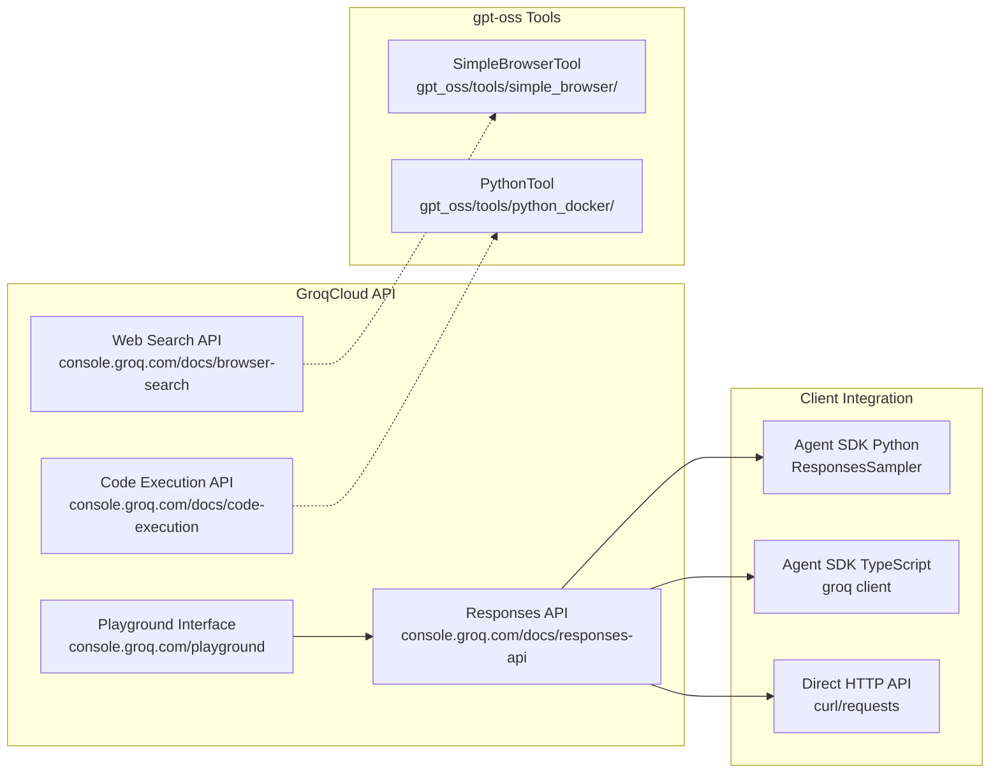
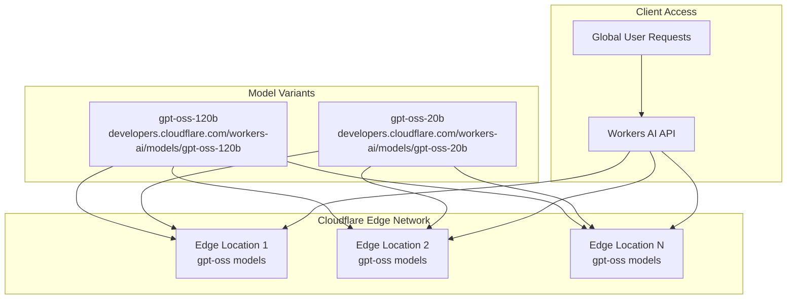

<!-- source: DeepWiki mcp.deepwiki.com · repo openai/gpt-oss · page 3.2 Cloud Deployment · fetched 2026-10-26 -->

# Cloud Deployment

Relevant source files

The following files were used as context for generating this wiki page:

- [README.md](README.md)
- [awesome-gpt-oss.md](awesome-gpt-oss.md)
- [examples/reinforcement-fine-tuning.ipynb](examples/reinforcement-fine-tuning.ipynb)

This page covers deploying and accessing gpt-oss models through cloud service providers that offer hosted inference endpoints. For local deployment options, see [Local Deployment](#3.1). For production server deployment on your own infrastructure, see [Production Backends](#4.4).

Cloud deployment provides immediate access to gpt-oss models without requiring local hardware setup or model downloads. These services handle model hosting, scaling, and optimization, offering API-based access to both `gpt-oss-120b` and `gpt-oss-20b` models.

## Cloud Provider Overview

Multiple cloud providers offer hosted gpt-oss model inference with different performance characteristics, pricing models, and additional features:

### Cloud Service Architecture

Sources: [awesome-gpt-oss.md:53-74](), [README.md:18-19]()

## GroqCloud

GroqCloud provides the most comprehensive gpt-oss integration with built-in tool support and Responses API compatibility.

### Available Models and Features

| Model | Playground Link | Features |
|-------|----------------|----------|
| gpt-oss-120b | `console.groq.com/playground?model=openai/gpt-oss-120b` | Full tool integration |
| gpt-oss-20b | `console.groq.com/playground?model=openai/gpt-oss-20b` | Fast inference |

### Tool Integration

GroqCloud offers native integration with gpt-oss reference tools:

- **Web Search**: Built-in browser tool functionality for web browsing and search.
- **Code Execution**: Python execution environment for code analysis and generation.
- **Responses API**: Full compatibility with the `/v1/responses` endpoint specification.

### API Integration

Sources: [awesome-gpt-oss.md:55-61](), [awesome-gpt-oss.md:84-85]()

## NVIDIA Cloud

NVIDIA provides gpt-oss models optimized for high-throughput inference on GB200 NVL72 architecture.

### Platform Access

- **gpt-oss-120b**: Available at `build.nvidia.com/openai/gpt-oss-120b` [awesome-gpt-oss.md:65]()
- **gpt-oss-20b**: Available at `build.nvidia.com/openai/gpt-oss-20b` [awesome-gpt-oss.md:65]()
- **Performance**: Up to 1.5M tokens per second inference capability on NVIDIA GB200 NVL72 [awesome-gpt-oss.md:64]().

### Architecture Optimization

NVIDIA Cloud leverages TensorRT-LLM optimizations and GB200 NVL72 hardware for maximum throughput. This makes it suitable for high-volume production workloads requiring consistent low latency.

Sources: [awesome-gpt-oss.md:62-65]()

## Cloudflare Workers AI

Cloudflare Workers AI offers edge-deployed gpt-oss models for globally distributed inference.

### Edge Deployment Model

### Benefits

- **Low Latency**: Requests routed to nearest edge location.
- **Global Scale**: Distributed inference without regional limitations.
- **Workers Integration**: Seamless integration with Cloudflare Workers platform.

Sources: [awesome-gpt-oss.md:66-69]()

## Additional Cloud Providers

### AWS (Amazon Web Services)
Deploy gpt-oss for both 20b and 120b models on AWS EKS using Tensorfuse [awesome-gpt-oss.md:73]().

### AMD MI300X Cloud
AMD provides gpt-oss-120B access through specialized MI300X hardware via Hugging Face Spaces integration [awesome-gpt-oss.md:71]().

### Google Colab
For experimentation, `gpt-oss-20b` can be run on Google Colab using Unsloth's 4-bit quantization (MXFP4) [awesome-gpt-oss.md:76]().

## Cloud Provider Selection

### Performance Characteristics

| Provider | Throughput | Latency | Global Distribution | Tool Support |
|----------|------------|---------|-------------------|--------------|
| GroqCloud | High | Low | Regional | Full (Web + Code) |
| NVIDIA | Very High (1.5M TPS) | Very Low | Regional | Standard API |
| Cloudflare | Medium | Very Low | Global Edge | Standard API |
| AMD MI300X | Medium | Low | Regional | Web Interface |

### Integration Considerations

**For Responses API compatibility**: GroqCloud provides the most complete integration with native support for the `/v1/responses` endpoint and built-in tool execution [awesome-gpt-oss.md:59-61]().

**For maximum throughput**: NVIDIA Cloud with GB200 NVL72 architecture offers the highest performance for production workloads [awesome-gpt-oss.md:64]().

**For global deployment**: Cloudflare Workers AI provides the lowest latency worldwide through edge distribution [awesome-gpt-oss.md:67]().

**For AMD hardware optimization**: AMD MI300X Cloud offers specialized acceleration for AMD-based infrastructures [awesome-gpt-oss.md:71]().

Sources: [awesome-gpt-oss.md:53-77]()

---

