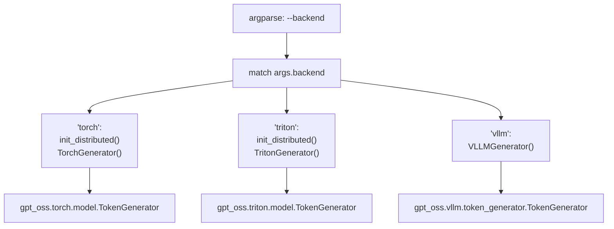
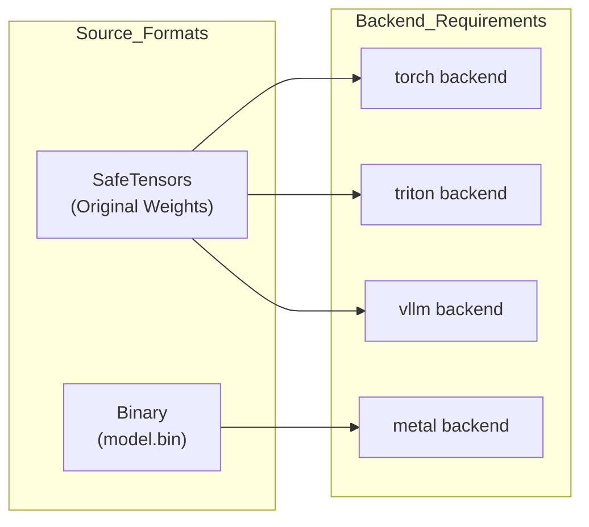

<!-- source: DeepWiki mcp.deepwiki.com · repo openai/gpt-oss · page 4 Inference Backends · fetched 2026-10-26 -->

# Inference Backends

<details>
<summary>Relevant source files</summary>

The following files were used as context for generating this wiki page:

- [README.md](README.md)
- [_build/gpt_oss_build_backend/backend.py](_build/gpt_oss_build_backend/backend.py)
- [gpt_oss/generate.py](gpt_oss/generate.py)
- [gpt_oss/triton/attention.py](gpt_oss/triton/attention.py)
- [pyproject.toml](pyproject.toml)

</details>


This document provides an overview of the different computational backends available for running gpt-oss models. It covers the architecture, trade-offs, and selection criteria for each backend type. For detailed implementation specifics, see [PyTorch Reference Implementation](#4.1), [Triton Optimized Backend](#4.2), [Metal Apple Silicon Backend](#4.3), and [Production Backends](#4.4).

## Backend Architecture Overview

The gpt-oss inference system supports multiple backends through a unified interface pattern. Each backend implements a `TokenGenerator` class that provides consistent text generation capabilities while optimizing for different hardware configurations and use cases [gpt_oss/generate.py:11-27]().

**Backend Architecture**
```mermaid
graph TB
    subgraph "Frontend_Interface"
        [gpt_oss.generate]
        [gpt_oss.chat]
        [api_server.py]
    end
    
    subgraph "Backend_Selection"
        BackendRouter["match args.backend"]
    end
    
    subgraph "Reference_Implementations"
        TorchBackend["TorchGenerator<br/>gpt_oss.torch.model"]
        TritonBackend["TritonGenerator<br/>gpt_oss.triton.model"]  
        MetalBackend["MetalGenerator<br/>gpt_oss.metal"]
    end
    
    subgraph "Production_Backends"
        VLLMBackend["VLLMGenerator<br/>gpt_oss.vllm.token_generator"]
        TransformersBackend["Transformers Pipeline"]
        OllamaBackend["Ollama streaming bridge"]
    end
    
    subgraph "Model_Weights"
        OriginalWeights["SafeTensors<br/>original/"]
        MetalWeights["Binary<br/>model.bin"]
        HFWeights["HuggingFace<br/>Converted"]
    end
    
    [gpt_oss.generate] --> BackendRouter
    [gpt_oss.chat] --> BackendRouter  
    [api_server.py] --> BackendRouter
    
    BackendRouter --> TorchBackend
    BackendRouter --> TritonBackend
    BackendRouter --> MetalBackend
    BackendRouter --> VLLMBackend
    
    TorchBackend --> OriginalWeights
    TritonBackend --> OriginalWeights
    MetalBackend --> MetalWeights
    VLLMBackend --> HFWeights
    TransformersBackend --> HFWeights
    OllamaBackend --> HFWeights
```

Sources: [gpt_oss/generate.py:11-27](), [README.md:47-127](), [pyproject.toml:26-31]()

## Backend Categories

### Reference Implementations

The reference implementations serve educational and development purposes, providing transparent access to model internals with varying levels of optimization [README.md:170-174]().

| Backend | Purpose | Hardware Requirements | Optimization Level |
|---------|---------|----------------------|-------------------|
| `torch` | Educational reference | 4× H100 (120b model) | Minimal (Reference) |
| `triton` | Optimized reference | 1× H100 80GB | High (Custom Kernels) |
| `metal` | Apple Silicon demo | Apple M-series | Moderate (MPS) |

### Production Backends

Production backends prioritize performance, scalability, and deployment flexibility over code transparency [README.md:79-92]().

| Backend | Use Case | Integration | Deployment |
|---------|----------|------------|------------|
| `vllm` | High-throughput serving | Native integration | Server/Cloud |
| `transformers` | Development/Research | HuggingFace ecosystem | Local/Cloud |
| `ollama` | Consumer hardware | API integration | Local |

Sources: [README.md:49-182](), [pyproject.toml:5-21]()

## Backend Selection Logic

The backend selection mechanism in the codebase follows a consistent pattern across different entry points, specifically utilizing the `match` statement in the CLI to instantiate the appropriate generator [gpt_oss/generate.py:12-27]().

**Backend Selection Flow**


Sources: [gpt_oss/generate.py:12-27](), [gpt_oss/generate.py:73-80]()

## Performance and Resource Characteristics

### Memory Requirements

Different backends have varying memory footprint characteristics based on their optimization strategies:

- **torch**: Loads all weights to BF16; requires tensor parallelism across multiple GPUs for the 120b model [README.md:18-19]().
- **triton**: Supports native MXFP4 quantization, allowing `gpt-oss-120b` to fit on a single 80GB GPU [README.md:45]().
- **metal**: Uses a custom binary format for weights and targets Apple Silicon unified memory [README.md:31]().
- **vllm**: Implements advanced memory optimization, recommending `gpu_memory_utilization` around 0.95 [README.md:137-144]().

### Computational Optimization

The Triton backend specifically includes advanced features like FlashAttention v2 with learned sinks and banded attention [gpt_oss/triton/attention.py:1-7]().

| Optimization | torch | triton | metal | vllm |
|-------------|-------|--------|-------|------|
| Custom kernels | ❌ | ✅ `_attn_fwd` | ✅ Metal | ✅ CUDA |
| MXFP4 support | ❌ | ✅ Native | ❌ | ✅ |
| Banded Attention | ❌ | ✅ | ❌ | ❌ |
| KV caching | Basic | ✅ | ✅ | ✅ PagedAttention |

Sources: [gpt_oss/triton/attention.py:18-36](), [README.md:45-46](), [README.md:101-101]()

## Weight Format Requirements

Each backend expects model weights in specific formats, reflecting their optimization strategies and target hardware.

**Weight Format Mapping**


Sources: [gpt_oss/generate.py:42-47](), [pyproject.toml:27-29]()

## Integration Points

### CLI Applications

The main entry points for inference backends are:

- `gpt_oss.generate` - Basic text generation with backend selection [gpt_oss/generate.py:11-38]().
- `gpt_oss.chat` - Interactive chat with tool integration.
- `gpt_oss.responses_api.serve` - HTTP API server with multiple backend support.

### Programmatic Access

Each backend exposes a consistent `TokenGenerator` interface for programmatic usage:

```python
# Backend instantiation patterns from generate.py
generator = TorchGenerator(args.checkpoint, device=device) # [gpt_oss/generate.py:17]
generator = TritonGenerator(args.checkpoint, context=args.context_length, device=device) # [gpt_oss/generate.py:22]
generator = VLLMGenerator(args.checkpoint, tensor_parallel_size=args.tensor_parallel_size) # [gpt_oss/generate.py:25]
```

### Build System Integration

The build system supports conditional compilation of backend extensions through environment variables, particularly for the Metal backend [pyproject.toml:33-35]().

- `GPTOSS_BUILD_METAL=1` - Enables Metal backend compilation via `scikit-build-core` [_build/gpt_oss_build_backend/backend.py:39-40]().
- Default build - Pure Python wheel without native extensions [_build/gpt_oss_build_backend/backend.py:4-6]().

Sources: [gpt_oss/generate.py:11-27](), [_build/gpt_oss_build_backend/backend.py:31-55](), [pyproject.toml:41-47]()

---

