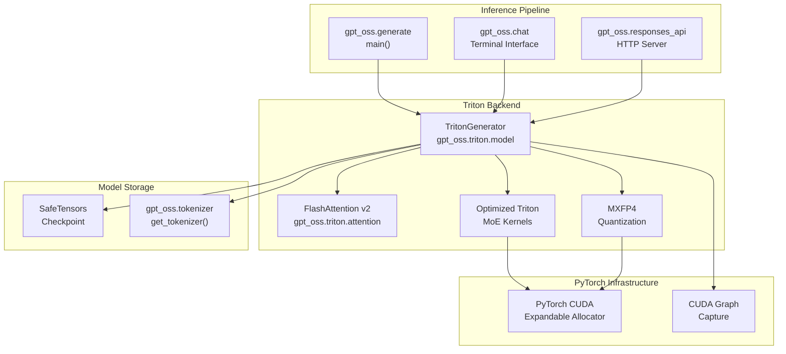
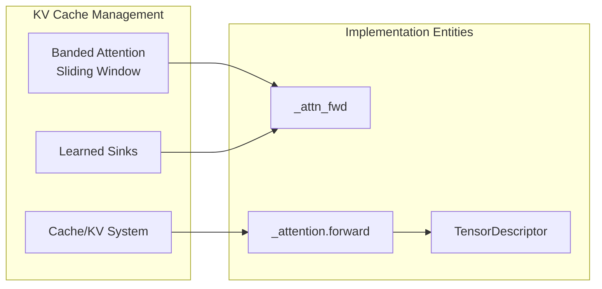

<!-- source: DeepWiki mcp.deepwiki.com · repo openai/gpt-oss · page 4.2 Triton Optimized Backend · fetched 2026-10-26 -->

# Triton Optimized Backend

<details>
<summary>Relevant source files</summary>

The following files were used as context for generating this wiki page:

- [README.md](README.md)
- [_build/gpt_oss_build_backend/backend.py](_build/gpt_oss_build_backend/backend.py)
- [gpt_oss/triton/attention.py](gpt_oss/triton/attention.py)
- [pyproject.toml](pyproject.toml)

</details>


The Triton optimized backend provides a single-GPU inference implementation for gpt-oss models using PyTorch and optimized Triton kernels. This backend is designed to run `gpt-oss-120b` efficiently on a single 80GB GPU through memory optimizations, MXFP4 quantization support, and specialized kernels for attention and Mixture-of-Experts (MoE).

## Architecture Overview

The Triton backend serves as an optimized single-GPU inference solution that bridges the gap between the educational PyTorch reference implementation and production-ready backends like vLLM. It leverages custom Triton kernels to achieve high performance while maintaining the flexibility of a Python-based stack.

### Backend Integration



Sources: [README.md:134-136](), [README.md:202-228](), [gpt_oss/triton/attention.py:1-7]()

## Core Components

### FlashAttention v2 with Learned Sinks

The Triton backend implements an expanded version of FlashAttention v2. This implementation includes support for **learned attention sinks** and **banded (sliding window) attention**, which are critical for maintaining long-context performance in the gpt-oss architecture.

The core kernel `_attn_fwd` manages the following:
*   **Learned Sinks**: Loads attention sinks per head to stabilize attention scores [gpt_oss/triton/attention.py:45-48]().
*   **Banded Attention**: Implements a sliding window mechanism via the `BANDWIDTH` parameter to limit the attention scope [gpt_oss/triton/attention.py:35-36](), [gpt_oss/triton/attention.py:61-64]().
*   **Softmax Normalization**: Uses a modified softmax that accounts for the learned sinks [gpt_oss/triton/attention.py:94-97]().

### MXFP4 MoE Kernels

Mixture-of-Experts (MoE) layers are accelerated using specialized Triton kernels that handle MXFP4 quantized weights. This allows the 117B parameter model to fit within the memory constraints of a single 80GB GPU.

| Component | Role | Source |
|-----------|------|--------|
| `triton_kernels` | External dependency providing the core MXFP4 MoE implementation. | [README.md:213-214]() |
| `MXFP4 Quantization` | Post-training quantization format used for MoE weights. | [README.md:45]() |
| `MoE Routing` | Logic for dispatching tokens to active experts (5.1B active parameters). | [README.md:18-19]() |

Sources: [README.md:45](), [README.md:213-214]()

## Memory and Performance Optimization

### Cache and KV Management

The Triton backend utilizes a sophisticated Cache/KV management system to minimize recomputation and memory fragmentation.



The `_attention` class handles tensor padding to align with Triton block sizes (`BLOCK_M`, `BLOCK_N`) and uses `TensorDescriptor` for efficient memory layout management [gpt_oss/triton/attention.py:121-151]().

### CUDA Graph Capture

To reduce CPU overhead and kernel launch latency during auto-regressive decoding, the Triton backend employs CUDA Graph capture. This freezes the execution sequence for a fixed context length, allowing the GPU to replay the entire inference step with a single launch.

### CUDA Allocator Configuration

Efficient memory utilization requires the PyTorch CUDA expandable allocator. This prevents fragmentation when handling the large MoE weight matrices and KV caches.
*   **Setting**: `PYTORCH_CUDA_ALLOC_CONF="expandable_segments:True"` [README.md:224-228]().

## Installation and Setup

### Dependencies

The Triton backend is an optional dependency group in the `gpt-oss` package.

```toml
[project.optional-dependencies]
triton = ["triton>=3.4", "safetensors>=0.5.3", "torch>=2.7.0"]
```
Sources: [pyproject.toml:27-27]()

### Build Process

Building the Triton backend requires specific nightly versions of both PyTorch and Triton to support the latest kernel features:

1.  **Triton Source**: Clone and install `triton-lang/triton` from source [README.md:206-212]().
2.  **MoE Kernels**: Install the `triton_kernels` package from the Triton repository [README.md:213-214]().
3.  **GPT-OSS**: Install with the triton extra: `pip install -e ".[triton]"` [README.md:215-218]().

## Performance Characteristics

| Metric | gpt-oss-120b (Triton) | gpt-oss-20b (Triton) |
|--------|-----------------------|----------------------|
| **GPU Requirement** | 1x 80GB (H100/MI300X) | 1x 16GB (Consumer) |
| **Quantization** | MXFP4 (MoE Weights) | MXFP4 (MoE Weights) |
| **Attention** | FlashAttention v2 + Sinks | FlashAttention v2 + Sinks |
| **Throughput** | Optimized for single-GPU | Low-latency local use |

Sources: [README.md:18-19](), [README.md:45](), [gpt_oss/triton/attention.py:1-7]()

---

