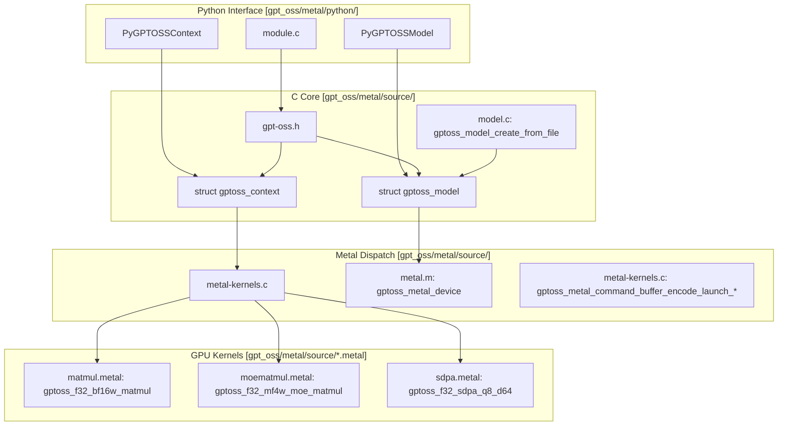
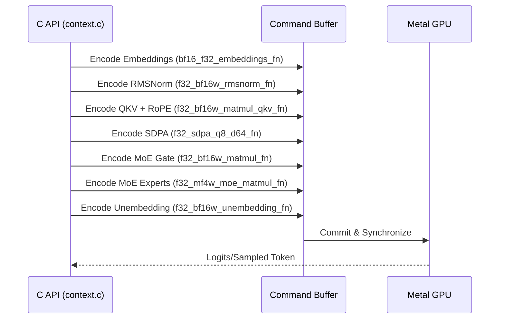

<!-- source: DeepWiki mcp.deepwiki.com · repo openai/gpt-oss · page 4.3 Metal Apple Silicon Backend · fetched 2026-10-26 -->

# Metal Apple Silicon Backend

<details>
<summary>Relevant source files</summary>

The following files were used as context for generating this wiki page:

- [gpt_oss/metal/CMakeLists.txt](gpt_oss/metal/CMakeLists.txt)
- [gpt_oss/metal/benchmark/end-to-end-threadgroup.cc](gpt_oss/metal/benchmark/end-to-end-threadgroup.cc)
- [gpt_oss/metal/benchmark/end-to-end.cc](gpt_oss/metal/benchmark/end-to-end.cc)
- [gpt_oss/metal/examples/generate.py](gpt_oss/metal/examples/generate.py)
- [gpt_oss/metal/include/gpt-oss/functions.h](gpt_oss/metal/include/gpt-oss/functions.h)
- [gpt_oss/metal/python/context.c](gpt_oss/metal/python/context.c)
- [gpt_oss/metal/python/model.c](gpt_oss/metal/python/model.c)
- [gpt_oss/metal/scripts/create-local-model.py](gpt_oss/metal/scripts/create-local-model.py)
- [gpt_oss/metal/source/context.c](gpt_oss/metal/source/context.c)
- [gpt_oss/metal/source/expert_routing_metadata.metal](gpt_oss/metal/source/expert_routing_metadata.metal)
- [gpt_oss/metal/source/gather_and_accumulate.metal](gpt_oss/metal/source/gather_and_accumulate.metal)
- [gpt_oss/metal/source/generate.c](gpt_oss/metal/source/generate.c)
- [gpt_oss/metal/source/include/internal/kernel-args.h](gpt_oss/metal/source/include/internal/kernel-args.h)
- [gpt_oss/metal/source/include/internal/math.h](gpt_oss/metal/source/include/internal/math.h)
- [gpt_oss/metal/source/include/internal/metal-kernels.h](gpt_oss/metal/source/include/internal/metal-kernels.h)
- [gpt_oss/metal/source/include/internal/metal.h](gpt_oss/metal/source/include/internal/metal.h)
- [gpt_oss/metal/source/include/internal/metal.hpp](gpt_oss/metal/source/include/internal/metal.hpp)
- [gpt_oss/metal/source/include/internal/model.h](gpt_oss/metal/source/include/internal/model.h)
- [gpt_oss/metal/source/matmul.metal](gpt_oss/metal/source/matmul.metal)
- [gpt_oss/metal/source/metal-kernels.c](gpt_oss/metal/source/metal-kernels.c)
- [gpt_oss/metal/source/metal.m](gpt_oss/metal/source/metal.m)
- [gpt_oss/metal/source/model.c](gpt_oss/metal/source/model.c)
- [gpt_oss/metal/source/moematmul.metal](gpt_oss/metal/source/moematmul.metal)
- [gpt_oss/metal/source/rope.metal](gpt_oss/metal/source/rope.metal)
- [gpt_oss/metal/source/sample.metal](gpt_oss/metal/source/sample.metal)
- [gpt_oss/metal/source/scatter.metal](gpt_oss/metal/source/scatter.metal)
- [gpt_oss/metal/source/sdpa.metal](gpt_oss/metal/source/sdpa.metal)
- [gpt_oss/metal/test/rope-kernel-tester.hpp](gpt_oss/metal/test/rope-kernel-tester.hpp)

</details>


This document covers the Metal backend implementation for running gpt-oss models on Apple Silicon hardware. This is a high-performance C/Metal implementation that provides native inference capabilities by leveraging Metal Performance Shaders and custom compute kernels.

## Purpose and Scope

The Metal Apple Silicon Backend provides a complete stack for running gpt-oss models natively on macOS. It includes a low-level C API, custom Metal compute kernels for transformer operations (including Mixture of Experts), a binary model format, and Python bindings for easy integration.

## Architecture Overview

The backend is structured into three primary layers: the Python interface, the C/C++ core logic (Model and Context management), and the Metal Compute layer where GPU kernels are dispatched.

### System Architecture and Code Entities


Sources: [gpt_oss/metal/source/include/internal/model.h:32-178](), [gpt_oss/metal/source/context.c:19-157](), [gpt_oss/metal/python/context.c:8-175](), [gpt_oss/metal/source/metal-kernels.c:13-181]()

## Model and Context Lifecycle

The backend distinguishes between the `gptoss_model`, which holds static weights and GPU pipeline states, and the `gptoss_context`, which manages the KV cache and activation buffers for a specific inference session.

### Model Loading
Models are loaded from a custom binary format via `gptoss_model_create_from_file` [gpt_oss/metal/source/model.c:80-203](). The loader:
1. Validates the `GPT-OSS v1.0` magic header [gpt_oss/metal/source/model.c:115-132]().
2. Verifies UUIDs for the model type and Apple GPU layout [gpt_oss/metal/source/model.c:141-165]().
3. Initializes the Metal device, command queue, and compiles/loads the `default.metallib` [gpt_oss/metal/source/include/internal/model.h:70-73]().
4. Maps weights into `gptoss_metal_buffer` objects, separating shared weights (embeddings, gates) from per-block MoE weights [gpt_oss/metal/source/include/internal/model.h:126-130]().

### Context Management
A context is created using `gptoss_context_create` [gpt_oss/metal/source/context.c:19-23](). It allocates several GPU buffers for activations:
- **Residual stream**: `residual_activation_buffer` [gpt_oss/metal/source/context.c:68-71]().
- **MoE Routing**: `gate_activation_buffer` and `token_to_expert_routing_buffer` [gpt_oss/metal/source/context.c:84-100]().
- **KV Cache**: `kvcache_buffer` sized for the full context length [gpt_oss/metal/source/context.c:139-142]().

## Kernel Dispatch Pipeline

The backend uses a structured dispatch system defined in `metal-kernels.c`. Each high-level operation (e.g., RMSNorm, MatMul) has a corresponding C function that prepares `kernel-args.h` structures and encodes the Metal command.

### Key Dispatch Functions
| Function | Shader Kernel | Purpose |
|----------|---------------|---------|
| `gptoss_metal_command_buffer_encode_launch_f32_bf16w_matmul` | `gptoss_f32_bf16w_matmul` | Standard BFloat16 weight matrix multiplication [gpt_oss/metal/source/metal-kernels.c:97-113]() |
| `gptoss_metal_command_buffer_encode_launch_f32_bf16w_matmul_qkv` | `gptoss_f32_bf16w_matmul_qkv` | QKV projection with integrated RoPE [gpt_oss/metal/source/metal-kernels.c:115-142]() |
| `gptoss_metal_command_buffer_encode_launch_mf4_f32_convert` | `gptoss_mf4_f32_convert` | Dequantizes MXFP4 weights to FP32 [gpt_oss/metal/source/metal-kernels.c:149-158]() |

### Data Flow: Token to Logits


Sources: [gpt_oss/metal/source/context.c:49-157](), [gpt_oss/metal/source/include/internal/model.h:74-95](), [gpt_oss/metal/source/matmul.metal:70-156]()

## Mixture of Experts (MoE) Implementation

The Metal backend implements efficient MoE routing and execution:
1. **Routing**: The `gate_activation_buffer` stores the expert scores. `gptoss_expert_routing_metadata_fn` calculates the necessary offsets for expert dispatch [gpt_oss/metal/source/include/internal/model.h:90]().
2. **Execution**: The `f32_mf4w_moe_matmul_swiglu_fn` kernel handles the expert MLP computation. It uses MXFP4 (Microscaling) quantization to reduce memory bandwidth requirements [gpt_oss/metal/source/include/internal/model.h:83-84]().
3. **Aggregation**: Experts are gathered and accumulated back into the residual stream using `f32_gather_and_accumulate_e4_fn` [gpt_oss/metal/source/include/internal/model.h:89]().

## Python Bindings

The Python interface [gpt_oss/metal/python/module.c]() wraps the C structures into Python objects:
- `PyGPTOSSModel`: Wraps `gptoss_model_t` [gpt_oss/metal/python/model.c]().
- `PyGPTOSSContext`: Wraps `gptoss_context_t` and provides methods like `append()`, `process()`, and `sample()` [gpt_oss/metal/python/context.c:187-194]().

### Example Usage (Python)
```python
import _metal
model = _metal.Model("model.bin")
ctx = model.Context(context_length=2048)
ctx.append("Hello, world!")
ctx.process()
tokens = ctx.sample(max_output_tokens=50, temperature=0.7)
```
Sources: [gpt_oss/metal/python/context.c:64-114](), [gpt_oss/metal/python/context.c:126-175]()

## Build System

The backend uses a custom build process defined in `CMakeLists.txt` [gpt_oss/metal/CMakeLists.txt:1-56]():
1. **Shader Compilation**: Uses `xcrun metal` to compile `.metal` files into `.air` intermediate files [gpt_oss/metal/CMakeLists.txt:39-52]().
2. **Library Creation**: Links `.air` files into a single `default.metallib` using `xcrun metallib` [gpt_oss/metal/CMakeLists.txt:53]().
3. **C Library**: Compiles `model.c`, `tokenizer.c`, and `context.c` into the `gptoss` static library [gpt_oss/metal/CMakeLists.txt:74-75]().
4. **Python Extension**: The `_metal` module is created by linking the C core and the Metal kernel wrappers [gpt_oss/metal/CMakeLists.txt:63-72]().

Sources: [gpt_oss/metal/CMakeLists.txt:1-114]()

---

