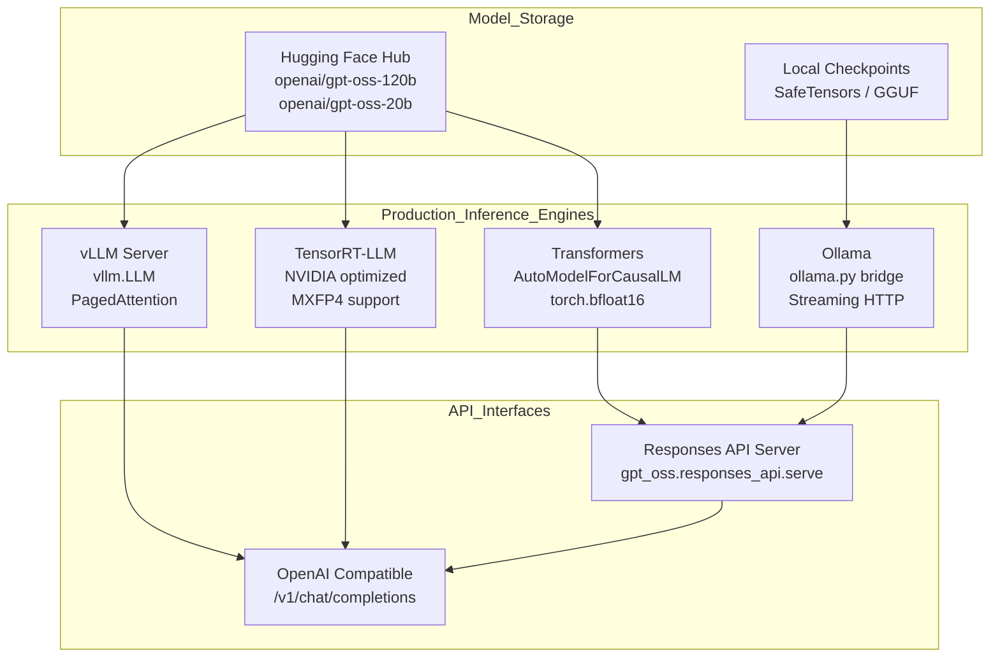
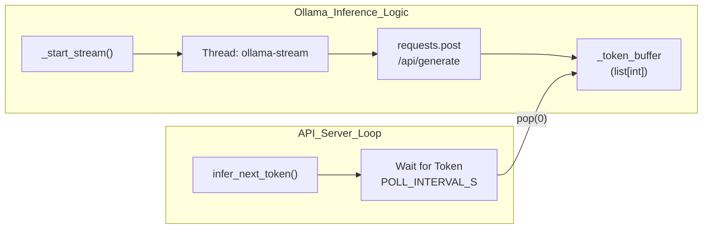
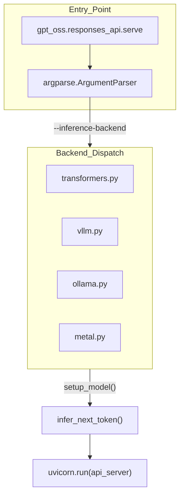

<!-- source: DeepWiki mcp.deepwiki.com · repo openai/gpt-oss · page 4.4 Production Backends · fetched 2026-10-26 -->

# Production Backends

<details>
<summary>Relevant source files</summary>

The following files were used as context for generating this wiki page:

- [README.md](README.md)
- [awesome-gpt-oss.md](awesome-gpt-oss.md)
- [examples/reinforcement-fine-tuning.ipynb](examples/reinforcement-fine-tuning.ipynb)
- [gpt_oss/evals/healthbench_eval.py](gpt_oss/evals/healthbench_eval.py)
- [gpt_oss/responses_api/inference/metal.py](gpt_oss/responses_api/inference/metal.py)
- [gpt_oss/responses_api/inference/ollama.py](gpt_oss/responses_api/inference/ollama.py)
- [gpt_oss/responses_api/inference/transformers.py](gpt_oss/responses_api/inference/transformers.py)
- [gpt_oss/responses_api/serve.py](gpt_oss/responses_api/serve.py)

</details>


This page covers production-ready inference solutions for running gpt-oss models in real-world deployment scenarios. Unlike the reference implementations covered in the Triton or Metal backends, these solutions are designed for high-throughput, scalable, and reliable production use cases.

## Overview

Production backends provide optimized inference engines with features like continuous batching, prefix caching, quantization support, and standardized API compatibility. They are designed to handle multiple concurrent requests efficiently and integrate with existing deployment infrastructure via the `Responses API` server [gpt_oss/responses_api/serve.py:11-13]().

## Production Backend Architecture



Sources: [README.md:79-127](), [awesome-gpt-oss.md:14-65](), [gpt_oss/responses_api/serve.py:40-53]()

## vLLM High-Throughput Server

vLLM is the recommended engine for high-concurrency production environments. It supports `gpt-oss` models through specialized wheels and features `PagedAttention` for efficient KV cache management [README.md:84-87]().

### Configuration and Deployment
The `vLLM` implementation for `gpt-oss` supports tensor parallelism and specific memory optimizations for the 120B model [README.md:137-144]().

```python
# Configuration example for gpt-oss-20b
llm = LLM(
    model="openai/gpt-oss-20b",
    trust_remote_code=True,
    gpu_memory_utilization=0.95,
    max_num_batched_tokens=4096,
    max_model_len=5000,
    tensor_parallel_size=1
)
```
Sources: [README.md:137-144]()

### Harmony Integration
To ensure correct model behavior, vLLM outputs must be parsed through the `openai-harmony` package to handle the structured response format [README.md:162-167]().

Sources: [README.md:118-135](), [README.md:162-167]()

## Transformers Backend

The Hugging Face Transformers library provides a straightforward production deployment option using the `AutoModelForCausalLM` API.

### Implementation Details
The `gpt_oss.responses_api.inference.transformers` module implements a wrapper around `AutoModelForCausalLM` to match the internal `infer_next_token` interface [gpt_oss/responses_api/inference/transformers.py:31-50]().

```python
def load_model(checkpoint: str):
    model = AutoModelForCausalLM.from_pretrained(
        checkpoint,
        torch_dtype=torch.bfloat16,
        device_map="auto",
    )
    return model
```
Sources: [gpt_oss/responses_api/inference/transformers.py:17-28]()

### Inference Flow
The backend issues single-token generation calls via `model.generate` to mimic the behavior of optimized streaming backends while maintaining compatibility with the standard `Responses API` [gpt_oss/responses_api/inference/transformers.py:41-50]().

Sources: [gpt_oss/responses_api/inference/transformers.py:1-4](), [gpt_oss/responses_api/inference/transformers.py:41-50]()

## Ollama Streaming Bridge

For consumer-grade hardware and local production use, `gpt-oss` integrates with Ollama via a threaded streaming bridge [gpt_oss/responses_api/inference/ollama.py:1-5]().

### Threaded Token Buffering
Because Ollama operates as an external service, the `ollama.py` backend manages a `_token_buffer` and a background `_stream_thread` to provide tokens to the `Responses API` server without blocking the main event loop [gpt_oss/responses_api/inference/ollama.py:24-28]().



### Timeouts and Error Handling
The bridge implements specific timeouts to handle the latency of local inference:
* `FIRST_BYTE_TIMEOUT_S`: 30.0s for the initial token [gpt_oss/responses_api/inference/ollama.py:21]().
* `NO_TOKEN_TIMEOUT_S`: 15.0s for inactivity during streaming [gpt_oss/responses_api/inference/ollama.py:20]().

Sources: [gpt_oss/responses_api/inference/ollama.py:17-21](), [gpt_oss/responses_api/inference/ollama.py:64-117](), [gpt_oss/responses_api/inference/ollama.py:129-145]()

## Cloud Backends

Production deployments of `gpt-oss` are supported on several high-performance cloud platforms, leveraging specialized hardware like LPUs and H100s [awesome-gpt-oss.md:55-71]().

| Provider | Optimization | Model Support |
| :--- | :--- | :--- |
| **Groq** | LPU Inference (High Speed) | 120b, 20b [awesome-gpt-oss.md:55-58]() |
| **NVIDIA** | GB200 NVL72 (1.5M TPS) | 120b, 20b [awesome-gpt-oss.md:62-65]() |
| **Cloudflare** | Workers AI (Edge) | 120b, 20b [awesome-gpt-oss.md:66-69]() |
| **AMD** | MI300X | 120b [awesome-gpt-oss.md:70-71]() |

Sources: [awesome-gpt-oss.md:55-71]()

## Responses API Server Integration

The `serve.py` entry point acts as the production gateway, dispatching to the appropriate backend based on the `--inference-backend` flag [gpt_oss/responses_api/serve.py:31-37]().

### Shared Interface
All production backends must implement the `setup_model` function, which returns a callable `infer_next_token` with the following signature [gpt_oss/responses_api/serve.py:57-58]():

`infer_next_token(tokens: list[int], temperature: float, new_request: bool) -> int`



Sources: [gpt_oss/responses_api/serve.py:14-38](), [gpt_oss/responses_api/serve.py:40-53](), [gpt_oss/responses_api/serve.py:57-58]()

---

