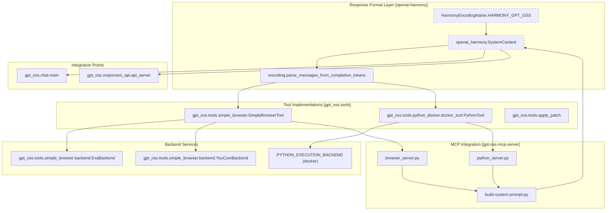
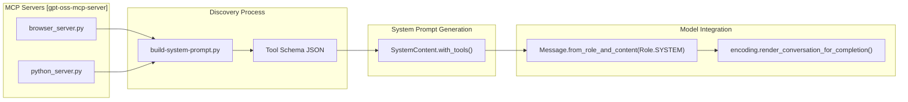
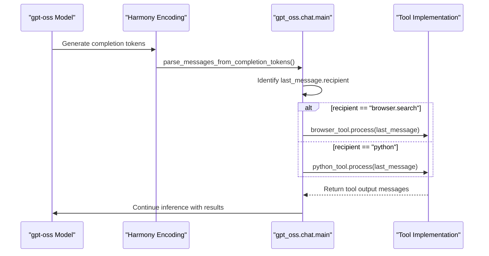

<!-- source: DeepWiki mcp.deepwiki.com · repo openai/gpt-oss · page 5 Tools and Capabilities · fetched 2026-10-26 -->

# Tools and Capabilities

Relevant source files

The following files were used as context for generating this wiki page:

- [README.md](README.md)
- [gpt_oss/chat.py](gpt_oss/chat.py)

This page covers the integrated tool ecosystem and response formats that enable gpt-oss models' capabilities. The models were specifically trained to work with the Harmony response format and include native support for web browsing, Python code execution, and file manipulation tools. This document explains the technical architecture of these systems and their integration.

For information about specific client applications that utilize these tools, see [Client Applications](#6). For details about the evaluation of tool performance, see [Evaluation Framework](#7).

## Architecture Overview

The tools and capabilities system consists of several key components that work together to provide external functionality to the gpt-oss models. The following diagram bridges the natural language space to the code entities that implement these capabilities.

**System to Code Entity Mapping**

Sources: [gpt_oss/chat.py:20-39](), [README.md:21-21](), [README.md:348-481]()

## Harmony Response Format

The `openai-harmony` library is the foundation for all model interactions. Both `gpt-oss-120b` and `gpt-oss-20b` require this format to function correctly. It handles the structured rendering of system instructions, tool definitions, and the parsing of model-generated tool calls.

Key entities include:
- `Conversation`: Manages the list of `Message` objects.
- `SystemContent`: Configures model identity, reasoning effort, and tool schemas.
- `StreamableParser`: Handles real-time parsing of streaming model tokens into structured actions.

For details, see [Harmony Response Format](#5.1).

Sources: [gpt_oss/chat.py:25-39](), [README.md:104-112]()

## Tool Discovery and System Prompt Integration

The system uses Model Context Protocol (MCP) servers to dynamically discover available tools and integrate them into system prompts. This allows the model to understand what tools are available and how to call them via the `SystemContent.with_tools()` method.

**MCP Tool Discovery Flow**

Sources: [gpt_oss/chat.py:81-102](), [README.md:363-413](), [README.md:430-475]()

## Integrated Tools

### Browser Tool
The `SimpleBrowserTool` provides web search and navigation. It supports multiple backends like `ExaBackend` and `YouComBackend`. It handles HTML-to-text extraction and manages a scrollable window to stay within the model's context window limits.

For details, see [Browser Tool](#5.2).

Sources: [gpt_oss/chat.py:21-22](), [gpt_oss/chat.py:87-96]()

### Python Execution Tool
The `PythonTool` enables secure code execution. It primarily uses a Docker-based backend for isolation, though it supports local execution for development. It captures `stdout` and `stderr` and returns them to the model as tool response messages.

For details, see [Python Execution Tool](#5.3).

Sources: [gpt_oss/chat.py:23](), [gpt_oss/chat.py:98-100]()

### File Patching Tool
The `apply_patch` tool is integrated into the chat interface to allow the model to create, update, or delete files on the local system. It uses a specific markdown-based patch format defined in `apply_patch.md`.

For details, see [File Patching Tool](#5.4).

Sources: [gpt_oss/chat.py:20](), [gpt_oss/chat.py:105-126]()

## Tool Execution Flow

The following sequence illustrates how a model's intent is translated into a tool action within the `gpt_oss.chat` implementation.

Sources: [gpt_oss/chat.py:157-185](), [README.md:162-167]()

## MCP Integration

The `gpt-oss-mcp-server` directory contains servers that implement the Model Context Protocol. These servers facilitate tool discovery and provide a standardized way to generate system prompts that include tool definitions compatible with the Harmony format.

For details, see [MCP Integration](#5.5).

Sources: [README.md:363-413]()

---

