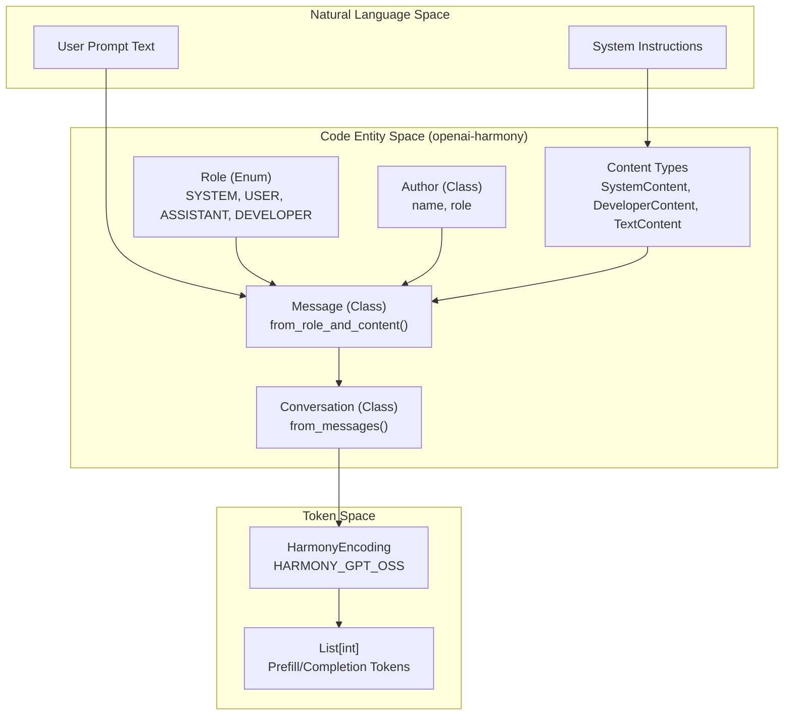
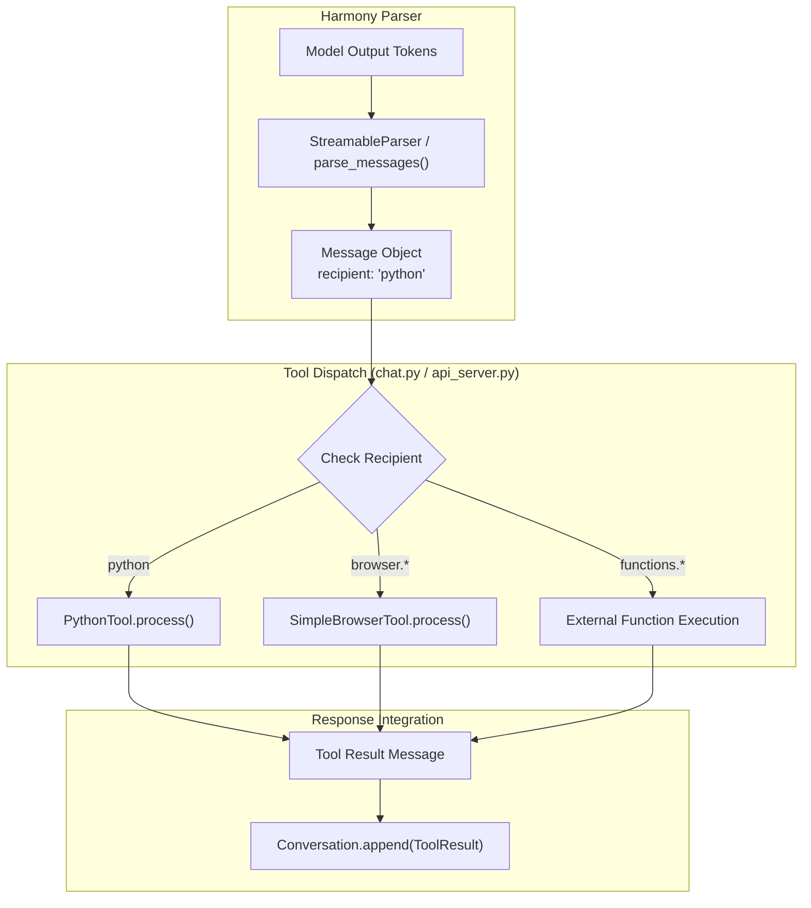

<!-- source: DeepWiki mcp.deepwiki.com · repo openai/gpt-oss · page 5.1 Harmony Response Format · fetched 2026-10-26 -->

# Harmony Response Format

Relevant source files

The following files were used as context for generating this wiki page:

- [README.md](README.md)
- [gpt_oss/chat.py](gpt_oss/chat.py)
- [gpt_oss/responses_api/api_server.py](gpt_oss/responses_api/api_server.py)

## Purpose and Scope

The Harmony Response Format is an essential chat format library that `gpt-oss` models require for correct operation. It provides the structured communication protocol used during both training and inference. This document covers the implementation details of the `openai-harmony` library, message encoding/decoding processes, tool integration mechanisms, and the streaming architecture used by the Responses API server.

## Overview

Both `gpt-oss-120b` and `gpt-oss-20b` models were trained exclusively with the Harmony response format [README.md:21-22](). The format is not merely a wrapper but a structural requirement; without it, the models will fail to generate coherent or tool-compatible outputs. 

The core implementation resides in the `openai-harmony` package, which defines the primitive entities (`Message`, `Role`, `Conversation`) and the encoding logic (`HarmonyEncoding`) required to bridge natural language prompts and the model's token space.

**Harmony Architecture: Natural Language to Code Entity Space**

Sources: [README.md:104-112](), [gpt_oss/chat.py:25-39](), [gpt_oss/responses_api/api_server.py:10-22]()

## Core Components

### Conversation and Message Structure
The system models a chat as a `Conversation` object, which is a sequence of `Message` objects [gpt_oss/chat.py:134-135](). Each message is attributed to a `Role` and contains specific content types:

*   **Role**: Defines the origin of the message (e.g., `Role.SYSTEM`, `Role.USER`, `Role.ASSISTANT`, `Role.DEVELOPER`) [gpt_oss/chat.py:32]().
*   **SystemContent**: Used for high-level configuration, including `reasoning_effort`, `conversation_start_date`, and tool definitions via `with_tools()` [gpt_oss/chat.py:81-85]().
*   **DeveloperContent**: Used for providing specific instructions to the model and defining function tools [gpt_oss/chat.py:112-126]().

### Harmony Encoding
The `HarmonyEncoding` class handles the conversion between these high-level objects and the integer token IDs required by the model's embedding layer.

*   **Loading**: The specific encoding for these models is loaded using `load_harmony_encoding(HarmonyEncodingName.HARMONY_GPT_OSS)` [README.md:118]().
*   **Rendering (Prefill)**: `render_conversation_for_completion` generates the token sequence for the prompt, ending with the header for the target role (usually `Role.ASSISTANT`) [README.md:131]().
*   **Parsing (Completion)**: `parse_messages_from_completion_tokens` converts the model's raw output tokens back into structured `Message` objects, identifying tool calls and text responses [README.md:163]().

### Stop Tokens
Harmony defines specific "stop tokens" that signify the end of a model's turn or an action. These are retrieved via `encoding.stop_tokens_for_assistant_actions()` and passed to the inference sampler to prevent the model from "hallucinating" further turns [README.md:134-150]().

## Tool Integration and Descriptions

Tools are integrated into the Harmony format by defining them in the `SystemContent` or `DeveloperContent`.

*   **ToolDescription**: A class used to define the schema for tools, including name, description, and parameters [gpt_oss/chat.py:115-123]().
*   **Recipient Routing**: When a model decides to use a tool, it generates a message with a specific `recipient` (e.g., `browser.search`, `python`, or `functions.apply_patch`) [gpt_oss/chat.py:171-190]().
*   **Built-in vs. Custom**: The `api_server.py` distinguishes between built-in recipients (like `assistant` or `browser`) and external function calls [gpt_oss/responses_api/api_server.py:88-97]().

**Tool Call Execution Flow**

Sources: [gpt_oss/chat.py:171-205](), [gpt_oss/responses_api/api_server.py:163-205]()

## Streaming and the StreamableParser

For production environments, Harmony supports streaming responses via the `StreamableParser`. This allows the UI to display reasoning or text deltas as they are generated, rather than waiting for the full completion.

### StreamState and Events
The `StreamableParser` maintains a `StreamState` to track the model's progress through various content parts (reasoning, text, tool calls) [gpt_oss/responses_api/api_server.py:18-19](). As tokens arrive, the parser emits events that the `api_server.py` translates into Response API events:

1.  **Reasoning**: `ResponseReasoningTextDelta` [gpt_oss/responses_api/api_server.py:45]().
2.  **Text**: `ResponseOutputTextDelta` [gpt_oss/responses_api/api_server.py:43]().
3.  **Tool Calls**: `ResponseCodeInterpreterCallCodeDelta` or `ResponseWebSearchCallSearching` [gpt_oss/responses_api/api_server.py:29, 49]().

### Implementation in API Server
The `api_server.py` utilizes the `encoding` and `StreamableParser` within its `generate_response` and streaming loops to ensure that the HTTP SSE (Server-Sent Events) stream remains synchronized with the Harmony protocol state [gpt_oss/responses_api/api_server.py:101-136]().

Sources: [gpt_oss/responses_api/api_server.py:28-69](), [gpt_oss/chat.py:33-34]()

---

