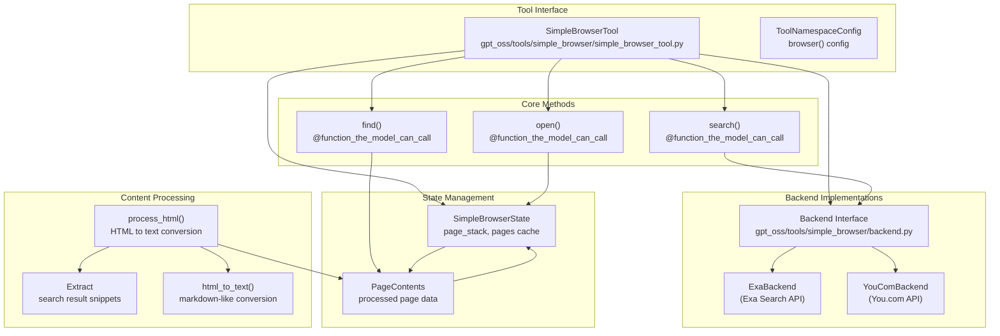
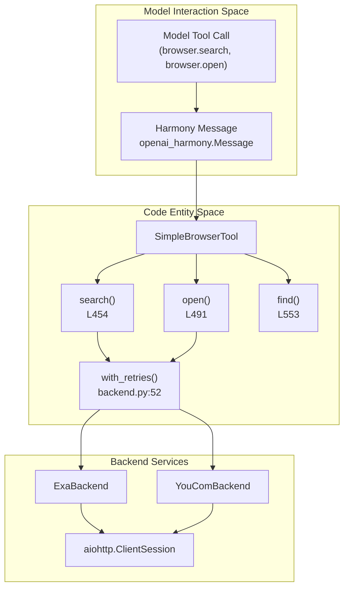
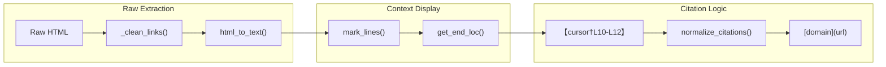

<!-- source: DeepWiki mcp.deepwiki.com · repo openai/gpt-oss · page 5.2 Browser Tool · fetched 2026-10-26 -->

# Browser Tool

Relevant source files

The following files were used as context for generating this wiki page:

- [gpt_oss/tools/simple_browser/__init__.py](gpt_oss/tools/simple_browser/__init__.py)
- [gpt_oss/tools/simple_browser/backend.py](gpt_oss/tools/simple_browser/backend.py)
- [gpt_oss/tools/simple_browser/page_contents.py](gpt_oss/tools/simple_browser/page_contents.py)
- [gpt_oss/tools/simple_browser/simple_browser_tool.py](gpt_oss/tools/simple_browser/simple_browser_tool.py)
- [tests/gpt_oss/tools/simple_browser/test_backend.py](tests/gpt_oss/tools/simple_browser/test_backend.py)

The Browser Tool provides web browsing and search capabilities for gpt-oss models, enabling them to search the internet, open web pages, and find specific content within pages. This tool implements the browser functionality that the models were trained to use, supporting citation-formatted responses and context-aware content display through a scrollable window management system.

## Architecture Overview

The Browser Tool implements a stateful browsing session with caching, citation support, and token-aware content management. It abstracts different search engines and content extraction logic behind a unified interface.

**Sources:** [gpt_oss/tools/simple_browser/simple_browser_tool.py:319-362](), [gpt_oss/tools/simple_browser/backend.py:81-121](), [gpt_oss/tools/simple_browser/page_contents.py:51-58]()

## Core Components

The Browser Tool consists of several key classes that handle different aspects of web browsing functionality:

| Component | Purpose | Key Methods/Properties |
|-----------|---------|----------------------|
| `SimpleBrowserTool` | Main tool implementation | `search()`, `open()`, `find()`, `tool_config` | [gpt_oss/tools/simple_browser/simple_browser_tool.py:319-320]() |
| `SimpleBrowserState` | Session state management | `add_page()`, `get_page()`, `page_stack`, `pages` | [gpt_oss/tools/simple_browser/simple_browser_tool.py:277-317]() |
| `PageContents` | Processed web page data | `url`, `text`, `title`, `urls`, `snippets` | [gpt_oss/tools/simple_browser/page_contents.py:51-58]() |
| `Backend` | Search/fetch abstraction | `search()`, `fetch()` | [gpt_oss/tools/simple_browser/backend.py:81-95]() |
| `ExaBackend` | Search via Exa API | `BASE_URL = "https://api.exa.ai"` | [gpt_oss/tools/simple_browser/backend.py:123-132]() |
| `YouComBackend` | Search via You.com | `BASE_URL = "https://api.ydc-index.io"` | [gpt_oss/tools/simple_browser/backend.py:192-198]() |

## Tool Methods and Data Flow

The `SimpleBrowserTool` exposes three methods that models invoke via the Harmony format. These methods use a retry logic wrapper `with_retries` for resilience against network flakes [gpt_oss/tools/simple_browser/backend.py:52-71]().

### Search Method
The `search()` method performs web searches using the configured backend [gpt_oss/tools/simple_browser/simple_browser_tool.py:454-489](). It returns a list of results formatted as a simple HTML page which is then processed into a `PageContents` object [gpt_oss/tools/simple_browser/backend.py:154-169]().

### Open Method
The `open()` method handles navigation [gpt_oss/tools/simple_browser/simple_browser_tool.py:491-551]():
- **URL Navigation**: Opens a direct URL string.
- **Link Navigation**: Uses an integer `id` to follow a link from the current page's `urls` mapping.
- **Context Management**: Supports `loc` (line number) and `view_source` prefixing [gpt_oss/tools/simple_browser/backend.py:36]().
- **Scrollable Window**: Manages context windowing via `view_tokens` to avoid overloading the model context [gpt_oss/tools/simple_browser/simple_browser_tool.py:528-540]().

### Find Method
The `find()` method searches for a `pattern` within the current page text [gpt_oss/tools/simple_browser/simple_browser_tool.py:553-579](). It uses `run_find_in_page()` to extract matching snippets and their associated line numbers [gpt_oss/tools/simple_browser/simple_browser_tool.py:208-241]().

**Sources:** [gpt_oss/tools/simple_browser/simple_browser_tool.py:454-579](), [gpt_oss/tools/simple_browser/backend.py:141-169]()

## Content Extraction and Citation Format

The tool converts complex HTML into a simplified text format suitable for LLMs while preserving the ability to cite sources accurately.

### HTML to Text Transformation
Content extraction is handled by `process_html()` [gpt_oss/tools/simple_browser/page_contents.py:253-304]().
1. **Link Cleaning**: `_clean_links()` replaces anchor tags with a custom format: `【link_id†text†domain】` [gpt_oss/tools/simple_browser/page_contents.py:130-164]().
2. **Structural Conversion**: `html_to_text()` uses `html2text` with custom overrides to ignore images and tables while preserving the body width [gpt_oss/tools/simple_browser/page_contents.py:185-206]().
3. **Line Numbering**: `mark_lines()` prepends `L{idx}:` to every line for precise referencing [gpt_oss/tools/simple_browser/page_contents.py:81-89]().

### Citation Normalization
The model outputs citations in the format `【cursor†content】` [gpt_oss/tools/simple_browser/simple_browser_tool.py:47](). The `normalize_citations()` function post-processes these into standard markdown links using the `page_stack` to resolve the `cursor` index to a real URL [gpt_oss/tools/simple_browser/simple_browser_tool.py:620-695]().

**Sources:** [gpt_oss/tools/simple_browser/page_contents.py:130-206](), [gpt_oss/tools/simple_browser/simple_browser_tool.py:620-695]()

## Backend Implementations

Backends inherit from the `Backend` base class and implement `search` and `fetch` methods.

### ExaBackend
- **Mechanism**: Uses the Exa Search API (`/search` and `/contents` endpoints) [gpt_oss/tools/simple_browser/backend.py:141-189]().
- **Authentication**: Requires `EXA_API_KEY` [gpt_oss/tools/simple_browser/backend.py:134-138]().
- **Features**: Requests `text` with `includeHtmlTags: True` to allow the tool's own extraction logic to run [gpt_oss/tools/simple_browser/backend.py:178]().

### YouComBackend
- **Mechanism**: Uses the You.com Search API (`/v1/search` endpoint) [gpt_oss/tools/simple_browser/backend.py:209-213]().
- **Authentication**: Requires `YDC_API_KEY` [gpt_oss/tools/simple_browser/backend.py:199-203]().
- **Aggregation**: Combines both `web` and `news` results into a unified search page [gpt_oss/tools/simple_browser/backend.py:216-226]().

**Sources:** [gpt_oss/tools/simple_browser/backend.py:123-242]()

---

