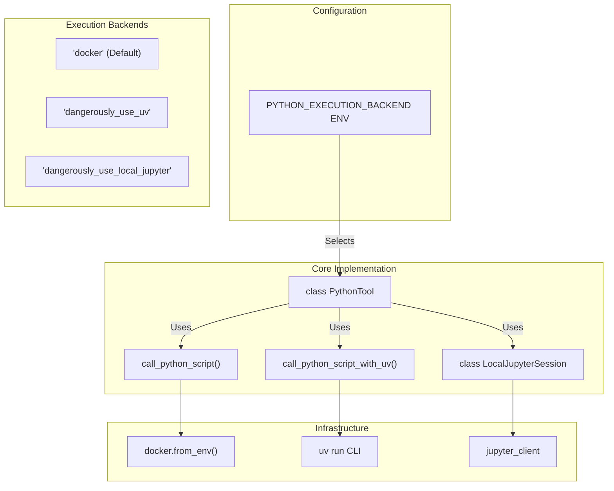
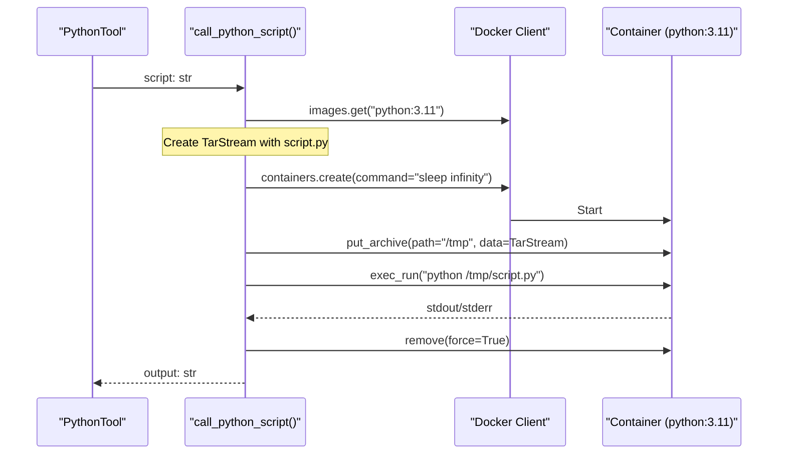
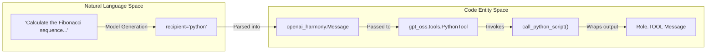

<!-- source: DeepWiki mcp.deepwiki.com · repo openai/gpt-oss · page 5.3 Python Execution Tool · fetched 2026-10-26 -->

# Python Execution Tool

Relevant source files

The following files were used as context for generating this wiki page:

- [gpt_oss/tools/python_docker/docker_tool.py](gpt_oss/tools/python_docker/docker_tool.py)

The Python Execution Tool provides secure code execution capabilities for gpt-oss models through isolated environments. This tool enables models to perform calculations, data processing, and other computational tasks as part of their reasoning process. While primarily utilizing Docker for isolation, the tool supports multiple execution backends via environment configuration.

## Architecture Overview

The Python tool integrates into the gpt-oss ecosystem through multiple layers, from the core Harmony message format up to client applications and MCP servers. It supports a stateless execution model where, by default, each request starts in a fresh environment.

### System Integration and Backend Selection

Sources: [gpt_oss/tools/python_docker/docker_tool.py:28-38](), [gpt_oss/tools/python_docker/docker_tool.py:211-236]()

## Execution Backends

The system supports three distinct backends, controlled by the `PYTHON_EXECUTION_BACKEND` environment variable [gpt_oss/tools/python_docker/docker_tool.py:34-38]().

### 1. Docker Backend (`docker`)
The default and most secure backend. It uses the `docker` Python library to manage the lifecycle of a `python:3.11` container for every execution [gpt_oss/tools/python_docker/docker_tool.py:41-79]().

- **Isolation**: High. Each script runs in a new container.
- **Mechanism**: The script is bundled into a `tar` archive and injected into the container using `put_archive` [gpt_oss/tools/python_docker/docker_tool.py:54-71]().
- **Cleanup**: Containers are forcibly removed after execution [gpt_oss/tools/python_docker/docker_tool.py:78]().

### 2. UV Backend (`dangerously_use_uv`)
A faster, local execution backend that uses the `uv` package manager [gpt_oss/tools/python_docker/docker_tool.py:82-98]().

- **Isolation**: Low. Runs on the host system.
- **Mechanism**: Uses `subprocess.run` to call `uv run --no-project python script.py` [gpt_oss/tools/python_docker/docker_tool.py:91-93]().

### 3. Jupyter Backend (`dangerously_use_local_jupyter`)
A stateful backend that allows the model to maintain variables and state across multiple tool calls [gpt_oss/tools/python_docker/docker_tool.py:101-209]().

- **Mechanism**: Manages a `BlockingKernelClient` and `KernelManager` from `jupyter_client` [gpt_oss/tools/python_docker/docker_tool.py:111-142]().
- **State**: Unlike other backends, this can persist a session if the `PythonTool` instance is held [gpt_oss/tools/python_docker/docker_tool.py:215-217]().

Sources: [gpt_oss/tools/python_docker/docker_tool.py:28-32](), [gpt_oss/tools/python_docker/docker_tool.py:41-79](), [gpt_oss/tools/python_docker/docker_tool.py:82-98](), [gpt_oss/tools/python_docker/docker_tool.py:101-209]()

## Implementation Detail: Docker Lifecycle

The `call_python_script` function manages the interaction with the Docker daemon.

Sources: [gpt_oss/tools/python_docker/docker_tool.py:41-79]()

## The PythonTool Class

The `PythonTool` class implements the `Tool` interface and acts as the bridge between Harmony messages and the execution backends.

### Key Methods

| Method | Role |
| :--- | :--- |
| `tool_config` | Returns `ToolNamespaceConfig` with name `"python"` and internal tool settings [gpt_oss/tools/python_docker/docker_tool.py:220-226](). |
| `instruction` | Provides the system prompt snippet explaining the tool's stateless nature [gpt_oss/tools/python_docker/docker_tool.py:228-236](). |
| `_process(message)` | Extracts the script from `TextContent`, routes it to the correct backend, and returns a `Message` with `Role.TOOL` [gpt_oss/tools/python_docker/docker_tool.py:238-261](). |

### Stateless vs. Stateful Execution
By default, the `PythonTool` initializes a new execution environment for every call in its `_process` method unless the `dangerously_use_local_jupyter` backend is configured, in which case it attempts to maintain a `LocalJupyterSession` [gpt_oss/tools/python_docker/docker_tool.py:215-217]().

Sources: [gpt_oss/tools/python_docker/docker_tool.py:211-268]()

## Data Flow: Natural Language to Code Execution

This diagram bridges the gap between the model's intent (Natural Language Space) and the actual code entities that perform the work.

Sources: [gpt_oss/tools/python_docker/docker_tool.py:238-261](), [gpt_oss/tools/python_docker/docker_tool.py:15-22]()

## Security and Warnings

The Python Execution Tool includes specific warnings regarding its use in production environments:

1.  **Permissive Environment**: The default Docker backend runs in a permissive container. Users are advised to implement additional resource constraints (CPU/Memory limits) and network restrictions for production use [gpt_oss/tools/python_docker/docker_tool.py:46-79]().
2.  **Local Execution**: The `uv` and `jupyter` backends are prefixed with `dangerously_use_` because they execute code directly on the host system with the model's permissions [gpt_oss/tools/python_docker/docker_tool.py:28-32]().
3.  **Statelessness**: Models are instructed that the environment is stateless, meaning they should include all necessary imports and data definitions in every code block [gpt_oss/tools/python_docker/docker_tool.py:231-234]().

Sources: [gpt_oss/tools/python_docker/docker_tool.py:28-32](), [gpt_oss/tools/python_docker/docker_tool.py:228-236]()

---

