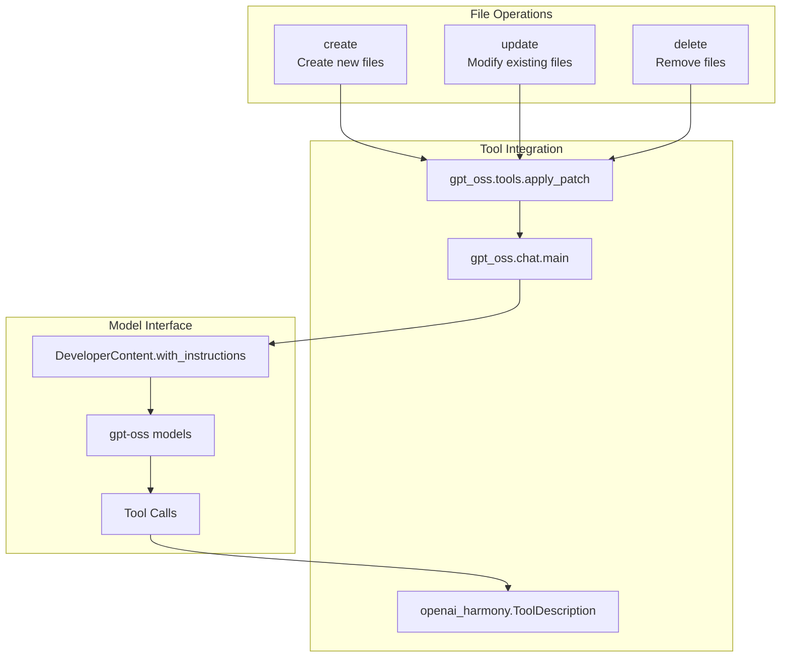
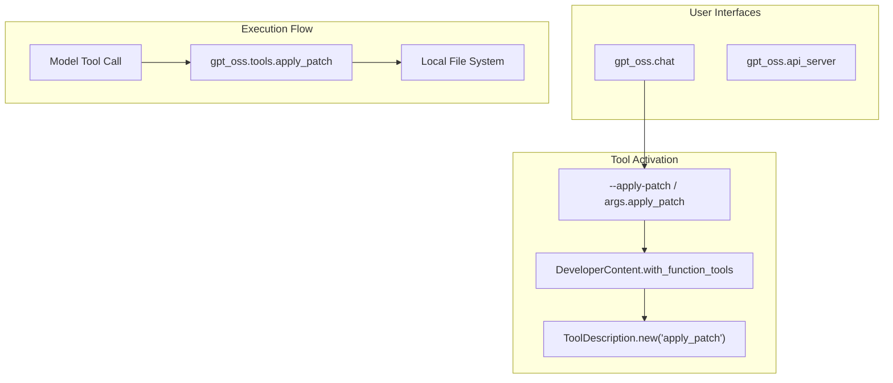
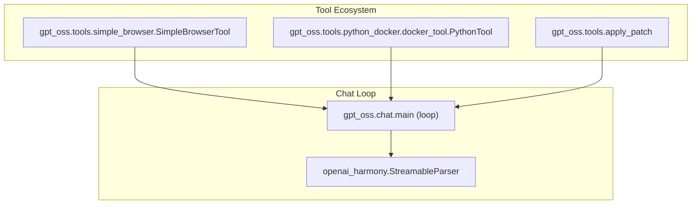

<!-- source: DeepWiki mcp.deepwiki.com · repo openai/gpt-oss · page 5.4 File Patching Tool · fetched 2026-10-26 -->

# File Patching Tool

<details>
<summary>Relevant source files</summary>

The following files were used as context for generating this wiki page:

- [README.md](README.md)
- [gpt_oss/chat.py](gpt_oss/chat.py)

</details>


The File Patching Tool provides file manipulation capabilities for the gpt-oss models, allowing them to create, update, and delete files during their reasoning process. This tool enables the models to perform file operations as part of their agentic capabilities, particularly useful for tasks involving code generation, file editing, and content management.

For information about web browsing capabilities, see [Browser Tool](#5.2). For Python code execution, see [Python Execution Tool](#5.3). For the underlying response format system, see [Harmony Response Format](#5.1).

## Purpose and Integration

The `apply_patch` tool is integrated into the chat interface to allow models to modify the local environment. It operates by interpreting specific patch instructions and executing them against the file system.



Sources: [gpt_oss/chat.py:20-20](), [gpt_oss/chat.py:105-126]()

## System Architecture

The File Patching Tool is implemented as a function tool that the model can invoke via the Harmony response format. Unlike the Python execution tool which uses Docker, the `apply_patch` tool acts directly on the file system relative to the execution path.



Sources: [gpt_oss/chat.py:105-126](), [gpt_oss/chat.py:150-150]()

## Usage Patterns

### Terminal Chat Interface

The `apply_patch` tool is enabled in the terminal chat interface using the `--apply-patch` flag. When this flag is active, the chat application injects specific instructions and a tool definition into the conversation's `DeveloperContent`.

```bash
python -m gpt_oss.chat --apply-patch --checkpoint /path/to/model
```

Sources: [gpt_oss/chat.py:105-126](), [gpt_oss/chat.py:150-150]()

### Implementation Details

In `gpt_oss/chat.py`, the tool is configured by reading an external documentation file `apply_patch.md` and appending it to the developer instructions. This ensures the model understands the specific syntax required for patching.

```python
if args.apply_patch:
    apply_patch_instructions = Path(apply_patch.__file__).parent / "apply_patch.md"
    developer_message += apply_patch_instructions.read_text()
    developer_message_content = (
        DeveloperContent.new()
        .with_instructions(developer_message)
        .with_function_tools([
            ToolDescription.new(
                "apply_patch",
                "Patch a file",
                parameters={
                    "type": "string",
                    "description": "Formatted patch code",
                    "default": "*** Begin Patch\n*** End Patch\n",
                }
            ),
        ])
    )
```

Sources: [gpt_oss/chat.py:105-126]()

## Tool Invocation and Schema

The model invokes the tool using the following schema defined in the `ToolDescription`:

| Property | Value | Description |
|-----------|---------|-------------|
| **Name** | `apply_patch` | The identifier used by the model to call the function. |
| **Description** | "Patch a file" | Instruction to the model on when to use this tool. |
| **Parameters** | `string` | A formatted patch string containing instructions for file changes. |
| **Default** | `*** Begin Patch\n*** End Patch\n` | The expected wrapper for the patch content. |

Sources: [gpt_oss/chat.py:115-124]()

## Security and Safety Considerations

The `apply_patch` tool operates with direct file system access, which requires careful consideration of security implications:

### File System Permissions
The tool operates with the permissions of the process running the `gpt_oss.chat` application [gpt_oss/chat.py:105-126](). This means it can modify any file the user has write access to in the current environment.

### Integration with Reasoning
Because the tool is provided via `DeveloperContent`, it is treated as a high-priority instruction. The model uses its reasoning capabilities to determine the exact diff or file content required before calling the `apply_patch` function [gpt_oss/chat.py:111-126]().

## Integration with Other Tools

The `apply_patch` tool is often used in conjunction with the `PythonTool` and `SimpleBrowserTool`. For instance, a model might search for a library's documentation using the browser, test a code snippet in the Python sandbox, and finally use `apply_patch` to save the working code to a local file.



Sources: [gpt_oss/chat.py:20-23](), [gpt_oss/chat.py:87-103](), [gpt_oss/chat.py:171-180]()

---

