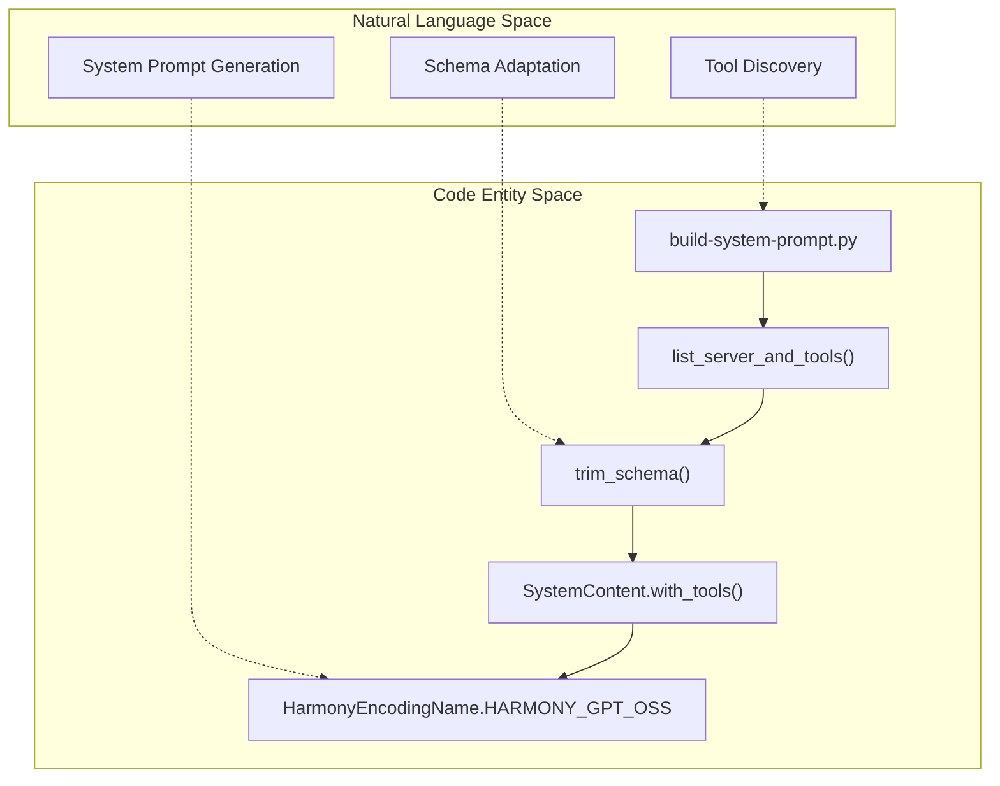
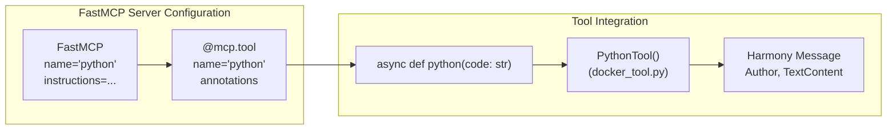
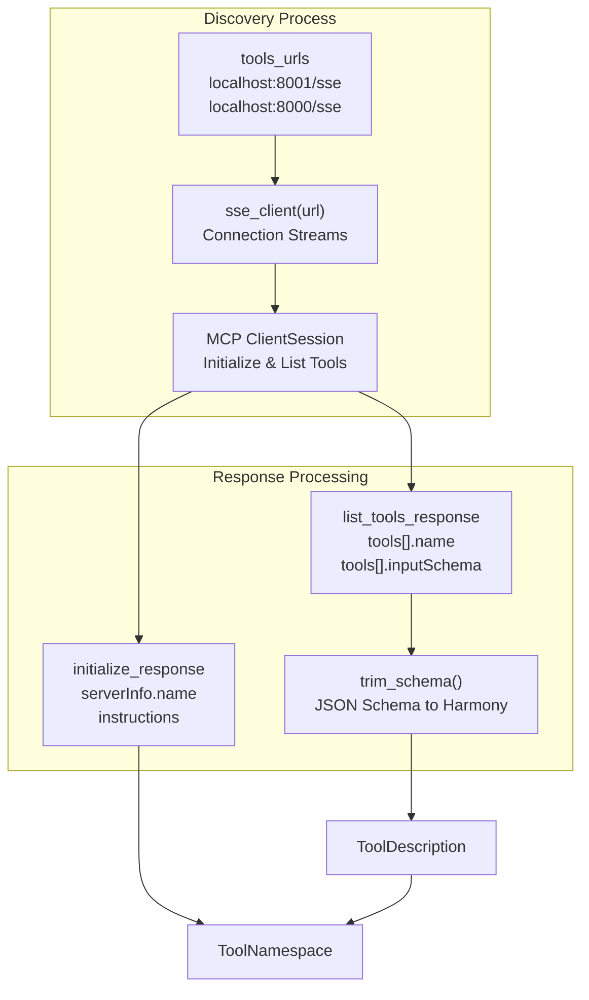
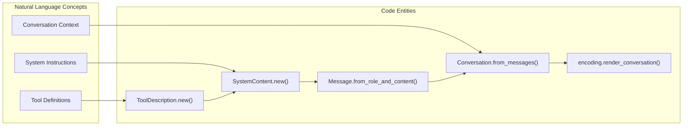

<!-- source: DeepWiki mcp.deepwiki.com · repo openai/gpt-oss · page 5.5 MCP Integration · fetched 2026-10-26 -->

# MCP Integration

<details>
<summary>Relevant source files</summary>

The following files were used as context for generating this wiki page:

- [gpt-oss-mcp-server/README.md](gpt-oss-mcp-server/README.md)
- [gpt-oss-mcp-server/browser_server.py](gpt-oss-mcp-server/browser_server.py)
- [gpt-oss-mcp-server/build-system-prompt.py](gpt-oss-mcp-server/build-system-prompt.py)
- [gpt-oss-mcp-server/pyproject.toml](gpt-oss-mcp-server/pyproject.toml)
- [gpt-oss-mcp-server/python_server.py](gpt-oss-mcp-server/python_server.py)
- [gpt-oss-mcp-server/reference-system-prompt.py](gpt-oss-mcp-server/reference-system-prompt.py)

</details>


The MCP Integration system provides Model Context Protocol (MCP) servers that enable dynamic tool discovery and automated system prompt generation for gpt-oss models. This system bridges individual tools with the Harmony response format, allowing for automatic discovery of available tools and their schemas to construct appropriate system prompts.

For information about the underlying tools that MCP servers expose, see [Browser Tool](#5.2), [Python Execution Tool](#5.3), and [File Patching Tool](#5.4). For details about the response format system that MCP integration feeds into, see [Harmony Response Format](#5.1).

## Architecture Overview

The MCP integration consists of three main components: MCP servers that expose tool capabilities, a service discovery mechanism that automatically detects available tools, and a system prompt builder that constructs Harmony-compatible system messages.

### Natural Language to Code Entity Mapping: Discovery Flow
The following diagram maps the high-level discovery process to specific code entities within the `gpt-oss-mcp-server` directory.



Sources: [gpt-oss-mcp-server/README.md:1-30](), [gpt-oss-mcp-server/build-system-prompt.py:1-117]()

## MCP Server Implementation

MCP servers wrap the individual tool implementations and expose them through the Model Context Protocol using Server-Sent Events (SSE). Each server provides both tool execution capabilities and schema information for automatic discovery.

### Python Execution Server
The `python_server.py` creates a `FastMCP` server [gpt-oss-mcp-server/python_server.py:6-12]() that wraps the `PythonTool` [gpt-oss-mcp-server/python_server.py:27-33](). It uses specific annotations to control schema inclusion in system prompts; the `include_in_prompt: False` annotation [gpt-oss-mcp-server/python_server.py:24]() prevents simple text-in-text-out tools from cluttering the system prompt with redundant schema definitions.

### Browser Server
The `browser_server.py` implements a more complex server with session management via `AppContext` [gpt-oss-mcp-server/browser_server.py:12-29](). It dynamically instantiates `SimpleBrowserTool` using either `ExaBackend` or `YouComBackend` based on the `BROWSER_BACKEND` environment variable [gpt-oss-mcp-server/browser_server.py:17-24]().



Sources: [gpt-oss-mcp-server/python_server.py:1-34](), [gpt-oss-mcp-server/browser_server.py:12-49]()

## Service Discovery Mechanism

The MCP integration uses an asynchronous service discovery process to automatically detect available MCP servers and collect their tool schemas. This process connects to multiple MCP servers simultaneously and aggregates their capabilities.

The `list_server_and_tools` function [gpt-oss-mcp-server/build-system-prompt.py:24-29]() establishes SSE connections using `sse_client` and retrieves both initialization information and tool schemas via `ClientSession.list_tools()`.



Sources: [gpt-oss-mcp-server/build-system-prompt.py:24-30](), [gpt-oss-mcp-server/build-system-prompt.py:71-92]()

## Schema Transformation

MCP tool schemas must be transformed to be compatible with Harmony's format requirements. The `trim_schema` function [gpt-oss-mcp-server/build-system-prompt.py:32-52]() performs this transformation by removing unnecessary fields and converting MCP JSON Schema conventions to Harmony's expected format.

| MCP Schema Element | Harmony Transformation | Code Reference |
|-------------------|----------------------|----------------|
| `"title"` field | Removed completely | [gpt-oss-mcp-server/build-system-prompt.py:34-35]() |
| `"default": null` | Removed if null | [gpt-oss-mcp-server/build-system-prompt.py:36-37]() |
| `"anyOf"` union | Converted to `"type": [list]` | [gpt-oss-mcp-server/build-system-prompt.py:38-46]() |
| `"null"` type | Filtered out from unions | [gpt-oss-mcp-server/build-system-prompt.py:43]() |
| Nested `"properties"` | Recursively transformed | [gpt-oss-mcp-server/build-system-prompt.py:47-51]() |

Sources: [gpt-oss-mcp-server/build-system-prompt.py:32-53]()

## System Prompt Generation

The system prompt generation process combines the discovered MCP tools with Harmony's system content structure to create properly formatted system messages.

### Natural Language to Code Entity Mapping: Prompt Building
This diagram shows how the system prompt is assembled from discrete code objects into the final string.



The `build-system-prompt.py` script [gpt-oss-mcp-server/build-system-prompt.py:94-116]() demonstrates the complete process. It loads the `HARMONY_GPT_OSS` encoding [gpt-oss-mcp-server/build-system-prompt.py:94](), adds tools to `SystemContent` [gpt-oss-mcp-server/build-system-prompt.py:100-102](), and renders the final string using the tokenizer [gpt-oss-mcp-server/build-system-prompt.py:115]().

Sources: [gpt-oss-mcp-server/build-system-prompt.py:94-116](), [gpt-oss-mcp-server/reference-system-prompt.py:19-46]()

## Integration with Harmony

The MCP integration connects with Harmony's tool system through the `ToolNamespaceConfig` and `ToolDescription` classes. Each MCP server becomes a tool namespace:
- MCP server `serverInfo.name` becomes the `ToolNamespaceConfig.name` [gpt-oss-mcp-server/build-system-prompt.py:84]().
- MCP server `instructions` becomes the namespace description [gpt-oss-mcp-server/build-system-prompt.py:85]().
- Individual MCP tools are mapped to `ToolDescription` objects [gpt-oss-mcp-server/build-system-prompt.py:87-90]().

This design allows the system to automatically adapt to new MCP servers without requiring changes to the core Harmony integration logic.

Sources: [gpt-oss-mcp-server/build-system-prompt.py:83-92](), [gpt-oss-mcp-server/build-system-prompt.py:100-102]()

## Usage and Deployment

MCP servers are deployed as standalone SSE-enabled services. The typical deployment involves starting the servers via the `mcp` CLI and using `build-system-prompt.py` for integration.

**Starting MCP servers:**
```bash
# Start browser server on port 8001
mcp run -t sse browser_server.py:mcp

# Start python server on port 8000
mcp run -t sse python_server.py:mcp
```

The servers are configured to listen on specific ports (e.g., `port=8001` for the browser server [gpt-oss-mcp-server/browser_server.py:48]()). Once running, the `build-system-prompt.py` script connects to these local endpoints [gpt-oss-mcp-server/build-system-prompt.py:71-74]() to generate the system prompt.

Sources: [gpt-oss-mcp-server/README.md:12-29](), [gpt-oss-mcp-server/browser_server.py:48](), [gpt-oss-mcp-server/build-system-prompt.py:71-74]()

---

