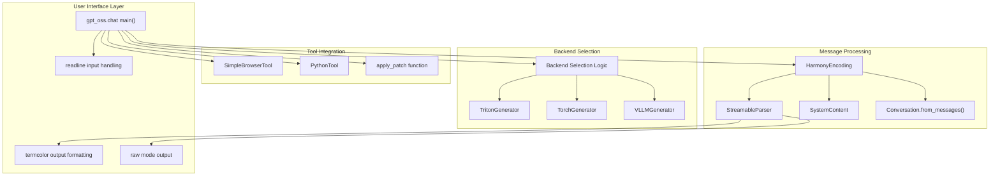
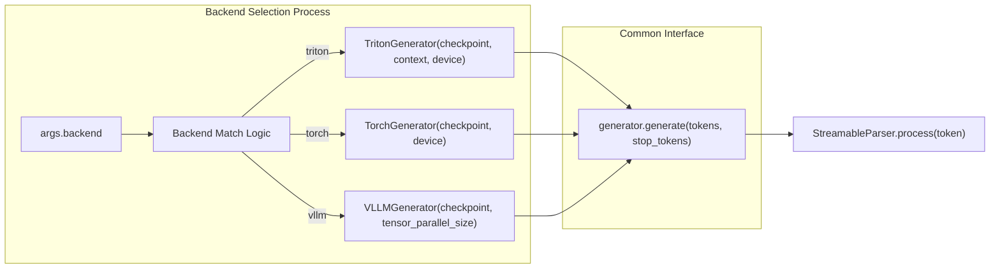
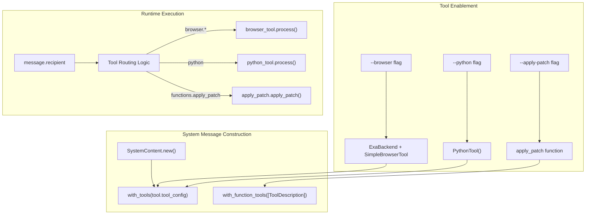
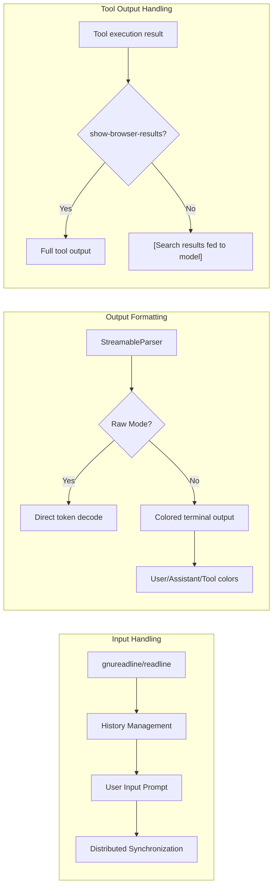
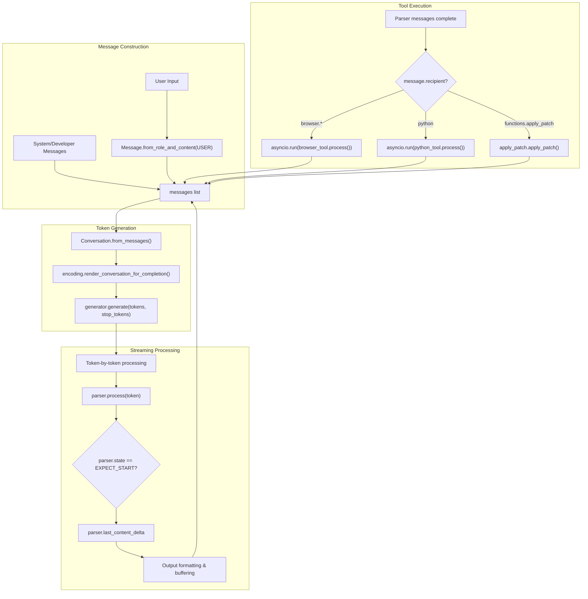

<!-- source: DeepWiki mcp.deepwiki.com · repo openai/gpt-oss · page 6.1 Terminal Chat Interface · fetched 2026-10-26 -->

# Terminal Chat Interface

Relevant source files

The following files were used as context for generating this wiki page:

- [README.md](README.md)
- [gpt_oss/chat.py](gpt_oss/chat.py)

The Terminal Chat Interface is a command-line chat application that provides interactive access to gpt-oss models with full tool integration and multiple backend support. This interface serves as the primary reference implementation for building conversational applications using the harmony response format and demonstrates integration patterns for tools, backends, and user interaction.

For web-based interfaces, see [Web Interfaces](#6.2). For programmatic API access, see [Responses API Server](#6.3).

## Purpose and Architecture

The terminal chat interface acts as an integration layer between inference backends, tool implementations, and user interaction, providing a complete conversational experience in a command-line environment.

**Sources**: [gpt_oss/chat.py:1-370](), [README.md:267-299]()

## Backend Integration

The chat interface supports multiple inference backends through a unified `TokenGenerator` interface, selected at runtime based on the `--backend` argument.

| Backend | Generator Class | Requirements | Use Case |
|---------|----------------|--------------|----------|
| `triton` | `TritonGenerator` | Single GPU, optimized kernels | Default, production-ready |
| `torch` | `TorchGenerator` | Multi-GPU, reference implementation | Educational, debugging |
| `vllm` | `VLLMGenerator` | vLLM server integration | High-throughput deployment |

**Sources**: [gpt_oss/chat.py:62-77]()

## Tool Integration

The interface integrates with the MCP-compatible tool ecosystem, enabling browser search, Python execution, and file manipulation capabilities.

### Tool Configuration

### Tool Execution Flow

The chat loop detects tool calls based on message recipients and routes them to appropriate tool implementations:

- **Browser Tool**: Recipients starting with `browser.` (search, open, find operations) [gpt_oss/chat.py:171-180]()
- **Python Tool**: Recipients matching `python` (code execution) [gpt_oss/chat.py:182-193]()
- **Apply Patch**: Recipients matching `functions.apply_patch` (file operations) [gpt_oss/chat.py:195-208]()

**Sources**: [gpt_oss/chat.py:87-96](), [gpt_oss/chat.py:167-223]()

## User Interface Features

### Interactive Components

The interface provides rich terminal interaction through several key components:

### Display Modes

**Raw Mode** (`--raw`): Displays the exact harmony-encoded conversation tokens, useful for debugging and understanding the underlying format. [gpt_oss/chat.py:133-141]()

**Formatted Mode** (default): Provides a user-friendly interface with:
- Color-coded message roles (User: red, Assistant: green, CoT: yellow, Tools: cyan/magenta) [gpt_oss/chat.py:240-281]()
- System information display (model identity, reasoning effort, enabled tools) [gpt_oss/chat.py:143-154]()
- Citation normalization for browser tool results [gpt_oss/chat.py:270-281]()

**Sources**: [gpt_oss/chat.py:129-150](), [gpt_oss/chat.py:225-234](), [gpt_oss/chat.py:240-281]()

## Configuration Options

The interface supports extensive configuration through command-line arguments:

| Argument | Type | Default | Purpose |
|----------|------|---------|---------|
| `checkpoint` | str | required | Path to model checkpoint |
| `--reasoning-effort` | choice | "low" | Model reasoning intensity (low/medium/high) |
| `--backend` | choice | "triton" | Inference backend (triton/torch/vllm) |
| `--browser` | flag | False | Enable browser tool |
| `--python` | flag | False | Enable Python execution |
| `--apply-patch` | flag | False | Enable file patching |
| `--context` | int | 8192 | Maximum context length |
| `--raw` | flag | False | Raw token output mode |
| `--developer-message` | str | "" | Custom developer instructions |

**Sources**: [gpt_oss/chat.py:286-357]()

## Message Processing Pipeline

The core conversation loop implements a sophisticated message processing pipeline that handles streaming token generation, tool execution, and response parsing.

**Sources**: [gpt_oss/chat.py:235-283](), [gpt_oss/chat.py:153-234]()

## Implementation Details

### Distributed Computing Support

The interface supports distributed inference through PyTorch's distributed computing framework:

- **Rank-based Input**: Only rank 0 reads user input, broadcasts to other ranks [gpt_oss/chat.py:49-58]()
- **Synchronized Generation**: All ranks participate in token generation
- **History Management**: Only rank 0 maintains readline history [gpt_oss/chat.py:360-365]()

### Citation Processing

When browser tools are enabled, the interface performs real-time citation normalization:

- **Buffer Management**: Accumulates partial tokens to avoid breaking citations mid-stream [gpt_oss/chat.py:270-272]()
- **Citation Detection**: Uses `browser_tool.normalize_citations()` to identify and format citations [gpt_oss/chat.py:273-274]()
- **Partial Citation Handling**: Delays output when citations are incomplete [gpt_oss/chat.py:275-281]()

### Error Handling

The interface implements robust error handling for:
- **Tool Execution Errors**: Captured and displayed as tool output [gpt_oss/chat.py:195-208]()
- **JSON Parsing**: For apply_patch tool argument processing [gpt_oss/chat.py:200-201]()
- **Token Generation**: Graceful handling of generation stopping conditions

**Sources**: [gpt_oss/chat.py:49-58](), [gpt_oss/chat.py:270-281](), [gpt_oss/chat.py:195-208]()

---

