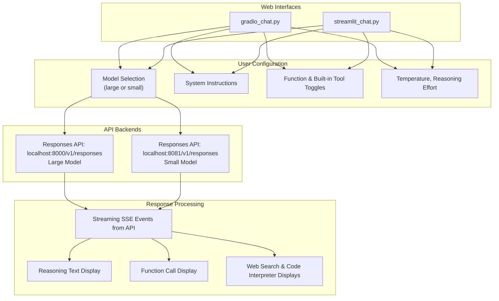
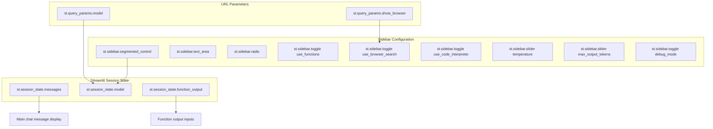
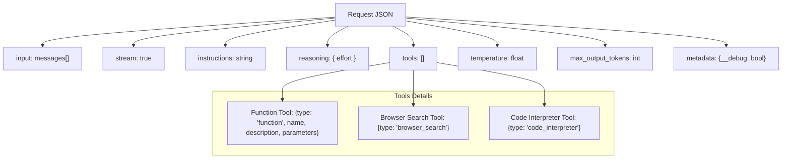

<!-- source: DeepWiki mcp.deepwiki.com · repo openai/gpt-oss · page 6.2 Web Interfaces · fetched 2026-10-26 -->

# Web Interfaces

<details>
<summary>Relevant source files</summary>

The following files were used as context for generating this wiki page:

- [examples/gradio/gradio_chat.py](examples/gradio/gradio_chat.py)
- [examples/streamlit/streamlit_chat.py](examples/streamlit/streamlit_chat.py)
- [gpt_oss/responses_api/events.py](gpt_oss/responses_api/events.py)

</details>


This document covers the web-based chat interfaces for interacting with gpt-oss models. These interfaces provide browser-accessible alternatives to the terminal chat application while supporting similar functionality including tool integration, streaming responses, reasoning display, and built-in tool toggles.

For terminal-based interaction, see [Terminal Chat Interface](#6.1). For programmatic API access, see [Responses API Server](#6.3).

## Overview

The gpt-oss repository includes two main web interface implementations:

- **Gradio Interface**: Implements a modern web UI with an interactive chat experience, layout managed by `gradio_chat.py`.
- **Streamlit Interface**: Provides a dashboard-style interface with sidebar controls and message display managed by `streamlit_chat.py`.

Both interfaces connect to the Responses API server, which serves as a backend for inference and tool integration, and allow configuration of the model, reasoning effort level, temperature, and toggles for built-in tools like browser search and code interpreter.



Sources: [examples/gradio/gradio_chat.py:1-247](), [examples/streamlit/streamlit_chat.py:1-253]()

---

## Gradio Interface

The Gradio interface (`gradio_chat.py`) presents a clean, responsive chat window alongside a sidebar for detailed configuration options.

### Core Components

- `chat_with_model`: The main function responsible for processing the user input, preparing the chat history in the Harmony format, configuring tools, sending requests to the Responses API server, and streaming the response events back to the UI.
- Gradio UI elements include:
  - `gr.Chatbot` for displaying the conversation history.
  - `gr.Textbox` for user text input.
  - Sidebar controls for:
    - Model choice (large or small)
    - System instructions
    - Reasoning effort selection
    - Toggle for functions and browser search
    - Temperature and max output token sliders
    - Debug mode toggle

Event handlers trigger the chat function on either submitting the textbox or clicking the send button.

```mermaid
graph TD
    subgraph "Gradio UI Components"
        Chatbot["gr.Chatbot(height=500)"]
        TextInput["gr.Textbox for user input"]
        SendButton["gr.Button \"Send\""]
        ClearButton["gr.Button \"Clear Chat\""]
    end
    
    subgraph "Sidebar Configuration"
        ModelRadio["gr.Radio large/small"]
        InstructionsBox["gr.Textbox system instructions"]
        EffortRadio["gr.Radio low/medium/high reasoning effort"]
        FunctionsToggle["gr.Checkbox use_functions"]
        BrowserToggle["gr.Checkbox use_browser_search"]
        TemperatureSlider["gr.Slider temperature"]
        MaxTokenSlider["gr.Slider max_output_tokens"]
        DebugToggle["gr.Checkbox debug_mode"]
    end
    
    TextInput -->|submit| ChatFunction["chat_with_model()"]
    SendButton -->|click| ChatFunction
    ClearButton -->|click| ClearChatFunction
    
    ModelRadio --> ChatFunction
    InstructionsBox --> ChatFunction
    EffortRadio --> ChatFunction
    FunctionsToggle --> ChatFunction
    BrowserToggle --> ChatFunction
    TemperatureSlider --> ChatFunction
    MaxTokenSlider --> ChatFunction
    DebugToggle --> ChatFunction
```



Sources: [examples/gradio/gradio_chat.py:179-243]()

### Message Processing Workflow

- The chat history is maintained as a list of tuples `(user_message, assistant_message)`.
- Each turn is converted into a Harmony message format with `"type": "message"`, `"role"` set to `"user"` or `"assistant"`, and `"content"` containing the textual payload.
- The tools array is constructed conditionally based on the toggles for functions and browser search.
- Requests to the Responses API server are streamed line-by-line, parsing event JSON payloads.
- Streaming events such as output text deltas and reasoning text deltas are appended to the assistant's last message, updating the UI incrementally.
- Function call and web search call completions are displayed with appropriate annotations.
- Debug metadata, if enabled, is appended at the response completion.

The code employs idiomatic Gradio patterns for streaming updates by `yield`ing the updated history and empty input textbox at each data delta.

Sources: [examples/gradio/gradio_chat.py:18-177]()

### API Endpoint Routing

The model selection controls which Responses API server endpoint the Gradio client posts requests to:

```python
URL = ("http://localhost:8081/v1/responses" if model_choice == "small" else "http://localhost:8000/v1/responses")
```

This distinguishes between the small and large model inference servers.

Sources: [examples/gradio/gradio_chat.py:69-72]()

---

## Streamlit Interface

The Streamlit interface (`streamlit_chat.py`) uses a sidebar panel for options while rendering messages in the main window with rich avatars and structural display.

### Session State Management

- Uses `st.session_state` to persist conversation history (`messages`) and user-selected model.
- Reads initial model selection from URL parameters if provided.
- Sidebar UI controls provide:
  - Segmented control for model selection.
  - Text area for system instructions.
  - Radio buttons for reasoning effort.
  - Toggles for enabling functions, browser search, and code interpreter tools.
  - Sliders for temperature and maximum output tokens.
  - Debug mode toggle.



Sources: [examples/streamlit/streamlit_chat.py:19-82]()

### Response Streaming and Display

The core function `run(container)` orchestrates the request to the Responses API server and processes streaming events:

- Builds the `tools` array based on toggles and includes function tool specification with name, description, and JSON schema parameters.
- Posts a streaming request with fields for input messages, instructions, reasoning effort, tools, temperature, and max output tokens.
- Iterates over the streaming response lines decoding each event JSON.
- Handles different event types:
  - `response.output_item.added` starts rendering a new message or reasoning segment.
  - `response.reasoning_text.delta` appends partial reasoning text with 🤔 avatar.
  - `response.output_text.delta` appends assistant message text.
  - `response.output_item.done` displays function calls and tool actions with appropriate icons.
- Also maintains session state updates with partial text increments and rendering for special items like code interpreter calls.

Historical messages are re-rendered each interaction using role-based layout with built-in avatars and rich text and code block support.

Sources: [examples/streamlit/streamlit_chat.py:105-201](), [examples/streamlit/streamlit_chat.py:203-236]()

### URL Routing Logic

Model selection determines the Responses API endpoint:

```python
URL = (
    "http://localhost:8081/v1/responses" if st.session_state.model == "small" else "http://localhost:8000/v1/responses"
)
```

Sources: [examples/streamlit/streamlit_chat.py:84-88]()

---

## Shared API Integration Details

Both interfaces share a consistent approach to interacting with the Responses API server.

### Request Payload Structure

Requests to `/v1/responses` include:

- `input`: Array of Harmony messages representing full conversation history.
- `stream`: Boolean enabled for streaming responses.
- `instructions`: System-level instructions string.
- `reasoning`: Object with `effort` level (`low`, `medium`, `high`).
- `tools`: Array specifying enabled tools, optionally including:
  - Function definitions (name, description, parameters schema).
  - Built-in tools like `"browser_search"` or `"code_interpreter"`.
- `temperature`: Sampling temperature float.
- `max_output_tokens`: Maximum response tokens.
- `metadata`: Includes debug flag.



Sources: [examples/gradio/gradio_chat.py:74-88](), [examples/streamlit/streamlit_chat.py:120-133]()

### Streaming Response Event Handling

Both clients process identical streaming event types emitted by the Responses API server's SSE stream. Important events include:

| Event Type                     | Description                               | UI Effect                      |
|-------------------------------|-------------------------------------------|-------------------------------|
| `response.output_item.added`   | Starts a new output item (message/reasoning/tool call) | Creates a new chat message block |
| `response.reasoning_text.delta`| Partial reasoning text chunk              | Append to reasoning text area (🤔 avatar) |
| `response.output_text.delta`   | Partial assistant output text              | Append to bot's message       |
| `response.output_item.done`    | Completion of a function call or tool action | Renders call details, arguments |
| `response.completed`           | Response fully completed                   | Finalizes message, optionally shows debug info |

This event-driven streaming mechanism enables rich interactive experiences with real-time incremental updates.

Sources: [examples/gradio/gradio_chat.py:107-168](), [examples/streamlit/streamlit_chat.py:149-200]()

---

## Configuration Options

### Model Selection

- `large`: Uses the large model server endpoint at `localhost:8000/v1/responses`.
- `small`: Uses the small model server endpoint at `localhost:8081/v1/responses`.

### Tools and Features

- **Function Tool:** A custom function can be defined with:
  - `function_name`: Identifier string.
  - `function_description`: Description of purpose.
  - `function_parameters`: JSON schema for parameters.
- **Browser Search:** Toggle to enable web search tool calls.
- **Code Interpreter:** (Streamlit only) Toggle to enable code execution tool.

### Generation Parameters

- **Temperature:** Float from 0.0 to 1.0 controlling randomness.
- **Max Output Tokens:** Integer setting the maximum tokens in the response.
- **Reasoning Effort:** Discrete choice from `low`, `medium`, `high` to control depth of reasoning.

Sources: [examples/gradio/gradio_chat.py:194-228](), [examples/streamlit/streamlit_chat.py:32-78]()

---

## Launch and Deployment

### Gradio Interface

Run:

```python
if __name__ == "__main__":
    demo.launch()
```

This will start the Gradio server, exposing the chat UI at `http://localhost:7860` with default options including live reload.

### Streamlit Interface

Run:

```bash
streamlit run examples/streamlit/streamlit_chat.py
```

Optional URL parameters:

- `?model=large` or `?model=small` to pre-select the model.
- `?show_browser=1` to enable display of browser tool toggles.

Sources: [examples/gradio/gradio_chat.py:246-247](), [examples/streamlit/streamlit_chat.py:25-56]()

---

# Appendix: Entity Mapping Diagram

This diagram bridges the natural language concepts with specific code entities relevant to the web interfaces.

```mermaid
graph TD
    NaturalLang["Natural Language Space"]
    CodeSpace["Code Entity Space"]
    
    NaturalLang -->|uses| WebInterfaces["Web Interfaces"]
    WebInterfaces --> StreamlitIntf["Streamlit Interface"]
    WebInterfaces --> GradioIntf["Gradio Interface"]
    
    StreamlitIntf --> "streamlit_chat.py[1-253]"
    GradioIntf --> "gradio_chat.py[1-247]"
    
    StreamlitIntf --> "Responses API Server"
    GradioIntf --> "Responses API Server"
    
    "Responses API Server" --> "api_server.py"
    "Responses API Server" --> "serve.py"
    
    StreamlitIntf --> SessionState["Streamlit st.session_state"]
    GradioIntf --> ChatHistory["Gradio history list"]
    
    ToolsToggle["Tools Toggle UI"] --> StreamlitIntf
    ToolsToggle --> GradioIntf
    
    StreamingEvents["Streaming Event Handling"] --> StreamlitIntf
    StreamingEvents --> GradioIntf
    
    StreamlitIntf -.-> ReasoningEffortUI["Sidebar control: reasoning effort"]
    GradioIntf -.-> ReasoningEffortUI
    
    StreamlitIntf -.-> ModelSelectionUI["Sidebar control: model large/small"]
    GradioIntf -.-> ModelSelectionUI
    
    ModelSelectionUI --> APIEndpointRouting["URL routing to API endpoints"]
    APIEndpointRouting --> "localhost:8000/v1/responses"
    APIEndpointRouting --> "localhost:8081/v1/responses"
```

Sources: [examples/gradio/gradio_chat.py:1-247](), [examples/streamlit/streamlit_chat.py:1-253]()

---

# Summary

The gpt-oss web interfaces provide flexible, user-friendly browser-based access to the underlying model inference systems for both large and small models. They implement rich configuration options for reasoning depth, temperature, tools, and system instructions. The integration with the Responses API server ensures modularity and streaming support for an interactive chat experience.

The Streamlit interface caters to users comfortable with sidebar controls and rich message rendering, including special handling for reasoning and code interpretation outputs. The Gradio interface offers a more streamlined and classic chat window with incremental streaming updates tailored to the Gradio component model.

Both interfaces are designed to be easy to launch, deploy, and extend, enabling developers and users to interact with the gpt-oss models via web browsers efficiently and with enhanced capabilities.

---

Sources:  
- [examples/gradio/gradio_chat.py:1-247]()  
- [examples/streamlit/streamlit_chat.py:1-253]()

---

