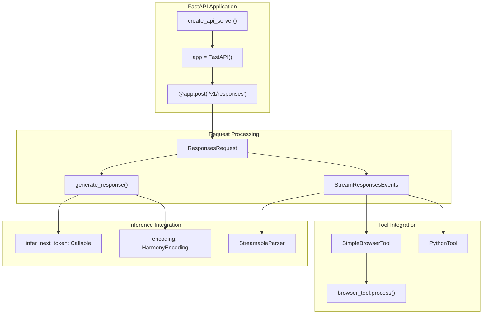
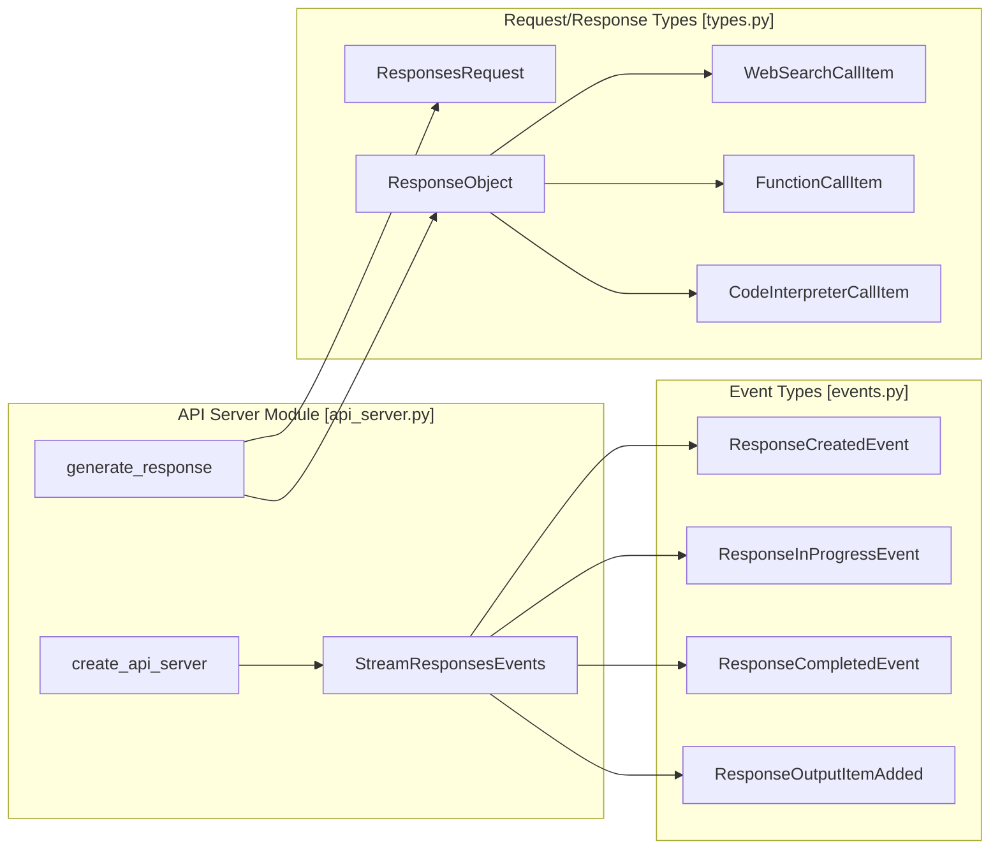
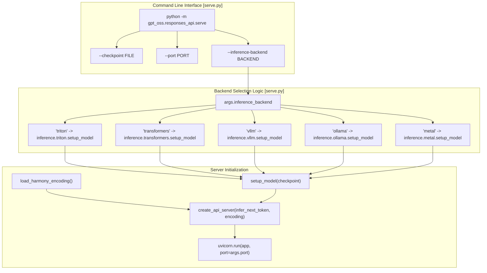
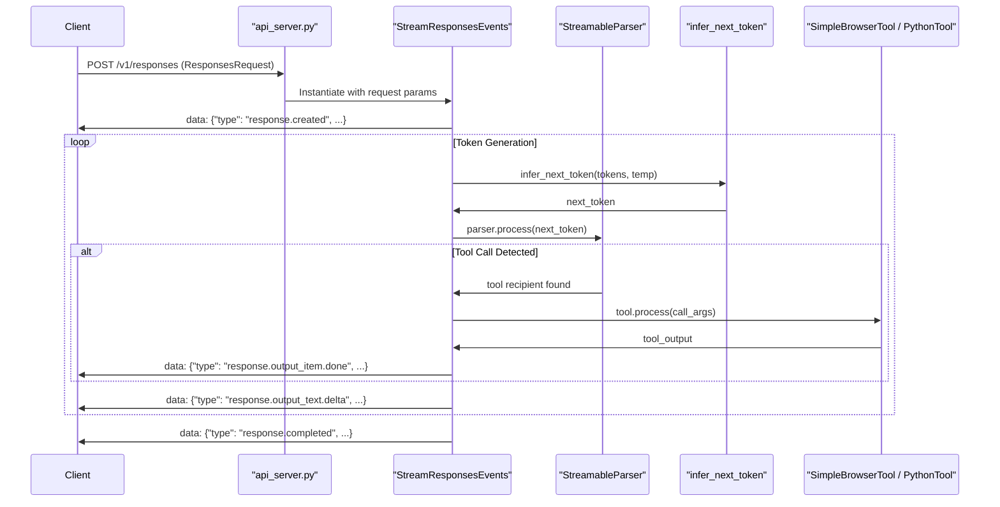

<!-- source: DeepWiki mcp.deepwiki.com · repo openai/gpt-oss · page 6.3 Responses API Server · fetched 2026-10-26 -->

# 6.3 Responses API Server

<details>
<summary>Relevant source files</summary>

The following files were used as context for generating this wiki page:

- [examples/streamlit/streamlit_chat.py](examples/streamlit/streamlit_chat.py)
- [gpt_oss/responses_api/api_server.py](gpt_oss/responses_api/api_server.py)
- [gpt_oss/responses_api/events.py](gpt_oss/responses_api/events.py)
- [gpt_oss/responses_api/types.py](gpt_oss/responses_api/types.py)

</details>


The Responses API Server provides an HTTP endpoint implementing the `/v1/responses` API for programmatic access to gpt-oss models. The server enables streaming responses with tool integration and supports multiple inference backends for flexible deployment scenarios.

For information about other client applications, see [Terminal Chat Interface](#6.1) and [Web Interfaces](#6.2). For details about the underlying tools integrated with this server, see [Browser Tool](#5.2) and [Python Execution Tool](#5.3).

## Purpose and Architecture

The server implements a reference version of the Responses API specification, providing streaming HTTP access to gpt-oss models while maintaining compatibility with the models' native [Harmony Response Format](#5.1). The implementation focuses on core functionality rather than comprehensive production features.

### FastAPI Server Architecture



**Sources:** [gpt_oss/responses_api/api_server.py:100-103](), [gpt_oss/responses_api/api_server.py:118-136](), [gpt_oss/responses_api/api_server.py:339-354]()

### Core Components and Classes

The server uses Pydantic models to define the type system for the Responses API, ensuring strict validation of incoming requests and structured outgoing events.



**Sources:** [gpt_oss/responses_api/api_server.py:28-69](), [gpt_oss/responses_api/types.py:154-216](), [gpt_oss/responses_api/events.py:21-205]()

### Server Entry Point and CLI Interface

The `serve.py` module acts as the entry point, handling model loading and backend selection before starting the FastAPI server via Uvicorn.



**Sources:** [gpt_oss/responses_api/serve.py:13-58]()

## Supported Inference Backends

The server supports multiple inference backends through a unified `infer_next_token` interface, allowing flexible deployment based on hardware.

| Backend | Description | Implementation File |
|---------|------------|----------------------|
| `triton` | Triton-optimized implementation | `gpt_oss/responses_api/inference/triton.py` |
| `metal` | Apple Silicon Metal backend | `gpt_oss/responses_api/inference/metal.py` |
| `ollama` | Ollama API bridge | `gpt_oss/responses_api/inference/ollama.py` |
| `vllm` | vLLM production backend | `gpt_oss/responses_api/inference/vllm.py` |
| `transformers` | HF Transformers integration | `gpt_oss/responses_api/inference/transformers.py` |

**Sources:** [gpt_oss/responses_api/serve.py:40-53]()

## Request Processing and Streaming

The server implements the `/v1/responses` endpoint with Server-Sent Events (SSE) for real-time streaming.

### Request Processing Pipeline



**Sources:** [gpt_oss/responses_api/api_server.py:742-743](), [gpt_oss/responses_api/api_server.py:339-741](), [gpt_oss/responses_api/api_server.py:438-518]()

### Streaming Events Architecture

Events are serialized using Pydantic and sent as SSE chunks. Key events include:

- `response.created`: Initial response object [gpt_oss/responses_api/events.py:25-28]()
- `response.output_item.added`: New item (message, reasoning, tool call) [gpt_oss/responses_api/events.py:70-79]()
- `response.output_text.delta`: Incremental text tokens [gpt_oss/responses_api/events.py:35-42]()
- `response.code_interpreter_call_code.delta`: Incremental Python code [gpt_oss/responses_api/events.py:175-185]()
- `response.completed`: Final response state [gpt_oss/responses_api/events.py:30-32]()

## Tool Integration

The server provides built-in support for `SimpleBrowserTool` and `PythonTool` (Code Interpreter).

### Browser Tool Flow
When the model outputs a `browser.` recipient, the server:
1. Detects the tool call via `StreamableParser` [gpt_oss/responses_api/api_server.py:616-620]().
2. Emits a `response.web_search_call.searching` event [gpt_oss/responses_api/api_server.py:686-689]().
3. Calls `browser_tool.process()` [gpt_oss/responses_api/api_server.py:692]().
4. Handles citation normalization and emits `response.output_text.annotation.added` events [gpt_oss/responses_api/api_server.py:532-553]().

### Code Interpreter Flow
When the model outputs a `python` recipient:
1. The server tracks code generation in `python_delta_buffer` [gpt_oss/responses_api/api_server.py:566-568]().
2. On completion, it executes the code using `python_tool.run()` [gpt_oss/responses_api/api_server.py:603]().
3. Execution logs and images are returned in a `CodeInterpreterCallItem` [gpt_oss/responses_api/types.py:101-116]().

## Configuration and Usage

### Command Line Interface
The server is started using the `gpt_oss.responses_api.serve` module:

```bash
# Start with default settings
python -m gpt_oss.responses_api.serve --checkpoint /path/to/model --port 8000

# Start with a specific backend
python -m gpt_oss.responses_api.serve --inference-backend vllm --port 8001
```

**Sources:** [gpt_oss/responses_api/serve.py:13-38]()

### Streamlit Integration Example
The server is designed to work with clients like the Streamlit chat interface, which consumes the SSE stream to render messages, reasoning, and tool outputs.

```python
# From examples/streamlit/streamlit_chat.py
response = requests.post(
    URL,
    json={
        "input": st.session_state.messages,
        "stream": True,
        "tools": tools,
        "reasoning": {"effort": effort},
    },
    stream=True,
)
```

**Sources:** [examples/streamlit/streamlit_chat.py:121-134]()

---

