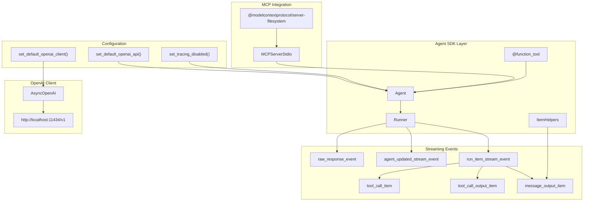
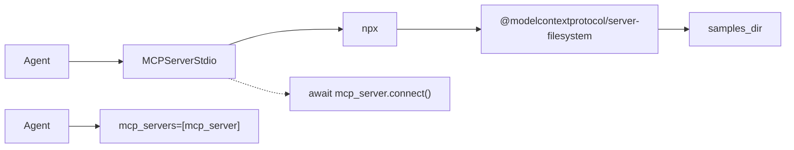
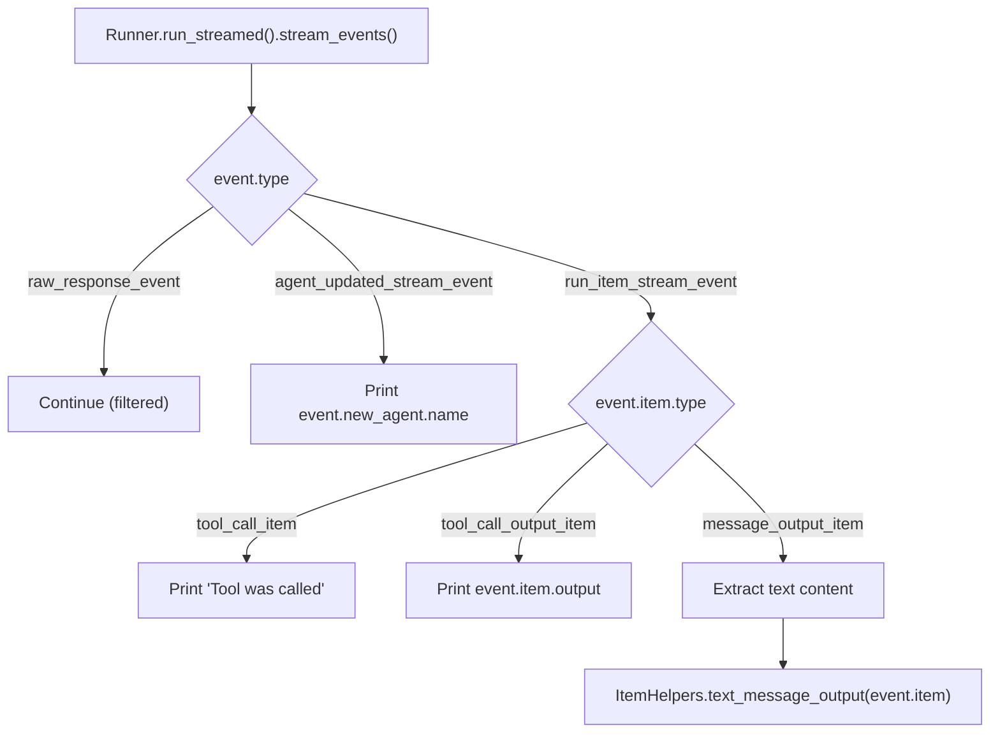

<!-- source: DeepWiki mcp.deepwiki.com · repo openai/gpt-oss · page 6.4 Agent SDK Examples · fetched 2026-10-26 -->

# Agent SDK Examples

<details>
<summary>Relevant source files</summary>

The following files were used as context for generating this wiki page:

- [README.md](README.md)
- [examples/agents-sdk-python/example.py](examples/agents-sdk-python/example.py)
- [examples/agents-sdk-python/pyproject.toml](examples/agents-sdk-python/pyproject.toml)

</details>


This document covers example implementations using the Agent SDK for programmatic interaction with gpt-oss models. The Agent SDK provides Python and TypeScript libraries for building applications that leverage model capabilities with integrated tool support and MCP server connectivity. For information about the underlying Responses API that powers these SDKs, see [Responses API Server](#6.3). For details about MCP integration and tool discovery, see [MCP Integration](#5.5).

## Overview

The Agent SDK enables developers to programmatically create conversational agents with tool capabilities. The SDK handles model interaction, streaming responses, tool execution, and MCP server integration. It provides a high-level abstraction over the underlying Responses API while maintaining access to advanced features like custom tools and external service integration.

### Agent SDK Architecture



**Sources:** [examples/agents-sdk-python/example.py:1-102]()

## Python SDK Example Implementation

The Python Agent SDK example demonstrates integration with local model servers, MCP filesystem tools, and custom function tools. The implementation uses `asyncio` for asynchronous operations and provides streaming response handling.

### Client Configuration

The example configures an `AsyncOpenAI` client to connect to a local model server, typically Ollama running on port 11434:

| Configuration | Value | Purpose |
|---------------|--------|---------|
| `api_key` | `"local"` | Placeholder for local server |
| `base_url` | `"http://localhost:11434/v1"` | Local Ollama endpoint |
| `model` | `"gpt-oss:20b-test"` | Model identifier |

The SDK configuration functions set global defaults for the agents framework:

- `set_default_openai_client(openai_client)` - Configures the OpenAI client instance [examples/agents-sdk-python/example.py:52]()
- `set_default_openai_api("chat_completions")` - Sets API type [examples/agents-sdk-python/example.py:53]()
- `set_tracing_disabled(True)` - Disables debug tracing [examples/agents-sdk-python/example.py:51]()

**Sources:** [examples/agents-sdk-python/example.py:25-53]()

### MCP Server Integration

The example creates an `MCPServerStdio` instance that connects to the ModelContextProtocol filesystem server via `npx`:



The MCP server provides filesystem capabilities to the agent, allowing it to read, write, and manipulate files in the specified directory. The server is configured with command-line parameters and connected asynchronously before agent creation using `await mcp_server.connect()` [examples/agents-sdk-python/example.py:48]().

**Sources:** [examples/agents-sdk-python/example.py:34-48]()

### Custom Function Tools

The example demonstrates custom tool creation using the `@function_tool` decorator:

```python
@function_tool
async def get_weather(location: str) -> str:
    return f"The weather in {location} is sunny."
```

This decorator converts regular Python functions into tools that the agent can call during conversations. The function signature and docstring are automatically parsed to generate tool schemas for the model.

**Sources:** [examples/agents-sdk-python/example.py:55-58]()

### Agent Creation and Execution

The `Agent` class combines model configuration, instructions, tools, and MCP servers:

| Parameter | Value | Purpose |
|-----------|--------|---------|
| `name` | `"My Agent"` | Agent identifier |
| `instructions` | `"You are a helpful assistant."` | System prompt |
| `tools` | `[get_weather]` | Custom function tools |
| `model` | `"gpt-oss:20b-test"` | Model specification |
| `mcp_servers` | `[mcp_server]` | Connected MCP servers |

The `Runner.run_streamed(agent, user_input)` method executes the agent with streaming response processing [examples/agents-sdk-python/example.py:73]().

**Sources:** [examples/agents-sdk-python/example.py:60-73]()

## Streaming Event Processing

The SDK provides detailed streaming events for real-time response handling via `result.stream_events()` [examples/agents-sdk-python/example.py:76]():



### Event Types and Processing

| Event Type | Processing | Output |
|------------|------------|--------|
| `raw_response_event` | Filtered out | None |
| `agent_updated_stream_event` | Agent metadata | `"Agent updated: {name}"` |
| `tool_call_item` | Tool execution start | `"-- Tool was called"` |
| `tool_call_output_item` | Tool results | `"-- Tool output: {output}"` |
| `message_output_item` | Model response | Extracted text via `ItemHelpers` |

The `ItemHelpers.text_message_output()` utility extracts readable text content from message items, handling the internal message structure [examples/agents-sdk-python/example.py:88]().

**Sources:** [examples/agents-sdk-python/example.py:75-92]()

## Dependencies and Requirements

The Python SDK example requires specific dependencies and runtime prerequisites:

### Package Dependencies

The project uses `openai-agents>=0.2.4` as the primary dependency [examples/agents-sdk-python/pyproject.toml:8](), which provides the Agent SDK functionality. This includes the core classes like `Agent`, `Runner`, `MCPServerStdio`, and decorators like `@function_tool`.

### Runtime Requirements

The example requires Node.js and `npx` for MCP server execution. It uses `shutil.which("npx")` to verify installation [examples/agents-sdk-python/example.py:98]():

```python
if not shutil.which("npx"):
    raise RuntimeError(
        "npx is not installed. Please install it with `npm install -g npx`."
    )
```

This check ensures the ModelContextProtocol filesystem server can be launched via `npx` before attempting to connect.

**Sources:** [examples/agents-sdk-python/pyproject.toml:1-10](), [examples/agents-sdk-python/example.py:98-101]()

## Usage Patterns

The Agent SDK example demonstrates several key usage patterns for building programmatic agents:

1. **Async/Await Architecture** - All operations use `asyncio` for non-blocking execution [examples/agents-sdk-python/example.py:102]().
2. **Local Model Integration** - Connects to local inference servers like Ollama via `AsyncOpenAI` [examples/agents-sdk-python/example.py:26-29]().
3. **MCP Tool Discovery** - Leverages external MCP servers for extended capabilities [examples/agents-sdk-python/example.py:35-45]().
4. **Custom Tool Definition** - Creates application-specific tools with simple `@function_tool` decorators [examples/agents-sdk-python/example.py:56-58]().
5. **Streaming Response Handling** - Processes real-time events for responsive UIs [examples/agents-sdk-python/example.py:76-91]().
6. **Error-Safe Configuration** - Validates runtime requirements like `npx` before execution [examples/agents-sdk-python/example.py:98-101]().

This pattern enables developers to build sophisticated agent applications that combine local model inference with external tool capabilities while maintaining full control over the execution environment.

**Sources:** [examples/agents-sdk-python/example.py:1-102]()

---

