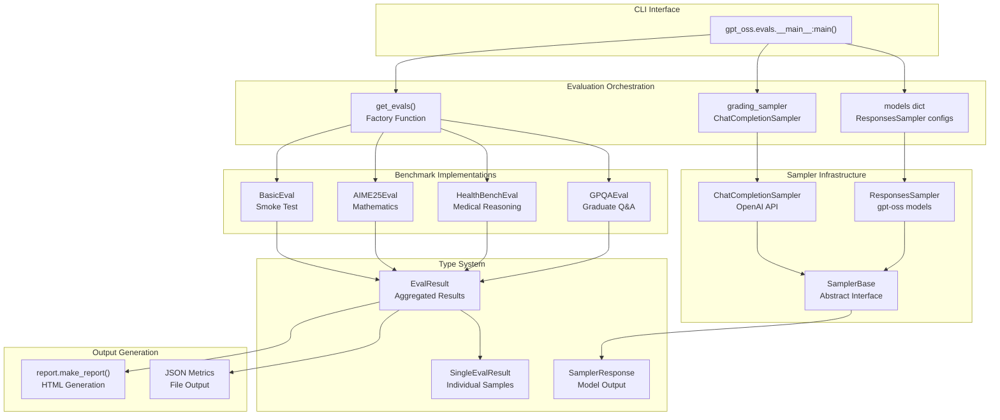
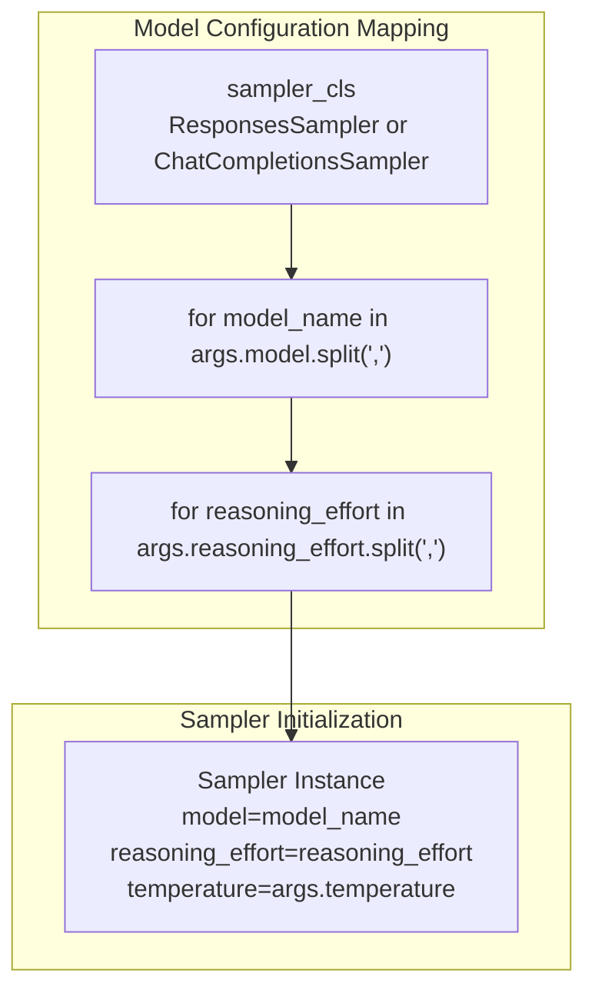

<!-- source: DeepWiki mcp.deepwiki.com · repo openai/gpt-oss · page 7 Evaluation Framework · fetched 2026-10-26 -->

# Evaluation Framework

Relevant source files

The following files were used as context for generating this wiki page:

- [gpt_oss/evals/__main__.py](gpt_oss/evals/__main__.py)
- [gpt_oss/evals/basic_eval.py](gpt_oss/evals/basic_eval.py)
- [gpt_oss/evals/chat_completions_sampler.py](gpt_oss/evals/chat_completions_sampler.py)
- [gpt_oss/evals/healthbench_eval.py](gpt_oss/evals/healthbench_eval.py)
- [gpt_oss/evals/responses_sampler.py](gpt_oss/evals/responses_sampler.py)
- [gpt_oss/responses_api/inference/ollama.py](gpt_oss/responses_api/inference/ollama.py)

The evaluation framework provides a comprehensive system for benchmarking gpt-oss model performance across multiple domains including graduate-level science (GPQA), medical reasoning (HealthBench), and mathematics (AIME25). The framework is adapted from OpenAI's simple-evals and integrates with both local model instances via the Responses API and external services via OpenAI-compatible APIs.

For information about running specific evaluations, see [Running Evaluations](#7.1). For details on individual benchmark implementations, see [Benchmark Implementations](#7.2).

## Architecture Overview

The evaluation framework follows a modular architecture with clear separation between evaluation orchestration, benchmark implementations, sampling interfaces, and result processing.

### Evaluation Framework Architecture

Sources: [gpt_oss/evals/__main__.py:1-148](), [gpt_oss/evals/basic_eval.py:8-15](), [gpt_oss/evals/types.py:7-33]()

## Evaluation Orchestration

The evaluation system is orchestrated through a command-line interface that manages model configurations, benchmark selection, and result generation.

### CLI Interface and Model Configuration

The main entry point provides a comprehensive CLI for configuring and running evaluations:

| Parameter | Default | Purpose |
|-----------|---------|---------|
| `--model` | `gpt-oss-120b,gpt-oss-20b` | Comma-separated list of model variants |
| `--base-url` | `http://localhost:8000/v1` | API endpoint for model service |
| `--eval` | `gpqa,healthbench...` | Comma-separated list of evaluations |
| `--temperature` | 1.0 | Sampling temperature |
| `--n-threads` | 1584 | Concurrent evaluation threads |
| `--debug` | False | Run with reduced sample size |
| `--examples` | None | Override default sample count |

The system defines model configurations combining the base models with reasoning effort levels (`low`, `medium`, `high`) using the `ResponsesSampler` [gpt_oss/evals/__main__.py:76-86]().

Sources: [gpt_oss/evals/__main__.py:22-86](), [gpt_oss/evals/__main__.py:17-71]()

## Benchmark System

The evaluation framework implements primary benchmarks targeting different domains of model capability.

### Benchmark Factory and Configuration

The `get_evals()` function serves as a factory for benchmark instantiation [gpt_oss/evals/__main__.py:97-143](). It handles configuration based on debug mode and example count overrides:

| Benchmark | Domain | Default Repeats | Debug Examples | Threading |
|-----------|---------|-----------------|----------------|-----------|
| `gpqa` | Graduate Science Q&A | 8 | 5 | Configurable |
| `healthbench` | Medical Reasoning | 1 | 10 | Configurable |
| `healthbench_hard` | Medical (Hard Subset) | 1 | 10 | Configurable |
| `healthbench_consensus` | Medical (Consensus) | 1 | 10 | Configurable |
| `aime25` | Mathematics | 8 | 5 | Configurable |
| `basic` | Smoke Test | 1 | N/A | 1 |

The grading system for complex benchmarks like `HealthBench` uses an external `grader_model` (typically GPT-4) initialized via `ChatCompletionsSampler` [gpt_oss/evals/__main__.py:90-95]().

Sources: [gpt_oss/evals/__main__.py:97-143](), [gpt_oss/evals/healthbench_eval.py:112-135](), [gpt_oss/evals/basic_eval.py:1-39]()

## Sampling Infrastructure

The evaluation framework defines a clean abstraction layer for model interaction through the sampler system.

### Sampler Interface and Implementation

The `SamplerBase` abstract class defines the core interface for model interaction, with concrete implementations for different API types [gpt_oss/evals/types.py:33-33]():

*   **`ResponsesSampler`**: Specifically designed for the `gpt-oss` Responses API, supporting reasoning effort parameters and streaming-compatible token usage tracking [gpt_oss/evals/responses_sampler.py:10-33]().
*   **`ChatCompletionsSampler`**: Provides compatibility with standard OpenAI-style chat completion endpoints, used primarily for the LLM-as-judge grading tasks [gpt_oss/evals/chat_completions_sampler.py:17-37]().

Both samplers implement a `__call__` method that accepts a `MessageList` and returns a `SamplerResponse` containing the text and usage metadata [gpt_oss/evals/responses_sampler.py:37-69](), [gpt_oss/evals/chat_completions_sampler.py:42-77]().

Sources: [gpt_oss/evals/responses_sampler.py:10-86](), [gpt_oss/evals/chat_completions_sampler.py:17-94]()

## Results and Reporting

The evaluation framework provides comprehensive result aggregation and reporting capabilities.

### Result Processing Pipeline

The execution loop in `main()` iterates through models and evaluations, generating reports for each combination [gpt_oss/evals/__main__.py:157-160]().

1.  **Execution**: `result = eval_obj(sampler)` invokes the benchmark.
2.  **HTML Generation**: `report.make_report(result)` creates a human-readable visualization [gpt_oss/evals/__main__.py:168]().
3.  **Metrics Export**: Aggregated scores and metadata are saved to JSON files [gpt_oss/evals/__main__.py:174-180]().

The result system generates three types of output files:

| File Type | Content | Purpose |
|-----------|---------|---------|
| HTML Report | Formatted results via Jinja2 templates | Human review and analysis |
| JSON Metrics | Aggregated scores and `metrics` dictionary | Automated processing |
| Full Results | Complete `EvalResult` dict including `convos` and `htmls` | Detailed analysis and debugging |

Sources: [gpt_oss/evals/__main__.py:155-191](), [gpt_oss/evals/types.py:44-56](), [gpt_oss/evals/basic_eval.py:36-37]()

---

