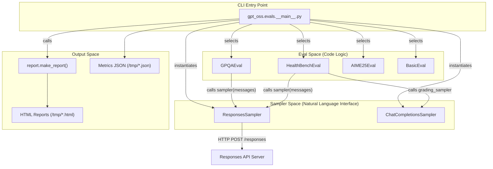
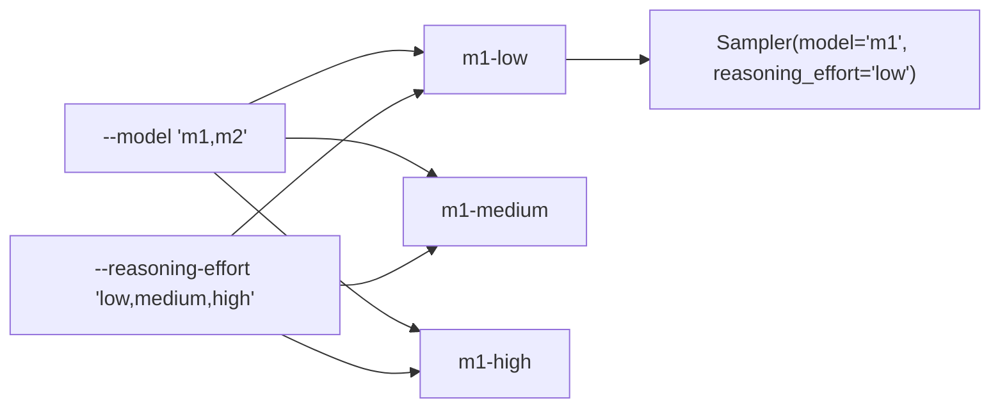

<!-- source: DeepWiki mcp.deepwiki.com · repo openai/gpt-oss · page 7.1 Running Evaluations · fetched 2026-10-26 -->

# Running Evaluations

<details>
<summary>Relevant source files</summary>

The following files were used as context for generating this wiki page:

- [gpt_oss/evals/__main__.py](gpt_oss/evals/__main__.py)
- [gpt_oss/evals/basic_eval.py](gpt_oss/evals/basic_eval.py)
- [gpt_oss/evals/chat_completions_sampler.py](gpt_oss/evals/chat_completions_sampler.py)
- [gpt_oss/evals/responses_sampler.py](gpt_oss/evals/responses_sampler.py)

</details>


This document covers how to execute evaluations using the `gpt-oss` evaluation framework. It provides a practical guide for running benchmarks against `gpt-oss` models through the command-line interface and understanding the evaluation workflow.

## Overview

The evaluation framework provides a command-line interface for running standardized benchmarks against `gpt-oss` models. The system is built around the concept of samplers that interface with running model instances and evaluators that execute specific benchmark tests.

## Evaluation Framework Architecture

The framework is orchestrated by `gpt_oss.evals.__main__.py`, which coordinates between samplers (the interface to the model) and evaluators (the benchmark logic).

### Data Flow and Entity Mapping



Sources: [gpt_oss/evals/__main__.py:1-15](), [gpt_oss/evals/responses_sampler.py:10-13](), [gpt_oss/evals/chat_completions_sampler.py:17-18](), [gpt_oss/evals/basic_eval.py:8-15]()

## Command-Line Interface

The evaluation system is accessed through Python's module execution:

```bash
python -m gpt_oss.evals [options]
```

### Core Arguments

| Argument | Default | Description |
|----------|---------|-------------|
| `--model` | `gpt-oss-120b,gpt-oss-20b` | Comma-separated list of model names. |
| `--reasoning-effort` | `low,medium,high` | Reasoning effort levels to test for each model. |
| `--sampler` | `responses` | Sampler backend: `responses` or `chat_completions`. |
| `--eval` | `gpqa,healthbench,...` | Comma-separated list of evaluation names. |
| `--base-url` | `http://localhost:8000/v1` | Base URL for the API server. |
| `--temperature` | `1.0` | Sampling temperature for the model. |
| `--n-threads` | `1584` | Number of threads for parallel execution. |
| `--examples` | `None` | Override the number of examples to run. |
| `--debug` | `False` | Run with minimal examples and repeats. |

Sources: [gpt_oss/evals/__main__.py:22-70]()

## Sampler Implementation details

The framework uses two primary sampler classes defined in the `gpt_oss.evals` package to communicate with model backends.

### ResponsesSampler
This sampler is designed to point at a local Responses API server. It uses the `OpenAI` client but calls the non-standard `responses.create` endpoint.

*   **Implementation**: It packs messages into a list and handles the `reasoning` parameter if `reasoning_model` is set to `True`.
*   **Retry Logic**: Implements exponential backoff for general exceptions [gpt_oss/evals/responses_sampler.py:78-84]().

### ChatCompletionsSampler
This sampler uses the standard OpenAI Chat Completions API. It is used both for testing models that support the standard API and for the "LLM-as-a-judge" grading mechanism.

*   **Grading**: By default, a `ChatCompletionsSampler` pointing to `gpt-4.1-2025-04-14` is instantiated to grade HealthBench results [gpt_oss/evals/__main__.py:90-95]().

Sources: [gpt_oss/evals/responses_sampler.py:10-86](), [gpt_oss/evals/chat_completions_sampler.py:17-94]()

## Model and Eval Resolution

The framework dynamically builds a matrix of models and evaluations based on CLI input.

### Model Matrix Generation
The CLI iterates through the cross-product of `--model` and `--reasoning-effort`.



Sources: [gpt_oss/evals/__main__.py:76-86]()

### Available Evaluations

The `get_evals` function in `__main__.py` maps string names to `Eval` class instances:

| Name | Class | Configuration |
|------|-------|---------------|
| `basic` | `BasicEval` | Simple "hi" test case. |
| `gpqa` | `GPQAEval` | Graduate-level Q&A; 8 repeats by default. |
| `healthbench` | `HealthBenchEval` | Medical eval; uses `grading_sampler`. |
| `healthbench_hard` | `HealthBenchEval` | Uses `subset_name="hard"`. |
| `healthbench_consensus` | `HealthBenchEval` | Uses `subset_name="consensus"`. |
| `aime25` | `AIME25Eval` | Mathematics competition; 8 repeats by default. |

Sources: [gpt_oss/evals/__main__.py:102-143]()

## Execution Workflow

The evaluation process follows this sequence:

1.  **Initialization**: Parse arguments and instantiate the requested `Sampler` (either `ResponsesSampler` or `ChatCompletionsSampler`) [gpt_oss/evals/__main__.py:72-86]().
2.  **Grading Setup**: Initialize a `ChatCompletionsSampler` for automated grading [gpt_oss/evals/__main__.py:90-95]().
3.  **Execution Loop**:
    *   Iterate through each model configuration.
    *   Iterate through each requested evaluation.
    *   Call the evaluation object: `result = eval_obj(sampler)` [gpt_oss/evals/__main__.py:160]().
4.  **Reporting**:
    *   Generate an HTML report using `report.make_report(result)` [gpt_oss/evals/__main__.py:168]().
    *   Save metrics and full conversation logs to `/tmp/` in JSON format [gpt_oss/evals/__main__.py:174-189]().

Sources: [gpt_oss/evals/__main__.py:155-192]()

## Example Usage

### Running a Local Evaluation
To evaluate a locally running `gpt-oss-120b` model via the Responses API:

```bash
python -m gpt_oss.evals \
  --model gpt-oss-120b \
  --reasoning-effort medium \
  --eval gpqa \
  --base-url http://localhost:8000/v1
```

### Debugging
To run a quick check with only 5 examples and no repeats:

```bash
python -m gpt_oss.evals --debug --examples 5 --eval healthbench
```

Sources: [gpt_oss/evals/__main__.py:17-70](), [gpt_oss/evals/responses_sampler.py:23-25]()

---

