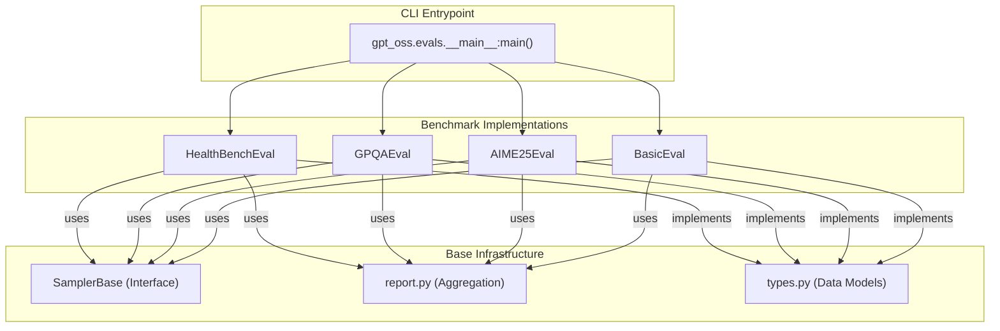
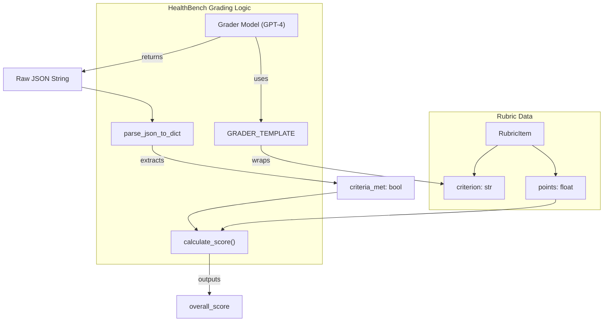
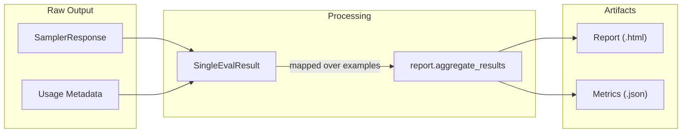

<!-- source: DeepWiki mcp.deepwiki.com · repo openai/gpt-oss · page 7.2 Benchmark Implementations · fetched 2026-10-26 -->

# Benchmark Implementations

Relevant source files

The following files were used as context for generating this wiki page:

- [gpt_oss/evals/__main__.py](gpt_oss/evals/__main__.py)
- [gpt_oss/evals/basic_eval.py](gpt_oss/evals/basic_eval.py)
- [gpt_oss/evals/chat_completions_sampler.py](gpt_oss/evals/chat_completions_sampler.py)
- [gpt_oss/evals/healthbench_eval.py](gpt_oss/evals/healthbench_eval.py)
- [gpt_oss/evals/responses_sampler.py](gpt_oss/evals/responses_sampler.py)
- [gpt_oss/responses_api/inference/ollama.py](gpt_oss/responses_api/inference/ollama.py)

This page provides a technical deep dive into the benchmark implementations within the `gpt-oss` evaluation framework. It covers the core `BasicEval` base class, specialized science and math benchmarks (GPQA, AIME25), and the comprehensive medical reasoning suite (HealthBench).

## Overview

The evaluation system is built around the `Eval` interface defined in `gpt_oss/evals/types.py`. Benchmarks are implemented as classes that, when called, orchestrate data loading, model sampling via a `SamplerBase`, and automated grading.

Sources: [gpt_oss/evals/__main__.py:6-14](), [gpt_oss/evals/basic_eval.py:8-13](), [gpt_oss/evals/healthbench_eval.py:110-133]()

## Base Classes and Interfaces

### BasicEval
The `BasicEval` class serves as a minimal implementation for testing the evaluation pipeline. It uses a hardcoded example and simple length-based scoring.

*   **Data Flow**: It packs a question into a `MessageList`, calls the sampler, and renders the result using the `report.HTML_JINJA` template.
*   **Scoring**: Returns a score of `1.0` if the response length is greater than zero, otherwise `0.0`.

Sources: [gpt_oss/evals/basic_eval.py:8-37]()

### Sampler Integration
Benchmarks interact with models through `SamplerBase` implementations. The framework primarily uses:
*   `ResponsesSampler`: Connects to the `gpt-oss` Responses API server [gpt_oss/evals/responses_sampler.py:10-33]().
*   `ChatCompletionsSampler`: Used for standard OpenAI-compatible APIs and for the LLM-as-judge grader (typically `gpt-4.1-2025-04-14`) [gpt_oss/evals/chat_completions_sampler.py:17-37]().

## HealthBench Implementation

`HealthBenchEval` is a complex medical reasoning benchmark that uses physician-validated rubrics and an LLM-as-judge for grading.

### Dataset Variants and Loading
HealthBench supports three subsets, loaded from Azure blob storage via `blobfile`:

| Subset Name | Constant | Source File |
| :--- | :--- | :--- |
| `None` (Standard) | `INPUT_PATH` | [gpt_oss/evals/healthbench_eval.py:35]() |
| `hard` | `INPUT_PATH_HARD` | [gpt_oss/evals/healthbench_eval.py:36]() |
| `consensus` | `INPUT_PATH_CONSENSUS` | [gpt_oss/evals/healthbench_eval.py:37]() |

### Grading Rubrics
The `RubricItem` class encapsulates the evaluation criteria. Grading is performed by an external model using the `GRADER_TEMPLATE`, which instructs the judge to return a JSON object containing an `explanation` and a `criteria_met` boolean.

Sources: [gpt_oss/evals/healthbench_eval.py:39-88](), [gpt_oss/evals/healthbench_eval.py:110-133](), [gpt_oss/evals/healthbench_eval.py:135-153]()

### Physician Evaluation Modes
Beyond model evaluation, `healthbench_eval.py` supports modes to evaluate human physician performance:
*   `physician_completions`: Evaluates "ideal" physician answers against the rubrics [gpt_oss/evals/healthbench_eval.py:10]().
*   `physician_completion_references`: Evaluates the reference model completions that physicians were shown during the validation process [gpt_oss/evals/healthbench_eval.py:11]().

## Specialized Benchmarks

### GPQA Diamond
The `GPQAEval` implementation handles the "Diamond" subset of the Graduate-Level Google-Proof Q&A benchmark.
*   **Implementation**: Configurable via `n_repeats` and `num_examples` [gpt_oss/evals/__main__.py:106-111]().
*   **Grading**: Typically uses the `ABCD` multiple-choice grader logic found in the wider framework.

### AIME25
`AIME25Eval` evaluates mathematical reasoning using the American Invitational Mathematics Examination 2025 problems.
*   **Execution**: It supports high-concurrency evaluation with `n_threads` (defaulting to 1584 for large-scale runs) [gpt_oss/evals/__main__.py:62-141]().

## Statistical Aggregation

Results from all benchmarks are processed through `report.aggregate_results`. For HealthBench, specific statistical methods are used:

*   **`calculate_score`**: Computes a weighted average where only positive point rubrics contribute to the denominator [gpt_oss/evals/healthbench_eval.py:138-153]().
*   **`_compute_clipped_stats`**: Computes the mean and bootstrap standard deviation (1000 resamples) for metrics, ensuring they are clipped to the `[0, 1]` range [gpt_oss/evals/healthbench_eval.py:194-210]().

### Reporting Data Flow

Sources: [gpt_oss/evals/healthbench_eval.py:440-497](), [gpt_oss/evals/__main__.py:157-191]()

---

